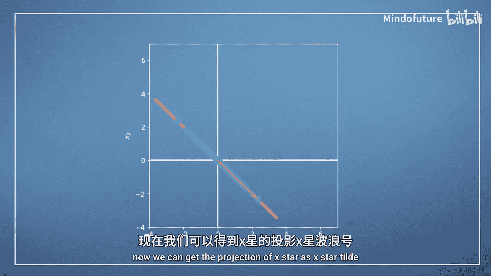

# 028：P28 | PCA的步骤


在本节课中，我们将要学习主成分分析的具体步骤。我们将从一个简单的二维数据集例子出发，逐步讲解如何将数据投影到一维主成分子空间上。

在开始推导PCA步骤之前，有两个重要的预处理步骤需要说明。虽然这些步骤在理论推导中并非绝对必要，但在实际应用中至关重要。

## 数据预处理：中心化与标准化

上一节我们介绍了PCA的基本思想，本节中我们来看看实施PCA前的准备工作。首先，我们通常假设数据是中心化的，即均值为零。这个假设可以避免数值计算上的困难。例如，如果数据值围绕10^8分布，计算协方差矩阵时需要处理非常大的数字，可能导致数值不稳定。因此，第一步是减去数据的均值。

其次，通常建议在中心化后，将数据的每个维度除以其对应的标准差。这样做有两个好处：一是消除了数据的单位，使不同尺度的特征具有可比性；二是确保每个维度的方差为1，但保留了维度间的相关性。

以下是数据标准化的一个例子：



在这个数据集中，两个维度都是距离，但一个以厘米为单位，另一个以米为单位。厘米单位的维度自然变化更大。如果不进行标准化，PCA会错误地认为该维度包含更多信息。标准化后，数据变得“单位自由”，两个维度的方差都为1。此时再观察其主成分子空间，会发现两个维度间存在很强的相关性，并且主成分轴的方向也发生了变化。

## PCA步骤详解

现在，让我们通过一个运行示例，逐步讲解PCA的完整过程。我们有一个二维数据集，目标是使用PCA将其投影到一个一维子空间上。

**第一步：减去均值**
首先，我们从数据中减去均值，使数据中心化。

**第二步：除以标准差**
接着，我们将中心化后的数据的每个维度除以其标准差。此时，数据变得单位自由，并且每个轴上的方差都为1（图中用两个箭头表示）。请注意，维度间的相关性仍然保留。

**第三步：计算协方差矩阵及其特征**
第三步，我们计算数据的协方差矩阵，然后计算该矩阵的特征值和对应的特征向量。在图中，特征向量按其对应特征值的大小进行缩放。最长的向量张成了主成分子空间，我们称之为 **U**。

**第四步：投影新数据点**
最后，我们可以将任何新的数据点 **x*** 投影到主成分子空间 **U** 上。为了正确投影，我们需要使用计算协方差矩阵时所用数据的均值和标准差来标准化这个新数据点。

具体操作如下：对于新数据点 **x***，我们计算其标准化版本 **x*~**：
```
x*~ = (x* - 均值) / 标准差
```
这个计算针对 **x*** 的每一个维度进行。


然后，**x*** 在主成分子空间 **U** 上的投影 **π_U(x*~)** 可以通过以下公式获得：
```
π_U(x*~) = B * B^T * x*~
```
其中，**B** 是一个矩阵，其列是由最大特征值对应的特征向量组成的。**B^T * x*~** 给出了投影点在主成分子空间基下的坐标。

## 总结

本节课中，我们一起学习了主成分分析的具体实施步骤。

首先，我们从数据中减去均值使其中心化，以避免数值问题。
其次，我们除以标准差使数据单位自由。
接着，我们计算数据协方差矩阵的特征值和特征向量。
最后，我们可以将任何数据点投影到由最大特征值对应的特征向量所张成的主成分子空间上。


