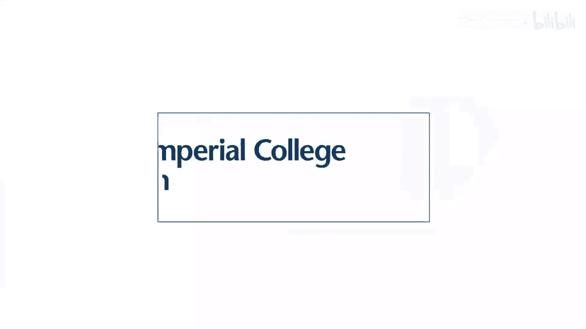

# 031：本模块总结

## 📚 概述

在本节课中，我们将总结主成分分析模块的核心内容。我们将回顾PCA的推导过程、关键性质，并探讨它与其他机器学习算法的联系。

---

## 🔍 PCA推导回顾

上一节我们详细推导了PCA。PCA的目标是找到一个低维子空间，使得数据点投影到该子空间后，与原始数据点的平均平方距离最小。

通过最小化数据点与其在主成分子空间上投影之间的平均平方误差，我们发现最优解是将数据投影到由最大特征值对应的特征向量所张成的子空间上。

---

## 🔗 PCA与其他算法的联系

PCA与许多其他机器学习算法有诸多相似之处。因此，深入理解PCA有助于我们掌握更广泛的机器学习概念。

本模块内容具有一定难度，但希望你能通过详细的推导过程或实践练习，获得新的、有价值的见解。

---

## 🎯 总结

本节课中，我们一起学习了主成分分析的推导与核心性质。我们了解到，PCA通过寻找数据方差最大的方向来实现降维，其数学基础是特征值分解。完成本模块是一个重要的成就。