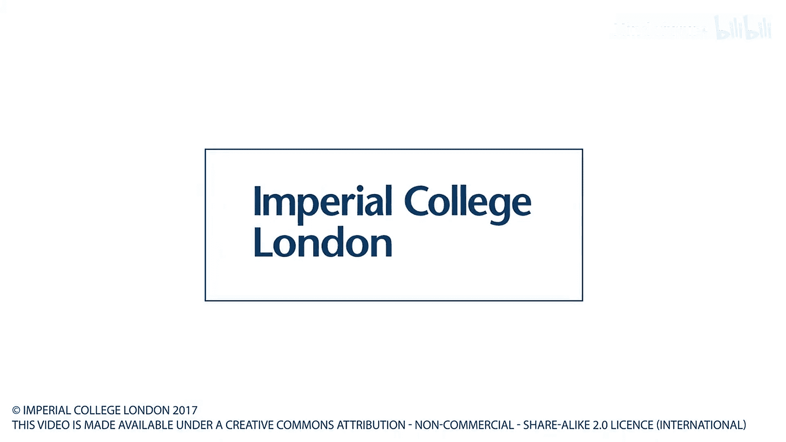

# 032：课程总结与回顾

在本节课中，我们将一起回顾主成分分析（PCA）这一用于降维和数据压缩的实用机器学习算法。我们将总结从基础概念到完整算法的推导过程。

## 概述

我们学习了许多内容，最终得以推导并理解PCA的工作原理。整个学习路径从数据的基本统计量开始，逐步深入到向量运算，最后将这些知识整合成PCA算法。

## 课程内容回顾

上一节我们介绍了PCA算法的具体步骤，本节中我们来回顾整个课程的知识体系。

以下是我们在课程中逐步构建的核心知识模块：

1.  **数据摘要统计量**
    我们首先学习了数据的均值与方差。这些统计量是后续计算的基础，特别是在PCA中用于构建数据的协方差矩阵。

2.  **向量内积**
    接着，我们探讨了向量的内积。内积运算允许我们计算向量之间的长度、距离和夹角。其公式为：**a · b = ||a|| ||b|| cosθ**。

3.  **数据投影**
    我们利用内积的概念，将数据投影到更低维度的子空间上。这本质上是将高维数据点映射到一条线或一个平面上，同时尽可能保留原始信息。

4.  **PCA算法集成**
    最后，我们将以上所有概念整合在一起，形成了完整的PCA算法。其核心步骤包括：中心化数据、计算协方差矩阵、进行特征值分解，并选取主要特征向量构成投影矩阵。

## 总结

本节课中我们一起学习了主成分分析（PCA）的完整知识框架。我们从基础的均值和方差出发，理解了内积与投影的几何意义，最终掌握了PCA这一强大的降维工具。虽然课程内容具有一定挑战性，但希望你能从中有所收获。

非常感谢坚持学习并完成本课程的每一位同学。

