# 001：课程序言（第一部分）

在本节课中，我们将学习云计算与大数据课程的总体结构、核心动机以及课程内容概览。我们将了解课程如何将云计算、大数据、机器学习等前沿技术联系起来，并介绍课程项目与评估方式。

## 课程结构概览

课程结构与2024年课程类似，但会融入机器学习、深度学习和大语言模型等快速发展的领域的最新内容。课程的核心思想保持不变。

以下是课程的主要模块及其关联：

*   **云计算与大数据导论**：介绍基本概念。
*   **机器学习入门**：一个无需先修知识的简单介绍，并将在云环境中应用简单模型。
*   **虚拟化与可扩展数据中心设计**：讲解云计算如何通过虚拟化技术支撑大规模应用（如社交媒体）。
*   **深度学习**：介绍当前消耗大量计算资源的主流技术，课程侧重实践应用而非深层数学理论。
*   **大语言模型**：新增讲座，探讨生成式AI及其与云计算的必然联系。
*   **经典范式转变**：介绍MapReduce、Apache Spark等大数据处理范式，并与高性能计算进行对比。
*   **云服务模型**：讲解基础设施即服务、平台即服务、软件即服务等核心概念。
*   **大数据分析与数据挖掘**：介绍相关技术及应用场景。
*   **Docker容器管理**：讲解如何管理云环境中的容器化应用。
*   **超参数优化**：介绍机器学习中需要大量计算资源的重要技术。
*   **OpenStack云操作系统**：讲解如何利用开源组件构建私有云或混合云。
*   **职业展望**：分析课程内容与云计算领域职位要求的关联。

课程将包含大量实践内容，并与行业项目紧密结合。我们鼓励学生尽早开始行业项目，以避免后期时间紧张。

## 课程动机与学习目标

课程的动机源于“大数据”及其引发的技术浪潮。海量数据需要通过机器学习进行分析，而这离不开强大的计算基础设施、工具集和相关技能。

完成本课程后，你将能够：

*   理解**并行处理**是云计算的基础，因为云服务需要同时被海量用户访问。
*   了解支撑云服务的底层计算与数据处理机制。
*   熟悉GPU等尖端技术在云计算和机器学习中的作用。

## 讲师与背景介绍

讲师Morris在云计算、高性能计算、大数据和机器学习领域拥有超过20年的经验。他曾在德国于利希超算中心长期工作，目前是冰岛大学教授，并领导冰岛国家高性能计算与人工智能能力中心。

研究项目涉及多个领域，包括与CERN的合作以及当前在遥感、大语言模型和欧洲AI工厂等方面的研究。这些实践经验将融入课程教学。

## 核心概念辨析：AI、ML与DL

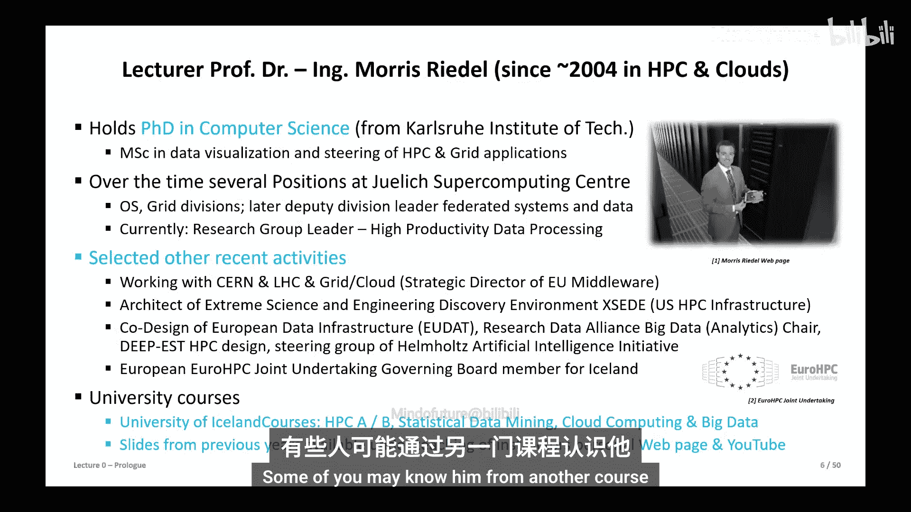

理解人工智能、机器学习和深度学习之间的关系至关重要：

*   **人工智能**：一个广泛的领域，包含机器人学、认知系统等。
*   **机器学习**：AI的一个子集，专注于从数据中学习的算法（如支持向量机、随机森林）。
*   **深度学习**：机器学习的一个分支，采用神经网络架构，能够自动学习数据特征。

它们并非相互竞争，而是互补的关系。传统机器学习模型在小数据上表现良好，而深度学习模型需要大数据和强大算力，但通常能获得更高的准确性。

## 为何需要机器学习？

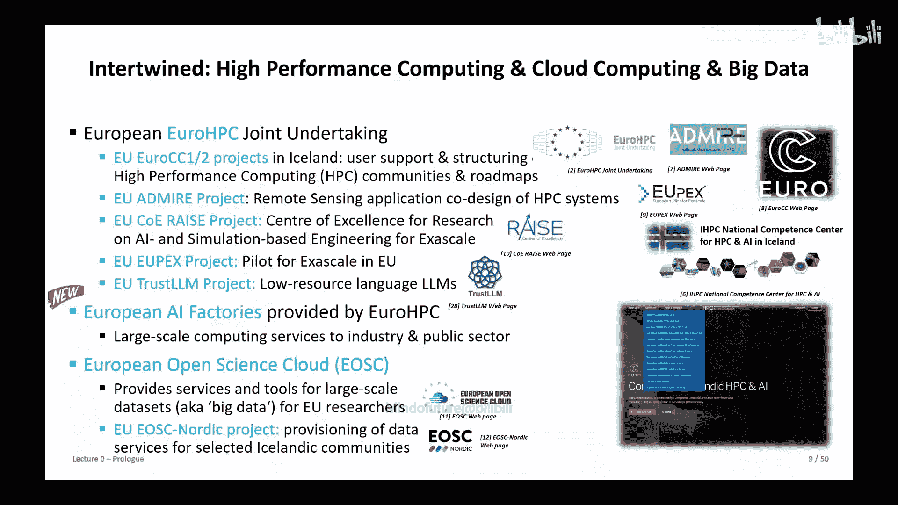

在以下情况下，机器学习是必要的工具：
1.  存在某种潜在模式。
2.  没有已知的物理公式来描述该模式。
3.  存在足够量的相关数据集。

数据科学正是这些领域的交叉点，并严重依赖于计算基础设施。

## 深度学习的革新

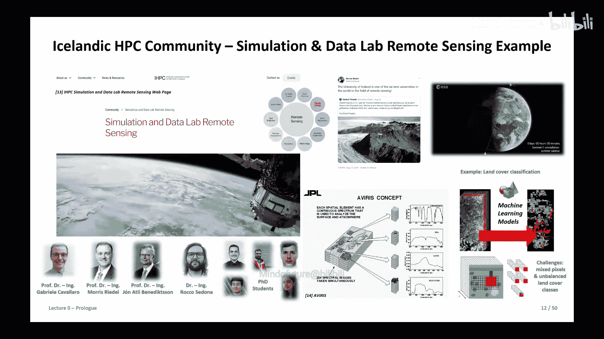

与传统机器学习需要手工设计特征不同，深度学习模型（如卷积神经网络）能够自动从原始数据（如图像）中学习层次化的特征表示（如边缘、形状、物体部件），从而实现更强大的性能。

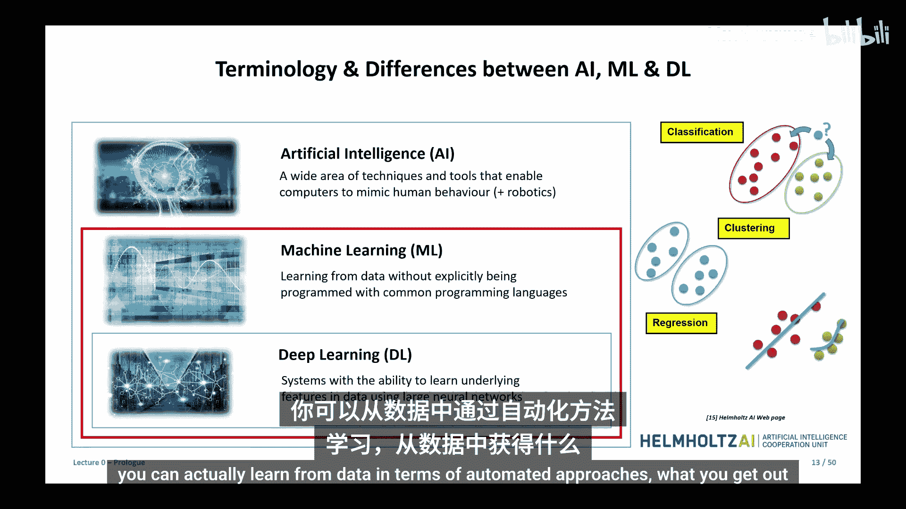

## 计算的作用

传统机器学习模型处理大数据集时可能遇到性能瓶颈。深度学习模型虽然能提供更高精度，但需要巨大的计算资源进行训练。因此，**强大的计算能力**是连接大数据与先进机器学习（尤其是深度学习）的关键桥梁。

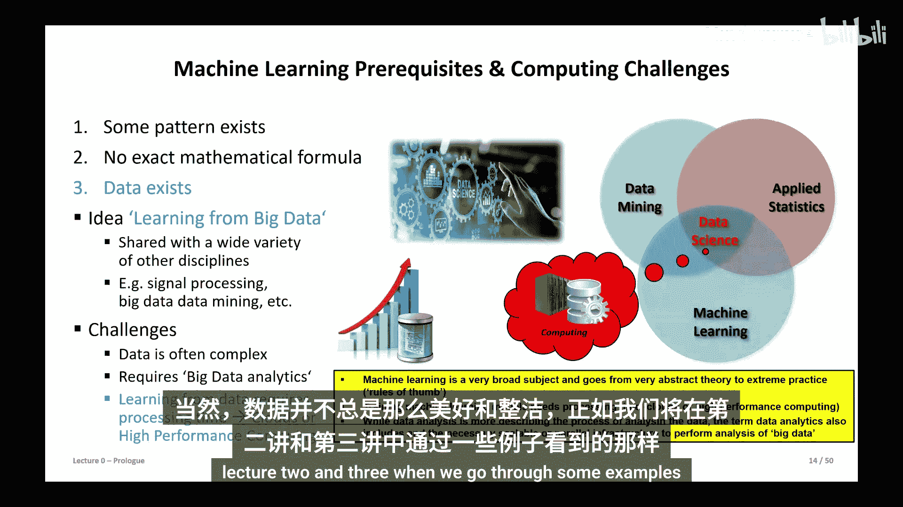

此外，开源软件框架（如PyTorch、TensorFlow）和专用硬件（如GPU）的普及，共同推动了当前深度学习的热潮。

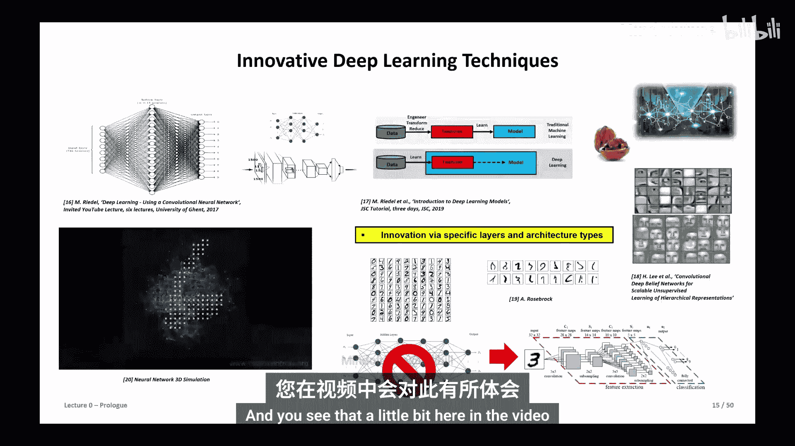

## 课程安排与评估

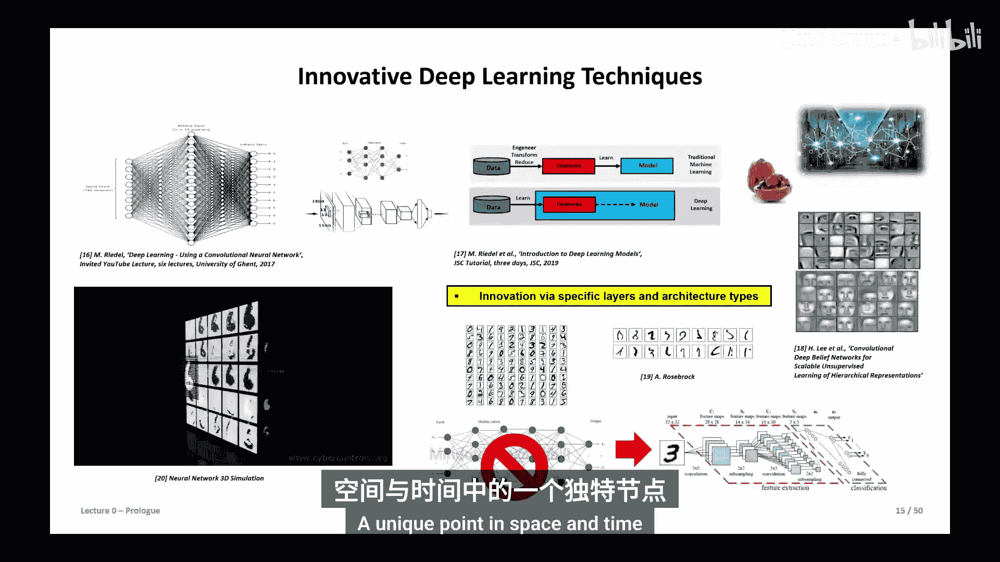

课程将通过Canvas平台进行管理，包含公告、资料和作业提交。

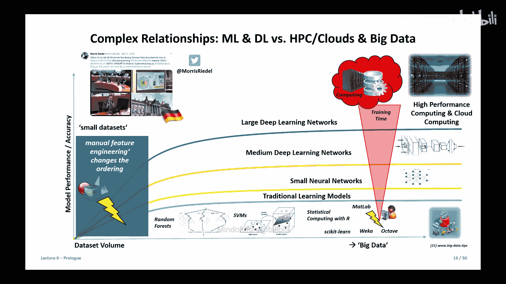

评估方式如下：
*   **三次作业**：共占50%分数（两次各20%，一次热身作业10%）。
*   **行业项目**：占50%分数，强调团队合作与实践。

课程核心内容（在幻灯片中以黄色标出）是学习的重点。讲座将被录制并分享，部分视频会公开在YouTube上，部分仅通过Canvas内部访问。

无需购买教科书，因为该领域发展迅速。每讲将提供详细的参考文献。

## 延伸学习

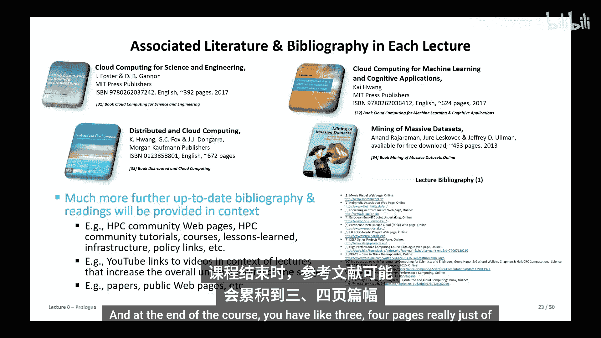

如果你对本课程内容感兴趣并希望进行更深入、技术性更强的学习，可以考虑在明年春季选修**高性能计算**课程。该课程将更深入地探讨并行处理、MPI编程，并涵盖更多基于物理定律的计算应用。

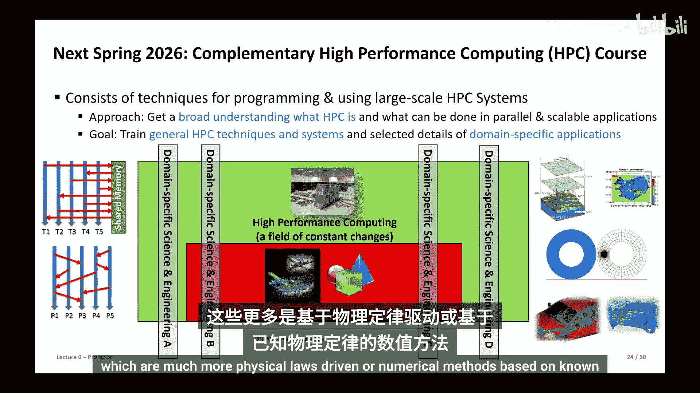

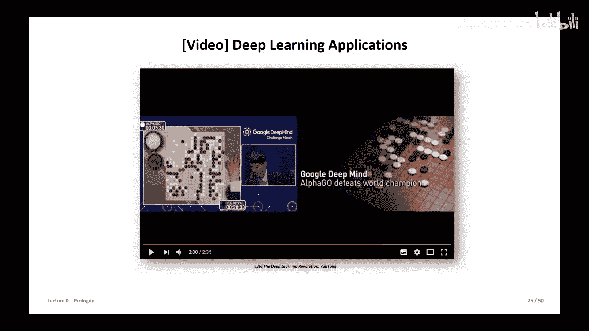

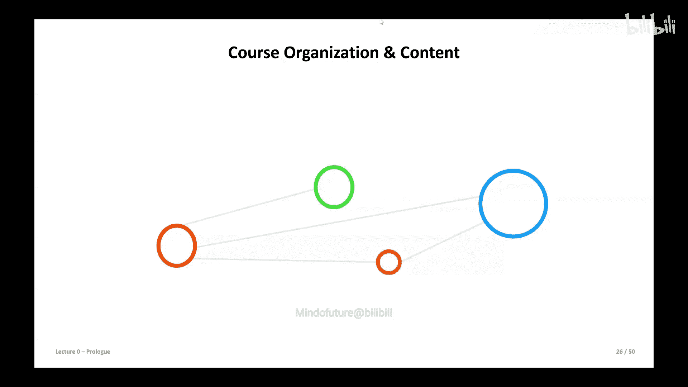

本节课中，我们一起学习了云计算与大数据课程的总体框架、核心技术的关联以及课程的基本要求。我们明确了大数据、机器学习与强大计算基础设施之间的紧密联系，这是贯穿整个课程的主线。在接下来的课程中，我们将逐一深入这些激动人心的主题。