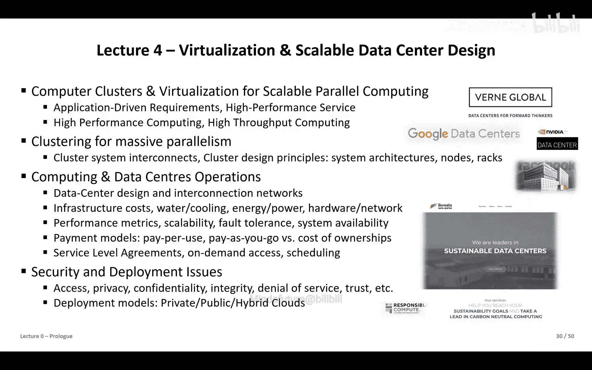
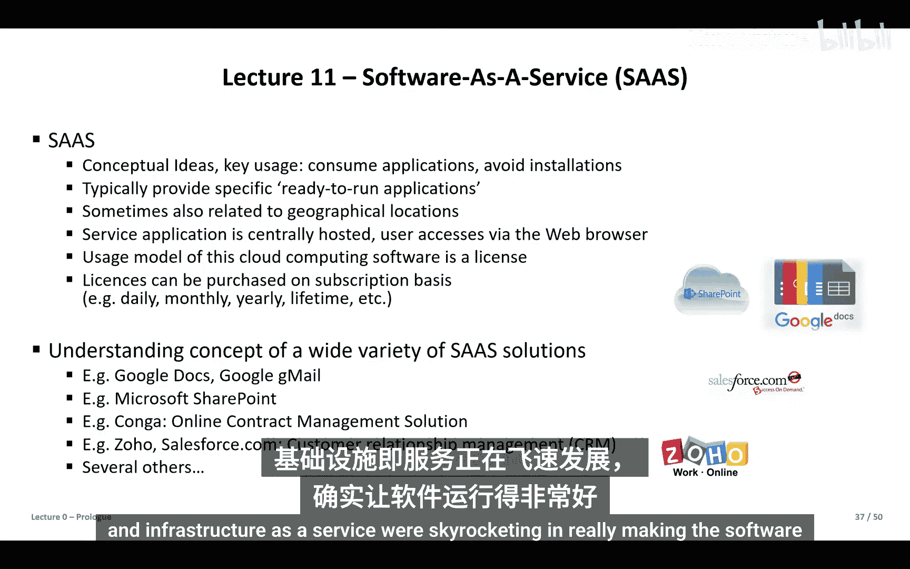
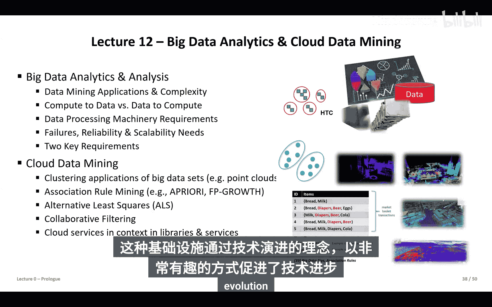
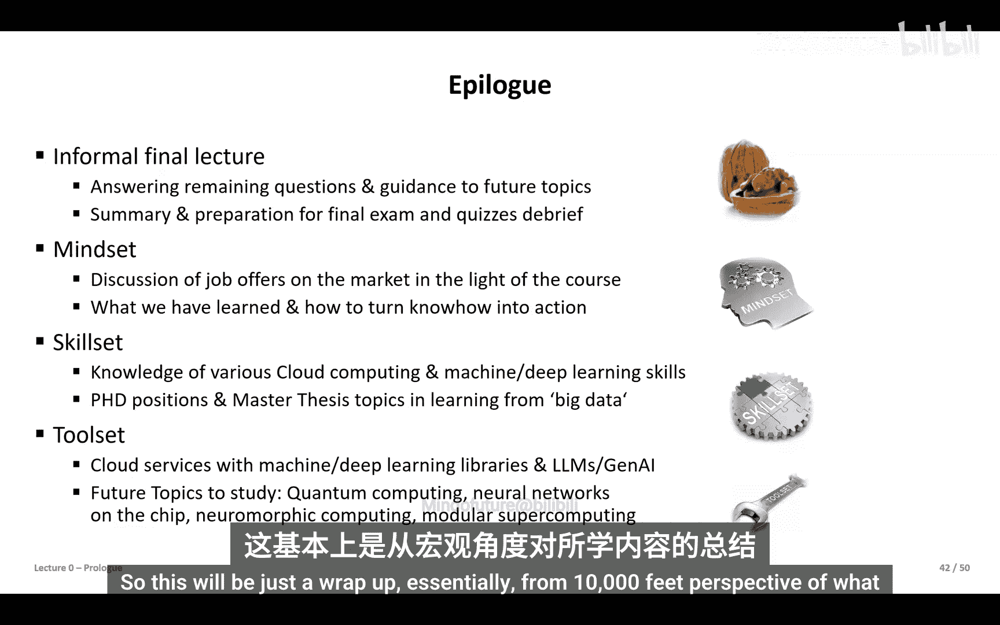
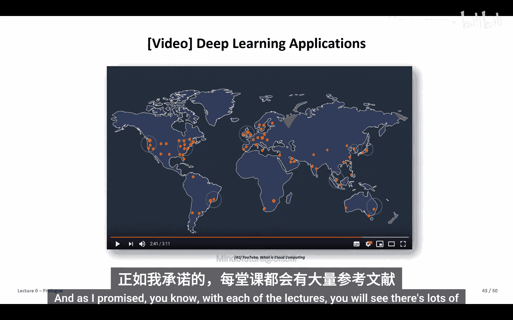
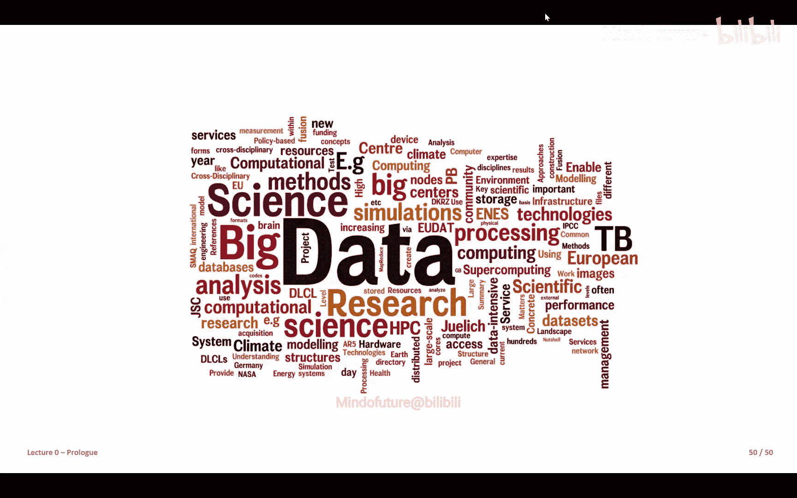

# 002：序言（第二部分）

在本节课中，我们将继续课程序言，深入探讨课程各章节的核心内容、技术背景及其与行业实践的联系。我们将了解从基础概念到前沿应用（如大语言模型）的完整知识脉络，以及如何将理论知识与产业项目相结合。

## 课程内容纵览

上一部分我们介绍了课程的整体运作方式。本节中，我们将详细拆解后续各个讲座的主题与目标。

以下是课程各核心章节的概要介绍。

*   **讲座一：引言与基础术语**
    *   本讲将澄清基础术语，例如**CPU**（中央处理器）与**GPU**（图形处理器）的区别。GPU对于当今的机器学习和深度学习至关重要，其强大的并行计算能力是云服务（如亚马逊、谷歌提供的服务）的基石。我们还将回顾云计算从网格计算演变而来的历史。

*   **讲座二：机器学习入门**
    *   本讲将以最简化的**感知机**学习模型为起点，介绍机器学习。感知机是深度学习的基础单元，类似于简化的人脑神经元。我们将使用**Python**和**Jupyter Notebook**进行实践，并展示如何将应用轻松移植到Google Colab等云平台。

*   **讲座三：Apache Spark与大数据处理**
    *   我们将快速过渡到**Apache Spark**。这是继Hadoop之后的新一代大数据处理框架，为许多云服务提供支持，用于处理SQL查询、数据库、机器学习流等任务。其核心在于**可扩展的并行处理**。

*   **讲座四：可扩展性概念与数据中心**
    *   本讲将概念化如何实现可扩展性。关键概念是**虚拟化**，它是现代数据中心和可扩展性的基础。我们将讨论“按使用付费”等商业模式，并计划参观冰岛本地的数据中心，让大家亲身感受基础设施。

*   **讲座五：深度学习基础**
    *   我们将从简单的感知机扩展到**深度学习**。通过将许多神经元连接成多层网络，形成**人工神经网络**。我们会介绍**反向传播**等学习算法，并探讨用于图像分析的**卷积神经网络**和用于时间序列数据的**长短期记忆网络**等模型。

*   **讲座六：大语言模型与生成式AI**
    *   本讲将连接计算能力与模型规模的关系。深度学习模型的可学习**参数**数量不断增长，这直接催生了**大语言模型**。我们将以**ChatGPT**为例，探讨生成式AI，并讨论欧洲建立AI工厂以保护数据隐私的相关议题。

*   **讲座七：MapReduce范式**
    *   这是一个更传统但重要的大数据处理范式。**MapReduce**的核心思想是“分而治之”，适用于高吞吐量、任务间独立的数据处理场景（例如，从大量文本中统计特定关键词）。它与需要频繁同步参数的深度学习训练形成对比。

*   **讲座八：云服务模型**
    *   本讲将深入云计算的层级模型：
        *   **基础设施即服务**：提供虚拟化的计算和存储资源，可按需灵活扩展。
        *   **平台即服务**：为开发者提供包含中间件、数据库等服务的平台，用于构建和部署应用。
        *   **软件即服务**：用户直接使用的完整软件应用（如Google Docs， Facebook），其背后利用了IaaS和PaaS。

*   **讲座九：云上的数据分析与挖掘**
    *   我们将探讨如何利用云的可扩展性进行数据分析。例如，使用**聚类算法**处理海量点云数据重建城市，或构建**推荐引擎**。亚马逊的成功正得益于其强大的云基础设施。

*   **讲座十：容器化与管理**
    *   当需要管理并迁移数据分析环境时，**容器化**技术（如**Docker**）是关键。它将应用及其依赖打包，使其能在不同云平台（如AWS， Azure）间轻松迁移，避免“供应商锁定”。

*   **讲座十一：超参数优化**
    *   机器学习模型的性能极大程度上受**超参数**（如学习率、网络层数）影响。本讲将介绍系统化的超参数优化技术，这需要大量的计算资源进行搜索，以找到最佳配置，可能带来显著的性能提升。

*   **讲座十二：自动化机器学习**
    *   这是更高级的主题，不仅优化超参数，还可能自动选择或组合模型架构。**AutoGluon**等工具利用预训练的**基础模型**，只需少量计算进行微调，就能在特定任务上获得优异表现。

*   **讲座十三：构建私有云**
    *   如果需要在内网构建私有云（出于数据安全考虑），可以使用**OpenStack**。它像一套乐高积木，提供了构建类似AWS或Azure功能的各种软件模块，让你能在自有硬件上搭建可扩展的云环境。

*   **讲座十四：课程总结与职业展望**
    *   最后一讲将以俯瞰视角总结课程，并展示课程中涉及的技术如何直接对应业界职位描述，帮助大家将所学知识与未来职业道路联系起来。

## 产业项目介绍

接下来，课程的另一位教师将简要介绍本学期的产业项目安排。

以下是关于产业项目的具体信息。

*   产业项目占课程成绩的50%，将于周四正式开始。
*   目前已引入两家公司：
    *   **Orb Green**：将介绍其项目。
    *   **Cateralgi**：一家零售云公司，也将介绍其项目。
*   学生可以组成3-4人的小组选择项目，每个公司项目允许多个小组参与。
*   后续还将引入另外三家公司，其项目均涉及人工智能与云服务（如AWS）的应用。

## 总结

本节课中，我们一起详细预览了《云计算与大数据》课程的全部核心内容，从机器学习、深度学习的基础，到大数据处理框架、云服务模型，再到前沿的生成式AI和私有云构建。同时，我们也了解了课程重要的实践环节——产业项目的初步安排。希望这能帮助大家对整个课程体系建立起清晰的认知。