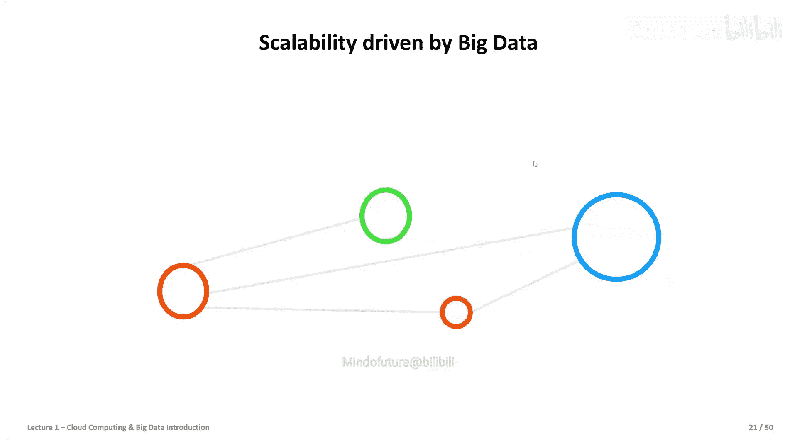

# 003：云计算与大数据导论（第一部分）

在本节课中，我们将学习云计算与大数据的基础概念。课程将从回顾上一讲的内容开始，然后深入探讨云计算的核心技术基础，包括并行与分布式计算、多核CPU与多核GPU的区别，以及“即服务”模型。我们还将初步了解大数据的概念及其带来的挑战。

## 课程回顾

上一讲（第0讲）是课程的序幕，我们概述了课程的整体内容。我们学习了数据量（数据集体积）的持续增长，这催生了“大数据”的概念。当数据量变得非常庞大时，传统的串行计算工具（如Scikit-learn、Matlab）在个人电脑上可能难以处理。这时，我们需要转向远程计算范式，例如云计算或高性能计算。

云计算在本课程中意味着一种更无缝地获取计算资源的方式，因为它提供了大量服务。这些服务通常来自亚马逊、谷歌云、微软Azure等主流云供应商，甚至是像EOSC这样的科研云平台。

另一个关键点是，要运行当前媒体中常见的大型深度学习模型（如大语言模型），不仅需要大数据，还需要大量的计算资源和训练时间。因此，要获得顶尖的模型性能，我们必须依赖云计算和高性能计算，而无法仅在个人笔记本电脑上完成训练（尽管进行推理是另一回事）。

此外，推动云计算在过去十年成功发展的三个关键因素是：
1.  **数据可扩展性**：越来越多的大型数据集变得可用且成本降低。
2.  **硬件演进**：特别是通用GPU的出现，极大地提升了计算能力。
3.  **开源软件**：如TensorFlow、PyTorch、Keras等工具的普及，降低了开发门槛。

这些因素共同促进了科学、工程领域的突破，也催生了新的商业模式和学习策略（如生成式AI）。

## 云计算基础

现在，让我们进入今天的正题。本节将探讨云计算的基础，理解为什么并行和分布式计算如此重要，以及互联网云系统背后的技术。

### 数据中心与虚拟化

云计算的基础是大型数据中心。这些数据中心包含大量基础设施，其中虚拟化的资源可供用户远程访问。这是云计算的一个关键要素：你可以在家或任何地方使用笔记本电脑，通过互联网向“云”发送请求。

云的一个核心特性是**弹性**。这意味着你可以根据需求动态地增加或减少存储、计算硬件等资源。当然，这通常会产生相应的费用。这种服务特性非常重要，它使得用户可以通过网页浏览器轻松访问各种服务，并将基础设施即服务、平台即服务和软件即服务等不同层次的服务组合起来。

为了实现这一切，**虚拟化**是一个非常重要的技术概念。我们将在第4讲中再次详细讨论它。

### 并行与分布式计算

云计算看似一直存在，但其背后是并行和分布式计算技术的长期演进。这里有两个重要的计算范式：

*   **高性能计算**：通常指大型超级计算机，其特点是节点间具有非常高速的互联网络。
*   **高吞吐量计算**：通常由许多较小的计算实体组成，节点间的网络连接可能不那么关键。

这两种范式在课程中都会出现，并且各有其适用场景，不能互换。例如，训练深度学习模型时使用的分布式技术（如Horovod）会借鉴HPC中的一些方法（如MPI消息传递）。而在进行大数据分析时，可能更侧重于高吞吐量计算。

从历史角度看，互联网云的形成是多种技术融合的结果。早期的HPC系统昂贵且难用，而HTC系统（如早期的P2P网络）更侧重于大规模数据分析。网格计算试图将两者结合。随着Web 2.0、物联网的发展，以及**面向服务的架构**的兴起，云计算最终成型。它抽象了底层的复杂性，使得服务的使用变得非常简单，从而极大地推动了其在工业界的应用。

### 核心硬件：多核CPU vs 多核GPU

了解不同类型的计算资源至关重要。在云计算中，你需要清楚多核CPU和多核GPU的区别。

*   **多核CPU**：在一个芯片上集成多个处理器核心。每个核心通常具有较高的时钟频率，擅长复杂的串行计算和逻辑处理。但由于功耗和散热限制，无法无限制地增加高频核心的数量。
*   **多核GPU**：在一个芯片上集成成千上万个处理核心。每个核心的时钟频率相对较低，但通过**大规模并行**处理数据，特别适合图形渲染、矩阵运算等任务。正是这种架构使得GPU能够为深度学习和科学计算提供巨大的计算能力。

在云计算中，你可以按需获取包含多核CPU或大量GPU的实例（如亚马逊的EC2实例），以满足不同计算任务的需求。

### “即服务”模型

云计算通过分层服务模型提供不同级别的抽象：

1.  **基础设施即服务**：提供最基础的虚拟化计算资源（如虚拟机、存储、网络）。用户需要自己管理操作系统、中间件和应用。例如：亚马逊EC2。
2.  **平台即服务**：在IaaS之上，提供开发、测试、部署和管理应用程序的平台。用户无需关心底层基础设施，只需关注自己的代码。例如：谷歌应用引擎。
3.  **软件即服务**：提供完整的、可直接使用的应用程序。用户通过浏览器即可访问，无需任何安装或维护。例如：Gmail、Salesforce、亚马逊SageMaker。

这种分层模型使得开发者能够像搭积木一样，利用云平台现有的服务（如支付模块、存储服务）快速构建和扩展自己的应用。

### 案例分析：弹性与可扩展性

以游戏《愤怒的小鸟》为例。它一夜之间获得了数百万用户。如果开发者使用自家地下室的服务
器，根本无法应对这种突如其来的流量高峰。而云计算提供的**弹性**和**可扩展性**使得他们能够根据用户量动态调整资源，从而支撑了业务的爆炸式增长。这体现了云计算的“规模经济”优势：无需前期巨额投资购买硬件，按需付费，并能始终使用最新的技术。

---

本节课中，我们一起学习了云计算的基础知识。我们回顾了课程动机，探讨了数据中心、虚拟化、并行与分布式计算的区别，理解了多核CPU与多核GPU的核心差异，并介绍了基础设施即服务、平台即服务和软件即服务这三种关键模型。这些基础概念为我们后续深入学习大数据、机器学习在云上的实践以及具体的云服务打下了坚实的基础。