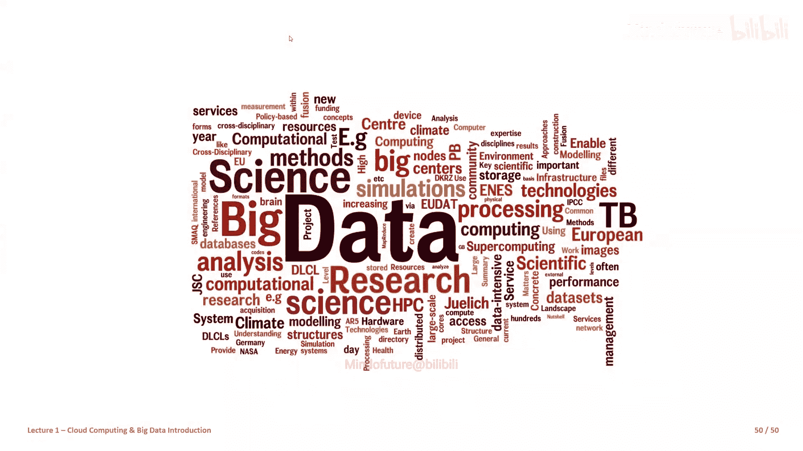

# 004：大数据导论与挑战 🚀

在本节课中，我们将要学习大数据的基本概念、核心挑战以及它与云计算的紧密联系。我们将探讨为什么传统计算方法在处理海量数据时会失效，并了解现代数据驱动应用（如深度学习）对计算基础设施提出的新要求。

上一节我们介绍了云计算的基础概念与服务模型，本节中我们来看看数据侧的关键问题。

## 什么是大数据？💾

大数据通常指数据量过大，以至于无法用传统方法进行处理的数据。一个关键的定义是：**大数据是规模大到无法用常规方法处理的数据**。例如，当你在个人笔记本电脑上尝试用串行实现的SVM算法处理TB级数据时，系统可能会崩溃，这就是大数据挑战的开始。

大数据最初由“3V”定义，但后来其内涵不断扩展。

以下是“3V”及其扩展的核心概念：

*   **Volume（体量）**：数据的绝对大小。例如，卫星数据、大型强子对撞机实验数据或人类大脑扫描图像，其规模可达TB、PB甚至EB级。
*   **Velocity（速度）**：数据生成和处理的速率。问题不仅在于存储1PB数据，而在于每秒都产生1PB新数据。例如，平方公里阵列射电望远镜每20秒就产生约1PB数据。
*   **Variety（多样性）**：数据的类型和格式多种多样。包括图像、文本序列、传感器测量值等，这些多模态数据需要整合才能用于机器学习等任务。

后来，定义中又加入了**Veracity（真实性）**、**Validity（有效性）**等更多“V”，但核心挑战在于这些维度的结合使得数据处理极为困难。

## 大数据的核心挑战 🧱

大数据带来的挑战是多方面的，其中最关键的是“内存墙”或“DRAM差距”问题。

尽管计算能力（CPU/GPU）飞速发展，但存储技术（尤其是大容量、低成本存储）的带宽和访问速度未能同步提升。像磁带库这样的归档存储虽然容量大、成本低，但速度极慢；而像内存这样靠近CPU的高速存储则非常昂贵。

**公式**：`数据处理瓶颈 ≈ 数据移动速度 << 数据处理速度`

这意味着，即使拥有强大的计算集群，如何快速地将海量数据从存储介质“喂”给CPU进行计算，已成为当今最大的挑战之一。这对于需要从全量数据中学习的机器学习模型（如大语言模型）尤为关键。

## 云计算作为解决方案 ☁️

面对大数据挑战，云计算提供了关键的解决方案。它通过提供可扩展、按需付费的服务，解决了自建基础设施的诸多难题。

以下是云计算服务相较于自建基础设施的主要优势：

*   **可扩展性**：云服务可以轻松应对负载峰值（如购物节），自动增减资源，而无需团队耗费精力管理硬件。
*   **高持久性与可用性**：云提供商通过虚拟化、数据备份和快速故障转移等机制，能提供高达99.9%的服务可用性，即使底层硬件不断发生故障。
*   **安全性**：大型云服务商在数据中心物理安全、网络安全和数据加密方面投入巨大，通常比大多数企业自建系统更安全。
*   **易于迁移与集成**：基于标准API（如REST）的服务，使得不同服务之间易于集成和迁移，支持快速的、基于服务的开发模式。
*   **成本效益**：无需前期巨额硬件投资和持续的运维团队成本，按使用量付费。

对于大多数初创公司和企业而言，在云上构建服务比自建数据中心更具性价比和灵活性。除非有特殊的、大规模的HPC需求或极高的数据隐私要求，才会考虑**混合云**模式（部分数据和服务留在私有基础设施中）。

## 大数据处理范式：从Hadoop到Spark ⚙️

为了高效处理大数据，出现了新的编程模型和框架。其核心思想是“将计算移向数据”，而非将海量数据移向计算。

**MapReduce** 是一种经典的分布式计算范式，它遵循“分而治之”的原则。其工作流程可以概括为 **Map -> Sort/Shuffle -> Reduce**。

**代码/流程描述**：
1.  **Map阶段**：多个工作节点并行处理输入数据块，生成一系列中间键值对 `(key, value)`。
2.  **Shuffle & Sort阶段**：系统根据键（key）对所有中间结果进行分组、排序和重新分发，确保相同键的数据到达同一个Reduce节点。
3.  **Reduce阶段**：Reduce节点对分配到它的、具有相同键的所有值进行聚合计算，产生最终结果。

Apache **Hadoop** 是早期实现MapReduce的流行框架。而 **Apache Spark** 作为后起之秀，通过更多地利用内存进行计算，在迭代计算（如机器学习算法）等场景下性能大幅提升，成为了当前大数据处理的主流引擎之一。

## 大数据分析与机器学习 🔍

大数据基础设施的最终目的是为了从数据中获取洞见和价值，这引向了**大数据分析**和**机器学习**。

需要区分两个重要概念：
*   **相关性分析**：发现数据中变量之间的统计关联。例如，通过谷歌搜索趋势预测流感爆发。但相关性不等于因果关系，可能产生误导（如“送子鸟数量”与“婴儿出生率”相关）。
*   **因果性分析**：致力于解释事件发生的根本原因，通常需要更严谨的模型和领域知识。

机器学习是利用算法让计算机从数据中学习规律的技术。在大数据背景下，我们主要关注：
*   **监督学习**：使用带标签的数据训练模型，用于**分类**（如图像识别）、**回归**（如房价预测）等任务。
*   **无监督学习**：从无标签数据中发现结构，如**聚类**（客户分群）。

一个典型的大数据机器学习工作流程如下：

以下是基于云平台（如Microsoft Azure）进行大数据分析的一般步骤：

1.  **问题识别与资源订阅**：确定分析目标，在云平台创建集群（如Spark集群）并获取计算资源。
2.  **环境部署与数据准备**：部署开发环境（如Jupyter Notebook），连接数据源，进行初步的数据探索和可视化。
3.  **模型训练与评估**：在分布式集群上运行机器学习算法训练模型，并使用测试数据评估模型性能。
4.  **模型优化与部署**：根据评估结果调整模型参数（超参数优化），迭代改进，最终将模型部署用于预测。

## 开放科学与FAIR原则 🌍

许多大数据来源于公共资金支持的科学研究（如气候模拟、卫星观测）。为了最大化其价值，推动**开放科学**和 **FAIR原则** 至关重要。

FAIR原则要求数据应具备：
*   **可发现性**
*   **可访问性**
*   **互操作性**
*   **可重用性**

开放共享数据和模型（如开源的大语言模型）能避免重复劳动和能源消耗，让整个社会在“巨人的肩膀上”创新。欧洲开放科学云等倡议正是为了推动这一目标。

---

本节课中我们一起学习了大数据的多维定义、它带来的核心“内存墙”挑战，以及云计算如何提供可扩展、高可用的解决方案来应对这些挑战。我们了解了MapReduce和Spark这样的分布式处理范式，并看到了大数据如何驱动机器学习与数据分析。最后，我们认识到在科学研究领域，遵循FAIR原则开放共享数据对于促进创新和节约资源具有重要意义。下一讲，我们将更具体地进入机器学习的世界，从一个简单的分类例子开始。