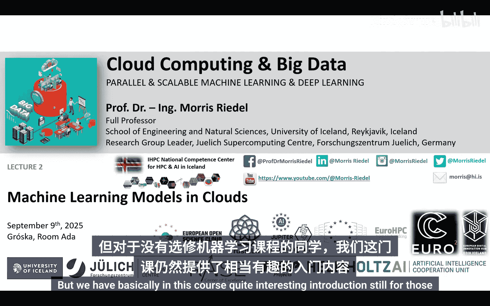
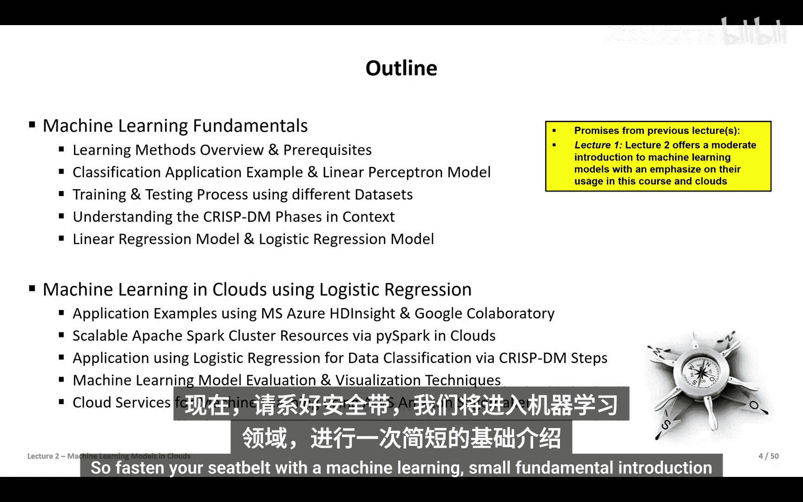
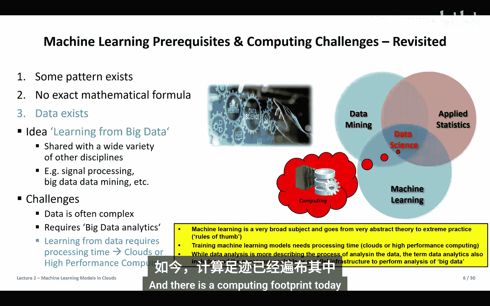
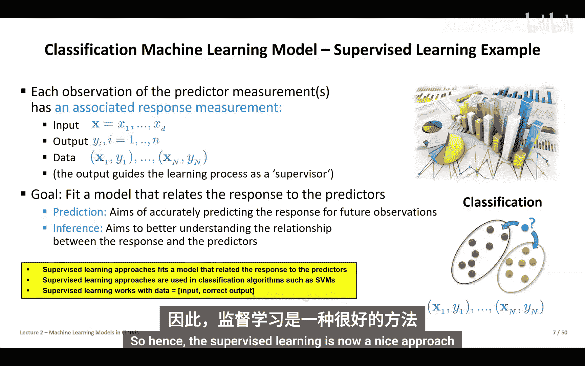
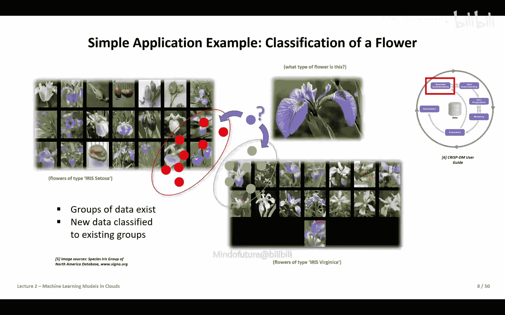
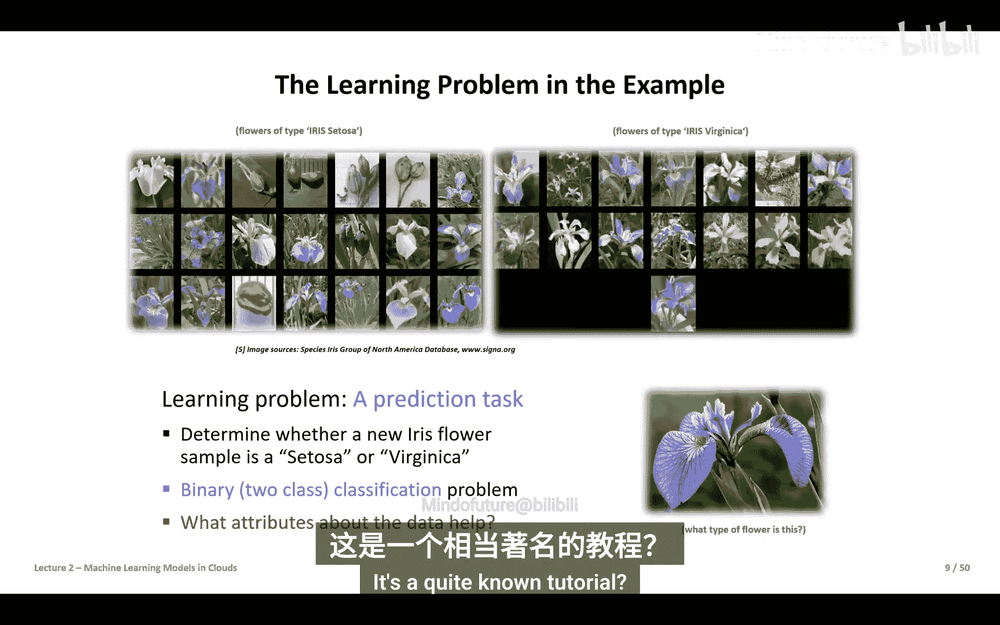
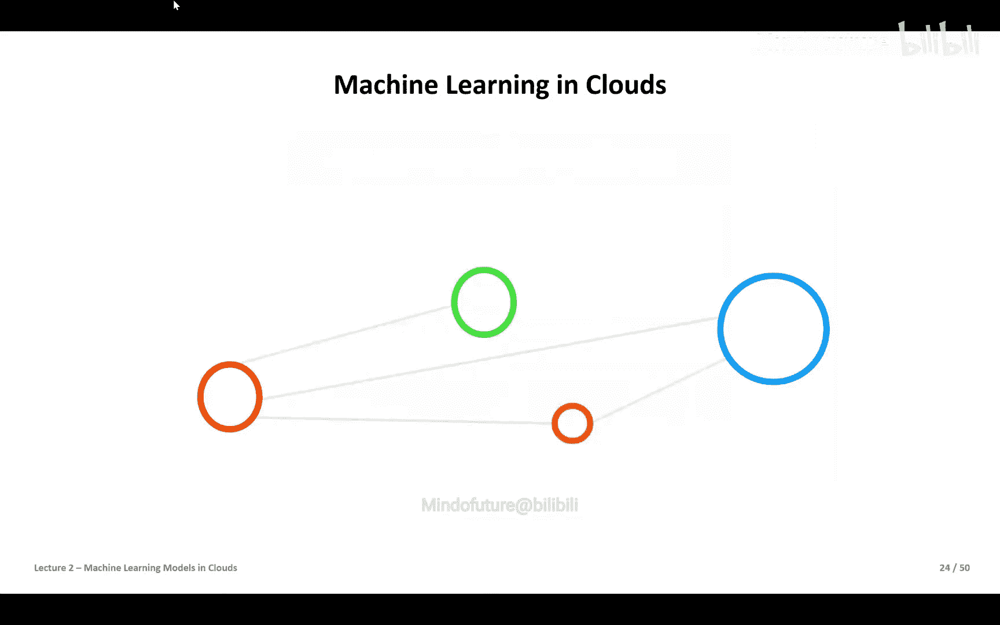

# 005：云中的机器学习模型（第一部分）🚀

在本节课中，我们将要学习机器学习的基础知识，特别是线性学习模型。我们将从最基础的概念开始，这些概念是构建更复杂模型（如人工神经网络和深度学习）的基石。课程内容将尽可能简单直白，确保初学者能够跟上。

---

## 课程回顾 📚

在深入今天的内容之前，让我们快速回顾一下上一讲的内容。上一讲是对云计算和大数据的一个宏观介绍。

我们了解到，云计算的基础是**服务**。云平台通过服务抽象了硬件和存储的细节，提供了极大的灵活性。这种灵活性正是“云计算”这一术语的由来。无论是谷歌云、亚马逊AWS还是其他专业平台，它们都深刻影响着我们的生活，我们手机上的应用、物联网设备等都离不开云服务的支持。

云计算与高性能计算（HPC）的一个关键区别在于其**互联性**和**抽象性**。云数据中心遍布全球，你可以根据需要选择区域，而无需深入了解底层硬件的编程细节。

另一个重要概念是**大数据**。我们面临的挑战不仅是数据量（Volume）巨大，还包括数据多样性（Veracity）。例如，卫星数据、医疗影像数据等各有特点，不能简单地套用同一个机器学习算法。云计算能够弹性伸缩，以应对这种数据增长和多样性带来的挑战。

此外，我们简单区分了**CPU**和**GPU**。CPU是强大的“计算核心”，擅长串行任务；而GPU则拥有“众核”架构，擅长并行处理，这在机器学习和深度学习领域至关重要。

---

## 机器学习基础入门 🤖

现在，让我们进入今天的主题——机器学习。我们将从一个非常基础的线性学习模型开始。

### 什么是机器学习？

机器学习，顾名思义，是从数据中学习。它需要满足几个前提条件：
1.  **存在模式**：数据中必须存在某种可以学习的规律。
2.  **无法用公式直接描述**：如果问题能用明确的物理或数学公式解决，则不一定需要机器学习。
3.  **拥有数据**：学习过程必须基于数据。

机器学习与统计学、数据挖掘等领域有重叠，但其核心目标是利用计算能力，从数据中学习模型，以对**新的、未见过的数据**进行预测或分类。

### 监督学习简介

机器学习主要分为监督学习、无监督学习和强化学习。今天我们重点介绍**监督学习**。

在监督学习中，我们拥有带有标签的数据集。例如，在分类问题中，每个数据点都有一个已知的类别标签（如“猫”或“狗”）。我们的目标是学习一个模型，使其能够根据输入数据（特征）预测出新数据点的标签。

以下是监督学习的关键步骤：
*   **输入**：数据特征向量 **x**。
*   **输出**：已知的标签 **y**。
*   **目标**：构建一个函数 `f(x)`，使其能准确预测新数据的 **y**。

### CRISP-DM 模型：一个实践框架

在实际的数据科学项目中，一个结构化的流程非常重要。**CRISP-DM**（跨行业数据挖掘标准流程）就是这样一个常用的框架。

它包含以下几个阶段，并且这些阶段通常是迭代循环的：
1.  **业务理解**：明确项目目标和需求。
2.  **数据理解**：收集并初步探索数据。
3.  **数据准备**：清洗、转换数据，为建模做准备。
4.  **建模**：选择和应用机器学习算法。
5.  **评估**：评估模型性能，看是否满足业务目标。
6.  **部署**：将模型投入实际使用。

机器学习是一个**过程**，而非一蹴而就的编程。我们需要不断调整数据、模型参数（超参数），并在此框架内迭代优化。

---

## 实战案例：鸢尾花分类 🌸

为了让大家更好地理解，我们来看一个经典的例子：鸢尾花分类。

### 问题定义与数据理解

我们的目标是构建一个模型，能够根据鸢尾花的花瓣尺寸，判断它属于 **Iris-setosa** 还是 **Iris-versicolor** 品种。

首先，我们需要理解数据。通过观察和可视化数据，我们发现花瓣长度和花瓣宽度这两个特征，似乎能够很好地区分这两个品种。当我们把数据点按品种着色并绘制在二维平面上时，可以清晰地看到两个簇。

### 从可视化到决策边界

数据可视化帮助我们看到了模式，但机器学习的目标是**自动化**这个过程。我们需要找到一个**决策边界**，将这两个簇分开。对于这个二维问题，一个简单的直线就可以作为决策边界。

这条直线可以用一个线性方程表示：
`y = w1 * x1 + w2 * x2 + b`
其中 `x1`（花瓣长度）和 `x2`（花瓣宽度）是输入特征，`w1`、`w2` 和 `b` 是模型需要学习的**权重**和**偏置**。

### 感知机：一个简单的线性学习模型

寻找这条最佳边界的过程，就是一个简单的机器学习模型——**感知机**（Perceptron）的工作。感知机是神经网络中神经元的基础模型。

它的工作原理如下：
1.  **输入**：特征向量 **x**。
2.  **加权求和**：计算 `z = w · x + b`（即 `w1*x1 + w2*x2 + b`）。
3.  **激活函数**：通过一个符号函数（如 `sign(z)`）输出预测类别（例如+1代表 setosa，-1代表 versicolor）。

感知机的学习算法非常直观：
1.  初始化权重。
2.  遍历数据，找到一个**分类错误**的点。
3.  根据这个点的真实标签，更新权重向量（加上或减去该点的特征向量）。
4.  重复步骤2-3，直到所有点都被正确分类或达到迭代次数。

**核心思想**：通过不断修正权重，来“旋转”和“平移”那条决策边界，直到它能完美分开两类数据。这个过程在数据是**线性可分**的情况下会被证明是收敛的。

### 训练、测试与预测

当我们通过上述算法学习到一组权重后，就得到了一个训练好的模型。
*   **训练集**：用于学习权重的数据。
*   **测试集**：用于评估模型在**新数据**上性能的数据，这部分数据在训练过程中从未使用过。
*   **预测**：对于一个新的鸢尾花测量数据（花瓣长、宽），我们将其输入训练好的模型，模型会根据它落在决策边界的哪一侧来预测其品种。

机器学习的核心目标，就是获得在**测试集**或未来真实数据（**样本外数据**）上的良好表现，而不仅仅是拟合训练数据。

---

## 本节总结与下节预告 🎯

本节课我们一起学习了机器学习的基础入门知识。我们首先回顾了云计算的核心概念，然后引入了机器学习，并重点讲解了**监督学习**和**CRISP-DM**实践框架。通过**鸢尾花分类**的案例，我们深入探讨了如何从数据理解过渡到建模，并详细介绍了最简单的线性学习模型——**感知机**，包括其模型结构、学习算法以及训练/测试的概念。

我们了解到，感知机虽然简单，但它清晰地展示了机器学习“通过数据学习权重参数以进行预测”的核心思想。然而，它的一个主要限制是只能处理**线性可分**的数据。

在下一部分（第二部分）中，我们将探讨**逻辑回归**。逻辑回归同样是一种线性模型，但它通过一个不同的函数（Sigmoid函数）将输出转化为概率，使其能够处理更复杂的分类问题，并自然地引入损失函数和梯度下降等优化概念，为我们后续学习更复杂的模型打下基础。