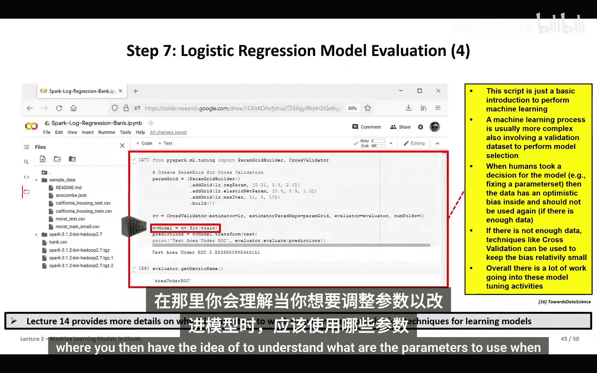
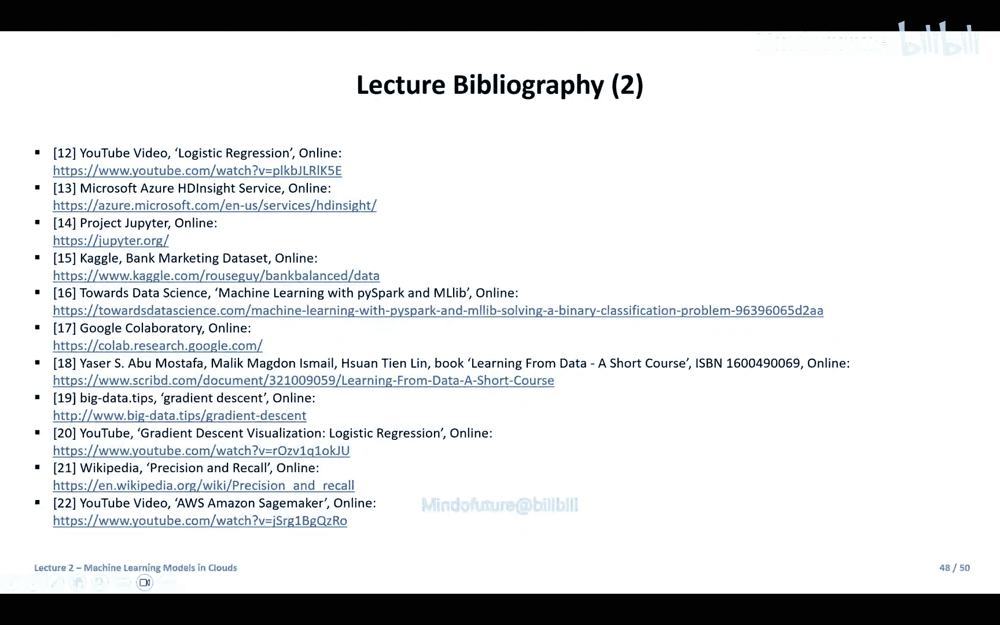

# 006：云中的机器学习模型（第二部分）🚀

在本节课中，我们将要学习如何将机器学习模型部署到云端，并深入探讨一个更高级的算法——逻辑回归。我们将通过一个银行客户存款预测的实际案例，来理解从数据准备到模型评估的完整流程，并对比不同云服务（如Google Colab与Apache Spark）在可扩展性上的差异。

## 概述

在第一部分中，我们学习了机器学习的基础知识，从一个简单的线性感知器模型开始。这个模型虽然历史悠久，但它抓住了机器学习从数据中学习的本质。然而，我们当时处理的是一个线性可分的数据集，这在现实世界的工业项目中并不常见。因此，我们需要更先进的算法来处理非线性可分的数据集。

上一节我们介绍了机器学习的基础，本节中我们来看看如何应用更高级的模型，并利用云计算的强大能力来处理更复杂的任务。

## 从理论到实践：CRISP-DM框架

为了将机器学习应用于实际问题，我们推荐使用CRISP-DM框架来构建你的项目。这是一个非常实用的行业标准方法，可以帮助你系统地处理数据。

以下是CRISP-DM的核心步骤：
1.  **业务理解**：明确你要解决的问题和目标。
2.  **数据理解**：探索和熟悉你所拥有的数据。
3.  **数据准备**：清洗、转换数据，使其适合建模。
4.  **建模**：选择并训练机器学习算法。
5.  **评估**：评估模型的性能，看它是否满足业务目标。
6.  **部署**：将模型投入实际使用。

## 应用案例：芝加哥食品检查

让我们看一个实际应用案例：预测芝加哥的餐厅是否会通过卫生检查。我们相信，餐厅的某些特征（如评论中的关键词）与检查结果之间存在某种模式。由于没有现成的数学公式可以预测，这正是机器学习的用武之地。这个案例中的数据很可能不是线性可分的，为我们引入了更复杂的现实场景。

## 迈向云端：为何需要云计算

当你的笔记本电脑或本地资源无法处理大规模数据或复杂计算时，就需要转向云端。云计算提供了灵活性和强大的可扩展性。

以下是向云端迁移的典型步骤：
1.  **选择云服务**：从AWS、Microsoft Azure、Google Cloud等供应商中选择。
2.  **考虑可扩展性**：对于需要并行处理的大数据任务，Apache Spark等技术是关键。
3.  **利用生态系统**：云平台通常集成了数据存储（如SQL/NoSQL数据库）、机器学习库等工具，简化了部署。

例如，Microsoft Azure的HDInsight服务就提供了预配置的Apache Spark集群，省去了手动集成各种开源组件的麻烦。

## 实践演练：银行客户存款预测

现在，我们通过一个具体的例子来实践上述步骤：预测银行客户是否会购买定期存款产品。

### 1. 业务与数据理解

我们相信客户的职业、婚姻状况、教育水平等属性与其储蓄行为存在关联。我们从Kaggle获得了一个已标注的数据集，其中包含客户特征和“是否存款”的标签。这是一个典型的**监督学习**问题。

在数据理解阶段，我们需要检查**类别平衡**。在这个数据集中，存款与不存款的客户数量大致相当，这有利于模型学习。如果某一类样本极少，模型将难以学习，或产生偏差。

### 2. 数据准备与特征工程

原始数据是表格形式，包含“职业”、“婚姻状况”等分类特征。机器学习模型需要数值输入，因此我们需要进行转换。

一种常见的方法是**独热编码**。例如，将“职业”这个特征转换为一个向量，其中每个元素代表一种职业（如教师、科学家、商人），如果客户是该职业，则对应位置为1，否则为0。

以下是使用Pandas进行数据处理的简化示例：
```python
import pandas as pd
# 读取数据
data = pd.read_csv('bank.csv')
# 进行独热编码
data_encoded = pd.get_dummies(data, columns=['job', 'marital', 'education'])
```
通过这种方式，我们将多个分类特征转换成一个长的数值型特征向量，便于模型处理。同时，我们可能会删除一些无关的特征（如“月份”、“日期”）。

### 3. 构建数据处理管道

为了保证训练和未来预测时数据处理的**一致性**，我们需要构建一个可复用的数据处理管道。这样，当有新客户数据到来时，可以经过完全相同的清洗和转换步骤，再输入给训练好的模型。

### 4. 建模：逻辑回归

我们选择**逻辑回归**作为本次的机器学习算法。它与感知器类似，但有一个关键改进：

*   **感知器**：输出是 `+1` 或 `-1`（通过符号函数 `sign(w·x + b)`）。
*   **逻辑回归**：输出是介于0和1之间的**概率值**（通过逻辑函数 `σ(w·x + b) = 1/(1+e^-(w·x+b))`）。

这个概率值表示样本属于正类（如“会存款”）的可能性。

### 5. 模型训练与优化

训练模型就是寻找一组最佳的权重 `w` 和偏置 `b`，使得模型的预测概率尽可能接近真实标签。这通过最小化一个**损失函数**（如交叉熵损失）来实现。

优化过程通常使用**梯度下降法**。想象你站在一个代表误差的山坡上，目标是走到最低点（最小误差）。梯度下降通过计算误差函数的梯度（最陡下降方向），并沿着该方向以小步长（**学习率**）更新参数，逐步逼近最低点。

```python
# 梯度下降的简化概念
w_new = w_old - learning_rate * gradient_of_loss_function
```
选择合适的学习率至关重要：太小会导致收敛过慢，太大可能越过最低点甚至导致发散。

### 6. 模型评估



模型训练完成后，需要使用未参与训练的**测试集**来评估其泛化能力。常见的评估指标包括：
*   **准确率**
*   **精确率与召回率**
*   **F1分数**（精确率和召回率的调和平均）
*   **AUC-ROC曲线**：通过绘制真正例率 vs. 假正例率来评估模型整体性能，曲线下面积越大越好。

为了更稳健地评估模型，我们还可以使用**交叉验证**，例如十折交叉验证，将数据多次分割为训练集和验证集，以得到更可靠的性能估计。

## 总结




本节课中我们一起学习了如何将机器学习项目部署到云端。我们从CRISP-DM框架出发，通过银行客户存款预测的案例，详细演练了从业务理解、数据准备、特征工程到模型训练与评估的完整流程。我们介绍了逻辑回归模型，它通过输出概率提供了比感知器更丰富的信息，并简要探讨了通过梯度下降进行模型优化的原理。最后，我们对比了像Google Colab这样的轻量级云服务与Apache Spark这样的可扩展大数据平台的区别，为后续深入学习云上的大规模机器学习奠定了基础。记住，在实际应用中，数据处理和参数调优往往与选择算法本身同等重要。