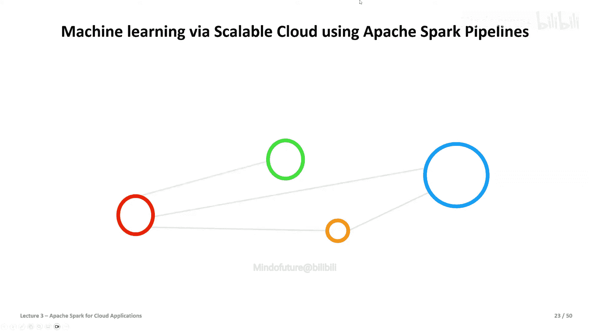

# 007：面向云应用的Apache Spark（第一部分）🚀


在本节课中，我们将要学习如何将Apache Spark应用于云环境，以处理大规模数据分析和机器学习任务。我们将从回顾上一讲的基础知识开始，逐步探讨Spark的核心概念、架构及其在云服务（如Azure HDInsight）中的实际应用。

---

## 回顾：机器学习基础

上一节我们介绍了机器学习的基础概念。本节中，我们来看看这些概念如何为后续的云应用奠定基础。

机器学习算法大致可分为几类。其中，监督学习分类模型是最为人熟知的。此外，还有用于发现数据中潜在分组的聚类算法，以及用于趋势分析等任务的回归算法。

一个机器学习问题通常包含三个基本要素：
1.  **存在模式**：数据中必须存在可学习的模式。
2.  **无现成公式**：如果已有精确的数学公式解决问题，则无需使用机器学习。
3.  **数据可用**：机器学习依赖于数据，因此必须有数据可供学习。

我们曾探讨过一个最简单的机器学习问题：二元分类。并介绍了对应的简单模型——感知机模型。其核心思想是模拟神经元，通过输入数据 `X`（不同属性）和对应的监督标签 `Y` 来学习一组权重 `W` 和偏置 `b`。

其数学形式可表示为：
```
输出 = sign(W^T * X + b)
```
其中，`sign` 函数用于二元分类（输出+1或-1）。学习过程就是调整权重 `W`，以在数据空间中移动决策边界，直到所有数据点被正确分类。然而，感知机算法的局限在于要求数据必须是线性可分的。

为了处理更复杂的情况，我们引入了逻辑回归模型。它在线性模型 `W^T * X` 的基础上，使用了逻辑函数（Sigmoid函数）将输出压缩到0到1之间，从而提供更平滑的概率估计。

这些模型已应用于实际问题，例如：
*   **花卉分类**：根据萼片和花瓣的长度、宽度等属性，区分鸢尾花的种类。
*   **银行营销**：根据客户的职业、教育程度、婚姻状况等多维属性，预测客户是否会订阅定期存款。


---


## 课程概述与目标

在回顾了基础知识后，本节我们将转向云计算的实践，探讨如何利用Apache Spark构建可扩展的云应用。

本节课是第三讲，我们将延续第二讲的内容，更深入地探讨Apache Spark如何为云应用赋能，特别是在构建数据处理和机器学习流水线方面。

我们将通过一个具体的案例来理解为何在真实数据科学项目中，需要从Google Colab这类工具转向更强大的云服务。核心原因在于**数据规模**和**计算需求**的急剧增长。


以下是本节课的主要路线图：
1.  **引入Apache Spark**：介绍这一可扩展的数据分析框架及其核心架构。
2.  **转向云服务**：更新我们的实践方法，使用Microsoft Azure HDInsight（一种云服务）替代Google Colab。
3.  **分析新案例**：以“食品检查”预测为例，系统化地理解机器学习的数学构建模块。
4.  **展望第二部分**：后续将更系统地介绍云计算中的流水线概念。


---

## 从Google Colab到可扩展云服务

上一节我们提到了数据规模的挑战，本节中我们来看看Google Colab在实际生产中的局限性。

在之前的课程中，我们使用了Google Colab。它提供了基于Web浏览器的Jupyter Notebook界面，便于快速开始。我们甚至可以在其中部署一个小型的Spark集群并运行Python代码进行数据分析与机器学习。

然而，Google Colab本质上并非一个真正的可扩展集群。用户通常只能选择单个GPU，且无法拥有多个工作节点。这对于入门和原型设计是很好的工具，但无法满足大规模生产需求。

让我们通过一个真实案例来感受“大规模”的含义。以我们的行业合作伙伴SME Greenfish为例，他们使用哥白尼海洋数据存储库进行渔业预测。仅获取过去五年的全球海面温度数据，就可能达到**370 GB**。尝试在Google Colab中上传一个2.8 GB的文件都可能耗时极长，更不用说370 GB。即使通过API获取，Colab通常约68 GB的存储空间也远远不够。


在进行更复杂的分析时，例如海洋波浪传播模拟，数据量可能迅速增长到**5.8 TB**。这远远超出了Colab的免费或付费升级套餐的存储上限。因此，**存储**是首要瓶颈。

其次，**计算能力**同样受限。在Colab中，用户只能在有限的几种GPU类型（如T4, A100）中选择，且需要订阅付费的Colab Pro才能获得更快的GPU。然而，在真实的高性能计算场景中，我们可能需要同时使用数十甚至上百个GPU。例如，在一次卫星图像土地覆盖分析中，我们使用了24个节点，每个节点配备4个GPU，总计**96个GPU并行工作**。这是Google Colab无法提供的计算规模。

因此，对于像SME Greenfish这样的生产级应用，我们需要探索更具扩展性的解决方案。这也引出了本课程的核心：学习如何利用云服务来满足大规模机器学习的计算和存储需求。

---

## Apache Spark 框架简介

认识到对可扩展计算的需求后，本节我们介绍能满足这一需求的核心技术——Apache Spark。

Apache Spark是一个用于大规模数据处理的统一分析引擎。它源于对不断增长的数据进行分布式处理的需求。与早期的Hadoop框架相比，Spark利用内存计算进行了优化，速度显著更快，特别适合需要多次迭代的机器学习算法。

Spark不仅仅是一个执行引擎，它周围有一个庞大的生态系统，与众多开源项目（如Cassandra、Airflow、Kubernetes、MongoDB）集成良好。Spark本身专为大规模数据科学设计，其内置的机器学习库（MLlib）包含了许多本身就支持并行执行的算法。


Spark应用运行时的核心架构如下：
1.  **SparkSession**：应用程序的入口点，用于创建SparkContext。
2.  **集群管理器**：负责管理集群资源（如Hadoop YARN）。它支持多用户同时使用同一集群（多租户），这涉及到虚拟化技术。
3.  **工作节点**：真正执行计算任务的节点。**可扩展性的关键就在于可以动态增加或减少工作节点的数量**，以适应不同计算任务的需求。

Spark具有良好的互操作性，支持Python（通过PySpark）、SQL（Spark SQL）等，并且能够与PyTorch等深度学习框架以及MLflow等MLOps工具协同工作。目前，所有主流云服务提供商（AWS、Azure、Google Cloud）都提供托管的Spark服务。

---

## 实践：使用 Azure HDInsight


了解了Spark的理论后，本节我们来看看如何在微软Azure云平台上具体使用它。

我们将使用Azure HDInsight服务来部署和管理Spark集群。与Google Colab的“开箱即用”不同，使用生产级云服务需要更多的配置和管理意识。


以下是关键步骤和注意事项：

**1. 订阅与配置**
使用HDInsight需要有一个Azure订阅（例如“即用即付”模式）。即使有了订阅，也需要先注册“HDInsight集群”资源提供程序，才能创建集群。这个过程旨在让用户明确意识到即将使用一个可能产生高成本的生产级服务。

**2. 集群成本与规模**
成本控制是云使用的核心。在HDInsight中，您需要决定集群的规模，特别是**工作节点的数量**。每个工作节点都对应着特定的虚拟机配置（CPU、内存、GPU）。内存越大、核心数越多，成本就越高。
*   **头节点**：管理集群，通常需要两个以实现高可用。
*   **ZooKeeper节点**：管理集群协调，所需资源较少。
*   **工作节点**：执行实际任务，**数量可弹性伸缩**，是成本的主要部分。


用户可以根据需求随时扩展或收缩工作节点，这正是云计算的核心理念之一。例如，在年底处理大量数据时扩展到100个节点，而在平时缩减到几个节点。

**3. 配额与资源可用性**
为了防止意外产生巨额费用，云平台会设置资源配额。如果您需要创建超出配额限制的大型集群（例如需要特定类型的数百个CPU核心），必须手动申请提高配额。

**4. 重要注意事项：集群生命周期管理**
这一点与Google Colab有本质区别：**关闭Jupyter Notebook界面并不会停止Spark集群**。只要集群在运行，就会持续产生费用。因此，务必在不使用时通过管理控制台**停止（Stop）集群**（注意不是删除）。停止后不再计费，且以后可以重新启动。务必对集群规模和使用时间保持警惕，管理好成本。

---


## 应用案例：食品检查预测

在搭建好云环境后，本节我们引入一个新的应用案例来系统化实践机器学习流程。

我们将分析芝加哥市的食品检查数据，目标是通过餐厅的历史检查记录（如违规类型、厨房清洁度等文本数据），构建一个二元分类模型，预测餐厅在未来的检查中是否会“不合格”。这是一个典型的监督学习问题，因为历史数据已经被标记了“通过”或“失败”的标签。


我们将遵循一个系统化的机器学习流程，其数学构建模块如下：

**1. 训练样本**
这是机器学习的基础，没有数据就没有学习。数据通常表示为：
```
D = {(x1, y1), (x2, y2), ..., (xn, yn)}
```
其中 `x` 是特征向量（属性），`y` 是对应的标签。正如哥白尼海洋数据案例所示，真实场景中的 `D` 可能非常庞大。

**2. 未知目标函数**
存在一个未知的理想函数 `f`，它完美地定义了特征 `x` 与标签 `y` 之间的关系（即 `f(x) = y`）。我们的目标就是学习一个尽可能接近 `f` 的假设函数。


---

## 总结与预告

本节课中我们一起学习了将Apache Spark应用于云计算环境的核心知识。


我们首先回顾了机器学习的基础，指出了简单工具在应对大规模数据时的局限性。接着，我们深入介绍了Apache Spark这一可扩展的分布式计算框架及其架构。然后，我们详细讲解了如何在Microsoft Azure HDInsight云服务中部署和管理Spark集群，并重点强调了成本控制与资源管理的重要性。最后，我们引入了一个新的应用案例——食品检查预测，并开始构建系统化的机器学习流程视图。




在接下来的第二部分，我们将继续这个案例，深入探讨如何构建机器学习流水线，并利用Spark在云中高效地执行数据准备、模型训练、评估等完整步骤。