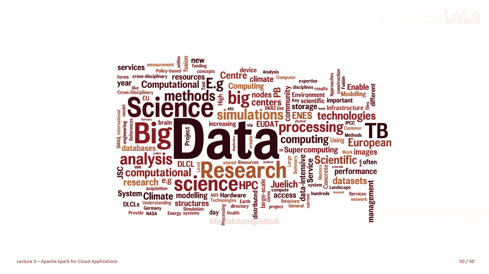

# 008：面向云应用的Apache Spark（第二部分）

在本节课中，我们将继续学习如何在云环境中使用Apache Spark进行机器学习。我们将基于第一部分的基础，深入探讨如何构建一个完整的机器学习管道，从数据准备、模型选择、训练到最终的评估。我们将使用一个食品检查数据的实际案例，演示如何使用Spark的MLlib库实现逻辑回归分类。

---

## 概述与回顾

上一节我们介绍了如何从Google Colab迁移到Microsoft Azure云平台，并设置了一个可伸缩的Apache Spark集群来处理更大规模的数据集。我们讨论了云计算的成本考量以及Spark集群管理的基本概念。

本节中，我们将聚焦于机器学习的实际应用流程。我们将加载一个真实的数据集，进行数据理解和预处理，选择一个机器学习模型（逻辑回归），构建训练管道，并最终在独立的测试集上评估模型性能。整个过程将在我们之前建立的Spark集群上分布式执行。

---

## 启动Spark会话

首先，我们需要在已运行的Spark集群上启动一个Jupyter Notebook会话并初始化Spark环境。

以下是初始化Spark会话并导入必要库的代码：

```python
from pyspark.sql import SparkSession
from pyspark.ml import Pipeline
from pyspark.ml.classification import LogisticRegression
from pyspark.ml.feature import HashingTF, Tokenizer
from pyspark.sql.functions import *
```

执行这段代码会启动一个Spark应用。与Google Colab不同，你会看到类似`yarn application ID`的输出，这表明你的应用已经连接到YARN集群资源管理器。该管理器负责调度和管理所有工作节点上的任务。现在，Spark上下文（`SparkSession`）已准备就绪，可以在Notebook中使用Python进行操作。

---

## 加载与理解数据

我们的应用案例是分析食品检查数据，目标是构建一个模型来预测检查结果是“通过”还是“失败”。这是典型的二分类问题。

我们有两个数据文件。首先，我们加载训练集 `food_inspections1.csv`。

```python
# 辅助函数：读取CSV数据
def load_data(file_path):
    # 此处为读取和解析CSV文件的代码
    ...

# 加载训练数据
training_data = load_data(‘food_inspections1.csv‘)
```

我们暂时将测试集 `food_inspections2.csv` 放在一边。在机器学习中，必须将训练数据和测试数据严格分开。模型只能从训练数据中学习，然后用从未见过的测试数据来评估其泛化能力。这是检验模型能否对未知数据做出准确预测的关键。

为了理解数据，我们可以查看一条记录：

```python
# 查看一条数据样本
sample_inspection = training_data.take(1)
print(sample_inspection)
```

执行此操作时，Spark会在集群上启动一个作业（Job）。即使是一个简单的`take(1)`操作，也会触发分布式执行。你会看到类似“Spark有6个执行器，15个核心在运行”的信息。这直观地展示了云计算的分布式特性。

通过查看数据，我们发现数据集中包含`Results`（结果）和`Violations`（违规项）等字段，这些字段对于我们的分类预测至关重要。

---

## 数据准备：处理类别不平衡

在深入建模之前，我们需要进行数据准备。首先，我们检查目标变量`Results`的类别分布。

```python
# 统计结果类别的分布
result_counts = training_data.groupBy(‘Results‘).count().collect()
print(result_counts)
```

分析发现，原始数据中有5个类别：`Fail`, `Pass`, `Pass with Conditions`, `Business Not Located`, `Out of Business`。然而，我们的目标是二分类（通过/失败）。因此，我们需要进行数据转换。

以下是数据准备步骤：
1.  **合并相关类别**：将`Pass`和`Pass with Conditions`合并为“通过”（标签1）。
2.  **保留核心类别**：`Fail`作为“失败”（标签0）。
3.  **移除无关类别**：`Business Not Located`和`Out of Business`的样本数极少，对整体模型影响不大，因此将其过滤掉（标记为-1后删除）。

```python
# 创建二进制标签
from pyspark.sql.functions import when

labeled_data = training_data.withColumn(‘label‘,
    when(training_data[‘Results‘] == ‘Fail‘, 0)
    .when(training_data[‘Results‘].isin([‘Pass‘, ‘Pass with Conditions‘]), 1)
    .otherwise(-1)  # 其他类别标记为-1
)

# 过滤掉标签为-1的数据，只保留0和1
binary_data = labeled_data.filter(labeled_data[‘label‘] >= 0)
```

这个步骤是CRISP-DM（跨行业数据挖掘标准流程）中“数据准备”阶段的一部分，目的是使数据适应我们选择的模型。

---

## 选择模型与假设集

现在数据已经准备好，我们需要选择一个机器学习模型。这对应着从庞大的“假设集”中选择一个特定的假设类型。

*   **假设集（H）**：所有可能模型的集合。例如，支持向量机（SVM）、神经网络、决策树、**逻辑回归**等都是不同的假设集。
*   **具体假设（h）**：在一个特定的模型（如逻辑回归）中，不同的模型参数（权重W）会构成无数个具体的假设（h1, h2, h3...）。
*   **目标（g）**：我们的学习算法将从假设集中选出一个最佳的假设`g`，希望它能很好地近似未知的真实目标函数`f`。

我们选择**逻辑回归**作为我们的模型（假设集）。它是一个简单的线性学习模型，其输出通过逻辑函数映射到[0,1]区间，非常适合二分类问题。在Spark MLlib中，它已经内置实现。

---

## 构建机器学习管道

为了将整个流程系统化、可重复化，并便于未来部署，我们构建一个Spark ML管道。管道将数据预处理、特征工程和模型训练串联起来。

我们的管道主要包括以下阶段：
1.  **Tokenizer（分词器）**：将文本字段（如`Violations`）拆分成单词。
2.  **HashingTF（哈希词频）**：将单词转换为固定长度的特征向量。这是一种高效的特征工程方法，将文本转换为数学模型可以处理的数值形式。
3.  **LogisticRegression（逻辑回归模型）**：这是我们选择的分类器。

```python
# 定义管道的各个阶段
tokenizer = Tokenizer(inputCol=“Violations“, outputCol=“words“)
hashingTF = HashingTF(inputCol=tokenizer.getOutputCol(), outputCol=“features“)
lr = LogisticRegression(maxIter=10, regParam=0.01)

# 构建管道
pipeline = Pipeline(stages=[tokenizer, hashingTF, lr])

# 在训练数据上拟合管道，得到模型
model = pipeline.fit(binary_data)
```

拟合管道的过程会触发一系列Spark作业。你会看到多个任务在集群上执行，包括分词、特征哈希和模型优化迭代。

---

## 学习算法与误差度量

仅仅选择模型（如逻辑回归）还不够，我们还需要一个**学习算法**来找到模型的最佳参数（权重W）。

*   **学习算法**：例如，随机梯度下降（SGD）或其变种（如Adam）。该算法通过迭代优化来最小化**误差（损失）函数**。
*   **误差函数**：衡量模型预测与真实标签之间的差距。对于逻辑回归，常用的损失函数是对数损失（Log Loss）。

公式表示为：**`min_W Loss(y, σ(W^T * x))`**，其中`σ`是逻辑函数。

在Spark中，优化器（如SGD）和损失函数（对数损失）都已集成在逻辑回归模型中。我们通过设置`maxIter`（最大迭代次数）和`regParam`（正则化参数）等超参数来影响学习过程。正则化有助于防止模型在训练数据上过拟合。

---

## 模型评估

模型训练完成后，我们必须评估其性能。现在，我们拿出之前预留的、从未使用过的测试集 `food_inspections2.csv`。

```python
# 加载测试数据
test_data_raw = load_data(‘food_inspections2.csv‘)

# 使用与训练集相同的数据准备步骤处理测试集
test_data_labeled = ... # 同样的标签转换
test_data = test_data_labeled.filter(...) # 同样的过滤

# 使用训练好的管道模型对测试集进行预测
predictions = model.transform(test_data)
```

`model.transform()` 方法会应用整个管道（包括特征处理），并使用训练好的逻辑回归模型进行预测。

接下来，我们使用**混淆矩阵**来评估预测结果：

```python
from pyspark.ml.evaluation import MulticlassClassificationEvaluator

# 选择需要评估的列
evaluator = MulticlassClassificationEvaluator(labelCol=“label“, predictionCol=“prediction“, metricName=“accuracy“)
accuracy = evaluator.evaluate(predictions)
print(f“Test Accuracy = {accuracy}“)

# 也可以计算更详细的混淆矩阵
from pyspark.mllib.evaluation import MulticlassMetrics
# ... 将预测结果转换为RDD并计算指标
```

混淆矩阵展示了：
*   **真正例（TP）**：实际为“失败”且预测为“失败”。
*   **真负例（TN）**：实际为“通过”且预测为“通过”。
*   **假正例（FP）**：实际为“通过”但预测为“失败”。
*   **假负例（FN）**：实际为“失败”但预测为“通过”。

根据这些指标，可以计算出准确率、精确率、召回率等，全面评估模型性能。

---

## 总结


本节课中，我们一起学习了在云环境下使用Apache Spark完成一个端到端的机器学习项目。

1.  **环境与数据**：我们在Azure HDInsight Spark集群上启动会话，并加载了食品检查数据集。
2.  **数据理解与准备**：我们分析了数据分布，处理了多类别问题，将其转换为二分类问题，并清洗了数据。
3.  **模型选择**：我们选择了逻辑回归模型，理解了其作为“假设集”的含义。
4.  **管道构建**：我们创建了一个Spark ML管道，集成了文本特征工程（分词、哈希）和模型训练。
5.  **训练与优化**：管道在训练集上拟合，利用内置的优化算法和损失函数自动学习模型参数。
6.  **评估与验证**：最后，我们在独立的测试集上评估了模型性能，使用混淆矩阵等指标判断模型泛化能力。




整个过程充分利用了Spark的分布式计算能力，能够处理远超单机内存限制的大规模数据。同时，管道化的设计使得整个机器学习工作流可重复、易维护，为生产环境部署奠定了基础。