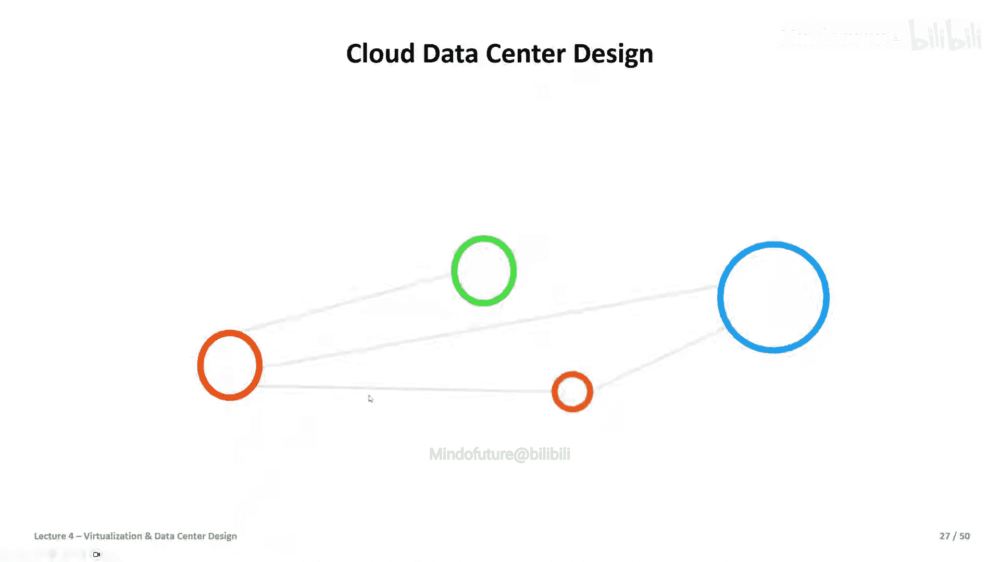

# 009：虚拟化与可扩展数据中心设计（第一部分）


在本节课中，我们将要学习虚拟化的基础知识，并探讨它如何成为现代云计算和多租户数据中心的关键推动力。我们将回顾虚拟化的核心概念，理解其如何提升资源利用率和系统灵活性，并为后续学习数据中心设计打下基础。

上一讲我们重点介绍了机器学习在云应用中的形式化方法，包括训练集、假设集、学习算法等核心概念。本节中，我们来看看支撑这些大规模计算和存储需求的底层技术——虚拟化。

## 虚拟化技术回顾

虚拟化是当今每位计算机科学家或工程师都应掌握的基础技术。它本质上通过一个抽象层，使云计算和多租户数据中心成为可能。

### 从传统计算到虚拟化

在传统计算机中，物理硬件之上直接运行着主机操作系统（如Linux或Windows），操作系统对硬件拥有完全的控制权。

**传统架构**：
```
物理硬件 -> 主机操作系统 -> 应用程序
```


引入虚拟化后，架构发生了变化。在物理硬件之上，我们增加了一个**虚拟化层**（或称为**管理程序**）。这个层创建了一套虚拟化的硬件资源，可以被多个**客户操作系统**共享。


**虚拟化架构**：
```
物理硬件 -> 虚拟化层（管理程序） -> 客户操作系统1 -> 应用程序1
                                     -> 客户操作系统2 -> 应用程序2
```

这种架构带来了巨大的灵活性。用户可以在同一台物理机器上同时运行Linux和Windows系统，并且每个虚拟机都是相互隔离的。


### 虚拟化的核心优势

以下是虚拟化带来的几个关键优势：


*   **提升服务器利用率**：通过在一台物理服务器上运行多个虚拟机，可以将服务器利用率从传统的5%-15%显著提升至60%-80%甚至更高。这对于大规模数据中心节约成本和资源至关重要。
*   **支持多租户与隔离**：不同用户或租户可以安全地共享同一硬件资源，因为每个虚拟机都是隔离的环境。这是云计算商业模式的基础。
*   **灵活性与可移植性**：虚拟机可以轻松地暂停、存储状态、恢复，甚至迁移到另一台物理主机上。
*   **高可用性与容错**：通过**实时迁移**技术，当一台物理主机出现故障时，其上的虚拟机可以几乎无感知地迁移到其他健康的主机上，从而保障服务的高可用性。这帮助云服务提供商实现其服务等级协议中承诺的高正常运行时间（如99.9%）。

### 虚拟机、镜像与实例

在云计算的语境下，有几个重要术语需要区分：


*   **虚拟机**：一个完整的、隔离的软件计算机系统，它模拟了物理计算机的功能。
*   **虚拟机镜像**：一个预配置的、包含操作系统和应用程序的静态文件模板。例如，一个预装了Ubuntu和Web服务器的镜像。
*   **虚拟机实例**：从一个镜像启动并正在运行的虚拟机。你可以创建同一个镜像的多个实例。

主流云服务提供商（如AWS、Microsoft Azure、Google Cloud）都基于这些概念提供服务，允许用户从市场中选择预制的镜像快速启动实例。


### 虚拟化实现方式


虚拟化的实现主要有两种架构：


1.  **裸机虚拟化**：虚拟化管理程序直接安装在物理硬件之上。这是性能最高、数据中心最常用的方式。
    ```
    物理硬件 -> 管理程序 -> 客户操作系统
    ```
2.  **主机虚拟化**：虚拟化软件作为一个应用程序安装在现有的主机操作系统之上。这种方式更常见于个人电脑（例如，在Windows上安装VMware Workstation来运行Linux虚拟机）。
    ```
    物理硬件 -> 主机操作系统 -> 虚拟化应用 -> 客户操作系统
    ```


需要注意的是，容器化技术（如Docker）是另一种轻量级的虚拟化方案，它主要在操作系统层面进行隔离，共享主机内核，我们将在后续课程中详细讨论。


## 数据中心中的虚拟化管理


将虚拟化技术扩展到数据中心规模，带来了复杂的管理挑战和机遇。


### 大规模虚拟化基础设施

在数据中心，虚拟化不再仅仅是几台虚拟机，而是涉及成千上万的物理服务器、存储和网络设备，以及运行在其上的海量虚拟机。这需要一个强大的**云操作系统**或**虚拟化管理平台**来统一管理。

以下是该平台需要处理的核心任务：


*   **资源供应**：动态分配和回收物理资源（CPU、内存、存储、网络）给虚拟机。
*   **监控与计量**：跟踪所有资源的使用情况，用于性能分析、计费和容量规划。
*   **安全管理**：确保不同租户之间的隔离，管理访问权限和密钥。
*   **高可用与备份**：实施灾难恢复策略，定期备份虚拟机数据。
*   **调度**：智能地将虚拟机任务分配到最合适的物理服务器上，以优化资源利用率和能效（类似于Hadoop YARN或Spark集群的调度器，但范围更广）。


### 商业与开源解决方案


市场上有许多成熟的虚拟化解决方案，既包括商业软件如**VMware vSphere**，也包括开源方案如**KVM**。这些平台提供了上述大部分管理功能，帮助企业和服务提供商构建私有云、公有云或混合云基础设施。




本节课中我们一起学习了虚拟化的基本原理及其对云计算的革命性影响。我们了解了虚拟机如何通过抽象硬件来实现资源的高效利用、多租户隔离和高可用性。我们还探讨了虚拟机、镜像和实例的概念，以及虚拟化在数据中心规模下面临的管理挑战。在下一部分，我们将深入探讨可扩展数据中心的设计，包括物理布局、冷却系统和容错机制。