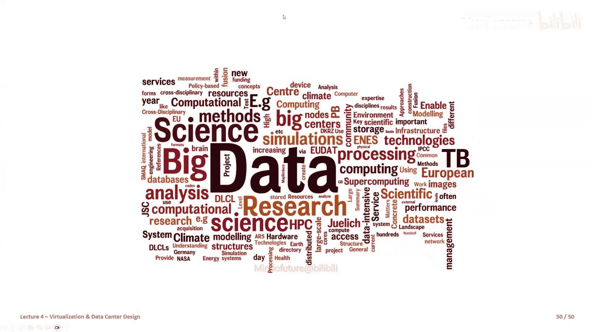

# 010：虚拟化与数据中心设计（第二部分）

在本节课中，我们将继续探讨数据中心设计，了解其核心原则、成本模型、基础设施考量以及实现可扩展性的关键因素。我们将看到，虚拟化技术如何支撑起现代大规模数据中心的经济效益和灵活性。

上一部分我们回顾了虚拟化的基本概念，如虚拟机、虚拟设备和虚拟机管理程序。本节中，我们将把这些概念置于更广阔的数据中心设计背景下进行考察。

## 数据中心设计原则

数据中心并非简单地将服务器堆放在房间里。在专业托管的数据中心中，计算资源以**机架**为单位进行组织。机架是一种紧凑的设计，能够容纳大量服务器，并优化冷却和网络互连。

以下是数据中心设计的一些核心原则：
*   **高密度与紧凑性**：现代机架设计非常紧凑，能在有限空间内容纳更多计算和存储单元。
*   **高效冷却**：冷却系统是数据中心运营的关键成本和设计重点，设计目标是最大化散热效率。
*   **高速网络互连**：机架内部及机架之间需要高速、可靠的网络连接，以实现资源的紧密集成。
*   **规模经济**：数据中心规模越大，其基础设施（如冷却、电力）的运营成本分摊越低，从而降低单位计算成本。

这种规模效应是云计算提供商（如微软、亚马逊）在全球建设数百个大型数据中心的主要原因，它们能够以更低的运营成本提供服务。

## 虚拟化与资源利用

在抽象层面，我们可以将庞大的数据中心建模为一个由许多物理服务器组成的集群。虚拟化技术在此发挥了核心作用，它允许创建**虚拟集群**，这些虚拟集群可以灵活地映射到底层物理硬件上。

虚拟化驱动了数据中心的高利用率，因为不同用户和应用有不同的需求。例如：
*   一个虚拟集群可以横跨多个物理集群，以提高应用的可用性（如当某个物理集群因网络问题宕机时）。
*   另一个虚拟集群可能完全独占一组物理资源，以满足特定的性能或隔离要求。
*   像Apache Spark这样的应用，其虚拟集群可以根据工作负载需求动态扩展或收缩，增加或减少工作节点。

这种灵活性使得数据中心能够同时服务多用户和多应用领域，只要应用能够运行在虚拟机中，并利用虚拟化的计算资源。例如，某些虚拟集群可以提供配备**GPU**的节点，专门用于机器学习任务，而用户只需为实际使用的GPU资源付费。

## 成本模型：固定成本 vs. 可变成本

自行建设和运营数据中心与使用云服务在成本结构上有本质区别。

**公式：总成本 = 固定成本（资本支出） + 可变成本（运营支出）**

*   **自建数据中心**：需要高昂的**固定成本**，包括购买服务器、GPU、网络设备、存储系统以及建设冷却和电力基础设施。此外，IT技术更新换代极快（例如NVIDIA GPU架构从Kepler、Ampere、Hopper到Blackwell），每隔几年就可能需要再次投入巨资进行硬件更新。
*   **使用云服务**：用户主要承担**可变成本**，即“按使用量付费”。云服务提供商负责所有固定成本投入和基础设施维护，用户只需像使用水电一样，为实际消耗的计算、存储和网络资源付费。

这种“按需付费”的模式，尤其对于中小型企业、初创公司或需要尖端AI算力的用户而言，极大地降低了使用高性能计算资源的门槛，是云计算商业模式的一个突破。

## 数据中心基础设施考量

数据中心的基础设施成本因地理位置和规模差异很大，但有一些共同的核心考量因素：

以下是建设数据中心需要考虑的关键基础设施要素：
1.  **冷却系统**：这是主要运营成本之一。寒冷地区（如冰岛、芬兰）可以利用环境空气进行自然冷却，具有显著优势。其他技术还包括温水冷却、浸没式液体冷却等。
2.  **电力供应与分配**：需要稳定的电力来源。许多数据中心配备柴油旋转不间断电源（UPS），在主电源中断时提供短期备用电力，以满足服务级别协议（SLA）。
3.  **IT设备**：包括服务器、GPU、网络交换机、存储阵列等。高性能GPU和高速网络设备成本尤其高昂。
4.  **网络连接**：数据中心内部（机架内/间）及对外都需要高带宽、低延迟的网络连接。
5.  **物理安全与认证**：包括门禁系统、监控、防火（如使用惰性气体灭火系统）以及获得各种行业认证（如Uptime Institute的等级认证），这些对于赢得客户信任至关重要。

以冰岛的数据中心为例，它们不仅受益于寒冷的自然环境冷却，还拥有100%来自地热和水电的绿色能源，并且通常有多个独立的绿色能源来源，在环保和可靠性方面具有吸引力。

## 容错设计与可扩展性

在设计大规模数据中心时，必须**默认硬件会发生故障**。在拥有成千上万台服务器的环境中，CPU、硬盘、网络设备出现故障是常态。

因此，数据中心和运行其上的软件都内置了容错机制：
*   **软件层面**：如Apache Spark、Hadoop HDFS（分布式文件系统）具备内置的容错和数据复制功能，任务失败后可自动重启，数据丢失可从副本恢复。
*   **虚拟化层面**：支持虚拟机实时迁移（Live Migration），当物理服务器需要维护时，可将其上的虚拟机无中断地迁移到其他服务器。
*   **基础设施层面**：采用冗余电源、网络路径和冷却系统。

可扩展性是用户选择数据中心的核心原因之一，它体现在多个维度：
*   **规模可扩展性**：根据需求快速增加或减少计算、存储资源。例如，一款应用突然爆火，需要立即扩容服务器以应对用户流量。
*   **软件生态可扩展性**：云平台提供丰富的、预集成且易于维护的软件栈（如各种版本的Apache Spark、PyTorch、TensorFlow），用户无需自行处理复杂的软件依赖和部署问题。
*   **应用可扩展性**：应用本身能利用云平台的弹性来处理不断增长的数据量（从GB到PB）或计算需求。
*   **技术可扩展性**：云服务商持续集成最新硬件技术（如新一代GPU、更快的网络、量子计算实验机），用户无需自行投资升级便能使用前沿技术。

## 云部署模型：公有云、私有云与混合云

根据所有权、访问和管理方式，云部署主要有三种模型：
*   **公有云**：资源由第三方云提供商（如AWS、Azure、Google Cloud）拥有和运营，通过互联网向公众开放。提供最大的弹性和规模经济效益。
*   **私有云**：云基础设施专供单个组织使用，可由该组织或第三方管理。通常部署在本地（on-premises），提供最高的控制力、安全性和定制化，例如医院管理敏感患者数据。
*   **混合云**：结合公有云和私有云，允许数据和应用程序在两者之间共享。例如，医院将敏感数据保存在私有云，但将匿名化后的数据发送到公有云，利用其强大的GPU集群进行分析。

## 总结

本节课中，我们一起学习了数据中心设计的核心原则。我们了解到，虚拟化技术是实现数据中心高资源利用率、灵活性和多租户支持的基础。通过对比自建数据中心的固定成本模型与云计算的按需付费可变成本模型，我们明白了云计算的经济吸引力所在。我们还探讨了数据中心在冷却、电力、网络、容错和安全性等方面的基础设施挑战，以及冰岛等地凭借绿色能源和自然冷却获得的优势。最后，我们分析了数据中心提供的多种可扩展性维度和不同的云部署模型（公有、私有、混合）。所有这些因素共同构成了现代大规模、可扩展、经济高效的云计算基础设施的基石。