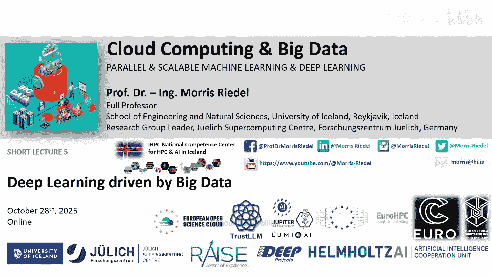
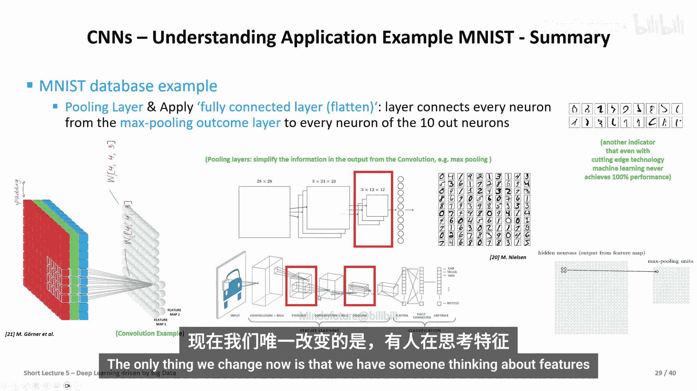
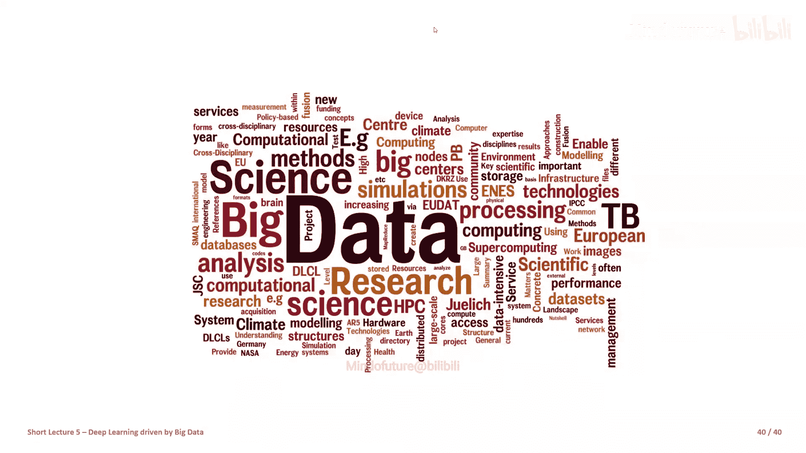

# 011：大数据驱动的深度学习 🧠



在本节课中，我们将学习深度学习的基础知识，并探索如何利用云计算资源来运行和扩展深度学习模型。我们将从简单的感知器模型开始，逐步深入到人工神经网络和卷积神经网络，同时理解计算复杂度如何随着模型复杂度的增加而急剧上升。

上一节我们回顾了虚拟化技术及其在云计算中的核心作用。本节中，我们将看看如何将这些虚拟化资源应用于计算密集型的深度学习任务。

## 课程回顾与背景

上一次课程简要介绍了虚拟化技术。对于计算机科学家和工程师而言，这如今应是一门基础技术。传统计算机，包括你的笔记本电脑，其硬件由主机操作系统直接访问，并运行着多个不同的应用程序。

虚拟化通过引入所谓的**虚拟化层**（也称为管理程序或虚拟机管理器）改变了这一模式。该层对底层真实硬件进行抽象，创建出**虚拟化硬件**。然后，客户操作系统（如Windows或Linux）可以在此虚拟硬件上运行，托管不同类型的应用程序，这就是**虚拟机**的概念。

今天，我们将学习如何在虚拟机中使用深度学习，并在云计算环境中进行大规模扩展。

## 从虚拟化到云计算

虚拟化带来了资源调度的灵活性。设想一个大型数据中心，你希望在上面运行Spark工作负载（我们在最初的课程中已经了解过）。物理集群由许多机架组成。虚拟化的概念允许你在这些物理集群之上创建**虚拟集群**。

这种模式实现了更好的控制和更灵活的资源共享。不同的用户组（例如“绿色团队”和“红色团队”）可以根据应用程序和服务的需求，被调度到不同的虚拟集群上，而不是被绑定到特定的物理硬件上。

除了资源共享，虚拟化的另一个重要优势是**实时迁移**。如果某个机架上的硬件过热，你可以快速将应用程序迁移到其他正常运行的硬件上，从而减少云服务的停机时间。

在实际实现中，用户看到的是一个理想化的虚拟平台。其背后是大量的物理硬件，之上是虚拟化平台，再之上是管理整个虚拟基础设施的各种服务，包括负载管理、资源供应、调度、安全以及计费和用户管理等系统服务。

## 深度学习简介

需要声明的是，完整的深度学习介绍需要一门完整的课程。本讲座的目的是将Andreas Literman邀请讲座中的概念性内容，与云服务的实际应用连接起来。我们将回顾人工神经网络和深度学习网络（特别是卷积网络），并将其应用于手写字符识别这一经典基准问题。

我们将看到，深度学习的计算复杂度极高，这迫使我们离开CPU的领域，转向高性能计算和云计算。这正是本课程的一个核心目标：理解为何日益增长的可训练参数需要HPC和云计算的支持。

## 从简单模型开始：感知器

回想我们之前课程中的机器学习内容，我们有一个基本的简单线性感知器模型。其公式为：

**`输出 = 激活函数( Σ (权重_i * 输入_i) + 偏置 )`**

这是一个线性模型，其中权重是可训练的参数。

我们将使用MNIST手写数字数据集。该数据集包含28x28像素的手写字符图像，目标是将其分类为0到9这10个数字之一。这是一个**10类分类问题**，将我们之前讨论的二元分类扩展到了多类分类。

该数据集包含约60,000个训练样本和10,000个测试样本，是一个广泛使用的基准数据集，可通过Keras等框架轻松访问。

### 数据理解与准备

首先，我们需要理解数据。MNIST数据集中的图像是带有标签的（例如，某个图像被标记为“5”），因此这是一个**监督学习**问题。

然而，感知器模型期望的是一维向量输入，而我们的图像是二维的（28x28）。因此，我们需要一个数据准备步骤：将二维图像**重塑**为一个长向量（28*28=784维）。

**注意**：这种重塑操作会丢失像素之间的空间邻域信息，这是简单感知器模型的一个局限，我们稍后会解决这个问题。

以下是使用Python和Keras加载并准备数据的基本步骤：

```python
from tensorflow import keras

# 加载数据
(train_images, train_labels), (test_images, test_labels) = keras.datasets.mnist.load_data()

# 重塑数据为向量并归一化
train_images = train_images.reshape((60000, 28 * 28))
train_images = train_images.astype('float32') / 255
test_images = test_images.reshape((10000, 28 * 28))
test_images = test_images.astype('float32') / 255
```

### 构建多输出感知器模型

我们的感知器模型需要处理10个类别。我们使用一个**全连接层**，直接将输入向量连接到10个输出神经元。这本质上是一个没有隐藏层的模型。

模型参数计算：输入784维，输出10维，加上每个输出神经元的偏置项。总参数数量约为 `(784 * 10) + 10 = 7850`。

我们使用**Softmax**激活函数来输出每个类别的概率分布。优化器选择随机梯度下降，损失函数选择适用于多类分类的**分类交叉熵**。

在Keras中构建和训练该模型的代码如下：

```python
model = keras.Sequential([
    keras.layers.Dense(10, activation='softmax', input_shape=(28 * 28,))
])

model.compile(optimizer='sgd',
              loss='categorical_crossentropy',
              metrics=['accuracy'])

# 将标签转换为分类格式
from tensorflow.keras.utils import to_categorical
train_labels_cat = to_categorical(train_labels)
test_labels_cat = to_categorical(test_labels)

# 训练模型
history = model.fit(train_images, train_labels_cat,
                    epochs=20,
                    batch_size=128,
                    validation_split=0.2)

# 评估模型
test_loss, test_acc = model.evaluate(test_images, test_labels_cat)
print(f'测试准确率: {test_acc}')
```

在云计算环境中（例如使用AWS的Deep Learning AMI），你可以通过Jupyter Notebook或Python脚本运行此代码。这个简单模型可以达到约92%的准确率。

### 过拟合与欠拟合

在训练过程中，需要注意**过拟合**和**欠拟合**。
*   **欠拟合**：模型没有充分学习数据中的模式。
*   **过拟合**：模型过度学习了训练数据中的细节和噪声，导致在未见过的测试数据上表现变差。

我们通过观察训练损失和验证损失曲线来寻找最佳点。通常，我们会使用验证集和正则化技术来对抗过拟合。

## 迈向更强大的模型：人工神经网络

简单感知器是线性的，无法解决非线性可分问题（如经典的异或问题）。解决方案是引入**隐藏层**，构建**多层感知器**，即人工神经网络。

通过在隐藏层中使用非线性激活函数（如ReLU），模型可以学习更复杂的决策边界。

### 构建与训练

以下是在Keras中构建一个包含两个隐藏层的人工神经网络的示例：

```python
model = keras.Sequential([
    keras.layers.Dense(128, activation='relu', input_shape=(28 * 28,)), # 隐藏层1
    keras.layers.Dense(64, activation='relu'),                         # 隐藏层2
    keras.layers.Dense(10, activation='softmax')                       # 输出层
])

model.compile(optimizer='adam',
              loss='categorical_crossentropy',
              metrics=['accuracy'])

model.fit(train_images, train_labels_cat, epochs=20, batch_size=128)
```

该模型的参数数量大幅增加至约11.8万个，计算复杂度显著上升。但其性能也提升至约97%的准确率。

### 训练过程：前向传播与反向传播

1.  **前向传播**：输入数据通过网络层层传递，得到预测输出。
2.  **计算损失**：比较预测输出与真实标签，计算损失值。
3.  **反向传播**：利用链式法则，将损失从输出层向输入层反向传播，计算网络中每个参数（权重）的梯度。
4.  **参数更新**：使用优化器（如SGD或Adam）根据梯度更新权重，以减小损失。

**学习率**是一个关键超参数：太小可能导致陷入局部最小值；太大可能导致在最小值附近震荡而无法收敛。

## 深度学习：卷积神经网络

人工神经网络在处理图像时，仍将输入视为扁平化的向量，忽略了空间结构。**卷积神经网络**专为处理网格状数据（如图像）而设计，它能保持数据的二维结构，并自动学习空间层次特征。

### CNN核心概念

*   **卷积层**：使用可学习的滤波器（小权重矩阵）在输入图像上滑动，进行特征提取。
*   **池化层**（通常为最大池化）：对特征图进行下采样，减少参数数量，增强特征不变性。
*   **全连接层**：在网络的末端，将学习到的高级特征映射到最终的分类输出。



### 构建CNN模型


在Keras中构建一个简单CNN的示例：

```python
model = keras.Sequential([
    # 卷积部分
    keras.layers.Conv2D(32, (3, 3), activation='relu', input_shape=(28, 28, 1)),
    keras.layers.MaxPooling2D((2, 2)),
    keras.layers.Conv2D(64, (3, 3), activation='relu'),
    keras.layers.MaxPooling2D((2, 2)),
    # 展平后接全连接层
    keras.layers.Flatten(),
    keras.layers.Dense(64, activation='relu'),
    keras.layers.Dense(10, activation='softmax')
])

model.compile(optimizer='adam',
              loss='categorical_crossentropy',
              metrics=['accuracy'])

# 注意：输入数据需要保持2D形状 (28, 28, 1)
train_images_cnn = train_images.reshape((60000, 28, 28, 1))
test_images_cnn = test_images.reshape((10000, 28, 28, 1))

model.fit(train_images_cnn, train_labels_cat, epochs=5, batch_size=64)
```

对于这个“玩具”问题，CNN的参数数量可能激增至120万左右，但准确率可以进一步提升到99%以上。这清晰地展示了模型复杂度与计算需求之间的权衡：更强大的模型需要显著更多的计算资源（如GPU），而这正是云计算的优势所在。

## 总结与云计算实践

本节课中，我们一起学习了：
1.  **从感知器到CNN**：回顾了从简单的线性感知器，到具有隐藏层的人工神经网络，再到专门处理图像的卷积神经网络的演进。
2.  **计算复杂度**：认识到模型性能的提升伴随着可训练参数数量的爆炸式增长，这直接导致了极高的计算需求。
3.  **云平台支持**：了解了主流云服务商（如AWS、Google Cloud）通过提供预配置的**虚拟机镜像**（如AWS Deep Learning AMI）来支持深度学习工作负载，这些镜像包含了TensorFlow、PyTorch、CUDA等必要的框架和库。
4.  **核心实践**：掌握了使用Keras在云环境中构建、训练和评估基本深度学习模型的流程。

对于实际项目，请始终牢记：
*   严格区分**训练集**、**验证集**和**测试集**。
*   密切关注**过拟合**现象，并考虑使用正则化、Dropout等技术。
*   根据问题复杂度选择合适的模型，平衡性能与计算成本。



深度学习在云端的实践，完美体现了本课程将“大数据”处理需求与“云计算”弹性资源相结合的核心主题。在接下来的课程中，我们将探索更高级的云服务（如AWS SageMaker）和更复杂的模型。