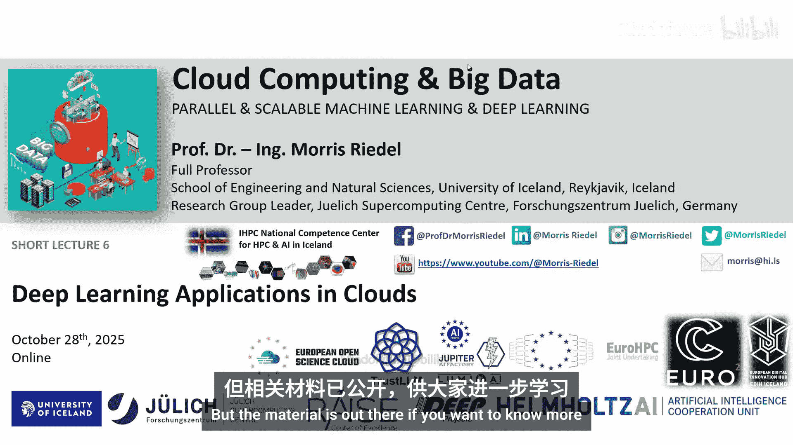
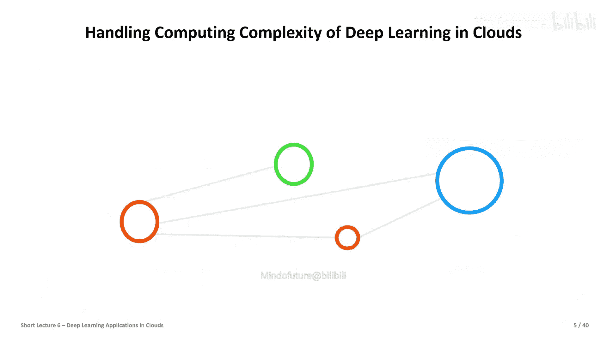
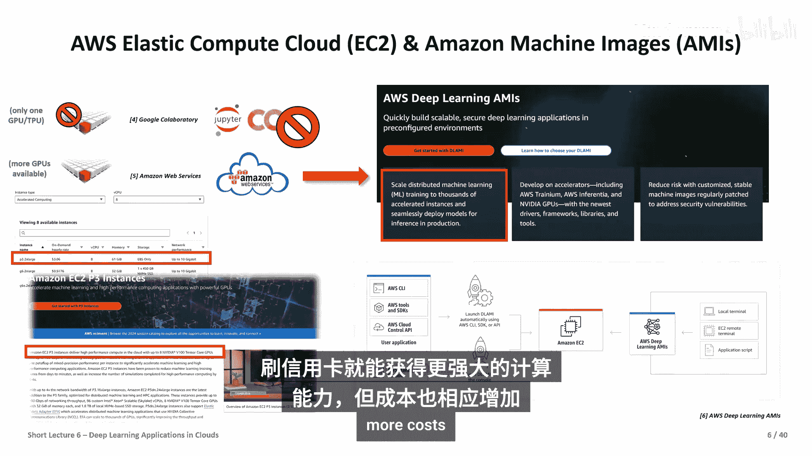
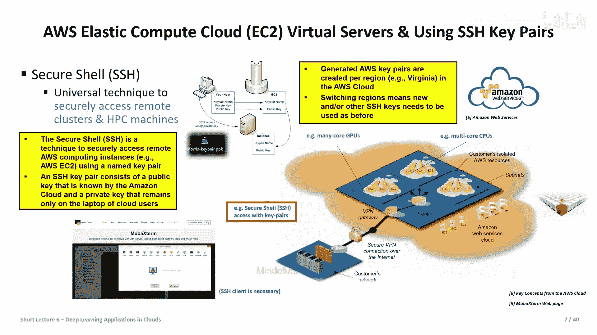
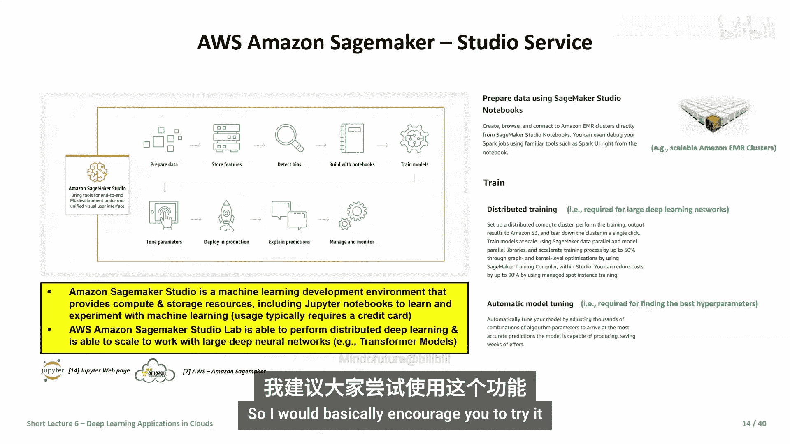
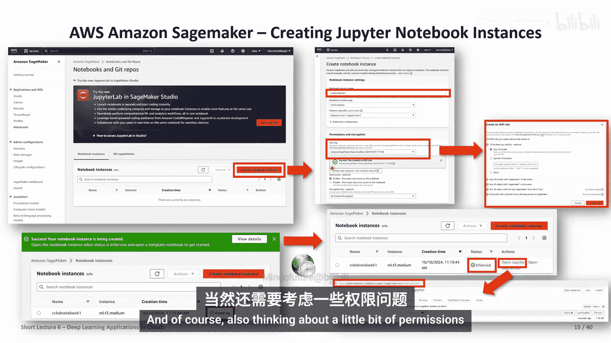
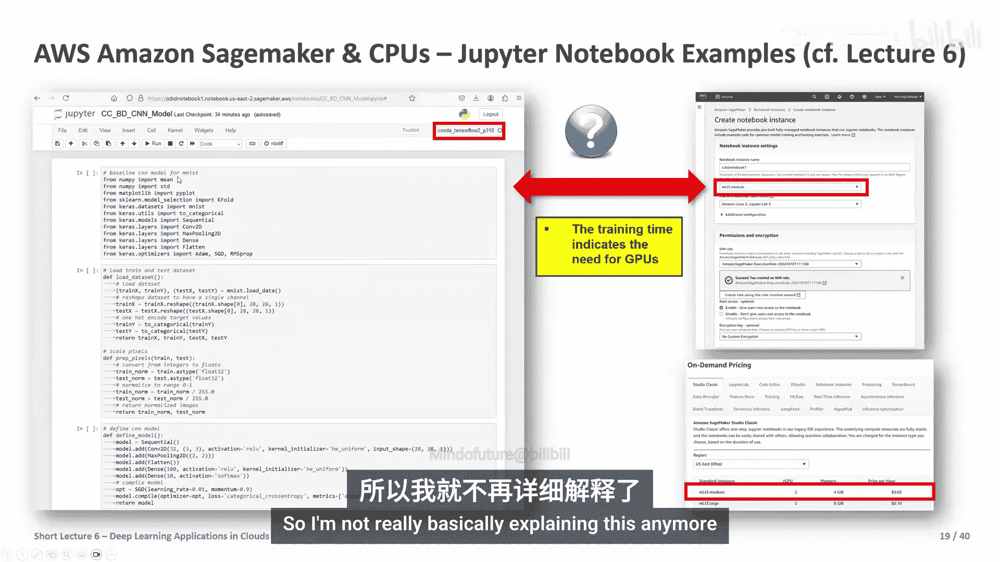
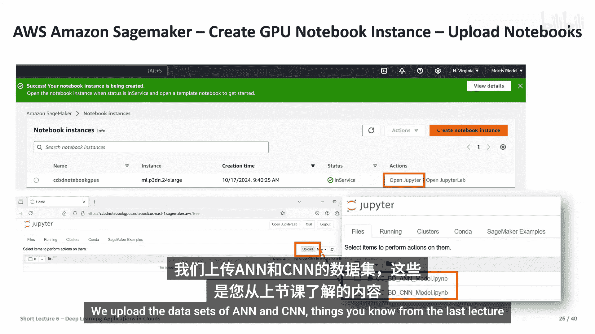
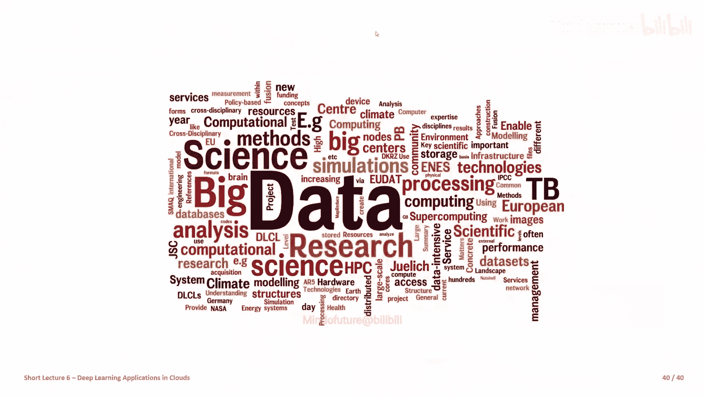

# 012：云中的深度学习应用 🧠☁️

在本节课中，我们将学习如何在云环境中应用深度学习。我们将回顾深度学习的基础概念，并探讨如何利用云服务（特别是AWS）来应对深度学习模型带来的巨大计算需求。课程将涵盖从基础设施即服务到软件即服务的不同云服务层级，并演示如何利用SageMaker等服务来高效地训练和部署模型。

---

## 回顾：从感知机到深度神经网络

上一讲我们介绍了感知机模型。本节中，我们来看看如何从简单的感知机扩展到更复杂的深度神经网络。

感知机是深度学习的基础模型，其核心是一个线性学习单元。一个神经元的基本数学模型可以表示为：

**公式：** `z = w1*x1 + w2*x2 + ... + wn*xn + b`

其中，`w` 是权重，`x` 是输入，`b` 是偏置项。这个线性信号 `z` 随后会通过一个非线性激活函数 `f(z)`，例如ReLU（修正线性单元），以引入非线性。

为了处理更复杂的问题（如识别0-9的手写数字，共10个类别），我们扩展了单神经元模型。我们不再使用一个输出神经元，而是使用10个神经元，每个对应一个数字类别。这形成了一个密集连接层，需要学习的参数数量也随之增加，达到了约8000个。

虽然8000个参数对于个人电脑来说或许可以处理，但这正是计算复杂性开始显现的地方。更多的数据意味着需要更频繁地进行计算，从而对计算资源提出了更高要求。

---

## 深度学习与计算挑战

当我们引入隐藏层，构建更复杂的神经网络（如人工神经网络ANN）时，情况发生了变化。模型无法再将输入直接连接到输出以计算误差，因此需要**反向传播算法**来更新各层的权重。

反向传播利用链式法则计算梯度，并逐层更新权重。随着网络层数和神经元数量的增加（例如，一个拥有128个神经元的隐藏层），需要训练的参数数量会急剧增长。在没有GPU的时代，这带来了巨大的计算挑战。

在上一讲的例子中，我们通过保留输入的2D结构（而非向量化）并引入卷积等操作，构建了卷积神经网络（CNN）。这虽然提升了模型性能（例如识别手写数字的准确率），但也使可训练参数的数量激增至约120万。

**核心观点：** 模型越复杂，可训练参数越多，对计算资源的需求就越大。当个人电脑需要数天甚至数周来完成训练时，转向云计算就成为了一个自然的选择。

---

## 云计算服务层级：从IaaS到SaaS

为了应对深度学习的计算需求，云服务提供了不同层级的解决方案。我们将以亚马逊AWS为例进行说明。

以下是云计算中常见的服务模型：

1.  **基础设施即服务**：这是最基础的层级，提供虚拟化的计算资源。在AWS中，对应的服务是**弹性计算云**。用户可以直接操作虚拟机实例，完全控制操作系统和软件环境。
2.  **平台即服务**：这一层级提供了预配置的软件环境和开发工具。AWS的**深度学习AMI**就是一个例子，它预装了TensorFlow、PyTorch等深度学习框架和操作系统，简化了环境搭建。
3.  **软件即服务**：这是最高级的层级，提供完全托管的应用程序服务。AWS的**SageMaker**服务属于此类，它专门为机器学习打造，集成了Jupyter Notebook、自动化训练、模型调优等一系列功能。

每一层都构建在下一层的基础之上。选择越高层级的服务，管理越方便，但灵活性和成本控制能力可能会降低。

---

## 实践：在AWS中运行深度学习

我们将了解如何在AWS的不同服务层级上运行我们的深度学习代码。

### 使用EC2（IaaS）

EC2是AWS的基础计算服务。使用EC2需要以下步骤：
*   创建密钥对（公钥上传至AWS，私钥保存在本地）用于安全连接。
*   从众多**亚马逊机器镜像**中选择一个预装了深度学习环境的AMI。
*   选择实例类型（如配备GPU的`p3`、`p4`或`p5`实例），并启动实例。
*   通过SSH命令行连接到实例，手动运行Python脚本或转换后的Jupyter Notebook代码。

这种方式提供了最大的灵活性，但要求用户具备一定的系统管理技能，并且需要自行管理计算实例的运行状态和成本。

### 使用SageMaker（SaaS）

对于专注于算法和应用的机器学习开发者，SageMaker提供了更便捷的体验。

以下是使用SageMaker Notebook的主要优势：
*   **托管环境**：无需管理底层基础设施，直接使用基于Web的Jupyter Notebook。
*   **轻松扩展**：可以方便地为Notebook实例选择不同的计算类型（如CPU或GPU），甚至连接多GPU集群进行分布式训练。
*   **集成工具**：内置了超参数调优、模型部署等一系列高级功能。

使用SageMaker Studio Lab（一个免费服务）可以几乎零门槛地开始，它非常类似于Google Colab，但允许使用更强大的预配置环境。

**重要提示**：在云中，计算实例只要处于“运行”状态就会持续产生费用，无论你是否正在 actively 使用它。因此，务必在不使用时停止或终止实例，以控制成本。

---

## 为什么需要GPU？速度与成本权衡

深度学习模型训练的核心运算（如矩阵乘法）具有高度的并行性，而GPU的架构正是为并行计算设计的。

以下是在云中使用GPU实例的考量：
*   **显著加速**：与CPU相比，GPU可以将每个训练周期的耗时从数分钟缩短到数秒，极大提升了实验迭代速度。
*   **成本更高**：更强大的GPU实例（如搭载NVIDIA H100的实例）价格昂贵，每小时费用可达数十甚至上百美元。
*   **按需选择**：需要根据模型复杂度、数据量和项目预算，合理选择GPU实例类型。对于训练阶段，可以使用高性能实例；对于推理阶段，则可以切换到成本更低的实例。

---

## 总结与展望

本节课中我们一起学习了云中的深度学习应用。

我们回顾了深度学习模型从简单到复杂的发展过程，并理解了模型参数数量增长所带来的计算挑战。我们介绍了云计算的三个服务层级，并通过AWS的EC2和SageMaker服务，实践了如何在基础设施层和软件服务层部署和运行深度学习工作负载。最后，我们探讨了使用GPU进行加速的必要性及其背后的成本权衡。

**核心收获**：转向云计算不仅是为了处理海量数据，更是为了获得强大的计算能力，以高效训练参数众多的复杂深度学习模型。云服务提供了从底层硬件到顶层应用的全套解决方案，使研究人员和开发者能够专注于模型本身，而非计算环境的管理。

在下一讲中，我们将探讨参数规模达到**数十亿**级别的大型语言模型，并了解云计算如何支撑这类前沿AI模型的训练与应用。