# 013：云中的大规模语言模型与生成式AI 🚀

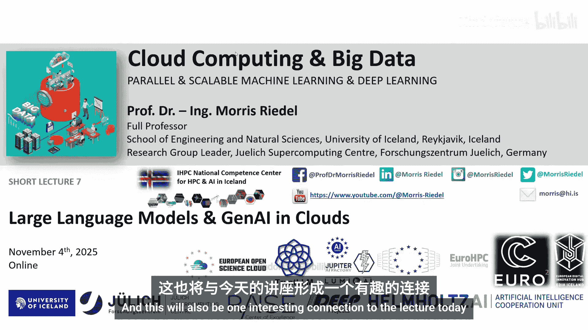

在本节课中，我们将要学习大规模语言模型和生成式AI的基本概念，了解它们在云计算环境中的重要性、工作原理、面临的挑战以及主要的云服务提供商如何提供相关服务。

---

## 概述

近年来，大规模语言模型和生成式AI已成为云计算和高性能计算领域日益重要的工作负载。与过去专注于分类和预测的传统AI不同，我们现在能够生成全新的文本、图像、声音和视频等内容。本节课将探讨这些模型的核心原理、计算需求、应用场景以及云服务商提供的解决方案。

上一节我们介绍了深度学习应用，本节中我们来看看如何将这些原理扩展到处理海量数据和参数的生成式模型中。

---

## 从深度学习到大规模语言模型

在上一讲中，我们学习了深度学习的基础，例如多层感知机和卷积神经网络。这些模型通过大量参数（如权重W）和激活函数来学习复杂模式。其计算复杂度随着网络深度和参数量的增加而显著上升。

一个简单的全连接神经网络层的前向传播可以表示为：
**a⁽ˡ⁺¹⁾ = σ(W⁽ˡ⁾ a⁽ˡ⁾ + b⁽ˡ⁾)**
其中，`σ`是激活函数，`W`是权重矩阵，`b`是偏置向量，`a`是激活值。

然而，我们今天讨论的Transformer模型等大规模语言模型，其参数量达到了**数十亿甚至数千亿**的级别，这远非我们之前讨论的百万级参数模型可比。这种规模的增长直接推动了对于强大计算资源（如云GPU集群）的需求。

---

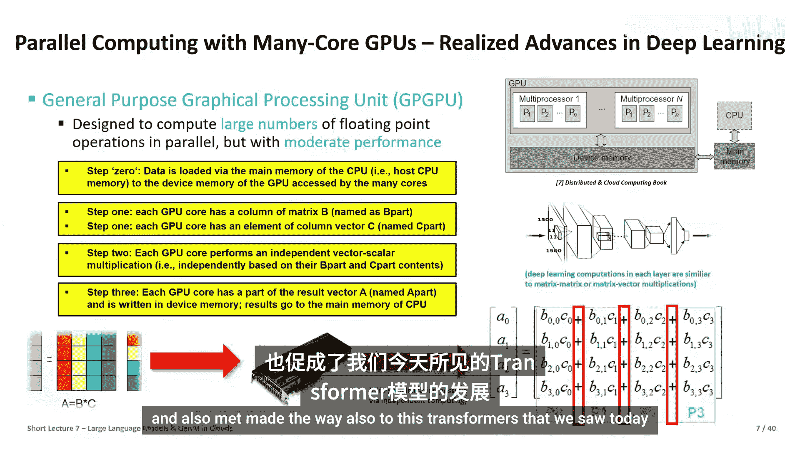

## 序列建模的演进：从RNN到Transformer

在自然语言处理领域，早期的序列建模主要依赖于循环神经网络和长短期记忆网络。

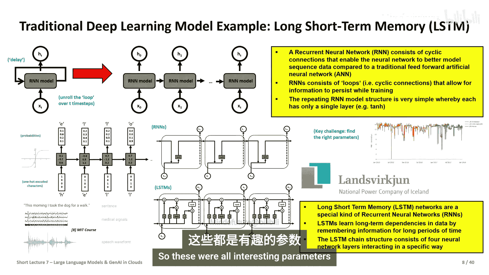

以下是LSTM单元内部计算的一个简化示意：
```python
# 简化的LSTM核心计算步骤（概念性代码）
i_t = sigmoid(W_i * [h_{t-1}, x_t] + b_i) # 输入门
f_t = sigmoid(W_f * [h_{t-1}, x_t] + b_f) # 遗忘门
c_tilde_t = tanh(W_c * [h_{t-1}, x_t] + b_c) # 候选记忆细胞
c_t = f_t * c_{t-1} + i_t * c_tilde_t # 更新记忆细胞
o_t = sigmoid(W_o * [h_{t-1}, x_t] + b_o) # 输出门
h_t = o_t * tanh(c_t) # 输出隐藏状态
```

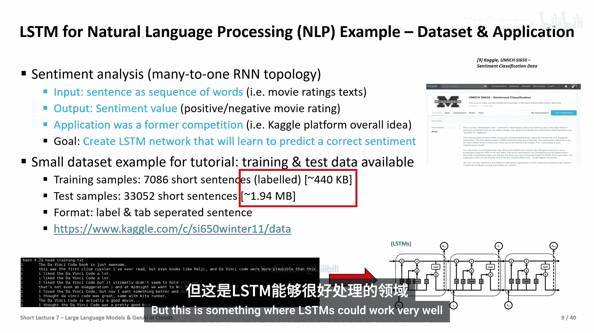

这些模型在处理如情感分析等任务上表现出色。然而，当需要处理更长的文本序列、理解更广泛的上下文或生成高质量内容时，它们的局限性就显现出来。

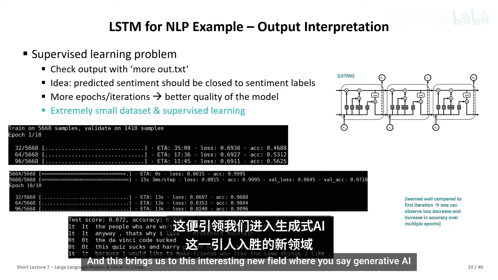

这引出了2017年提出的Transformer模型，其核心创新是**自注意力机制**。该机制允许模型在处理一个词时，权衡句子中所有其他词的重要性，从而更好地捕捉长距离依赖关系。

---

## 大规模语言模型与生成式AI的核心

大规模语言模型通常是基于Transformer架构构建的“基础模型”。它们在海量无标注文本数据上进行预训练，学习语言的通用模式和知识。

这些模型的能力体现在多种下游任务中：
*   **内容生成**：创作文章、故事、代码等。
*   **文档摘要**：快速提炼长文档的核心内容。
*   **翻译**：进行跨语言文本转换。
*   **分类与聊天机器人**：用于客服、信息查询等交互场景。

驱动这些模型的关键是庞大的参数量。参数量与模型能力大致对应关系如下：
*   **1-30亿参数**：适用于简单NLP任务，上下文理解较浅。
*   **70-130亿参数**：可用于聊天机器人、文本摘要，具有中等计算需求。
*   **300亿参数以上**：具备强大的代码生成和多语言翻译能力，需要大量GPU资源。

训练一个1750亿参数的模型（如GPT-3）可能耗资高达1200万美元，这凸显了云计算按需使用资源的优势。

---

## 开发流程：从预训练到任务微调

大规模语言模型的开发通常遵循一个分阶段的流程，这改变了传统的机器学习范式。

以下是典型的LLM开发流程：
1.  **预训练**：在海量通用数据（如网页文本）上训练一个基础模型。这是计算成本最高的阶段。
2.  **对齐与微调**：使用特定领域的数据集（如法律文书、医疗记录）对预训练模型进行微调，使其适应下游具体任务。此阶段常引入**基于人类反馈的强化学习**（RLHF）来优化模型输出，使其更符合人类偏好。
3.  **提示工程与部署**：设计有效的输入提示（Prompt）来引导模型，并将其部署到生产环境（如税务咨询聊天机器人）。

这种流程的核心优势在于**模型复用**。昂贵的预训练只需进行一次，之后可以通过相对低成本的微调来适配各种应用，从而节省大量计算资源和能源。

---

## 挑战与局限

尽管能力强大，大规模语言模型仍面临显著挑战：
*   **幻觉**：模型可能生成看似合理但实际不准确或完全虚构的信息，包括事实性错误或上下文无关的内容。
*   **数据偏见**：模型会继承训练数据中的偏见和不公。
*   **计算与成本**：训练和运行顶级模型需要巨大的算力，费用高昂。
*   **低资源语言困境**：对于冰岛语等语料较少的语言，缺乏足够的高质量数据来有效训练大型模型。
*   **数据隐私与主权**：将敏感数据（如医疗记录）发送至境外云平台进行处理可能违反数据保护法规（如GDPR）。这催生了强调数据本地化和符合地区价值观的“主权云”服务需求。

---

## 主要云服务商的解决方案

所有主流云服务商都已将LLM和生成式AI集成到其服务平台中。

以下是各云厂商提供的服务示例：
*   **微软 Azure**：提供Azure OpenAI服务，集成GPT系列模型，并支持Mistral AI等第三方模型。
*   **谷歌云**：通过Vertex AI平台提供Gemini等模型，并可与BigQuery等数据服务无缝集成。
*   **亚马逊 AWS**：提供Bedrock服务，作为一个统一的平台来访问和微调来自AI21 Labs、Anthropic、Cohere、Meta和Stability AI等公司的多种基础模型。

这些服务通常构建在强大的AI专用基础设施之上，例如AWS的EC2 P5实例（搭载NVIDIA H100 GPU）。然而，使用这些顶级计算资源的每小时成本非常高昂，这使得在云上从头训练大模型对大多数组织而言并不经济，进一步凸显了微调预训练模型策略的重要性。

---

## 研究前沿与本地化实践

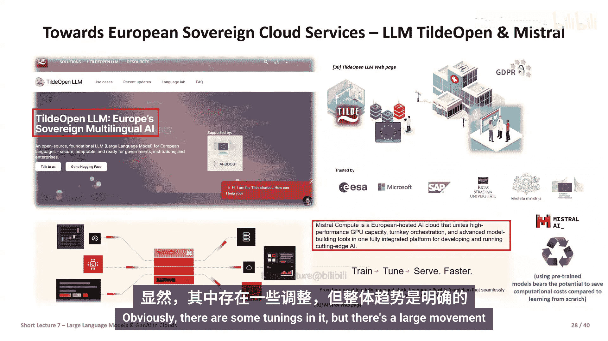

针对上述挑战，全球研究界正在积极寻求解决方案。

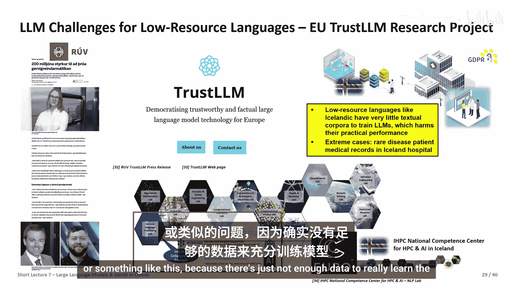

在冰岛，研究团队正致力于解决低资源语言问题。例如，“Trust-LLM”等项目旨在为冰岛语开发可靠的大语言模型。同时，在遥感等领域，研究重点转向**多模态生成式AI**，即模型能够处理和生成图像、雷达数据等多种类型的信息，用于土地覆盖分类等任务。

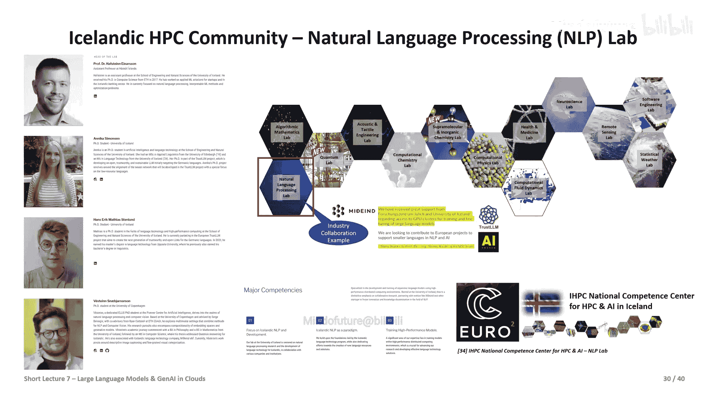

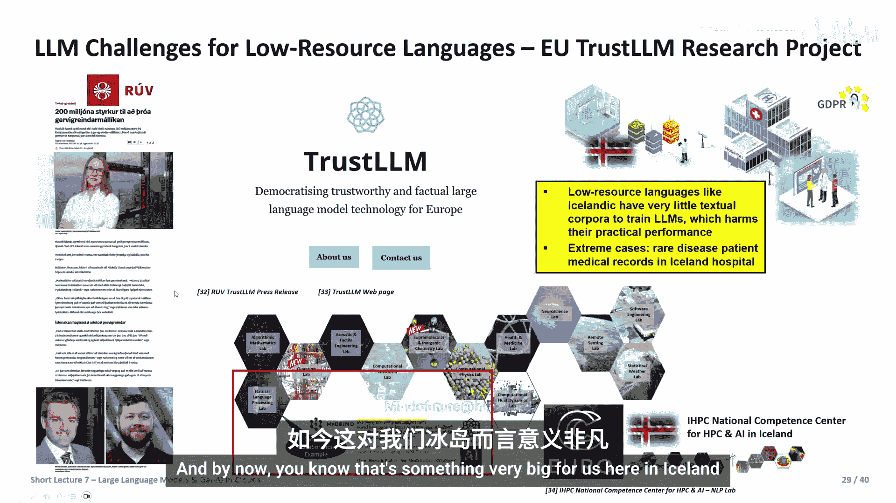

此外，得益于欧盟的资助，冰岛正在推进“AI工厂”等计划，旨在为医疗、气候、能源等关键领域的公共部门开发和应用AI基础模型，特别是专注于提升冰岛语语言模型的技术水平。

---

## 总结

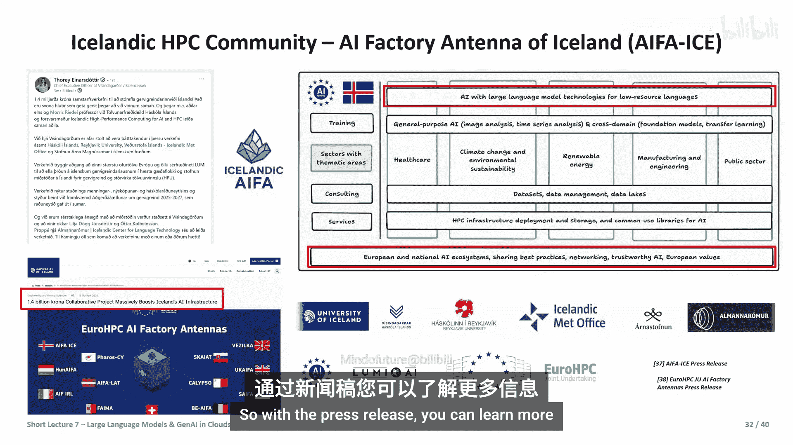

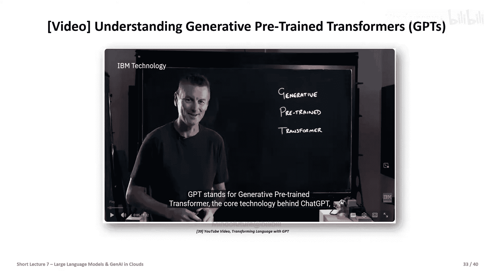

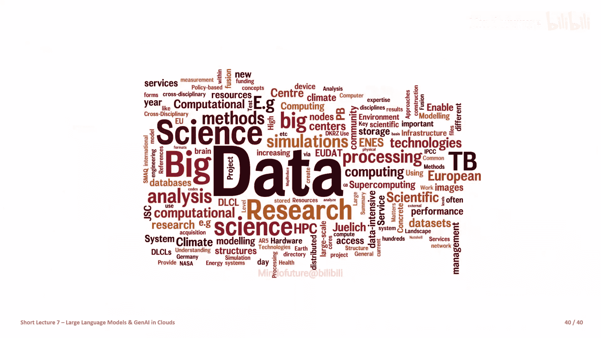

本节课我们一起学习了云中的大规模语言模型与生成式AI。我们回顾了从深度学习到Transformer的演进，理解了LLM的巨大参数量及其带来的计算挑战。我们探讨了从预训练、微调到部署的模型开发生命周期，并认识了“幻觉”、成本、数据隐私等关键挑战。最后，我们了解了各大云厂商如何将LLM作为服务提供，以及研究领域在低资源语言和多模态AI方面所做的努力。生成式AI正在重塑云计算的工作负载格局，理解其原理和生态对于未来至关重要。