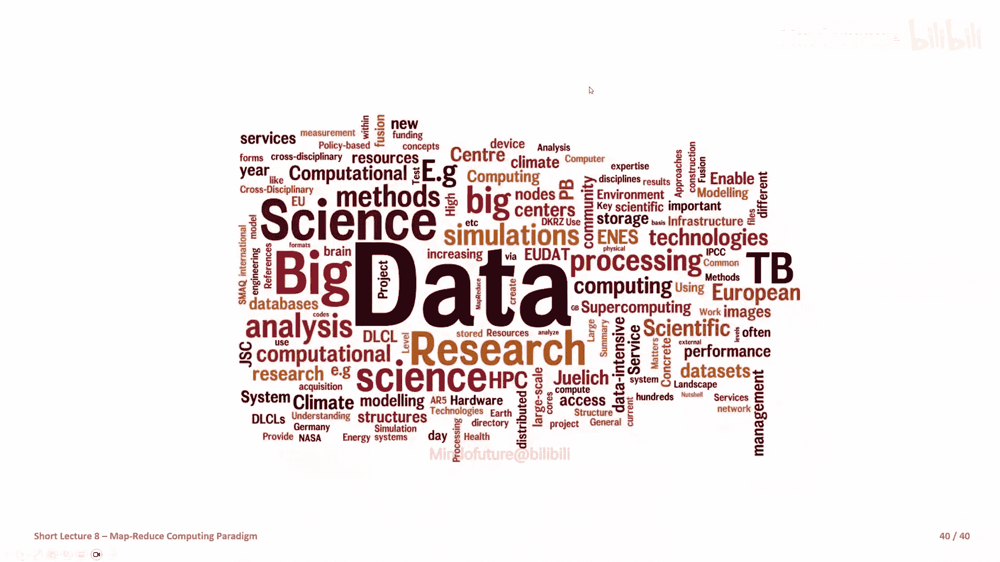

# 014：Map-Reduce计算范式 🗺️➡️🧹➡️📊


在本节课中，我们将要学习Map-Reduce计算范式。这是一种非常经典的计算模型，其思想可以追溯到计算机科学中的“分而治之”原则。我们将探讨它的基本原理、优势、适用场景，并将其与高性能计算进行对比。通过本课，你将理解Map-Reduce如何成为大数据处理生态系统的基石。

## 回顾：从深度学习到大数据处理

上一节我们介绍了生成式人工智能和大语言模型，了解了它们对高性能计算和云资源的巨大需求。这些模型拥有数十亿参数，需要强大的计算能力和海量存储。

本节中，我们将回到一个更基础但同样重要的云计算主题——Map-Reduce。这与我们在课程早期接触的Apache Spark密切相关。Map-Reduce不仅是分而治之思想的体现，更是高吞吐量计算的可行方案。它的优势在于隐藏了计算复杂性，并提高了系统的可靠性，这使得它在大数据生态中非常流行。

## Map-Reduce的动机：从数据分析到大数据分析

理解Map-Reduce，首先要理解大数据分析与传统数据分析的区别。

以下是两者的核心区别：
*   **数据分析**：深入探究数据，寻找因果关系。这通常耗时较长，常见于科学研究。
*   **大数据分析**：更关注发现数据间的相关性，旨在快速发现新规律。这在商业领域能提供快速洞察。


许多大数据分析任务，如网页排名、搜索和社交网络图遍历，其子任务可以独立处理，彼此间无需频繁通信。这与物理模拟等高性能计算任务有本质不同，后者需要计算节点间进行大量、密集的通信。


## 计算范式的对比：HPC vs. HTC

这种任务特性的差异，催生了两种不同的计算范式。


以下是高性能计算与高吞吐量计算的关键区别：
*   **高性能计算**：使用超级计算机，节点间通过高速网络（如InfiniBand）紧密互联。编程复杂，需要处理消息传递、共享内存等。适用于物理模拟、天气预报等强耦合问题。
*   **高吞吐量计算**：使用由廉价商用硬件组成的集群，网络要求不高。任务可以高度并行、独立执行。Map-Reduce正是为此类场景设计，它将复杂的通信和容错机制隐藏在框架内部。

Map-Reduce的理念是“保持简单”，让非技术用户也能轻松处理那些可独立并行的问题，同时系统能自动处理硬件故障、任务重调度等复杂问题。

## Map-Reduce核心思想：三步而非两步

Map-Reduce常被描述为“Map”和“Reduce”两个阶段，但实际上它包含三个核心步骤。

Map-Reduce流程可概括为以下三步：
1.  **Map（映射）**：用户编写映射函数，处理输入数据块，生成一系列中间键值对。例如，在词频统计中，为每个单词输出 `(单词, 1)`。
2.  **Sort-Shuffle-Group（排序-混洗-分组）**：**这是由框架自动执行的关键步骤**。系统会根据中间键（如单词）对所有Map任务的输出进行排序、混洗和分组，将相同键的所有值集中到一起。
3.  **Reduce（归约）**：用户编写归约函数，接收分组后的数据（一个键及其对应的值列表），进行汇总计算并输出最终结果。例如，将 `(单词, [1,1,1,...])` 列表中的所有1相加，得到该单词的总出现次数。

这种设计将复杂的分布式通信和数据重组工作交给了框架，用户只需关注业务逻辑（Map和Reduce函数），极大地简化了并行编程。


## 实例解析：词频统计与推文分析

让我们通过一个具体的例子来理解这个过程。

假设我们分析一系列推文，进行词频统计。Map任务非常简单：每遇到一个单词，就输出 `(单词, 1)`。框架随后会自动将所有相同单词的“1”聚集起来。最后，Reduce任务将每个单词对应的“1”列表求和，得到最终词频。


**伪代码示例**：
```python
# Map 函数
def map_function(document):
    for word in document.split():
        emit(word, 1)

# Reduce 函数
def reduce_function(word, list_of_counts):
    total_count = sum(list_of_counts)
    emit(word, total_count)
```
框架会自动处理 `(word, 1)` 的排序、混洗和分组，使得 `reduce_function` 接收到的是 `(word, [1, 1, 1, ...])`。


## 底层支撑：Hadoop生态系统

Map-Reduce理念最著名的实现是Apache Hadoop。Hadoop不仅是一个计算框架，更是一个生态系统。


以下是Hadoop生态系统的关键组件：
*   **Hadoop MapReduce**：计算引擎，负责调度和执行Map与Reduce任务。
*   **HDFS**：Hadoop分布式文件系统。它是一个高度容错的专用文件系统，默认将数据块复制到多个节点（通常为3份），确保数据可靠性和可用性。它采用主从架构，NameNode管理元数据，DataNode存储实际数据。
*   **YARN**：资源调度器，负责集群资源管理和作业调度。
*   **其他组件**：基于此之上，发展出了Hive（SQL查询）、HBase（NoSQL数据库）、Mahout（机器学习库）等一系列工具，共同构成了大数据处理生态。

Hadoop的设计遵循“将计算移至数据附近”的原则，调度器会尽量将Map任务分配到存储有其所需数据块的节点上执行，以减少网络传输，这特别适合数据密集型应用。

## Map-Reduce的局限与总结


本节课我们一起学习了Map-Reduce计算范式。它是一种强大的工具，但并非万能。

Map-Reduce主要适用于高吞吐量计算任务，其特点是子任务间通信很少或没有。例如，批量数据处理、日志分析、简单的统计汇总等。


然而，对于需要频繁迭代、节点间通信密集的任务，如大多数物理模拟、数值天气预报或复杂的深度学习训练（需频繁同步梯度），Map-Reduce则不是最佳选择。这类任务通常需要像MPI这样的高性能计算编程模型，以及InfiniBand这样的高速互联网络。




总而言之，Map-Reduce是大数据时代处理海量、可并行数据的基石性范式。它通过抽象底层复杂性，提供了一套简单可靠的编程模型，与HDFS等系统结合，共同支撑起了庞大而活跃的大数据生态系统。理解其核心思想、适用场景及局限，对于在云计算与大数据领域构建有效解决方案至关重要。