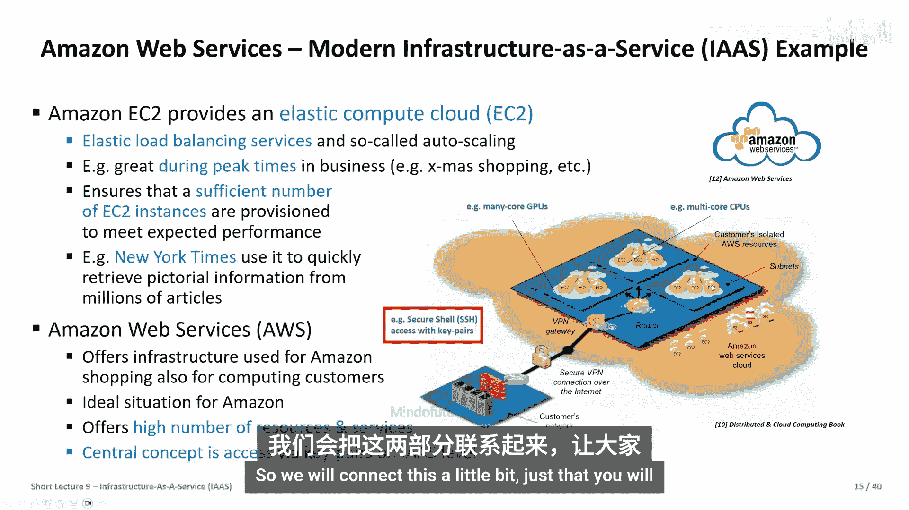
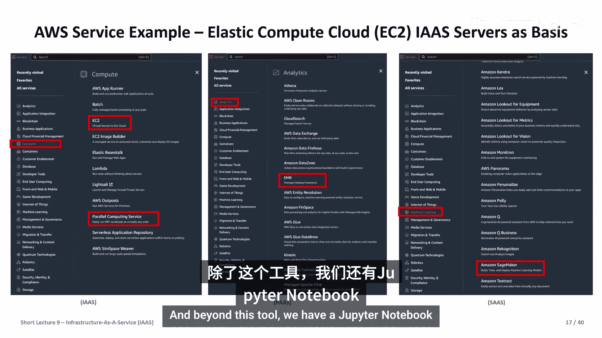
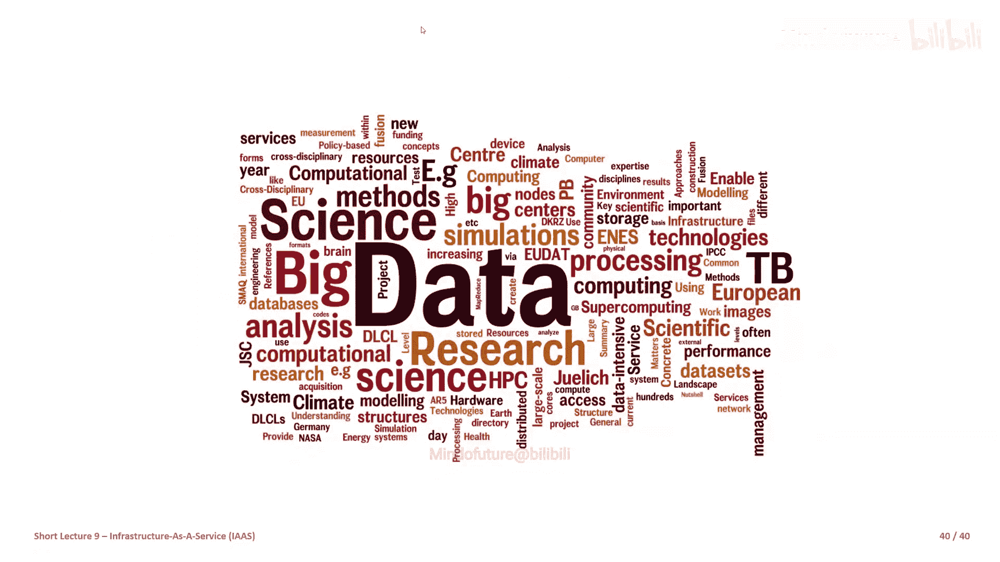

# 015：基础设施即服务 (IaaS) 🏗️

在本节课中，我们将学习云计算服务模型中的基础层——基础设施即服务。我们将回顾上节课的MapReduce概念，并将其与IaaS联系起来，同时探讨公有云、私有云和混合云的区别，并了解IaaS的核心组件、优势以及实际应用案例。

## 回顾：MapReduce与高吞吐量计算

上一节我们介绍了MapReduce这一并行计算范式。本节中，我们来看看它如何与云服务模型相结合。

MapReduce的核心思想源于“分而治之”的传统计算机科学理念。当面临需要分析的大数据问题时，我们可以将其分解为多个小任务，由不同的处理器或工作节点并行处理，最后再将结果合并。

以下是MapReduce的三个核心步骤：
1.  **Map任务**：将大问题分割成小任务。
2.  **分组、排序与混洗**：由框架自动处理中间数据的组织。
3.  **Reduce任务**：合并各个小任务的结果。

这种模式天然具有可扩展性，因为我们可以根据可用资源动态增加工作节点。MapReduce框架（如Hadoop）的设计还包含了容错机制，例如当某个计算节点或Map任务失败时，框架会自动重新提交任务，确保整个应用能够完成，这与传统高性能计算（HPC）中一个错误可能导致整个应用崩溃的情况不同。

此外，Hadoop分布式文件系统通过数据分块和复制方案，确保了数据的可靠性和局部性，进一步支持了MapReduce的容错和高吞吐量计算。

## 理解云服务层级：IaaS、PaaS、SaaS

在深入IaaS之前，我们需要理解云计算的三个基本服务层级。它们面向不同的用户，提供了不同抽象级别的服务。

*   **基础设施即服务**：提供最基础的计算资源。用户可以获取虚拟化的计算能力、块存储和网络资源，就像租用“裸金属”IT资源。用户需要自行管理操作系统、中间件和应用程序。**示例**：Amazon EC2（计算）， Amazon S3（存储）。
*   **平台即服务**：在IaaS之上，提供了一个用于开发、运行和管理应用程序的平台。开发者无需关心底层基础设施，可以专注于应用逻辑。**示例**：Google App Engine， AWS Elastic Beanstalk。
*   **软件即服务**：提供完全成熟的、可通过网络访问的应用程序。最终用户无需安装或管理任何东西，直接使用即可。**示例**：Google Docs， Salesforce， Spotify。

这些层级之间的界限有时是模糊的，取决于使用者的视角。例如，一个预配置了深度学习框架的亚马逊机器镜像（AMI），既可以看作是IaaS（因为基于EC2虚拟机），也可以看作是PaaS（因为它为AI专家提供了一个即用的平台）。

## 部署模型：公有云、私有云与混合云

在讨论服务层级时，还需要区分云的部署模型，这是一个独立但相关的概念。

*   **公有云**：资源由第三方云提供商（如AWS， Azure， Google Cloud）拥有和运营，并通过互联网向公众提供。用户共享底层基础设施。
*   **私有云**：云基础设施专供单个组织使用，可以在本地数据中心或由第三方托管。它提供了更高的控制和安全性，适用于处理敏感数据（如医疗记录、汽车设计）。
*   **混合云**：结合了公有云和私有云，允许数据和应用程序在两者之间共享。这种模式提供了灵活性，例如，企业可以在私有云中运行常规工作负载，而在需求激增时（如年终结算、促销活动）将峰值负载“爆发”到公有云。

这些部署模型可以与任何服务层级（IaaS， PaaS， SaaS）结合使用。

## IaaS详解：核心、优势与案例

现在，让我们聚焦于今天的主角——基础设施即服务。

### IaaS的核心组件

IaaS主要提供以下基础构建块：
*   **计算**：虚拟服务器或实例（如AWS EC2），提供CPU、内存和GPU资源。
*   **存储**：
    *   **对象存储**：用于存储非结构化数据，如文档、图片、视频。通过RESTful API访问。**示例**：Amazon S3。
    *   **块存储**：像硬盘一样挂载到计算实例，用于需要文件系统结构的数据。**示例**：Amazon EBS。
    *   **文件存储**：提供共享文件系统，多个实例可以同时访问。**示例**：Amazon EFS。
*   **网络**：虚拟网络、负载均衡器、IP地址等，用于连接和隔离资源。

### IaaS的核心优势

以下是采用IaaS的主要好处：
*   **按需付费与弹性**：用户只为实际使用的资源付费，并可以根据需求快速扩展或收缩资源，无需前期大量资本投入。这对初创公司尤其有利。
*   **降低运维负担**：用户无需购买和维护物理硬件，由云提供商负责数据中心的运营。
*   **快速创新与部署**：通过信用卡即可在几分钟内获取资源，加速了业务想法的验证和部署。
*   **全球可达性与可靠性**：利用云提供商遍布全球的数据中心，可以就近部署服务，并获得高可用性保障。

### 案例分析：AWS上的服务栈

以亚马逊AWS为例，我们可以看到IaaS如何作为基础支撑起更上层的服务。

一个典型的机器学习应用栈可能包括：
1.  **底层（IaaS）**：使用**EC2**实例（特别是GPU实例如P3， P4， P5）提供计算能力。
2.  **中间层（PaaS）**：使用**Amazon EMR**（托管Hadoop/Spark框架）作为处理大数据的平台。
3.  **顶层（SaaS）**：数据科学家通过**Amazon SageMaker**（一个集成的机器学习开发环境）进行模型训练和部署，而无需关心底层的EC2或EMR。

在这个例子中，SageMaker用户可能完全不知道他们的Jupyter Notebook正在由下层的PaaS和IaaS服务支持。这种分层架构让不同领域的专家（如基础设施工程师、数据平台开发者、AI研究员）可以各司其职，高效协作。

### 成本考量

使用IaaS时需要密切关注成本，因为它会持续累积。以下是一些成本因素：
*   **实例类型**：功能强大的GPU实例（如 `p5.48xlarge`）每小时费用可能高达98美元。
*   **存储类型与访问**：标准对象存储（如S3标准层）比归档存储（如S3 Glacier）更贵，但检索速度更快。API请求次数（GET， PUT）也会产生费用。
*   **数据传输**：数据传入云通常免费，但传出云（以及在不同可用区之间传输）可能产生费用。

## IaaS与MapReduce的部署选择

结合我们之前讨论的MapReduce，企业在部署此类大数据平台时，有多种基于IaaS的选项，需根据自身情况权衡：

以下是几种常见的部署模式：
*   **完全本地部署**：企业自行购买硬件，在本地数据中心安装、配置和运维整个Hadoop/Spark集群。优点是控制力强、数据完全自主；缺点是资本投入高、学习曲线陡峭、运维复杂。
*   **虚拟设备部署**：使用预配置的Hadoop虚拟机镜像在企业的虚拟化环境（如VMware）中部署。降低了安装复杂度，但仍需自行管理虚拟机集群。
*   **托管虚拟化部署**：由服务商提供托管的基础设施（IaaS），企业在其上自行部署和管理MapReduce软件。减少了硬件资本支出，按需付费，但平台软件仍需企业维护。
*   **完全托管服务**：直接使用云提供商提供的MapReduce服务（如 **Amazon EMR**）。这是一种PaaS/SaaS模式，提供商负责所有底层基础设施、平台软件的安装、配置、扩展和运维。企业只需关注自己的MapReduce作业逻辑，实现最大程度的“拎包入住”。

选择哪种模式，取决于企业的数据隐私要求、技术能力、成本预算和对灵活性的需求。

## 绿色计算与冰岛的数据中心 🇮🇸

在考虑IaaS提供商时，可持续性和总拥有成本（TCO）日益成为重要因素。冰岛凭借其独特优势，正在成为数据中心的热门选址地：
*   **100%可再生能源**：电力来自地热和水力发电，碳足迹极低。
*   **自然冷却**：寒冷的气候允许大量使用环境空气冷却，显著降低了传统数据中心中昂贵的制冷成本。
*   **政治与经济稳定**：为数据中心运营提供了可靠的环境。

这些因素使得在冰岛运营的IaaS设施不仅环保，而且在长期运营成本上可能更具竞争力。

## 总结

本节课中我们一起学习了云计算的基础层——基础设施即服务。我们首先回顾了MapReduce的高吞吐量计算范式，然后系统梳理了IaaS、PaaS、SaaS三个云服务层级的区别与联系，并明确了它们与公有、私有、混合云等部署模型是不同的维度。

我们深入探讨了IaaS提供的核心资源（计算、存储、网络），其按需付费、弹性伸缩的核心优势，并通过AWS的实际案例看到了IaaS如何作为基石支撑起更上层的PaaS和SaaS应用。最后，我们分析了MapReduce在IaaS上的不同部署选项，并了解了像冰岛这样的绿色数据中心在提供可持续IaaS方面的独特价值。

下一讲，我们将继续向上探索，学习平台即服务。