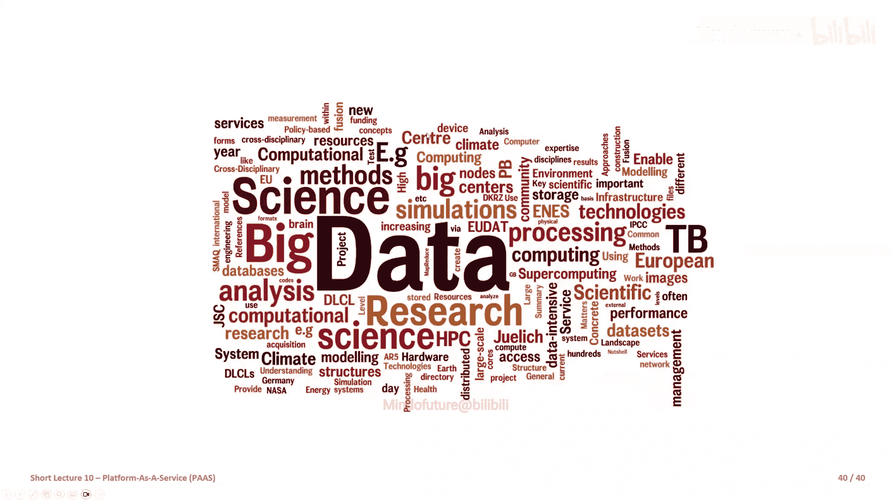

# 016：平台即服务 (PaaS) 🧱

在本节课中，我们将要学习**平台即服务**。我们将基于之前关于基础设施即服务的内容，探讨如何利用可扩展的基础设施来提供更多的平台组件。我们将从开发者的视角，了解PaaS如何提供一系列现成的“乐高积木”式构建块，以简化云应用的开发、部署和扩展过程。

上一节我们介绍了基础设施即服务，它关注的是硬件资源的虚拟化与管理。本节中我们来看看平台即服务，它将视角转向了应用开发。

## 云服务模型回顾

在深入PaaS之前，我们先简要回顾一下云服务模型。当前，一切皆可“即服务”，但本课程中有三个核心术语需要牢记：**基础设施即服务**、**平台即服务**和**软件即服务**。

下图清晰地展示了这三者的关系。软件即服务也可以理解为应用即服务，用户可以直接使用现成的应用，例如企业资源规划、财务应用或客户关系管理工具。

然而，这些SaaS应用本身通常也是由云构建块搭建而成的。平台即服务提供了大量的“乐高积木”，开发者可以将它们组合起来，构建自己独特的SaaS应用。

因此，当我们深入到平台即服务这一层时，视角发生了转变。我们将关注构建云应用所需的核心构建块，这很大程度上与数据相关。

## 从IaaS到PaaS的演进

上一节关于基础设施即服务的讲座，主要思考的是底层基础，即硬件本身。你可以想象一个灵活的、无处不在的云，但其根基是真实的硬件：计算、存储和网络。

平台层就构建在这个基础之上。需要理解的是，IaaS和PaaS之间的界限并非绝对严格。

例如，回顾一下我们上次讨论的EC2。这是亚马逊提供的计算服务，你可以选择所需的服务，如GPU、CPU，并按使用付费。S3对象存储服务也是如此，你无需关心数据具体存储在哪个文件里，只需通过键值对存取数据。

这些服务构成了基础设施的基础。但像AWS存储平台这样的服务，已经处于边界地带，它既提供了底层存储，也作为一种平台，支持你存放数据。

因此，平台即服务很好地承接了这些服务。从开发者的视角看，IaaS涉及大量基础设施的管理、硬件配置和虚拟化，而PaaS则更多地转向应用开发。

这种转变也体现在MapReduce的使用上。你可以在IaaS层面自行搭建MapReduce集群，也可以使用预装的MapReduce设备，或者更进一步，直接使用托管式的MapReduce服务，即MapReduce即服务。这体现了从裸金属、虚拟化逐渐向云端服务的迁移过程。

## 开发者视角与核心构建块

今天，我们将从云应用开发者的视角来理解PaaS。我们将简要讨论不同层级，然后快速进入核心：云解决方案中已经实现了大量的“乐高积木”，开发应用无需从零开始。

我们将以**Google App Engine**为例，看看平台层提供了哪些帮助开发的构建块。当然，这类服务非常多，我们只挑选一些非常核心的，例如NoSQL数据库、键值存储、文档存储等。

所有这些都围绕着**可扩展性**这一核心理念。当我们转向Google云时，目标就是能够轻松扩展，从几个用户迅速增长到数百万用户。这就需要专业的监控、故障管理等，这些都是云应用开发的一部分。

应用还有其生命周期，包括版本控制等，我们也会稍作讨论。当然，完整的应用开发是一门大学问，本讲座只是简要介绍PaaS层的一些关键构建块，包括定价模型，目的是让大家理解：今天，几乎所有功能都已实现，你只需组合这些“乐高积木”，并添加自己独特的价值。

## PaaS概述与开发工具

让我们再次简要回顾，因为我们在第9讲讨论IaaS时，已经谈到了许多虚拟化的IT资源，它们已经处于PaaS的边界。

现在，PaaS的核心思想是真正转向开发视角。如下图所示，在PaaS层面，你可以看到许多现成的构建块，用于创建你自己的应用。

需要说明的是，这不仅适用于Google App Engine，亚马逊、微软Azure等其他云提供商也提供了大量构建块。我们这里主要关注Google App Engine，它在开发支持方面非常强大。

PaaS层本质上包含了对基础设施的访问，如计算、存储和网络服务，但其重点更广泛：我们需要操作所有这些，并需要大量的开发工具、数据库管理、业务分析、机器学习算法等，然后才能构建出完整的托管应用。

在PaaS层面，你会看到许多软件开发工具包、应用程序编程接口，你可以用自己喜欢的语言进行开发，如Java、Python、Ruby等，并伴随着强大的数据管理支持。

## 案例研究：Spotify

一个众所周知的例子是**Spotify**。这款应用几乎由一半以上的课程参与者使用，它正是基于这种利用云服务构建块的理念。

Spotify拥有出色的用户界面，从一家初创公司发展起来，现在拥有海量的授权歌曲。它通过利用其他云供应商的服务来实现大规模扩展，例如使用AWS的Elastic MapReduce和Spark。Airbnb和Spotify都使用这些服务。

这表明你可以很好地混合使用不同云提供商的服务，通过REST接口进行集成。这进入了软件工程的领域。对于想成为平台或应用开发者的人来说，还需要学习软件工程，特别是应用工程的相关课程。

## Google Cloud Platform 与开发生命周期

在Google云平台中，底层仍然是基础设施即服务层，例如虚拟机实例、独特的TPU处理单元、典型的GPU等，它们通常按小时计费。

当你创建云应用时，一切都会在Google Cloud的开发引擎中围绕应用开发进行组织，底层则利用可扩展的IaaS。

这种方式支持了完整的**开发生命周期**。首先，你使用App Engine构建、测试和部署应用。你在本地进行开发，但当你需要向全球扩展时，就必须转向像Google Cloud这样的专业云提供商，它为你提供了大量可扩展的IaaS资源和数据处理能力。

这就是整个开发生命周期的理念：扩展到你的用户规模，并且不让用户察觉到容量不足。然后你利用云在IaaS层面进行扩展。

但今天的重点是思考这些“乐高积木”。在拥有基础设施和应用引擎生命周期支持的基础上，PaaS还包括构建应用所需的乐高积木，以及版本控制、流量监控等全套理念。所有这些都得到了很好的支持，并且本质上是高度可扩展的，因为它由Google Cloud中的IaaS管理。

## PaaS的优势与成本考量

使用PaaS可以大幅削减成本。通常，维护自有基础设施需要管理员、软件专家和存储专家。而使用云服务，例如可以无性能问题地扩展到30TB以上，这需要相当好的基础设施才能实现。

良好的用户体验是关键。通过利用云服务，你可以自动扩展到数百万用户，而不是在自有服务器上进行可能无法顾及扩展性的应用开发。

当然，使用这些服务是有成本的，你需要将其纳入应用的定价模型。但你在版本控制、可扩展的用户体验方面会更加安全。

以下是移动游戏后端可能需要的初始构建块：
*   你需要游戏地图和游戏服务器。你可以使用App Engine及其特定的数据存储服务。
*   操作层面的云监控、日志记录、错误报告和跟踪，帮助你理解应用的使用情况。
*   数据处理和分析构建块，如BigQuery等，用于分析应用运行状况。
*   发布/订阅机制，用于应用内的通信。

这些乐高积木用户通常看不见，但能体验到其带来的可扩展性。许多操作是自动化的，例如可以在凌晨2点自动添加存储，但你需要为此付费。

审视定价选项很重要。云服务中有许多不同的构建块。例如，入站网络流量可能是免费的，这鼓励你将数据迁移到Google Cloud，但如果你想将所有数据移出，则可能需要支付费用，这在一定程度上阻止你轻易迁移到其他平台。

另一个例子是搜索服务。如果你想在应用中使用高性能搜索API，则需要付费。这些单价看起来不高，但考虑到应用7x24小时运行，成本可能会累积。

## NoSQL数据库：核心构建块

现在让我们看看流行的现代PaaS构建块，其中一些已经间接提到过，比如BigTable。今天我想强调的一个核心元素是**NoSQL数据库**。

这些也是极其常用的乐高积木，主要是因为它们通常具有很高的读取性能，写入约束较少，一致性模型不如SQL数据库严格。对于大量只读操作的应用场景，这能显著降低延迟并提高吞吐量。

当然，这并不意味着SQL数据库不再需要。例如，飞利浦Hue智能照明系统就基于Google Cloud的NoSQL数据存储，因为它需要高性能和可扩展性，以处理每天2亿次的事务和2500万条远程照明命令。使用云服务让飞利浦能够专注于产品开发，并以十分之一的人力实现十倍于其他类似项目的规模。

良好的用户体验是关键。像《愤怒的小鸟》这样的游戏之所以成功，部分原因在于其初始版本就能很好地扩展，没有使用问题，这与一些未充分利用云特性的游戏不同。

NoSQL的特性本应是一门完整的大学课程。它简化了应用开发，没有严格的模式约束。在SQL中，你通常以模式开始，而在NoSQL中，更多的是键值对的思想。

云数据存储有点类似，但它没有SQL中那种严格的模式，也没有存储过程和触发器。它以不同的方式描述关系，这使你能够轻松地扩展。

## NoSQL数据库类型举例

以下是一些主要的NoSQL数据库类型：

**Cloud Bigtable**：这是一个非常知名的列式数据库，可以扩展到PB级数据。它底层与Google文件系统类似，但采用更多基于字符串的方法。它不强制要求每个记录都有所有字段，这在处理金融时间序列数据、机器学习等场景中非常有用，可以作为数据流处理的存储平台。

**HBase**：这是一个列式数据库。从概念上看，它仍然像一张表，但物理上，空字段并不存储，从而节省空间。并非每个元素都拥有所有信息。

**MongoDB**：这是一个文档数据库，使用类似JSON的简单符号。数据可以包含不同类型的信息，文档之间可以轻松链接。创建文档非常快速，不像SQL世界那样有严格的模式约束。

**Apache Cassandra**：这是一个键值型数据库，被许多应用使用。它通过设计就是分布式的，可以轻松部署到不同节点，实现地理分布，满足不同国家用户的体验需求。

## 总结与展望

本节课中我们一起学习了平台即服务。由于时间有限，我们只能简要介绍。对于想深入了解的同学，网上有更完整的资源。

总结一下，PaaS能大幅减少编码时间，提供大量开箱即用的开发能力，包括完整的生命周期支持、机器学习、自动化的存储伸缩以控制成本。它支持多平台，采用按需付费模式，并提供了复杂的工具来帮助你了解用户行为，从而改进应用。

开发工具也非常强大，涵盖了云开发者所需的一切。其他案例如沃达丰集团将600个本地Hadoop服务迁移到Google云，Twitter将其本地Hadoop迁移到Google云以降低成本。

最后，我们以《愤怒的小鸟》为例。它在发布后迅速获得1.4亿次下载，这得益于直接采用Google Cloud，从而能够快速扩展。他们使用了Memcached API来提供临时性的高速数据访问，而不是自己开发软件。

此外，自然语言处理、大型语言模型等也可以作为乐高积木轻松集成到你的应用中，例如用于情感分析、文本转语音、翻译等服务。

总而言之，PaaS提供了巨大的优势。无论你将来是成为开发者还是从事其他工作，了解云平台中可用的服务总是有益的。

本节课关于平台即服务的内容到此结束，我们下次将继续讨论更高层级的软件即服务。