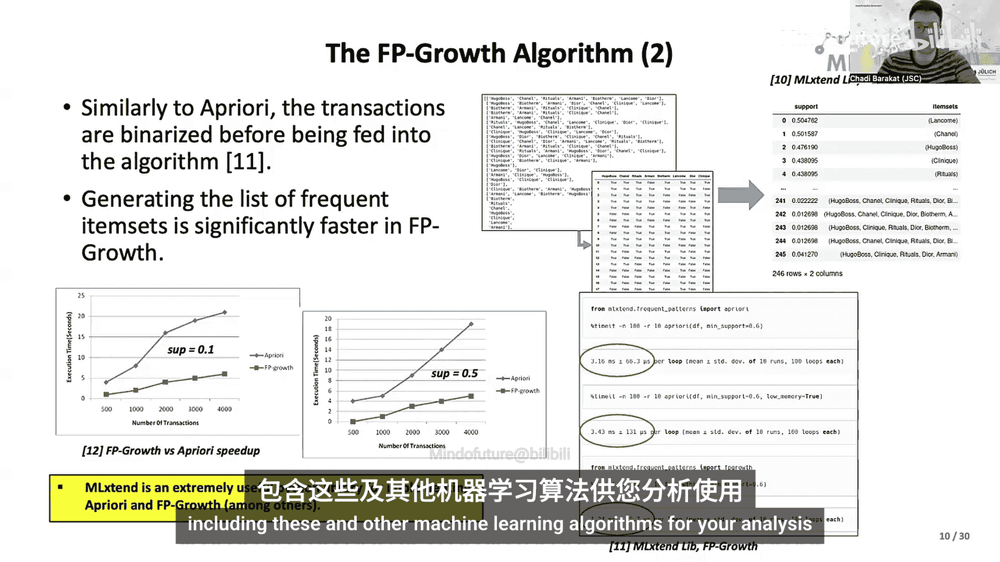
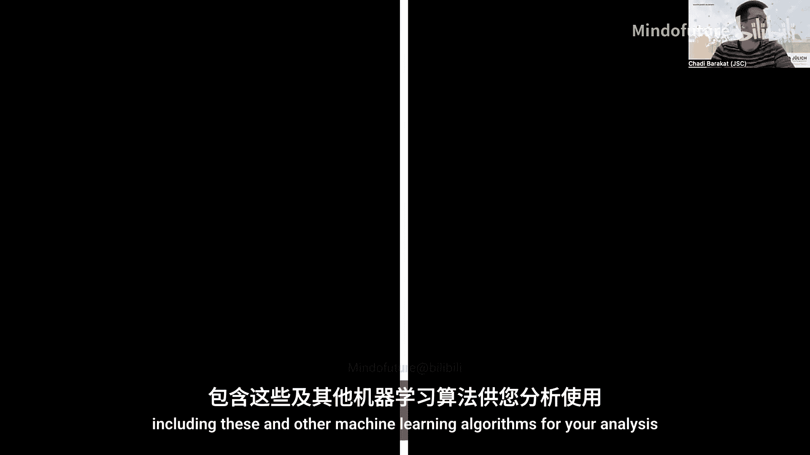
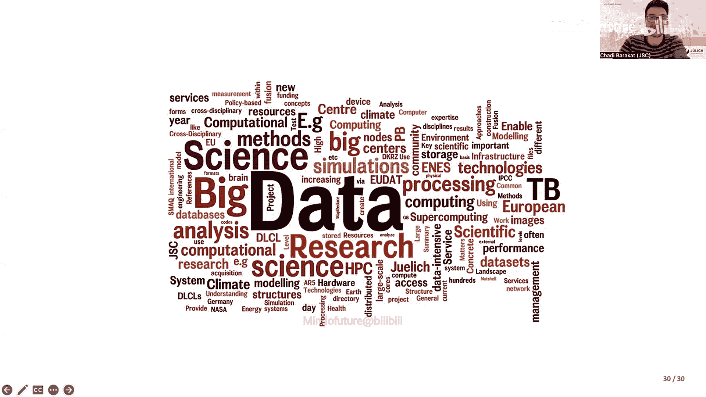

# 017：大数据分析与云数据挖掘 📊


在本节课中，我们将学习大数据分析的两个核心领域：关联规则挖掘，以及深度学习在医疗健康领域的应用。我们将探讨这些技术如何利用云计算资源来处理海量数据，并理解其背后的核心算法与工作流程。

## 关联规则挖掘与大数据

上一讲我们介绍了软件即服务（SaaS），它为在线数据分析提供了强大的平台。本节中，我们来看看如何利用这些服务进行关联规则挖掘。

关联规则挖掘是一种无监督机器学习方法，用于发现数据集中项之间的有趣关系。一个经典的例子是超市购物篮分析，通过分析顾客的购买记录，可以发现诸如“购买尿布的顾客也倾向于购买啤酒”这样的规则。

### 核心算法：Apriori 与 FP-Growth

以下是两种最常用的关联规则挖掘算法。

**Apriori 算法**
Apriori 算法通过迭代扫描事务列表来构建频繁项集。其核心思想是：一个频繁项集的所有子集也必须是频繁的。研究者需要设定一个**最小支持度**阈值，算法会生成所有支持度不低于此阈值的项集。

**伪代码示例：**
```
对于每个项集大小 k:
    生成候选 k-项集
    扫描数据库，计算每个候选的支持度
    保留支持度 >= 最小支持度的项集
    直到没有新的频繁项集产生
```





**FP-Growth 算法**
与 Apriori 的多轮扫描不同，FP-Growth 算法仅需扫描数据库两次。它首先构建一个紧凑的数据结构——FP 树（频繁模式树），然后直接从该树中挖掘频繁项集，效率更高。

**效率对比**
在处理大规模数据集时，FP-Growth 算法通常比 Apriori 算法更高效，因为它避免了生成大量候选集和重复扫描数据库。

### 云服务实现

这些算法已在各大云平台中实现。

以下是部分云服务提供的关联规则挖掘工具示例：
*   **IBM Cloud Pak for Data**： 提供了现成的 Apriori 算法实现作为关联规则节点。
*   **Microsoft Azure**： 通过 MLlib 库支持 FP-Growth 等算法。

用户可以直接在云端调用这些服务，无需在本地安装任何软件，但需要合理配置以控制计算成本。

## 医疗健康领域的数据挖掘与深度学习

接下来，我们将视角转向一个具体的应用领域——医疗健康，看看深度学习如何在此发挥作用。

深度学习，特别是卷积神经网络（CNN），已广泛应用于图像识别、自然语言处理等领域。在医疗领域，它常被用于分析医学影像，辅助医生进行诊断。

### 从问题到解决方案：迭代过程

实施一个机器学习项目并非一蹴而就。它通常遵循一个理解问题、处理数据、建模、评估并不断迭代的过程。

**以医学影像分析为例：**
1.  **理解问题**： 例如，早期诊断急性呼吸窘迫综合征（ARDS）。
2.  **处理数据**： 收集并标注胸部X光或CT影像数据。
3.  **选择与适配模型**： 由于医疗数据通常有限，常采用**迁移学习**。例如，使用一个在大型公共数据集（如ImageNet）上预训练好的CNN模型，移除其最后的分类层，替换为针对ARDS的新分类层，然后用有限的医疗数据对模型进行微调。
4.  **评估与迭代**： 评估模型性能，根据结果返回调整数据、模型参数或问题定义。

### 应对数据挑战：数据增强

在数据量不足时，**数据增强**是一种有效技术。通过对原始训练图像进行旋转、翻转、缩放、裁剪等变换，可以人工扩充数据集，帮助模型学习更鲁棒的特征，防止过拟合。

**代码示例（使用Python的Keras库）：**
```python
from tensorflow.keras.preprocessing.image import ImageDataGenerator

datagen = ImageDataGenerator(
    rotation_range=20,
    width_shift_range=0.2,
    height_shift_range=0.2,
    horizontal_flip=True
)
# 使用 datagen.flow 来生成增强后的批量图像
```

### 标准流程：CRISP-DM

上述所有步骤都契合一个行业标准流程——跨行业数据挖掘标准流程（CRISP-DM）。它强调项目的循环迭代特性，包含六个阶段：业务理解、数据理解、数据准备、建模、评估和部署。始终在这一框架下思考，能确保研究方法的严谨性和结果的有效性。

## 合作与跨学科应用

最后需要强调的是，大数据与人工智能领域的进步极大地依赖于合作。计算机科学的方法正在深刻改变物理学、生物学、医学等众多学科的研究范式。保持开放协作，分享知识与见解，是推动创新和解决复杂问题的关键。



本节课中我们一起学习了关联规则挖掘的核心算法（Apriori和FP-Growth）及其云上实现，并深入探讨了深度学习在医疗数据分析中的应用流程，包括迁移学习和数据增强等关键技术。记住，理解你的数据、清晰定义问题，并在CRISP-DM等标准流程的指导下进行迭代开发，是成功实施任何数据挖掘项目的基石。