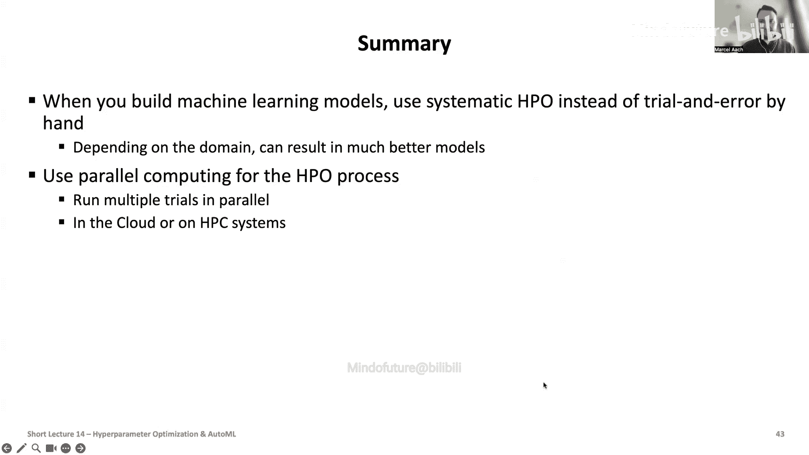

# 018：超参数优化与AutoML 🚀


在本节课中，我们将学习机器学习中两个至关重要的概念：**超参数优化**和**自动化机器学习**。我们将探讨什么是超参数，介绍几种寻找最优超参数的算法，并了解在何种情况下应使用哪种算法。最后，我们将介绍两个实用的工具：Ray Tune和AutoGluon，帮助你实际运行超参数优化任务。

---

## 什么是超参数？🤔

超参数是影响机器学习模型性能的参数。这些参数通常在训练开始前由用户设定。它们可以包括：
*   **架构参数**：例如模型类型、层数和种类、激活函数类型。
*   **优化过程参数**：例如优化器类型、学习率、动量值。
*   **机器学习流水线参数**：例如在计算机视觉任务中，图像的旋转、裁剪、归一化等预处理步骤的参数。

为了更清晰地理解，我们可以将参数调优分为三个预定义的领域：
1.  **神经架构搜索**：专门处理架构参数。
2.  **经典超参数优化**。
3.  **自动化机器学习**：在超参数优化基础上，增加了对整个机器学习流水线的优化。

找到好的超参数对模型成功至关重要。为了直观展示，下图是一个在CIFAR-10数据集上训练的简单残差网络的学习曲线。可以看到，仅通过选择正确的学习率，模型性能就能产生天壤之别——从准确率超过80%到完全失败（仅10%的验证准确率，相当于随机猜测）。

这些图表也揭示了超参数选择为何如此困难：通常无法做出通用预测。你无法简单地说“大学习率好”或“小学习率好”，必须找到或接近正确的值才能获得良好性能。

---

## 核心概念与挑战 🎯

在深入之前，我们先明确一些术语：
*   **搜索空间**：指超参数及其采样区间的集合。
*   **配置**：从搜索空间中采样得到的一组超参数值。
*   **试验**：使用一组采样的超参数配置运行一次训练过程。

超参数优化之所以困难，主要原因有两点：
1.  **搜索空间复杂**：通常包含不同类型（离散如层数、连续如学习率）的参数，无法像梯度下降那样计算梯度来寻找最优解。
2.  **计算成本高昂**：只有完全训练模型后，才能确定其配置的性能。这意味着必须完整训练大量模型才能找出最佳参数。

由于缺乏通用的指导方法，目前很多工作仍依赖于人工试错。但我们的目标是采用更系统化的方法。

---

## 超参数优化算法 🔍

### 基础方法：随机搜索与网格搜索

最简单的方法是**随机搜索**或**网格搜索**。
*   **随机搜索**：从超参数搜索空间中随机采样。
*   **网格搜索**：评估所有可能的超参数组合。

有趣的是，随机搜索是一个非常好的起点。当你对问题一无所知时，至少应该进行一些随机搜索。这两种方法本质上都是“令人尴尬的并行”任务，不同试验之间几乎不需要通信。

然而，这两种方法会浪费大量计算资源在那些可能早期就表现不佳的试验上。因此，我们需要更高效的方法。

---

### 加速优化：自适应方法

有两种主要途径来加速随机或网格搜索过程：
1.  **自适应选择配置**：使用贝叶斯优化或进化算法等选择更好的配置进行评估。主要挑战在于高维搜索空间可能使这些方法失效。
2.  **自适应调度试验**：提前终止表现不佳的试验，并将其计算资源重新分配给更有希望的试验。这是我们本节课的重点。

自适应调度的核心问题是：在缺乏先验信息的情况下，如何判断一个试验的好坏？

观察一些计算机视觉模型的学习曲线可以发现，通常在训练早期（例如前50个周期），通过比较不同试验的曲线，就能初步判断其优劣。当有多个试验并行运行时，这种比较成为可能，由此引入了**连续减半**算法。

---

### 连续减半与超带算法

**连续减半**的基本思想很简单：早期终止不良试验，将资源重新分配给更有希望的试验。实践中，流程如下：
1.  从一定数量的初始配置开始。
2.  训练几个周期后，根据验证损失或准确率对所有试验进行相对排名。
3.  终止排名靠后（例如后50%）的试验，仅继续训练排名靠前（如前50%）的试验。
4.  重复此过程，最终希望得到损失最低的单个试验。

随之而来的关键问题是：如何平衡计算资源？是应该在初期运行更多试验以进行探索，还是应该让最佳试验运行更长时间以进行利用？

**超带算法**通过执行具有不同“激进程度”的连续减半来扩展经典方法。例如，第一轮可能每20个周期削减一次，下一轮则每40个周期削减一次。希望通过不同激进程度的配置，也能捕捉到那些起步较慢但后期强劲的试验。

---

### 异步超带算法

在拥有大量并行资源（如高性能计算系统或云环境）的场景下，经典超带算法可能遇到性能问题。原因在于每个决策点都存在隐式的时间屏障：为了判断试验好坏，必须等待所有其他训练运行达到相同的周期数。

**异步超带算法**解决了这个问题。其核心思想是：在每个决策点，算法查看所有已有性能信息的试验的当前状态。如果一个试验属于当前最佳部分，则允许其继续；如果属于较差部分，则将其停止；如果算法不确定，则继续训练以确保不会过早终止一个有潜力的快速试验。

---

### 自适应选择方法：贝叶斯优化

除了自适应调度，另一种主流方法是**自适应选择配置**，其中最突出的是**贝叶斯优化**。

其思想是构建一个计算成本低廉的**代理模型**，来模拟原始大型机器学习模型的性能。存在许多使用不同贝叶斯方法的算法和库，例如SMAC、Dragonfly、Optuna或DEHB。

这些库面临的主要挑战是如何处理大量并行结果，因为贝叶斯优化通常是顺序过程。此外，贝叶斯优化有时在高维搜索空间中也会遇到问题。不过，像SMAC、Dragonfly、Optuna，尤其是DEHB，都非常注重工作负载的并行化。

当然，也可以将贝叶斯优化与我们之前看到的超带方法结合起来，这种算法被称为**BOHB**。

---

## 如何选择算法？📊

了解了多种方法后，自然要问：何时使用哪种算法？以下是一个基于经验总结的决策流程：

1.  **查看搜索空间维度**：
    *   如果超参数很少（≤2个），网格搜索或随机搜索仍然可行。网格搜索更有条理但计算量更大。两者都是很好的起点，并且在并行设置中运行良好。
2.  **搜索空间较大时（通常>3个参数），查看每次试验所需的计算时间**：
    *   如果计算资源充足且每次试验时间很短（<5分钟），即使对于较大搜索空间，仍可进行随机搜索。
    *   但深度学习模型通常训练数小时，因此需要依赖**自适应调度方法**以提高计算效率。
3.  **判断你的问题是否是“后发学习者”**：
    *   “后发学习者”指模型性能的最大提升发生在训练中后期。虽然超带和异步超带算法试图避免过早终止好试验，但仍可能错过最优组合。
    *   不过，大多数机器学习问题的学习曲线在训练初期提升最大，因此通常可以安全使用超带或异步超带算法。
4.  **考虑你想要运行的试验数量**：
    *   如果试验数量相对较少（例如<200次），依赖贝叶斯优化方法（或与超带结合的BOHB）非常高效。
    *   如果搜索空间非常大且需要运行大量试验，那么你可能需要回到随机搜索或异步超带算法，因为计算需求迫使你依赖这些自适应调度方法。

---

## 其他优化方法与实用技巧 💡

除了上述方法，还有一些完全不同的优化思路：
*   **强化学习**：使用强化学习智能体选择超参数组合，并将试验性能作为奖励。
*   **梯度下降**：对架构搜索空间进行特殊表示，从而可以计算梯度并使用梯度下降进行优化，这通常是非常高效的方法。
*   **零成本代理**：研究诸如神经网络参数总数等“零成本代理”指标与最终模型性能的关系，并以此进行预测，这种方法效果出奇地好。
*   **大模型超参数优化**：在只能负担一次大型训练的大模型时代，通常的做法是在小模型上寻找最优超参数，然后通过某种方式将这些参数迁移到大模型上。

以下是一些实用的超参数优化技巧：
*   **联合优化**：如果计算资源允许，尝试同时优化神经架构和经典超参数，因为它们通常相互影响。
*   **调整减半激进程度**：在实践中，通常只需保留排名前30%甚至25%的试验，终止其余部分，可以节省大量计算资源。
*   **谨慎对待批量大小**：不要将批量大小视为超参数。通常，较小的批量大小能带来更好的泛化性能，但需要更多计算。建议将批量大小增加到单个GPU能处理的最大值，然后专注于优化学习率，因为两者存在关联。
*   **精心选择搜索空间区间**：例如，权重衰减这个超参数非常敏感。如果该参数过小或过大，即使其他参数（如学习率）已处于最优位置，所有试验也可能表现不佳。
*   **使用独立的数据集**：进行超参数优化时，你需要三个独立的数据集：
    1.  **训练集**：用于训练模型。
    2.  **验证集**：用于验证性能，并据此选择最佳超参数组合。
    3.  **测试集**：用于最终评估在验证集上找到的最佳超参数模型，并报告其性能。

---

## 实践工具介绍 🛠️

上一节我们介绍了超参数优化的核心算法，本节中我们来看看两个可以用于实际运行超参数优化的工具：Ray Tune和AutoGluon。

### 工具一：Ray Tune

**Ray** 是一个通用的Python分布式计算框架，它提供了简单的原语来运行分布式应用。其卖点在于，只需对代码进行极少修改，就能将其从单机运行扩展到在大型机器上并行运行。Ray本身是开源的，由科技公司Anyscale维护。

在Ray生态中，**Ray Tune** 专注于分布式超参数调优。它支持多种机器学习框架（如PyTorch、TensorFlow，以及scikit-learn等），可以与Weights & Biases集成以获得美观的日志图表，并且内置了多种超参数优化算法（如异步超带、BOHB等）的兼容性。

**工作原理**：
1.  首先启动一个“头节点”。
2.  然后启动多个连接到头节点的“工作节点”。
3.  头节点负责在每个工作节点（例如，每个GPU对应一个工作节点）上调度和启动试验。
4.  工作节点定期将指标（如当前训练/验证准确率）报告回头节点。
5.  头节点基于这些信息运行优化步骤，决定终止哪些试验、继续哪些试验。

**集成示例**：
```python
import ray
from ray import tune

# 初始化Ray
ray.init()

# 设置超参数搜索空间
config = {
    "lr": tune.loguniform(1e-4, 1e-1),
    "batch_size": tune.choice([32, 64, 128]),
    "num_layers": tune.randint(1, 5)
}

# 选择调度器（如异步超带）和优化指标
scheduler = tune.schedulers.AsyncHyperBandScheduler(time_attr="training_iteration", metric="accuracy", mode="max")

# 定义每个试验的资源（例如在HPC系统上）
resources_per_trial = {"cpu": 30, "gpu": 1}

# 运行调优
analysis = tune.run(
    your_training_function,
    config=config,
    scheduler=scheduler,
    num_samples=100,  # 尝试100组配置
    resources_per_trial=resources_per_trial
)

# 关闭Ray
ray.shutdown()
```
运行结束后，可以将结果导入Weights & Biases查看可视化图表，或简单保存到CSV文件。

Ray的一个优点是，你不仅可以并行运行不同的试验，还可以使用像PyTorch DDP这样的框架，将单个试验本身分布到多个GPU上进行训练，从而实现两级并行，获得显著的加速。

---

### 工具二：AutoGluon

**AutoGluon** 由亚马逊开发，其特别关注点是**表格数据**和**时间序列预测**。如果你处理的是这类数据，这个工具可能非常适合你。

AutoGluon的核心思想是，在底层自动组合不同的先进模型（如各种回归模型、提升算法、神经网络），最终形成一个加权集成模型进行预测。这种方法的优势在于，通过结合多种方法，通常能获得非常好的性能。缺点则是可能损失一些可解释性。

近期，AutoGluon还将**Chronos**集成到了其优化流水线中。Chronos是一个基于Transformer架构的基础模型，在大量真实和合成的时间序列数据上进行了预训练，因此对于你提供的任何时间序列数据都有很强的预测能力。

AutoGluon的另一个优点是，它不仅提供点预测，还包含**概率预测**，给出分位数以帮助你评估预测的准确性，从而了解模型对其预测的置信度。

---

## 总结 📝

本节课中，我们一起学习了超参数优化与自动化机器学习。

我们了解到，在构建机器学习模型时，应使用系统化的超参数优化方法，而非依赖人工试错。根据你所处的领域，这可以显著提升模型性能。

同时，我们也鼓励你利用并行计算资源来进行超参数优化，以便能够同时运行多个试验。通过本节课介绍的Ray Tune和AutoGluon等工具，无论是在云平台还是高性能计算系统上，都可以轻松实现这一点。



希望本教程能帮助你更高效地进行机器学习模型开发。