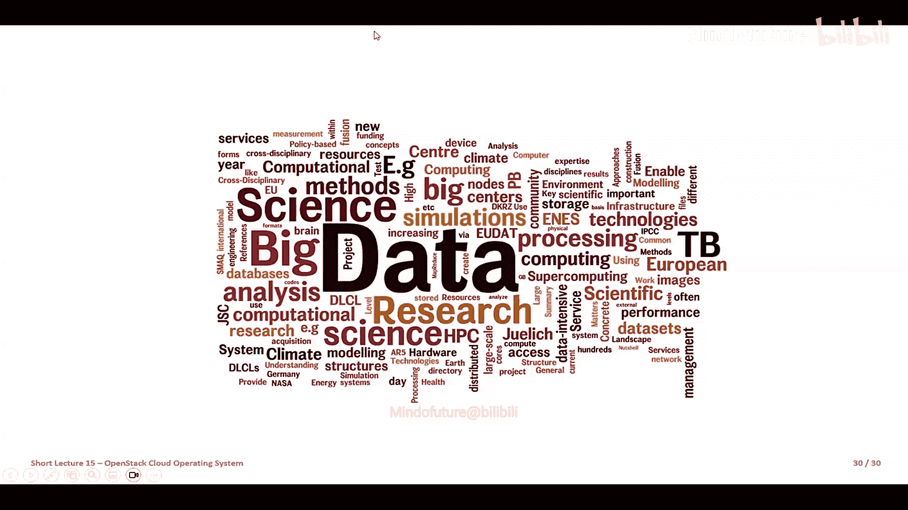

# 019：OpenStack云操作系统 🖥️

在本节课中，我们将学习OpenStack云操作系统。OpenStack使我们能够创建自己的私有云，而不是依赖AWS、微软Azure或谷歌云等超大规模公有云。这对于需要在组织内部处理敏感数据（如医疗或汽车行业）的场景尤为重要。我们将了解OpenStack的核心组件、它如何帮助应对构建云基础设施的挑战，以及它如何与我们已经学过的概念（如虚拟化、容器化和大数据分析）相结合。

上一节我们回顾了超参数优化和自动化机器学习的概念。本节中，我们来看看如何从云使用者的视角，切换到云构建者的视角。

## OpenStack概述

OpenStack是一个开源的云操作系统，它提供了构建和管理私有云或混合云所需的一系列组件。作为一个由开放基础设施基金会支持的项目，它具有稳定性和可持续性。使用OpenStack，组织可以避免从零开始构建云，而是利用其丰富的模块化服务。

## 构建私有云的挑战与需求

当决定在组织内部构建私有云时，需要应对多项挑战。OpenStack通过其组件集帮助解决这些挑战。

以下是构建云基础设施时需要满足的一些关键可扩展性指标：

*   **规模可扩展性**：指物理硬件（如处理器、存储）的增减能力。
*   **软件可扩展性**：确保各种库、编程环境、机器学习框架（如PyTorch、CUDA）与底层硬件（如GPU）兼容并能跨集群部署。
*   **应用可扩展性**：指应用程序本身根据负载动态扩展的能力，例如MapReduce中根据数据量增减工作节点。
*   **技术可扩展性**：指基础设施能够融合不同代际的技术（例如，混合使用A100、Grace Hopper和Blackwell等不同代际的GPU）。

## OpenStack核心组件

OpenStack包含众多服务，其核心围绕计算、网络和存储这三大资源池展开。

以下是OpenStack的一些核心服务及其功能：

*   **计算服务**：
    *   **Nova**：管理虚拟机实例的生命周期，是主要的计算服务。
    *   **Zun**：提供容器管理服务，支持Docker等容器技术。
*   **存储服务**：
    *   **Swift**：提供对象存储服务，类似于亚马逊S3。
    *   **Cinder**：提供块存储服务，类似于亚马逊弹性块存储。
    *   **Manila**：提供共享文件系统服务。
*   **网络服务**：
    *   **Neutron**：管理网络连接，提供软件定义网络功能。
*   **镜像服务**：
    *   **Glance**：存储和管理用于创建虚拟机或容器的镜像模板。
*   **身份认证服务**：
    *   **Keystone**：提供身份验证和授权服务，管理用户和权限。
*   **仪表板服务**：
    *   **Horizon**：提供基于Web的用户界面，方便用户管理云资源。
*   **编排服务**：
    *   **Heat**：提供编排服务，用于自动化部署和管理复合云应用。

## OpenStack实践示例

通过组合不同的OpenStack服务，可以构建出类似公有云功能的基础设施。

### 示例1：模拟亚马逊EC2（基础设施即服务）

要提供类似亚马逊EC2的虚拟机服务，需要多个OpenStack服务协同工作。

以下是实现此功能所需的关键服务交互：

1.  用户通过**Horizon**仪表板或API发起请求。
2.  **Keystone**对用户进行身份验证。
3.  用户从**Glance**中选择一个预定义的镜像（例如，包含深度学习框架的镜像）。
4.  **Nova**计算服务接收请求，并调度到合适的物理主机上启动虚拟机实例。
5.  **Neutron**为虚拟机配置网络连接。
6.  **Cinder**或**Swift**可为虚拟机提供额外的块存储或对象存储。
7.  （可选）**Heat**服务可以编排整个虚拟机的创建流程。

### 示例2：支持容器化应用

对于容器化应用，OpenStack提供了相应的服务。

**Zun**服务专门用于管理容器。它可以直接在物理主机或虚拟机上启动和管理容器，与**Keystone**、**Neutron**和**Glance**等服务集成，为容器提供网络、身份验证和镜像支持。这可以与Kubernetes结合使用，构建更强大的容器平台。

### 示例3：构建大数据分析平台（如Hadoop/Spark）

OpenStack可以轻松部署大数据框架。例如，部署Hadoop集群时，可以利用OpenStack的服务映射其架构。

以下是Hadoop核心组件与OpenStack服务的对应关系示例：

*   **NameNode** 和 **ResourceManager**：这些主节点可以运行在由**Nova**管理的虚拟机上，并使用**Cinder**块存储来保存元数据。
*   **DataNode** 和 **NodeManager**：这些工作节点同样由**Nova**管理，并使用**Swift**对象存储或**Cinder**块存储来保存实际数据块。**Neutron**确保所有节点间的网络连通性。

这种架构使得企业可以在自己的私有云中运行大数据工作负载，处理敏感数据，同时享受云的可扩展性和灵活性。

## 市场与社区

OpenStack拥有一个活跃的社区和丰富的生态系统。OpenStack Marketplace提供了大量预配置的解决方案和“样本配置”，例如一键部署Hadoop或Spark集群。这极大地简化了部署流程，用户无需从头开始配置每一个组件。

本节课中我们一起学习了OpenStack作为云操作系统的核心概念。我们了解到OpenStack如何通过模块化服务（计算Nova、存储Cinder/Swift、网络Neutron等）帮助组织构建私有云，应对可扩展性挑战。我们还探讨了它如何模拟公有云服务（如EC2）、支持容器化以及部署大数据分析平台。掌握OpenStack的基本原理，为你在未来可能需要设计或管理企业私有云时奠定了重要的基础。