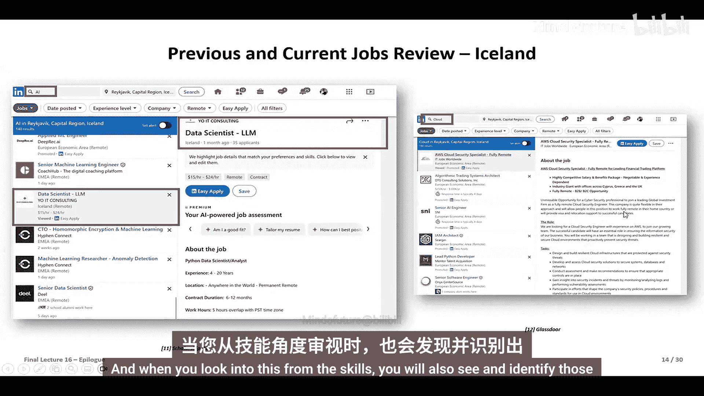
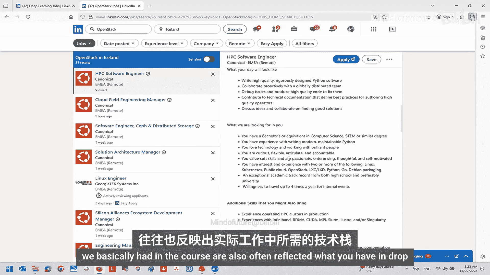
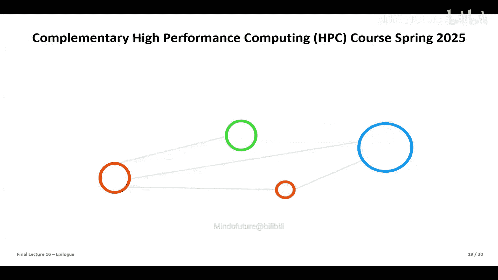
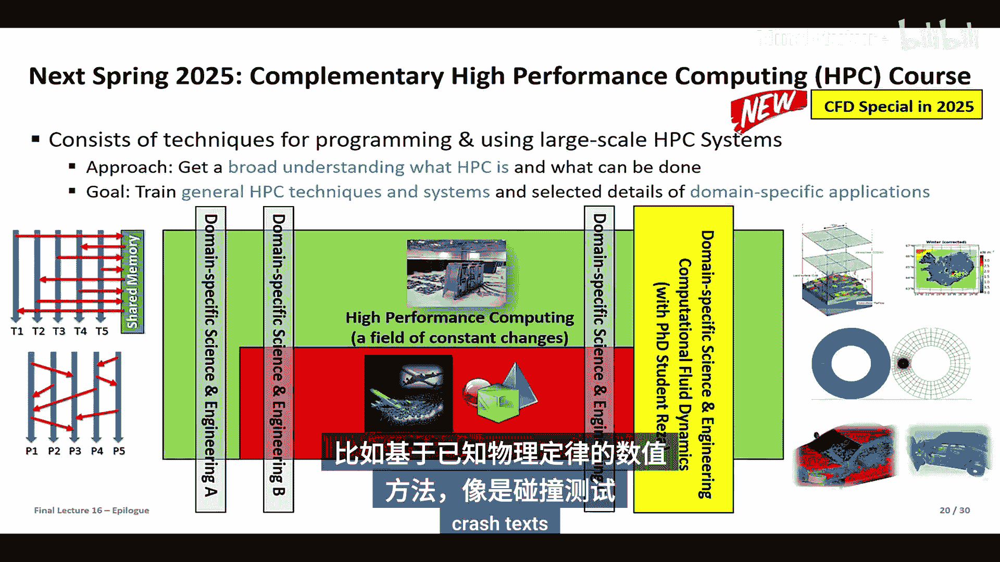
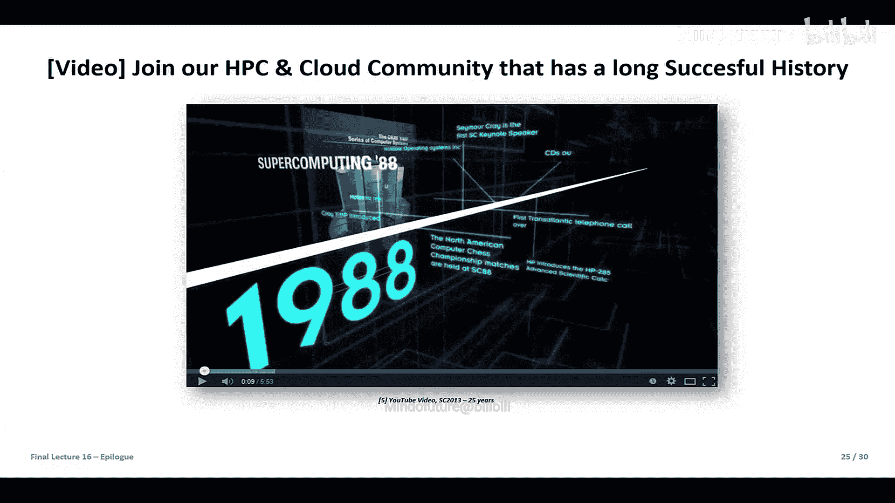
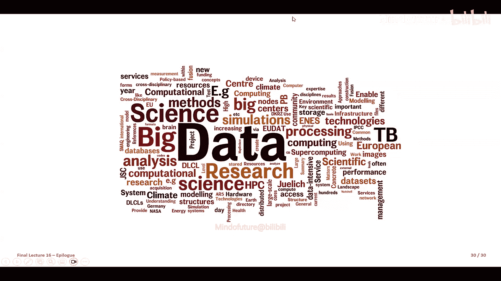

# 020：课程总结与展望 🎓

在本节课中，我们将回顾整个课程的核心内容，并从长远视角和就业市场的角度，探讨所学知识如何转化为实际技能。我们将总结关键的理论、技术与范式，并展望未来的学习方向。

---

## 课程内容回顾

上一节我们探讨了构建私有云和混合云的动机与方案。本节中，我们来看看如何将整个课程的知识体系串联起来，并理解其在现实世界中的应用价值。

我们学习了，当面临在组织内部构建私有云的需求时（例如出于数据敏感性、法规遵从性或成本考量），可以使用如OpenStack这样的开源平台。OpenStack提供了计算、网络和存储等核心服务组件，使我们能够构建类似公有云（如AWS、Azure）的基础设施即服务（IaaS）环境。

**核心概念示例：混合云架构**
```
公有云服务 (如AWS S3, EC2) <--> [API/容器] <--> 私有云 (基于OpenStack)
```
这种架构允许在公有云进行测试和开发，然后将应用容器（如Docker）无缝迁移到私有云中处理敏感数据。

然而，构建私有云也意味着需要承担底层硬件采购、维护升级（如GPU从V100到Blackwell架构的迭代）以及专业团队管理的成本。因此，需要在公有云的便利性与私有云的控制性之间做出权衡。

---

## 学习成果与技能映射

从课程中，我们获得了多方面的能力，这些能力直接对应着就业市场的需求。

以下是课程涵盖的核心技能领域：

1.  **思维模式**：理解了云计算的各个组件和不同层面，包括基础设施、平台和软件即服务（IaaS/PaaS/SaaS）的范式。
2.  **技能组合**：掌握了具体云系统服务（如AWS EC2、Azure HDInsight、Google Colab）的实践操作知识，能够直接应用于工业界或学术界的项目。
3.  **工具集**：接触并探索了多个主流云平台（AWS, Azure, GCP）及其工具，同时也认识到这些工具在快速演进，需要持续学习。

需要明确的是，本课程侧重于**在云平台上规模化运用机器学习和数据处理工具**。要深入理解机器学习算法本身（如应对过拟合、偏差、模型选择等），建议进一步学习专门的机器学习课程。

---

## 持久的理论与技术

大学课程的价值之一在于传授那些能够经受时间考验的范式、理论和技巧。

### 核心理论

*   **并行与分布式算法**：例如分布式深度学习中的梯度交换，用于加速训练过程。其加速效果受限于串行部分，遵循一定的定律（如阿姆达尔定律）。
*   **可扩展性设计**：这是云的核心特性，意味着服务需要能够优雅地应对用户、数据和计算资源量的增长。
*   **容错性**：硬件故障是必然的。我们学习了通过**数据复制**（如HDFS中默认的3副本机制）等策略来保证系统的高可用性。
*   **数据挖掘算法**：例如FP-Growth，用于从大规模数据（如购物清单）中高效发现频繁模式。
*   **统计学习理论**：理解假设空间（如SVM、神经网络、Transformer）、模型容量与数据量的匹配关系，这是避免过拟合等问题的理论基础。
*   **深度学习算法**：涵盖了卷积神经网络（CNN）、Transformer等，并展望了如物理信息神经网络（PINN）等前沿交叉领域。

### 关键技术

*   **规模经济**：大型数据中心通过集中采购、运维，能显著降低单位计算成本。
*   **内存优化**：利用内存（如Spark RDD、GPU HBM）进行计算能获得最佳性能，但也需权衡其较高的成本。
*   **计算找数据 vs 数据找计算**：这是两种核心范式。MapReduce代表“计算找数据”，适合高吞吐量批处理；而传统高性能计算（HPC）常是“数据找计算”，将数据移至超级计算机进行处理。
*   **云部署模型**：公有云、私有云、混合云的概念及实现（如通过OpenStack）。
*   **分布式文件系统与复制方案**：用于数据持久性、高可用和灾备。
*   **基础设施虚拟化**：通过虚拟机或容器（如Docker）实现资源的共享、隔离和灵活调度，提高利用率。

### 核心范式

以下范式在可预见的未来仍将保持其重要性：

*   **高吞吐计算 vs 高性能计算**：高吞吐计算关注在大量独立任务上实现最大数据处理速率；高性能计算则关注通过紧密协作加速单个复杂计算任务。
*   **MapReduce**：一种经典的“分而治之”编程模型，包含Map、Shuffle、Reduce阶段，适用于大规模数据集批处理。
*   **服务模型**：基础设施即服务（IaaS）、平台即服务（PaaS）、软件即服务（SaaS）的分层模型，服务于不同角色的用户（管理员、开发者、终端用户）。

---

## 就业市场与未来学习

课程中涵盖的技能在当前的招聘市场上需求旺盛。

以下是来自LinkedIn等平台的职位要求示例，它们直接对应了我们的课程内容：

*   **机器学习工程师**：要求具备“云平台（AWS、GCP、Azure）经验”以及“部署机器学习模型到生产环境”的能力。
*   **云/基础设施工程师**：要求熟悉“Kubernetes、OpenStack”以及“大规模多云平台的挑战”，并了解主要公有云厂商。

我们的行业项目和实践作业（如黑客松）为你提供了宝贵的实践经验，值得写入简历。



如果你对深入研究感兴趣，在机器学习、深度学习与云计算的交叉领域，仍有大量的硕士、博士课题可供探索，例如大语言模型（LLM）的规模化训练与优化。

为了保持竞争力，请务必持续关注云平台的新服务（如各厂商推出的大模型服务）和硬件发展（如新一代GPU）。可以通过课程网站、YouTube频道、LinkedIn上的冰岛高性能计算社区（EHPC）等渠道保持联系并获取最新信息。



---

## 总结与致谢

本节课中，我们一起回顾了“云计算与大数据”课程的全貌。我们从具体的云服务操作，深入到支撑这些服务的理论与技术，最后上升到通用的计算范式。我们也将所学知识与就业市场的实际需求联系起来，为你未来的职业或学术发展提供了清晰的路径图。





感谢你选修这门课程。教学相长，你们在行业项目中的反馈也帮助我们不断优化课程。祝愿各位在未来的求职市场或学术道路上一切顺利。如果你需要推荐信或有进一步的问题，欢迎联系。我们可能在未来的学术会议或社区活动中再见！



也衷心感谢广大YouTube社区观众的支持，你们的关注使得这门课程的内容产生了更广泛的影响。



再见，祝你好运！