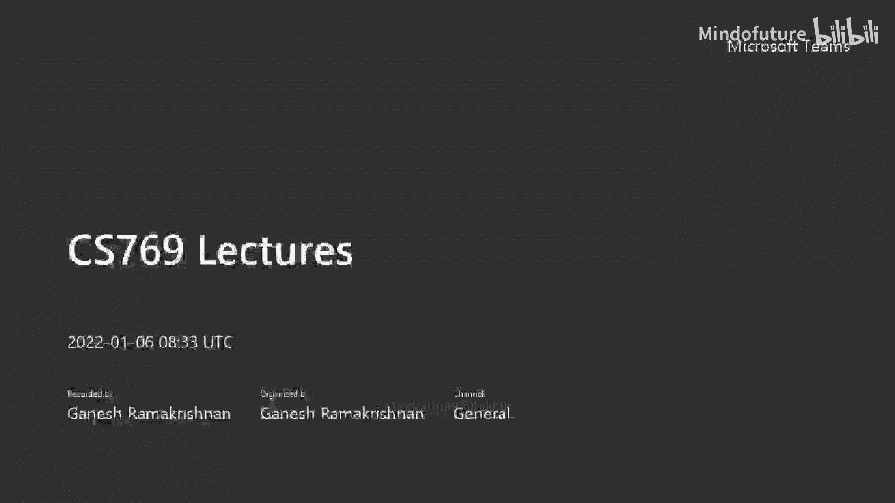
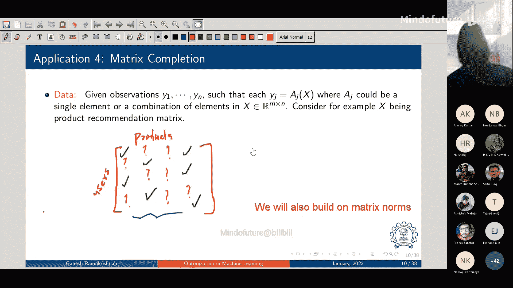

# 002：机器学习中的优化问题

在本节课中，我们将正式开启机器学习优化的主题。我们将聚焦于优化在机器学习中的应用，首先介绍连续优化的应用，然后简要探讨离散优化。通过具体的例子，我们将理解如何将常见的机器学习问题形式化为优化问题。

## 概述：监督学习中的优化

任何标准的机器学习课程都会从分类或回归等问题开始。在分类问题中，标签通常是 `+1` 或 `-1`；而在回归问题中，标签是连续值。例如，垃圾邮件过滤、手写数字识别和房价预测都是典型的监督学习任务。

解决这些问题的典型方法是学习一个从输入特征 `X` 到输出 `Y` 的映射。这个映射通常涉及一组权重参数 `θ`（或 `W`），可能通过一个广义线性函数 `f` 来实现。在深度学习中，这个映射可能由多层非线性函数 `f1, f2, ..., fL` 递归构成。

我们的目标是找到一个参数 `θ`，使得模型的预测 `F(x; θ)` 尽可能接近真实标签 `y`。这通过定义一个**损失函数 L** 来衡量预测值与真实值之间的差距。同时，为了控制模型复杂度、防止过拟合或加速优化过程，我们通常会加入一个**正则化项 R**。因此，监督学习的核心优化框架可以概括为：

**最小化： L(θ) + λ R(θ)**

其中，`λ` 是控制正则化强度的超参数。

上一节我们介绍了监督学习的基本优化框架，本节中我们来看看损失函数和正则化项的具体形式。

### 常见的损失函数

以下是几种常见的损失函数示例，它们衡量预测值与真实值之间的差异：

*   **0-1损失（黑色）**：如果预测标签与真实标签不一致，损失为1，否则为0。它既不连续也不可微。
*   **合页损失（绿色）**：用于支持向量机（SVM）。它是连续的，但在 `y·f(x) = 1` 处不可微。
*   **指数损失（蓝色）**：用于AdaBoost等提升算法。
*   **逻辑损失/交叉熵损失**：用于逻辑回归和多分类的Softmax回归。它是连续且处处可微的。
*   **最小二乘损失**：用于线性回归，计算预测值与真实值之差的平方。
*   **绝对误差损失**：计算预测值与真实值之差的绝对值，在差值为0处不可微。

### 常见的正则化项

正则化项 `R(θ)` 为模型参数 `θ` 添加了先验约束，主要目的包括：防止过拟合、使优化问题更易于求解（例如，通过增强凸性来加速收敛）。

以下是两种最著名的正则化项：

*   **L2正则化**：`R(θ) = ||θ||₂²`，即权重的平方和。它对应于高斯先验，倾向于让所有权重都变得较小，但很少精确为零。
*   **L1正则化**：`R(θ) = ||θ||₁`，即权重的绝对值之和。它对应于拉普拉斯先验，倾向于产生**稀疏解**，即许多权重值恰好为零。

L1正则化之所以能产生稀疏解，可以从几何和算法角度理解。从几何上看，L1范数的等高线是“菱形”，其顶点位于坐标轴上，优化解容易落在这些顶点上，导致某些维度为零。从算法上看，在求解Lasso（L1正则化线性回归）时，近端梯度下降法等算法会包含一个“软阈值”操作：如果权重估计值 `w_i` 的绝对值小于某个阈值 `λη`，则将其置为零。

这种稀疏性有助于模型压缩、提高解释性，并可能提升泛化能力。

## 应用二：聚类问题

聚类是无监督学习的一个典型例子。给定一组未标记的数据点 `{x_i}` 和聚类数量 `K`，目标是将数据点划分为 `K` 个组（簇），使得同一簇内的点彼此相似，不同簇的点彼此相异。

连续优化 formulations 通常会产生凸形状的簇。相似性可以通过距离（如欧氏距离、L1距离）或相似度度量（如余弦相似度、正定核函数）来定义。

一个著名的聚类方法是 **K-Means**。其优化目标是：找到簇中心 `{μ_i}` 和簇分配 `{C_i}`，最小化所有点到其所属簇中心的距离平方和。

**目标函数：** `min_{ {μ_i}, {C_i} } Σ_{i=1}^{K} Σ_{x∈C_i} ||x - μ_i||₂²`

这是一个**混合连续与离散的优化问题**（`μ_i` 连续，`C_i` 离散）。通常采用迭代算法（如EM算法）求解：先固定 `μ_i` 优化 `C_i`（将每个点分配给最近的中心），再固定 `C_i` 优化 `μ_i`（将中心更新为簇内点的均值）。

## 应用三：主成分分析

主成分分析（PCA）是另一种无监督学习技术，用于降维和特征提取。给定高维数据 `{x_i}`，PCA的目标是找到一组正交基（主成分），将数据投影到低维空间后，能最大程度地保留原始数据的方差（或最小化重构误差）。

可以从两个等价的角度来理解PCA的优化问题：

1.  **最大方差角度**：寻找投影方向，使得投影后数据的方差最大。
2.  **最小重构误差角度**：寻找一个压缩矩阵 `U` 和重构矩阵 `V`，使得原始数据 `x` 与经过压缩再重构的数据 `V(Ux)` 之间的误差最小。

在一定的约束下（如 `U` 的列是单位正交的，且 `V = Uᵀ`），PCA的优化问题可以写为：

**目标函数：** `min_U Σ_i ||x_i - UUᵀ x_i||₂²`，其中 `UᵀU = I`

其解就是数据协方差矩阵的特征向量。

## 应用四：矩阵补全

矩阵补全问题在推荐系统中非常常见。例如，有一个用户-电影评分矩阵，其中很多条目是缺失的（用户未评分）。目标是根据已知的评分，预测缺失的评分。

这个问题可以形式化为一个优化问题：寻找一个低秩矩阵 `M`（因为用户偏好通常可以由少数几个潜在因子解释），使得 `M` 在已知评分位置上的值与观测值尽可能接近。常用的模型是**带正则化的矩阵分解**：

**目标函数：** `min_{U,V} Σ_{(i,j)∈Ω} (M_{ij} - u_iᵀ v_j)² + λ(||U||_F² + ||V||_F²)`

其中，`Ω` 是已知评分的索引集合，`U` 和 `V` 是低维的用户和电影特征矩阵，`||·||_F` 是Frobenius范数，用于正则化。

## 总结

本节课中，我们一起学习了优化在机器学习中的几个核心应用：

1.  **监督学习**：通过“损失函数 + 正则化项”的框架，将分类、回归等问题转化为参数优化问题。我们讨论了不同损失函数（如0-1损失、合页损失、交叉熵损失）和正则化项（L1、L2）的特性及其影响。
2.  **聚类（K-Means）**：作为一个混合连续与离散的优化问题，其目标是最小化样本到簇中心的距离。
3.  **主成分分析（PCA）**：可以从最大化投影方差或最小化重构误差两个角度构建为连续优化问题，用于数据降维。
4.  **矩阵补全**：在推荐系统等场景中，通过低秩矩阵分解来预测缺失值，也是一个带正则化的优化问题。

这些例子表明，许多机器学习算法的核心都可以清晰地表述为一个优化问题。理解这些优化形式，是设计新算法、分析模型性质和改进求解效率的基础。在后续课程中，我们将深入探讨求解这些优化问题的具体方法与理论。