# 003：机器学习中的连续优化问题（结束）🎯

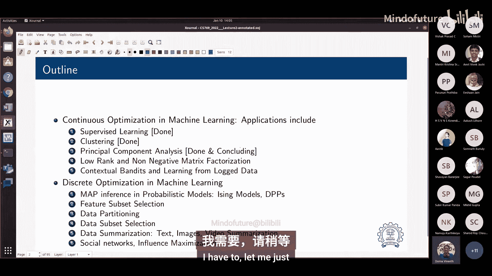

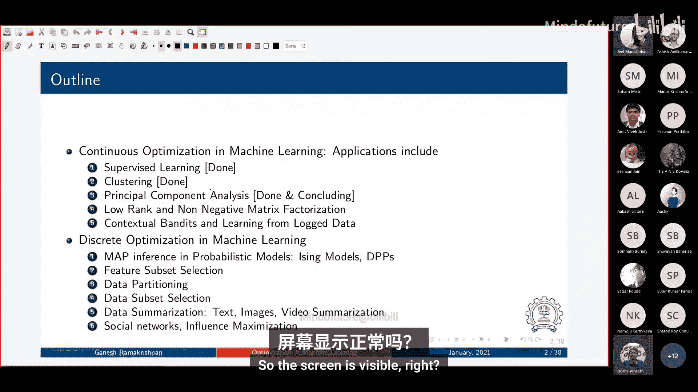

在本节课中，我们将学习机器学习中的几个核心连续优化问题。我们将从主成分分析（PCA）的解法开始，然后探讨矩阵补全、低秩与非负矩阵分解以及上下文老虎机问题。最后，我们会简要介绍离散优化问题，为后续课程做铺垫。

## 主成分分析（PCA）的解法 🔍

上一节我们介绍了PCA作为一种数据压缩和降维的优化问题。本节中我们来看看如何求解这个优化问题。

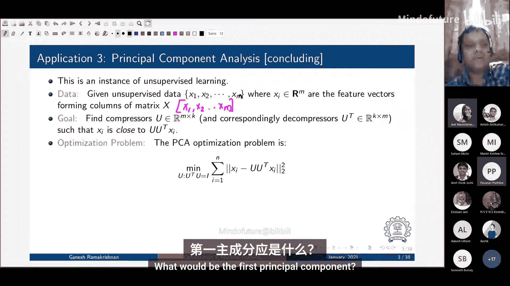

给定一个数据矩阵 **X**，其列向量为 **x₁, x₂, ..., xₙ**。PCA的目标是找到一个投影矩阵 **U**，使得重构误差最小化。该优化问题可以表述为：

**minimize ||X - UUᵀX||²**

其中，**U** 的列是标准正交的。

这个问题的解法基于矩阵的奇异值分解（SVD）。回顾一下，对于任意矩阵 **B**，其SVD可以表示为：
**B = VΣUᵀ**
其中，**Σ** 是一个对角矩阵，其对角线上的非零元素称为奇异值，数量等于矩阵 **B** 的秩。

对于PCA问题，解 **U** 的列对应于数据协方差矩阵 **XᵀX** 的前 **k** 个最大特征值所对应的特征向量。而这些特征值正是 **X** 的奇异值的平方。因此，求解PCA等价于对数据矩阵 **X** 进行SVD，并选取其最大的几个奇异值所对应的右奇异向量。

## 矩阵补全问题 🧩

接下来，我们探讨矩阵补全问题。设想一个用户-产品评分矩阵 **X**，其中许多条目是未知的（用问号表示）。我们的目标是根据已知的评分，合理地填充这些缺失值。

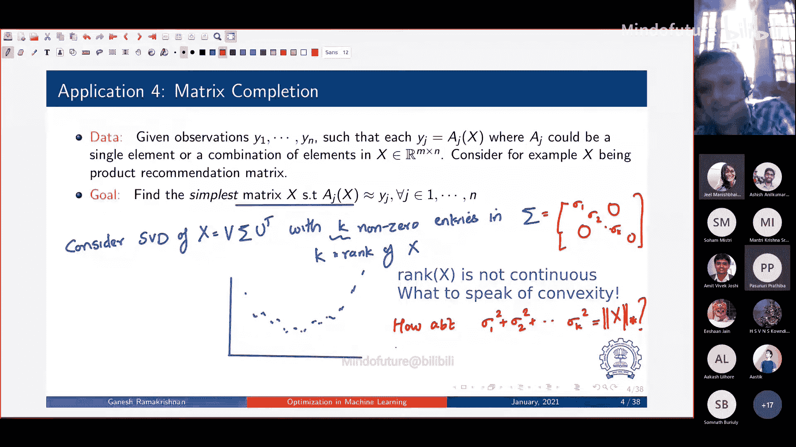

一个关键的思路是假设完整的矩阵 **X** 是“简单”的，例如它是低秩的。低秩意味着矩阵的行或列之间存在较强的线性相关性，这符合许多现实场景（如用户偏好可以由少数几个潜在因素解释）。

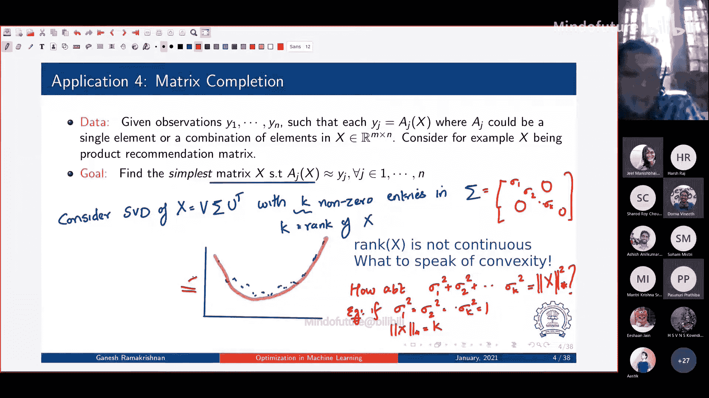

然而，直接最小化矩阵的秩是一个非凸且不连续的难题。因此，我们使用核范数（nuclear norm）作为秩函数的凸近似。矩阵 **X** 的核范数定义为其所有奇异值之和：
**||X||_* = Σ σ_i**

因此，矩阵补全的优化问题可以形式化为：
**minimize ||X||_* subject to A_j(X) = y_j for all j**
其中，**A_j** 是观测算子，**y_j** 是已知的观测值。

以下是解决此问题的一种迭代算法思路：
1.  从一个初始矩阵 **X₀** 开始（例如，用简单方法填充缺失值）。
2.  对当前矩阵 **X_t** 进行奇异值分解（SVD）。
3.  对得到的奇异值进行阈值处理（例如，保留最大的 **k** 个，或将小于某个阈值的奇异值设为零），得到一个新的奇异值矩阵 **Σ̃**。
4.  用 **Σ̃** 和原来的左右奇异向量重构矩阵，得到 **X_{t+1}**。
5.  重复步骤2-4，直到收敛。

这种方法被称为**迭代奇异值阈值算法**。

## 低秩与非负矩阵分解（NMF） ➕

矩阵补全自然引出了更一般的矩阵分解问题。低秩与非负矩阵分解要求我们将一个数据矩阵 **X** 近似分解为两个矩阵的乘积 **X ≈ LR**，并且要求 **L** 和 **R** 都是非负的，同时 **k** 较小以保证低秩。

其优化问题为：
**minimize ||X - LR||² subject to L ≥ 0, R ≥ 0**

非负约束使得分解结果具有更好的可解释性（例如，在主题模型中，单词权重和文档主题权重不应为负）。

以下是两种求解思路：

**1. 重参数化方法：**
将 **L** 和 **R** 本身表示为其他非负矩阵的乘积，例如令 **L = L̃L̃ᵀ**，**R = R̃R̃ᵀ**，从而天然满足非负约束。

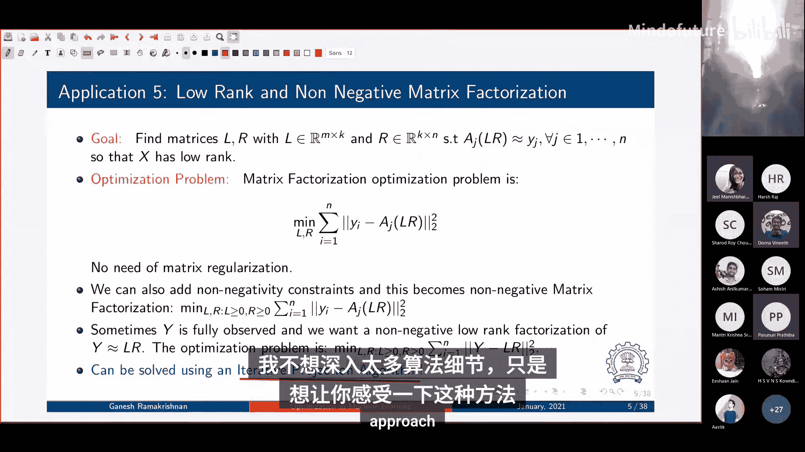

**2. 投影梯度法：**
采用迭代优化方法。在每一步更新 **L** 和 **R** 后，将其所有负值元素投影到0（即设置为0），以保证非负性。更新规则通常具有如下形式（以 **L** 为例）：
**L_{i,j}^{(new)} = L_{i,j}^{(old)} * ( [X Rᵀ]_{i,j} ) / ( [L R Rᵀ]_{i,j} )**
这是一个乘法更新规则，能自动保持非负性。

## 上下文老虎机问题 🎰

现在，我们进入在线学习场景，讨论上下文老虎机问题。以文章推荐系统为例：
*   **上下文（Context）：** 用户特征 **x_i**（如性别、年龄）。
*   **动作（Action）：** 系统选择的文章 **a_i**。
*   **奖励（Reward）：** 用户点击或阅读文章产生的反馈 **r_i**。
*   **策略（Policy）：** 系统根据用户上下文选择动作的概率分布 **π_θ(a|x)**。

我们拥有一个由历史日志数据构成的集合：**{ (x₁, a₁, r₁), (x₂, a₂, r₂), ... }**。这些数据是由某个已有的（可能是有偏的）线上策略 **π_0** 产生的。我们的目标是利用这些离线数据，学习一个新的、更好的策略 **π_θ**。

这里存在一个挑战：日志数据存在**选择偏差**。例如，编辑可能有意地将电影文章更多地推荐给女性用户（**π_0(电影|女性)** 很高），导致数据中“女性-电影”组合的样本过多。如果我们直接根据观测到的奖励平均值来评估新策略，会得到有偏的估计。

为了解决这个问题，我们使用**逆倾向评分（Inverse Propensity Scoring， IPS）** 进行纠偏。我们希望优化以下目标函数：
**maximize_θ Σ_i [ (r_i / π_0(a_i | x_i)) * I{ π_θ(a_i | x_i) } ]**
其中，**I{·}** 是指示函数，表示新策略 **π_θ** 是否选择了日志中的动作 **a_i**。

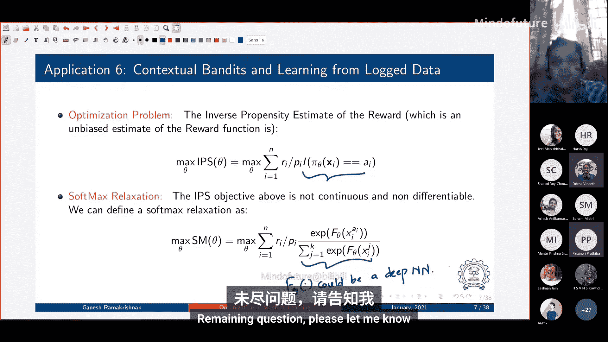

为了使其可微并便于优化，我们用 softmax 函数松弛离散的指示函数：
**maximize_θ Σ_i [ (r_i / π_0(a_i | x_i)) * softmax( f_θ(x_i, a_i) ) ]**
这里，**f_θ(x, a)** 是一个打分函数（例如线性模型或神经网络），参数为 **θ**。通过最大化这个纠偏后的期望奖励，我们可以从离线数据中学习更优的推荐策略。

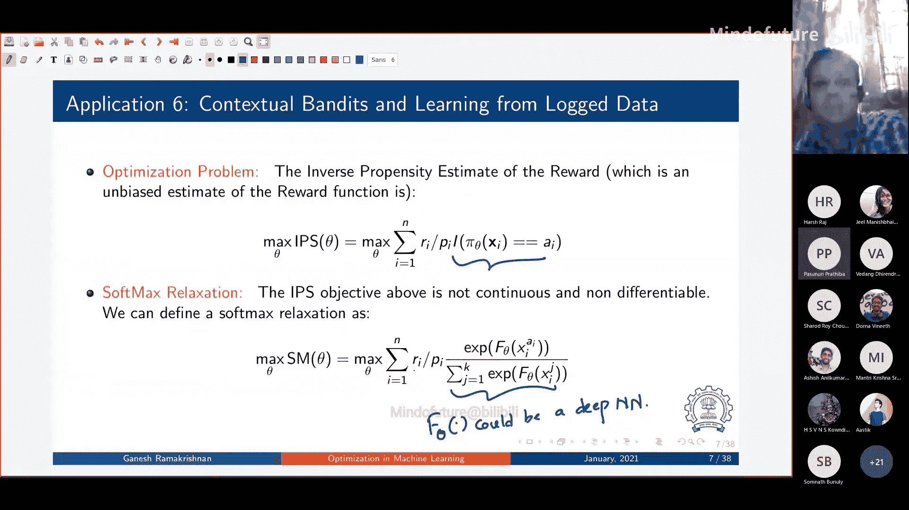

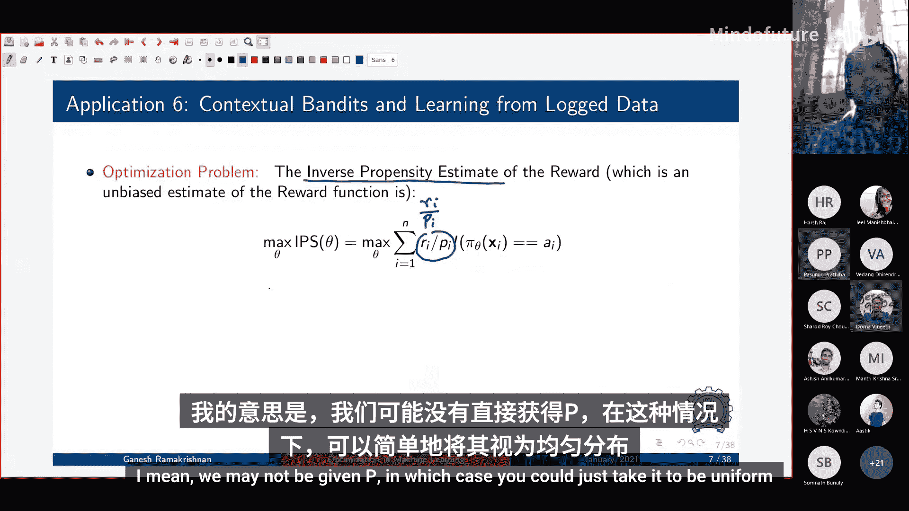

## 离散优化问题简介 ⚙️

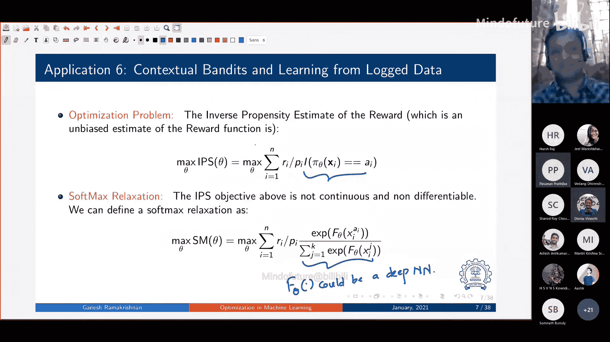

最后，我们简要介绍离散优化问题，它将在后续课程中详细展开。一个典型的例子是序列标注中的**最大后验（MAP）推理**。

任务是为一个序列（如句子中的单词）分配一组标签（如词性）。每个可能的标签序列 **y** 都有一个由模型参数 **θ** 决定的“能量”或“得分” **E(y; θ)**。MAP推理的目标是找到得分最高的标签序列：
**y* = argmax_y E(y; θ)**

这是一个离散优化问题，因为 **y** 来自一个有限的、但可能是指数级大的组合空间。

对于某些具有特殊结构的问题（如链式结构或树形结构），可以利用动态规划等算法高效求解。此外，如果目标函数满足**次模性**等性质，也存在有效的优化算法。我们将在未来的课程中深入探讨这些内容。

---

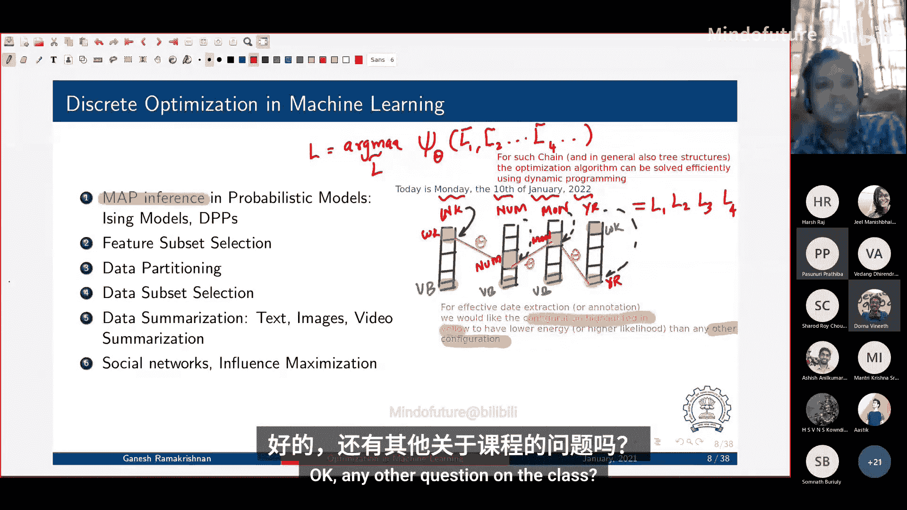

本节课中我们一起学习了机器学习中几个重要的连续优化问题及其应用。我们从PCA的SVD解法出发，探讨了利用核范数解决矩阵补全问题，介绍了带有非负约束的低秩矩阵分解方法，并学习了在存在选择偏差的离线数据中，如何使用逆倾向评分来优化上下文老虎机策略。最后，我们引出了离散优化问题的概念。理解这些问题的形式化和基本解决思路，是构建复杂机器学习模型的基础。