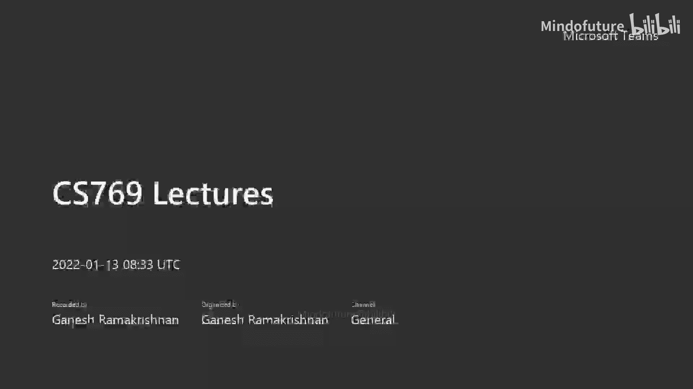
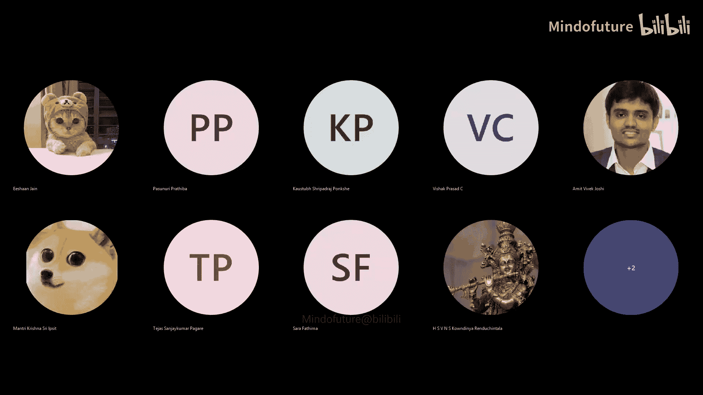
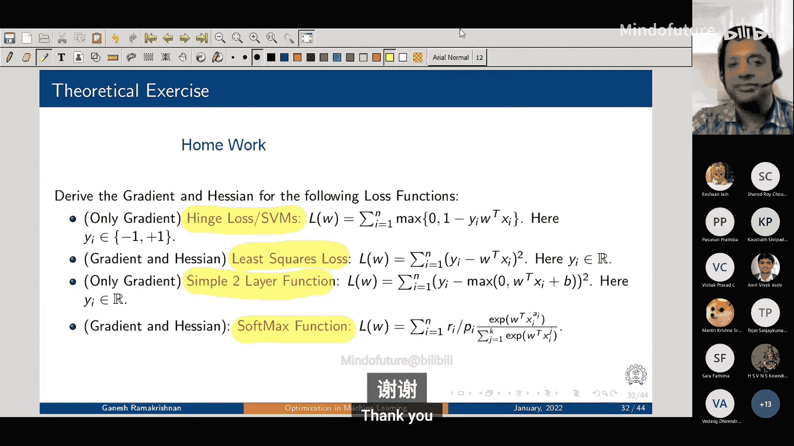

# 004：机器学习中的离散优化问题基础 🧩

在本节课中，我们将学习机器学习中常见的离散优化问题，并了解其基本概念和公式化方法。我们将探讨图像分割、特征选择、数据子集选择和K-Medoids聚类等问题，并理解它们如何与子模函数等核心概念相关联。

---

上一节我们介绍了机器学习中的连续优化问题，本节中我们来看看离散优化问题。离散优化问题在机器学习中同样至关重要，例如在图像处理、特征选择和数据子集选择等任务中。

## 图像分割与最小割问题 ✂️

在图像分割任务中，我们的目标是将图像划分为前景和背景两个区域。例如，在一张飞机在天空中飞行的图片中，我们希望将飞机（前景）与天空（背景）分开。

以下是图像分割问题的数学描述：

设图像中的像素点集合为 \( V \)，边集合为 \( E \)，每条边 \( (u, v) \) 有一个代价 \( C_{uv} \)。我们希望找到一个子集 \( S \subseteq V \)（前景），使得分割的代价最小。优化问题可以表述为：

\[
\min_{S \subseteq V} \sum_{u \in S, v \notin S} C_{uv}
\]

这个最小割问题可以在多项式时间内求解，特别是当代价函数满足子模性等性质时。

## 图像对应与最大流问题 🔄

图像对应问题涉及在两幅图像之间建立像素点的匹配关系。这可以形式化为一个二分图匹配问题，进而转化为最大流问题。

以下是最大流问题的数学描述：

我们引入一个源点 \( s \) 和一个汇点 \( t \)。源点 \( s \) 连接到左图的所有像素点 \( U \)，右图的所有像素点 \( V \) 连接到汇点 \( t \)。所有边的容量设为1。目标是最大化从 \( s \) 到 \( t \) 的流量 \( f \)，约束条件是每个节点的流入等于流出。

\[
\max \sum_{(s,u) \in E} f_{su}
\]
\[
\text{subject to: } \sum_{(q,p) \in E} f_{qp} = \sum_{(p,r) \in E} f_{pr} \quad \forall p \in U \cup V
\]
\[
0 \leq f_{uv} \leq 1 \quad \forall (u,v) \in E
\]

## 特征选择与互信息 📊

特征选择的目标是从所有特征中选择一个子集，使得该子集在预测任务中尽可能有效。互信息是衡量特征与类别标签之间相关性的常用指标。

互信息的定义基于熵。对于随机变量 \( X \) 和 \( Y \)，互信息 \( I(X;Y) \) 定义为：

\[
I(X;Y) = H(X) + H(Y) - H(X,Y)
\]

其中 \( H(\cdot) \) 表示熵。特征选择问题可以形式化为：

\[
\max_{A \subseteq \{X_1, \dots, X_n\}} I(X_A; Y)
\]

这里 \( X_A \) 表示特征子集 \( A \) 对应的随机变量。互信息函数具有子模性，这意味着它具有边际收益递减的性质。

## 数据子集选择 📉

在训练机器学习模型时，我们可能希望只使用数据集的子集，以节省计算资源或处理标注数据缺失的情况。目标是选择一个子集 \( D' \subseteq D \)，使得在 \( D' \) 上训练的模型性能与在整个数据集 \( D \) 上训练的模型性能相近。

一个具体的优化思路是梯度匹配，即选择子集 \( A \)，使得在该子集上计算的损失函数梯度与在整个数据集上计算的梯度尽可能接近：

\[
\min_{A \subseteq V} \left\| \nabla \mathcal{L}(A) - \nabla \mathcal{L}(V) \right\|_2
\]

## K-Medoids聚类 🎯

K-Medoids聚类是K-Means聚类的一种变体，要求聚类中心必须是数据集中的实际点，而不是像K-Means那样计算均值点。这类似于设施选址问题。

给定数据点集 \( V \)、点对之间的相似度 \( s_{ij} \) 和预算 \( k \)，K-Medoids问题旨在选择 \( k \) 个中心点（Medoids）\( A \subseteq V \)，以最大化每个点与其最近中心点的相似度之和：

\[
\max_{A \subseteq V, |A|=k} \sum_{i \in V} \max_{j \in A} s_{ij}
\]

这个目标函数也具有子模性。

---

## 从离散到连续：凸优化的重要性 🔗

尽管本节重点讨论了离散优化问题，但机器学习中的大多数问题本质上是混合的，其核心通常涉及连续优化。凸性在理解算法收敛性和处理非凸问题的凸区域方面至关重要。

凸函数具有许多优良性质，例如：
*   局部最小值就是全局最小值。
*   梯度为零的点（对于可微凸函数）是最小点。
*   存在高效的优化算法。

即使是处理离散优化问题（如子模函数最大化），其分析也常常借鉴凸优化的思想，因为子模函数在最大化时表现出类似凹函数的性质。

---

## 基础回顾：向量、矩阵与梯度 📚

为了深入理解后续的优化算法，我们需要掌握一些数学基础。

### 向量与矩阵
*   通常用 \( n \) 表示训练样本数，\( m \) 表示特征数。
*   特征向量 \( \mathbf{x} \in \mathbb{R}^m \)，其第 \( j \) 个元素记为 \( x_j \)。
*   标签通常用 \( y \) 表示。
*   向量内积：\( \mathbf{w}^\top \mathbf{x} = \sum_{j=1}^m w_j x_j \)。
*   范数：L1范数 \( \|\mathbf{w}\|_1 = \sum_j |w_j| \)，L2范数平方 \( \|\mathbf{w}\|_2^2 = \sum_j w_j^2 \)。

### 梯度与Hessian矩阵
对于多元函数 \( f(\mathbf{w}) \)，其梯度 \( \nabla f(\mathbf{w}) \) 是一个向量，由所有偏导数组成：

\[
\nabla f(\mathbf{w}) = \left[ \frac{\partial f}{\partial w_1}, \frac{\partial f}{\partial w_2}, \dots, \frac{\partial f}{\partial w_m} \right]^\top
\]

Hessian矩阵 \( \nabla^2 f(\mathbf{w}) \) 是一个矩阵，包含所有二阶偏导数：

\[
[\nabla^2 f(\mathbf{w})]_{ij} = \frac{\partial^2 f}{\partial w_i \partial w_j}
\]

当二阶偏导数连续时，Hessian矩阵是对称的。

### 示例：正则化逻辑回归的梯度
逻辑回归的损失函数（带L2正则化）为：

\[
\mathcal{L}(\mathbf{w}) = \frac{\lambda}{2} \|\mathbf{w}\|^2 + \sum_{i=1}^n \log\left(1 + \exp(-y_i \mathbf{w}^\top \mathbf{x}_i)\right)
\]

其梯度为：

\[
\nabla \mathcal{L}(\mathbf{w}) = \lambda \mathbf{w} - \sum_{i=1}^n \frac{y_i \mathbf{x}_i}{1 + \exp(y_i \mathbf{w}^\top \mathbf{x}_i)}
\]

建议读者通过链式法则自行推导，以加深理解。

---

## 课后练习 ✍️

为了巩固本节课的内容，请完成以下练习：
1.  推导正则化逻辑回归损失的梯度公式。
2.  尝试推导以下常见损失函数的梯度和Hessian矩阵：
    *   合页损失（Hinge Loss）：\( \max(0, 1 - y\mathbf{w}^\top\mathbf{x}) \)
    *   最小二乘损失（Least Squares Loss）：\( (y - \mathbf{w}^\top\mathbf{x})^2 \)
    *   Softmax函数

---

本节课中我们一起学习了机器学习中的几个经典离散优化问题，包括图像分割、特征选择、数据子集选择和K-Medoids聚类，并理解了它们如何通过最小割、最大流、互信息最大化等框架进行形式化。我们还回顾了向量、矩阵、梯度和Hessian矩阵等必要的数学基础，为后续学习连续优化和凸性理论做好了准备。