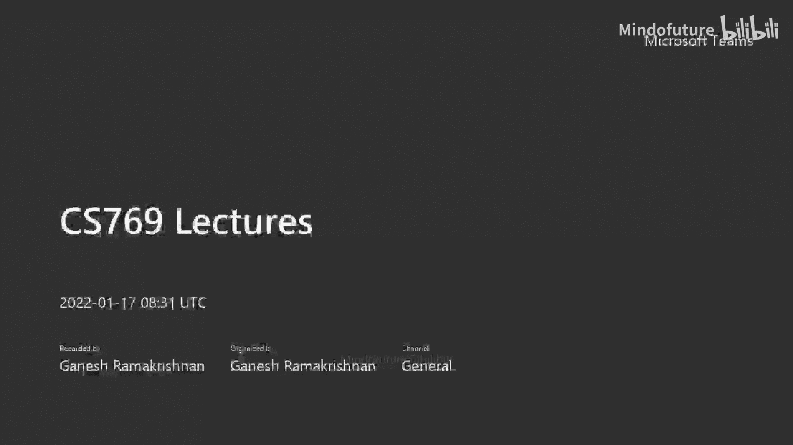
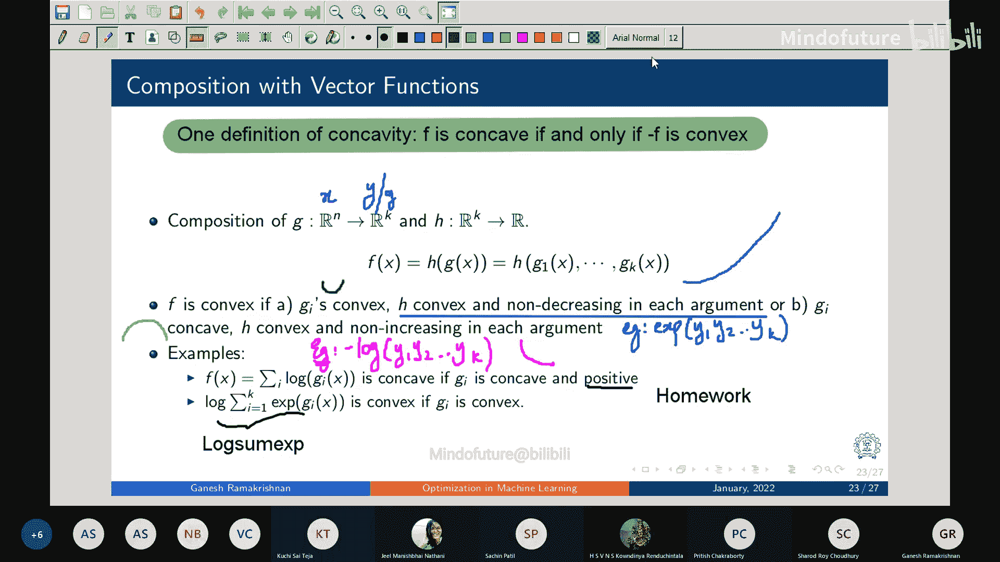

# 005：凸性-集合、函数、性质及其与机器学习的关系 🎯

在本节课中，我们将要学习凸性（Convexity）这一优化理论中的核心概念。我们将从凸集的定义和性质开始，然后过渡到凸函数，并探讨它们与机器学习问题的紧密联系。理解凸性对于设计高效、可靠的优化算法至关重要。

---

## 凸集的定义与性质

上一节我们介绍了梯度、海森矩阵等基本概念，并讨论了它们在机器学习损失函数中的应用。本节中，我们来看看优化问题中另一个至关重要的概念——凸集。

一个集合 **C** 被称为凸集，如果对于集合内的任意两点，连接这两点的线段上的所有点也都在该集合内。

用公式表示，即对于任意 **x, y ∈ C** 和任意标量 **λ ∈ [0, 1]**，都有：
**λx + (1-λ)y ∈ C**

以下是凸集的一些关键性质：
*   **交集性质**：多个凸集的交集仍然是凸集。
*   **投影性质**：点到凸集上的投影（即集合中离该点最近的点）是**唯一**的。这对于约束优化算法（如投影梯度下降）非常重要。
*   **凸包**：给定任意集合 **S**，其**凸包**（包含 **S** 中所有点的最小凸集）总是凸的。

常见的凸集例子包括：
*   **超平面和半空间**：例如，所有满足 **wᵀx ≤ b** 的点 **x** 构成的集合。
*   **范数球**：对于任意范数，满足 **||x|| ≤ r** 的点构成的集合都是凸集。
*   **椭球**：满足 **(x - x_c)ᵀP⁻¹(x - x_c) ≤ 1** 的点集，其中 **P** 是正定矩阵。

---

## 凸函数的定义与性质

理解了凸集后，我们现在可以定义凸函数。凸函数要求其定义域首先是一个凸集。

一个函数 **f: ℝⁿ → ℝ** 是凸函数，如果其定义域 **dom f** 是凸集，并且对于定义域内任意两点 **x, y** 和任意 **λ ∈ [0, 1]**，满足以下不等式（Jensen不等式）：
**f(λx + (1-λ)y) ≤ λf(x) + (1-λ)f(y)**

几何意义是：函数图像上任意两点之间的线段，总是位于函数图像的上方（或重合）。

以下是凸函数的一些重要类别和运算性质：
*   **严格凸函数**：上述不等式对 **λ ∈ (0, 1)** 严格成立（`<`）。
*   **强凸函数**：存在常数 **μ > 0**，使得函数 **f(x) - (μ/2)||x||²** 仍然是凸的。这为优化提供了更强的收敛保证。
*   **保凸运算**：
    *   **非负加权和**：若 **fᵢ** 是凸函数，**αᵢ ≥ 0**，则 **Σ αᵢ fᵢ** 是凸函数。
    *   **仿射变换**：若 **f** 是凸函数，则 **g(x) = f(Ax + b)** 也是凸函数。
    *   **逐点最大值**：若 **f₁, f₂** 是凸函数，则 **h(x) = max{f₁(x), f₂(x)}** 也是凸函数。

常见的凸函数例子包括：
*   **仿射函数**：**f(x) = aᵀx + b**
*   **指数函数**：**f(x) = exp(ax)**
*   **负对数函数**：**f(x) = -log(x)** （定义域为 **x > 0**）
*   **范数**：任意范数 **f(x) = ||x||** 都是凸函数。

---

## 凸性与机器学习的关系

现在，让我们将凸性的概念与机器学习的具体问题联系起来。凸性之所以重要，有以下几个关键原因：

首先，许多机器学习模型的损失函数（如逻辑回归的负对数似然、支持向量机的合页损失加上正则项）在其参数空间中是凸的或具有凸的区域。这意味着：
*   任何找到的局部最小值也必然是**全局最小值**。
*   我们可以设计出具有理论收敛保证的高效算法（如梯度下降）来找到这个最优解。

其次，即使对于非凸函数（如深度神经网络），其损失曲面通常也包含大的凸区域。优化算法（如随机梯度下降）在这些区域内的行为更容易分析和保证。

再者，凸性处理了不可微点的问题。对于凸函数，即使在某些点不可微（如合页损失在零点），我们也可以定义和使用**次梯度**，从而扩展梯度下降类算法的适用范围。

最后，在带有约束的优化问题中（如将模型参数限制在某个范围内），如果约束集是凸的，那么像投影梯度下降这样的算法就能保证迭代点始终落在可行域内，并且投影操作是唯一且高效的。

---

## 总结

本节课中我们一起学习了凸性这一优化理论的核心基石。我们首先定义了凸集，并了解了其基本性质，如交集保持凸性以及投影的唯一性。接着，我们定义了凸函数，探讨了严格凸和强凸等变体，并学习了通过加权和、仿射变换等运算保持凸性的规则。最后，我们深入探讨了凸性对于机器学习的重要性，包括它如何保证找到全局最优解、如何处理非光滑函数，以及为何在约束优化中不可或缺。理解这些概念，将为后续学习具体的优化算法打下坚实的基础。