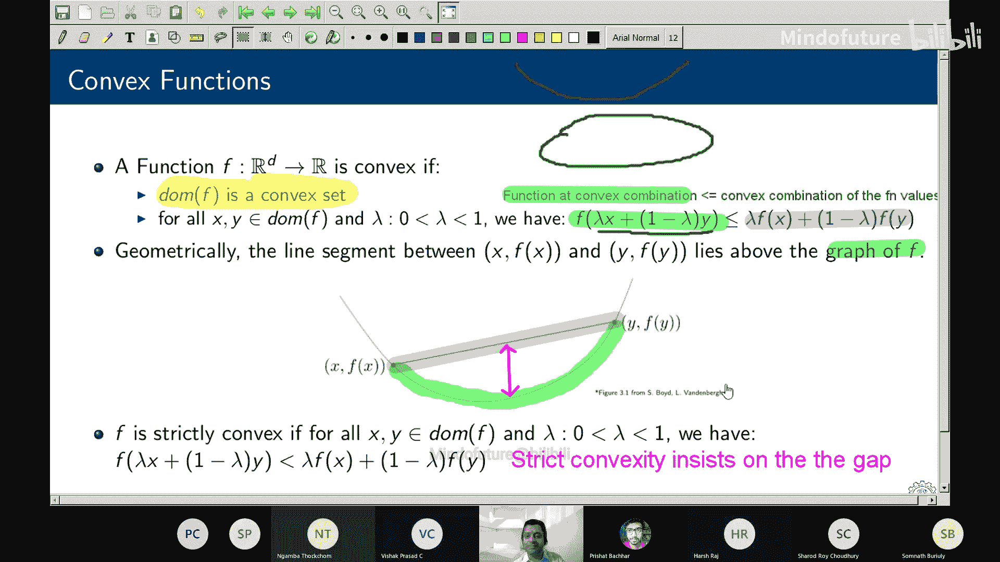

# 006：凸函数进一步性质与机器学习应用

在本节课中，我们将深入学习凸函数的更多性质，并通过机器学习中的具体例子来加深理解。我们将从回顾作业问题开始，探讨范数、强凸性等核心概念的证明，然后分析机器学习中常见损失函数的凸性，最后介绍点态最大值和上确界等高级性质。

## 作业问题回顾与讨论

上一讲我们介绍了凸函数的基本定义和性质。本节中，我们来看看一些作业中的具体问题，以巩固对凸性证明方法的掌握。

以下是几个关键作业问题的讨论：

1.  **证明任意范数是凸函数**
    *   **思路**：利用范数的三角不等式性质。对于任意两点 `x1`, `x2` 和 `θ ∈ [0, 1]`，需要证明：
        `||θx1 + (1-θ)x2|| ≤ θ||x1|| + (1-θ)||x2||`
    *   **证明**：直接应用范数的三角不等式：
        `||θx1 + (1-θ)x2|| ≤ ||θx1|| + ||(1-θ)x2|| = θ||x1|| + (1-θ)||x2||`
    *   **结论**：该不等式正是凸函数的定义式，因此任意范数都是凸函数。

2.  **强凸性的两种等价定义**
    *   **定义A（边际形式）**：函数 `f(x)` 是 `μ`-强凸的，如果对于所有 `x1, x2` 和 `θ ∈ [0, 1]`，有：
        `f(θx1 + (1-θ)x2) ≤ θf(x1) + (1-θ)f(x2) - (μ/2)θ(1-θ)||x1 - x2||^2`
    *   **定义B（操作形式）**：函数 `f(x)` 是 `μ`-强凸的，当且仅当函数 `g(x) = f(x) - (μ/2)||x||^2` 是凸函数。
    *   **等价性证明**：可以从定义B出发，利用凸函数 `g(x)` 的定义，经过代数展开和整理，最终得到定义A中的边际项 `(μ/2)θ(1-θ)||x1 - x2||^2`。反之亦然。
    *   **意义**：操作形式 `f(x) - (μ/2)||x||^2` 非常实用，它表明强凸函数可以通过减去一个正则项（二次项）转化为凸函数。这在优化中能带来更快的收敛速度。

3.  **复合函数的凸性：对数-求和-指数函数**
    *   **函数形式**：`h(x) = log( sum_i exp(g_i(x)) )`，其中 `g_i(x)` 是凸函数。
    *   **结论**：`h(x)` 是凸函数。
    *   **证明思路（利用中点凸性）**：
        1.  中点凸性指出，一个函数是凸的当且仅当对于所有 `x1, x2`，满足 `f((x1+x2)/2) ≤ (f(x1)+f(x2))/2`。
        2.  将 `h(x)` 代入中点凸性不等式。
        3.  利用柯西-施瓦茨不等式 `(∑ a_i b_i) ≤ sqrt(∑ a_i^2) * sqrt(∑ b_i^2)`。
        4.  结合对数函数的单调递增性，即可完成证明。
    *   **应用**：该函数在机器学习中非常常见，例如多项逻辑回归（Softmax）的损失函数就包含类似结构。
    *   **进一步思考**：`log-sum-exp` 函数是严格凸的，但不一定是强凸的，因为它缺少一个强制的二次下界。

## 点态最大值与上确界

了解了基本复合函数的性质后，我们来看一类通过最大化操作构造凸函数的方法。

**点态最大值**：如果一组函数 `{f_1(x), f_2(x), ..., f_m(x)}` 都是凸函数，那么它们的点态最大值函数 `f(x) = max{f_1(x), f_2(x), ..., f_m(x)}` 也是凸函数。

*   **直观理解**：取最大值相当于在函数图像的上方取“包络”，这个包络线保持了下凸的形状。
*   **例子**：向量 `x` 的无穷范数 `||x||_∞ = max{|x1|, |x2|, ..., |xn|}` 是凸函数，因为绝对值函数 `|xi|` 是凸的。
*   **例子**：向量 `x` 中前 `r` 个最大分量之和是凸函数。这可以写成所有可能的 `r` 个分量组合的线性函数的最大值。

**点态上确界**：这是点态最大值的推广。如果对于每个 `y ∈ S`，函数 `f(x, y)` 关于 `x` 是凸的，那么函数 `g(x) = sup_{y ∈ S} f(x, y)` 关于 `x` 也是凸的。

*   **理解**：上确界（sup）可以理解为可能无法取到的“最紧上界”。即使有无穷多个 `y`，只要每个 `f(x,y)` 对 `x` 凸，它们的上界 `g(x)` 也凸。
*   **关键例子：矩阵的谱范数**：
    *   矩阵 `A` 的谱范数（2-范数）定义为 `||A||_2 = sup_{x ≠ 0} (||Ax||_2 / ||x||_2)`。
    *   对于固定的 `x`，函数 `f(A, x) = ||Ax||_2 / ||x||_2` 关于 `A` 是凸的（实际上是线性函数后接范数）。
    *   因此，对其取上确界得到的谱范数 `||A||_2` 关于 `A` 也是凸函数。
    *   这等价于矩阵 `A^T A` 的最大特征值的平方根。

## 由向量范数诱导的矩阵范数

更一般地，给定一个向量范数 `||·||`，可以诱导出一个矩阵范数：
`||A|| = sup_{x ≠ 0} (||Ax|| / ||x||)`
根据点态上确界的性质，这样的矩阵范数关于矩阵 `A` 总是凸的。

以下是两个重要特例：

1.  **诱导出1-范数**：`||A||_1 = max_j (∑_i |A_{ij}|)`
    *   **解释**：等于矩阵 `A` 的列和范数，即所有列向量的1-范数中的最大值。

2.  **诱导出无穷范数**：`||A||_∞ = max_i (∑_j |A_{ij}|)`
    *   **解释**：等于矩阵 `A` 的行和范数，即所有行向量的1-范数中的最大值。

## Schatten范数：谱范数的推广

Schatten范数提供了一种统一看待多种矩阵范数的方式。对于矩阵 `A`，令 `σ_i` 为其奇异值。

*   **定义**：Schatten p-范数定义为 `||A||_p = (∑_i σ_i^p)^{1/p}`。
*   **特例**：
    *   `p = 1`：核范数（或迹范数）`||A||_* = ∑_i σ_i`。在矩阵补全、低秩逼近中非常有用。
    *   `p = 2`：Frobenius范数 `||A||_F = sqrt(∑_i σ_i^2)`。
    *   `p = ∞`：谱范数 `||A||_2 = max_i σ_i`。
*   **性质**：所有的Schatten范数都是凸函数。

## 机器学习损失函数的凸性分析（课后作业）

现在，请大家运用本节课所学的工具，分析以下常见机器学习损失函数的凸性（关于模型参数 `w`）：

1.  平方损失：`L(w) = (y - w^T x)^2`
2.  绝对损失：`L(w) = |y - w^T x|`
3.  Huber损失：`L_δ(w) = { 0.5*(y - w^T x)^2 if |y - w^T x| ≤ δ; δ*(|y - w^T x| - 0.5δ) otherwise }`
4.  逻辑损失：`L(w) = log(1 + exp(-y * w^T x))`，其中 `y ∈ {-1, +1}`
5.  铰链损失（Hinge Loss）：`L(w) = max(0, 1 - y * w^T x)`，其中 `y ∈ {-1, +1}`

**分析提示**：考虑它们是否由基本凸函数（如仿射函数、二次函数、绝对值、指数、对数等）通过保持凸性的操作（如非负加权和、仿射映射、点态最大值、与单调凸函数的复合等）组合而成。

## 总结

本节课中我们一起学习了：
1.  如何证明范数、强凸性等价定义等基本性质的凸性。
2.  掌握了 `log-sum-exp` 这类重要复合函数的凸性证明技巧。
3.  理解了通过**点态最大值**和**点态上确界**构造凸函数的方法，并以矩阵谱范数为例进行了深入分析。
4.  了解了由向量范数诱导的矩阵范数以及更一般的Schatten范数家族。
5.  最后，我们布置了分析经典机器学习损失函数凸性的作业，这是将理论应用于实践的关键一步。

掌握这些凸函数的性质与判别方法，是设计和分析高效、可靠的机器学习优化算法的基础。下一讲，我们将开始深入具体的优化算法。