# 007：边界与联合学习教程 - SPEAR Python 库

在本教程中，我们将学习SPEAR库中的CAGE联合学习模块和子集选择模块。我们将了解如何使用这些工具进行半监督数据编程，以程序化方式标注和构建训练数据。

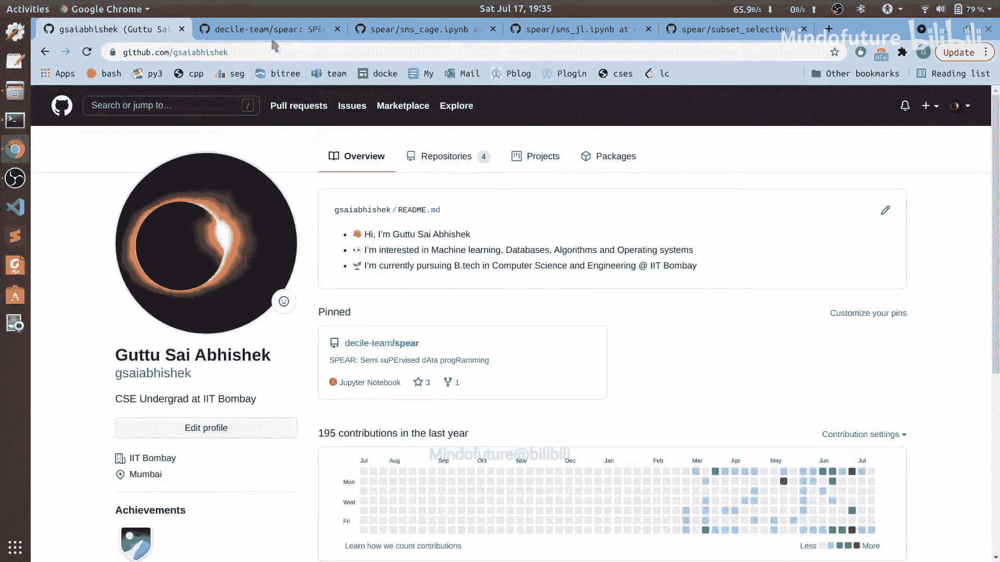

## 概述

SPEAR是一个用于半监督数据编程的Python库。它实现了多种前沿的数据编程方法，其核心流程分为三步：创建标注函数、生成包含标注信息的pickle文件，以及使用标签聚合器生成最终标签。本教程将重点介绍CAGE联合学习模块和子集选择功能。

## SPEAR库简介

SPEAR库的GitHub地址为 `DeL-team/spear`。该库提供了一个简单的三阶段流水线。

以下是SPEAR库的基本工作流程：

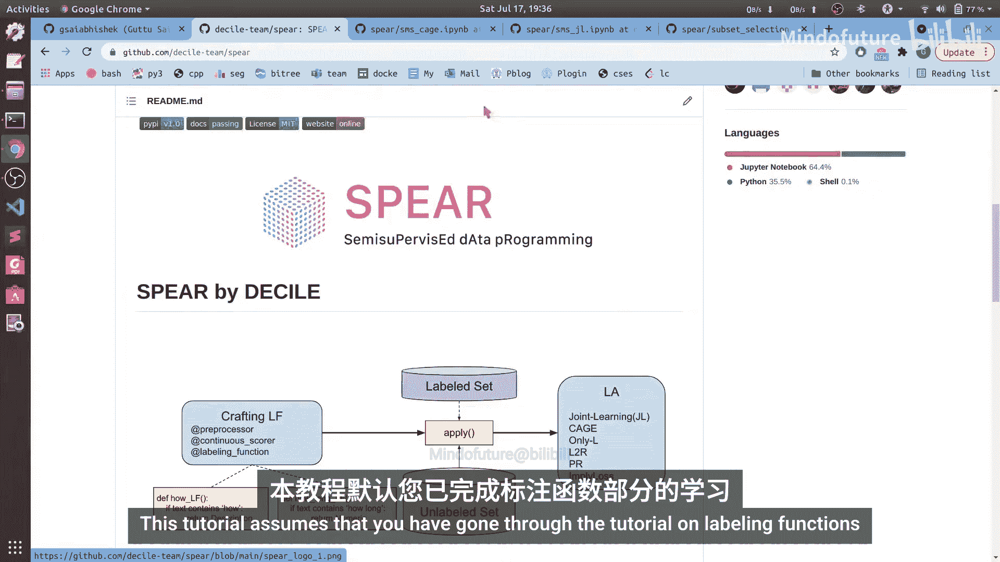

1.  **创建标注函数**：这些函数以原始数据为输入，基于启发式规则返回一个标签。
2.  **生成Pickle文件**：此文件包含标注函数为原始数据关联的标签。
3.  **标签聚合**：将Pickle文件传递给标签聚合器，以获得最终的标签。

本教程假设您已了解标注函数的基础知识。我们将重点讲解CAGE联合学习模块。

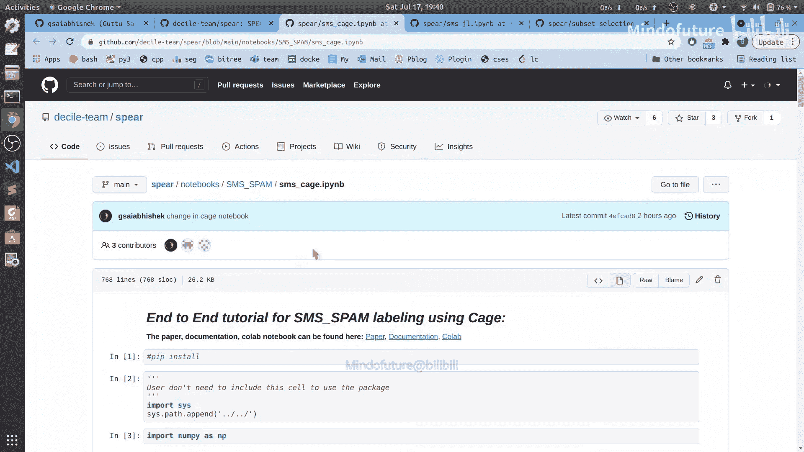

## CAGE模块使用指南

CAGE模块是SPEAR库中的一个标签聚合器。以下将逐步介绍其使用方法。

### 数据加载与预处理

首先，我们需要加载原始数据。用户可以使用任何方法加载数据，但需要准备好未标注数据、测试数据以及测试数据的真实标签（如果可用）。

```python
# 示例：加载数据（此函数非库内置，用户需自定义）
unlabeled_data = load_unlabeled_data()
test_data, test_labels = load_test_data()
```

接下来，声明`PreLabels`类对象并生成包含标注函数结果的Pickle和JSON文件。

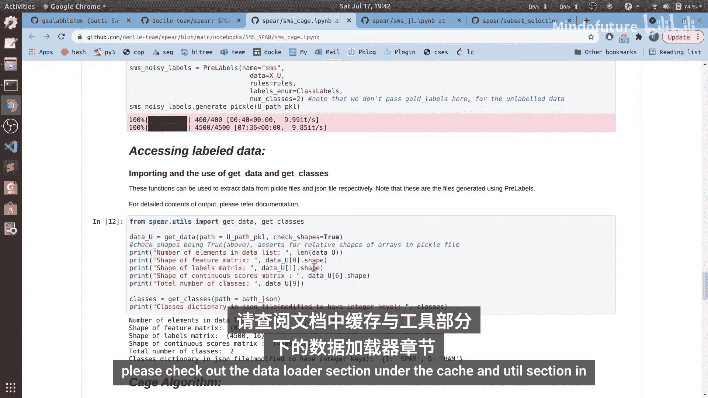

```python
from spear.labeling import PreLabels

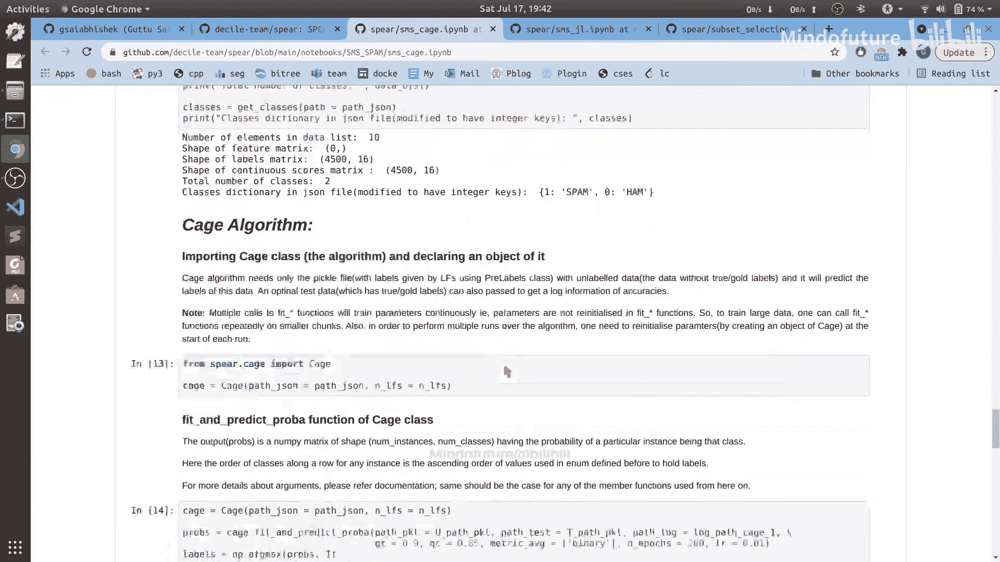

# 为测试数据和未标注数据创建PreLabels对象
# 注意：测试数据需要传入真实标签，未标注数据则不需要
test_pre_labels = PreLabels(test_data, gold_labels=test_labels)
unlabeled_pre_labels = PreLabels(unlabeled_data)

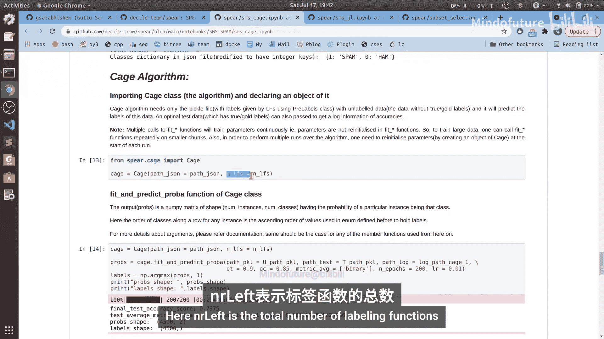

# 生成Pickle和JSON文件（JSON文件只需生成一次）
test_pre_labels.generate_pickle_file(‘test.pkl’)
unlabeled_pre_labels.generate_pickle_file(‘unlabeled.pkl’)
unlabeled_pre_labels.generate_json_file(‘unlabeled.json’)
```

### 使用CAGE类获取最终标签

生成必要的文件后，我们可以使用`CAGE`类来获取最终的聚合标签。

```python
from spear.cage import CAGE

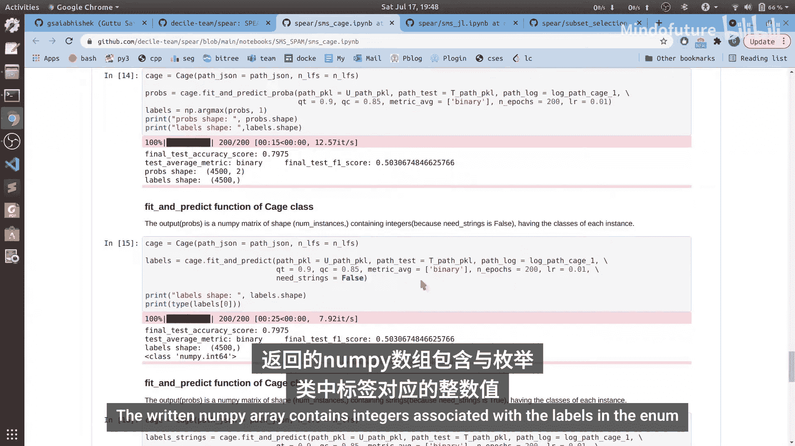

# 声明CAGE类，L是标注函数的总数
cage = CAGE(L=num_labeling_functions)
```

`CAGE`类提供了几个核心方法：

*   **`predict_proba`函数**：此函数聚合标签并返回每个实例属于各个类别的概率。返回值是一个NumPy数组，形状为 `(实例数量, 标签数量)`。类别顺序与之前定义的`Enum`类中的值升序排列一致。
    ```python
    probabilities = cage.predict_proba(‘unlabeled.pkl’, ‘unlabeled.json’)
    ```

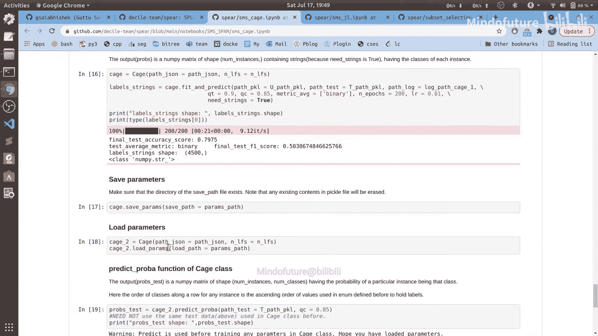

*   **`predict`函数**：此函数基于`predict_proba`返回的最大概率，为每个实例分配一个最终标签。返回值是一个包含与`Enum`类对应的整数的NumPy数组。
    ```python
    predicted_labels_int = cage.predict(‘unlabeled.pkl’, ‘unlabeled.json’)
    ```
    此函数还有另一个用例，可以直接返回字符串标签数组。
    ```python
    predicted_labels_str = cage.predict(‘unlabeled.pkl’, ‘unlabeled.json’, return_probs=False)
    ```

*   **参数保存与加载**：可以保存训练好的模型参数，以便后续使用。
    ```python
    # 保存参数（指定目录必须存在）
    cage.save_parameters(‘path/to/params.pkl’)
    # 加载参数
    cage.load_parameters(‘path/to/params.pkl’)
    ```

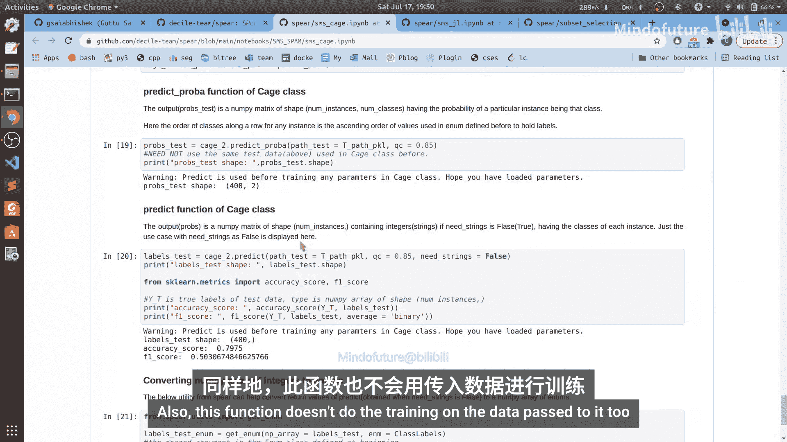

*   **基于已训练参数的预测**：加载参数后，可以直接进行预测而无需重新训练。
    ```python
    probs = cage.predict_proba_from_parameters(‘new_data.pkl’, ‘new_data.json’)
    final_labels = cage.predict_from_parameters(‘new_data.pkl’, ‘new_data.json’)
    ```

*   **`get_enum`函数**：此工具函数可用于将整数标签数组转换回之前定义的`Enum`数组。
    ```python
    enum_labels = cage.get_enum(predicted_labels_int)
    ```

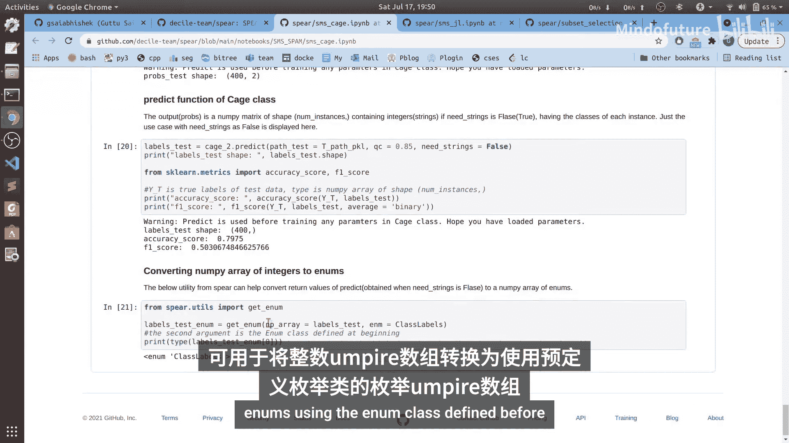

上一节我们介绍了基础的CAGE模块，本节中我们来看看功能更强大的联合学习模块。

## 联合学习模块使用指南

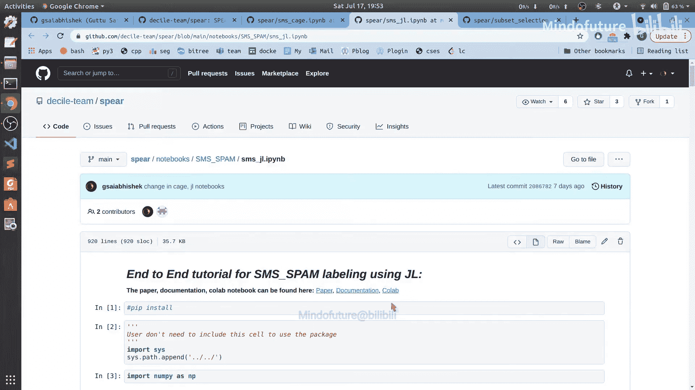

联合学习模块训练两个模型：一个特征模型（如神经网络或逻辑回归）和一个类似于CAGE中使用的图模型。它需要额外的特征矩阵和少量专家标注数据。

### 数据准备

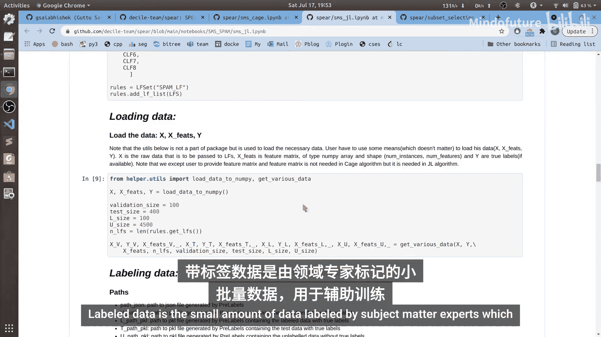

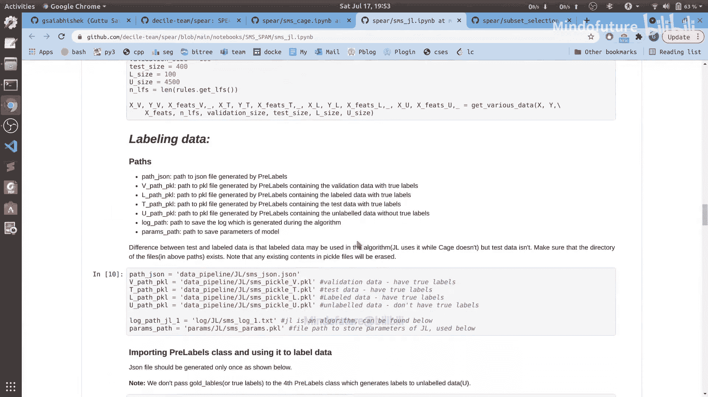

除了未标注和测试数据，联合学习还需要特征矩阵、验证数据和少量标注数据。

```python
# 加载额外数据
feature_matrix = load_features()
validation_data = load_validation_data()
label_data = load_expert_labeled_data() # 少量专家标注数据
```

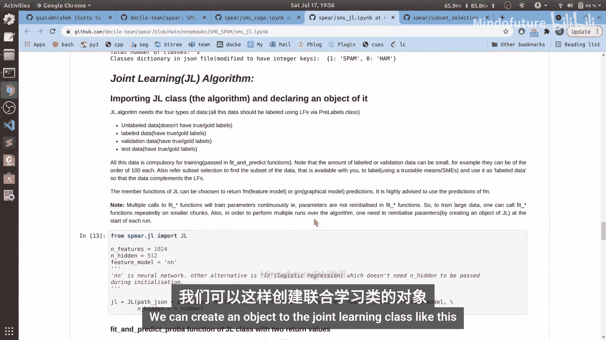

创建`PreLabels`对象时，注意我们**不**向未标注数据的`PreLabels`类传递真实标签。

```python
unlabeled_pre_labels = PreLabels(unlabeled_data) # 不传递gold_labels
unlabeled_pre_labels.generate_pickle_file(‘unlabeled.pkl’)
```

### 使用联合学习类

声明`JointLearning`类并开始训练。

```python
from spear.joint_learning import JointLearning

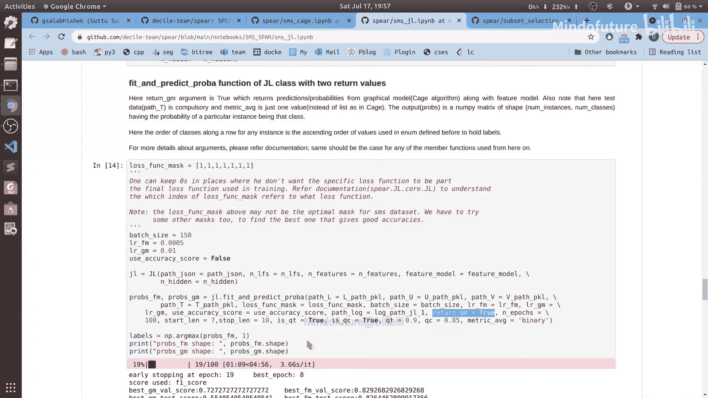

# 创建联合学习对象，feature_model可以是’nn’（神经网络）或’lr’（逻辑回归）
jl = JointLearning(feature_model=‘nn’)
```

联合学习模块的核心方法如下：

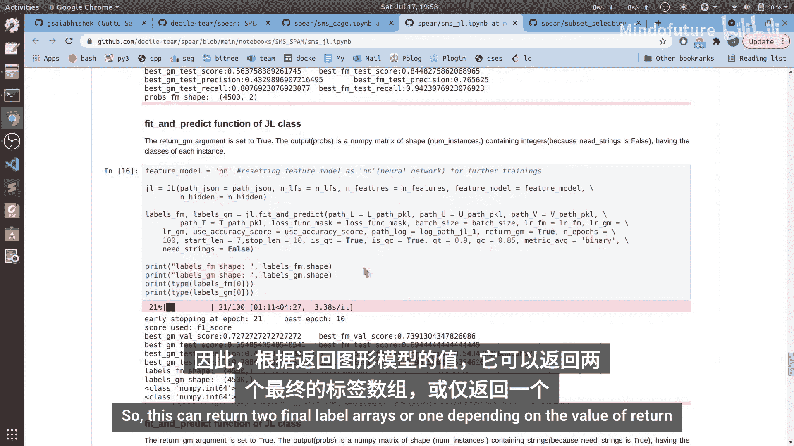

*   **`predict_proba`函数**：此函数训练模型并返回预测概率。参数`loss_mask`指定训练中使用的七种损失函数之一（详情请参阅相关论文）。当`return_gm=True`时，返回两个值：特征模型的概率和图模型的概率。通常建议使用特征模型的概率。
    ```python
    # 返回两个模型的概率
    probs_fm, probs_gm = jl.predict_proba(‘unlabeled.pkl’, feature_matrix, label_data, validation_data, return_gm=True)
    # 仅返回特征模型的概率
    probs_fm = jl.predict_proba(‘unlabeled.pkl’, feature_matrix, label_data, validation_data, return_gm=False)
    ```
    训练过程会基于验证数据使用早停策略。

*   **`predict`函数**：此函数返回最终的标签数组。同样，通过`return_gm`参数控制返回一个还是两个结果。
    ```python
    labels_fm, labels_gm = jl.predict(…, return_gm=True)
    labels_fm = jl.predict(…, return_gm=False)
    ```

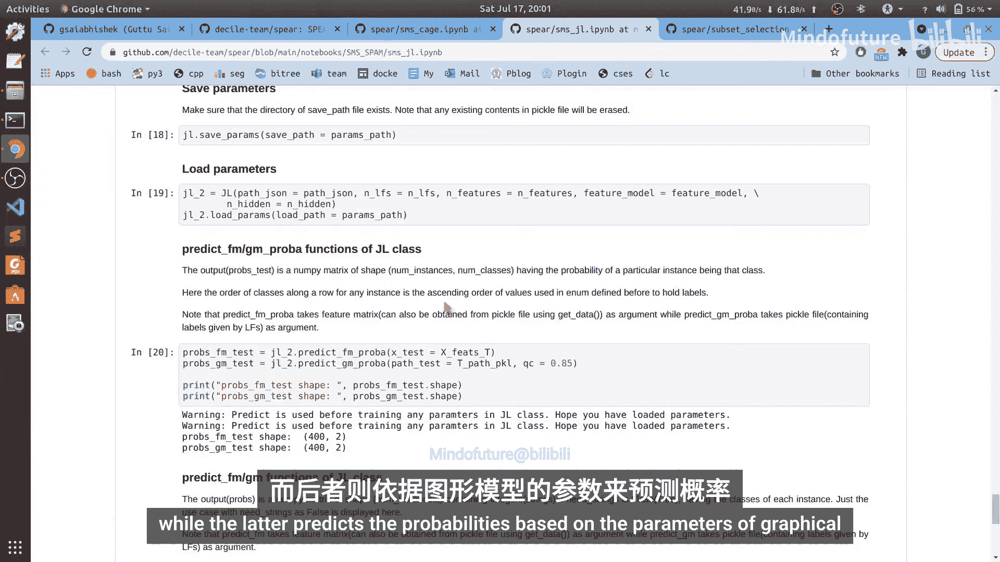

*   **参数保存与加载**：与CAGE模块类似。
    ```python
    jl.save_parameters(‘jl_params.pkl’)
    jl.load_parameters(‘jl_params.pkl’)
    ```

*   **基于已训练参数的预测**：加载参数后，可以分别使用特征模型或图模型进行预测。
    ```python
    # 预测概率
    probs_fm = jl.predict_fm_proba_from_parameters(…)
    probs_gm = jl.predict_gm_proba_from_parameters(…)
    # 预测标签
    labels_fm = jl.predict_fm_from_parameters(…)
    labels_gm = jl.predict_gm_from_parameters(…)
    ```

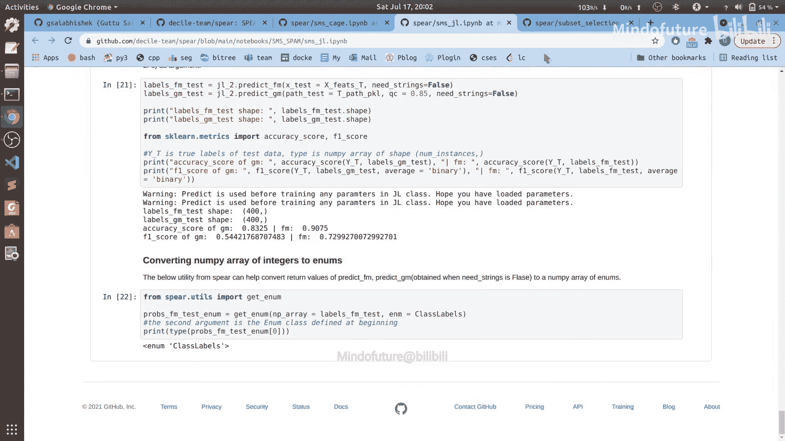

在联合学习中，专家标注数据的质量至关重要。接下来，我们将介绍如何智能地选择需要标注的数据子集，以提升模型效果。

## 子集选择模块

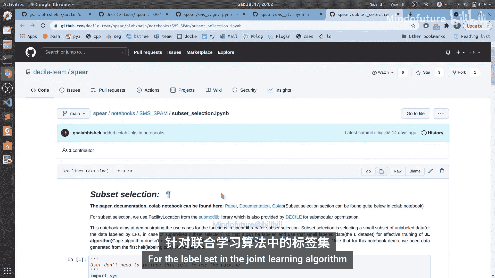

为了优化专家标注资源的利用，我们可以使用子集选择函数从未标注数据中挑选一个子集进行标注，使得该子集的标签能最好地补充标注函数的信息。

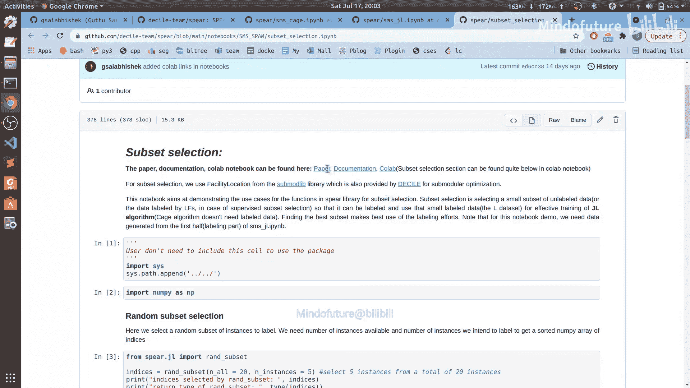

SPEAR库提供了几种子集选择策略：

*   **随机子集选择**：使用`random_subset`函数随机选择索引。
    ```python
    from spear.subset_selection import random_subset
    indices_to_label = random_subset(unlabeled_data_size, subset_size)
    ```

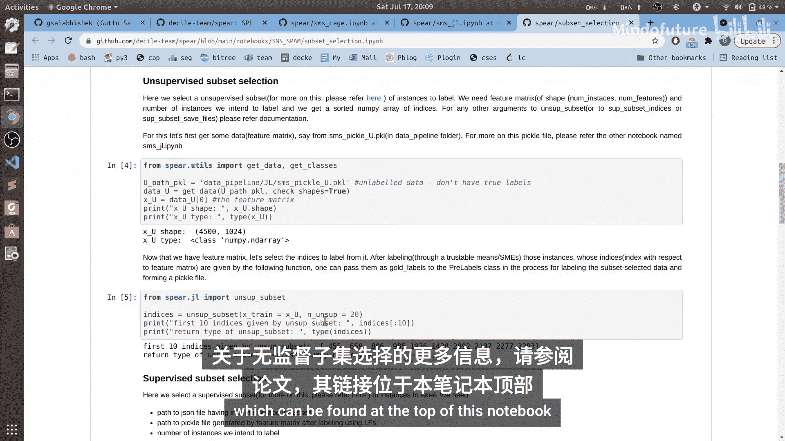

*   **Uncertainty-Probit子集选择**：使用`uncertainty_probit_subset`函数，该方法需要特征矩阵。
    ```python
    from spear.subset_selection import uncertainty_probit_subset
    indices_to_label = uncertainty_probit_subset(feature_matrix, subset_size)
    ```

*   **监督式子集选择**：使用`supervised_subset_indices`函数。此方法需要利用标注函数生成的标签数据，返回从未标注数据中选出的、最值得标注的索引。
    ```python
    from spear.subset_selection import supervised_subset_indices
    indices_to_label = supervised_subset_indices(‘unlabeled.pkl’, subset_size)
    ```

*   **`s_subset_save_files`函数**：此函数功能与上一个类似，但额外将未标注数据分割成两个独立的Pickle文件：一个包含待标注数据，另一个包含剩余数据。
    ```python
    from spear.subset_selection import s_subset_save_files
    indices, to_label_pkl, remaining_pkl = s_subset_save_files(‘unlabeled.pkl’, ‘to_label.pkl’, ‘remaining.pkl’, subset_size)
    ```

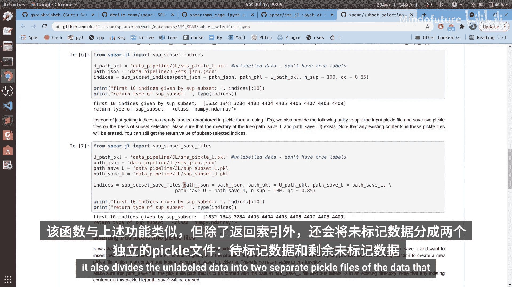

*   **`insert_gold_labels`函数**：当使用`s_subset_save_files`选出的子集被专家标注后，可以使用此函数将真实标签插入到对应的Pickle文件中。
    ```python
    from spear.subset_selection import insert_gold_labels
    insert_gold_labels(‘to_label.pkl’, expert_gold_labels, ‘labeled.pkl’)
    ```

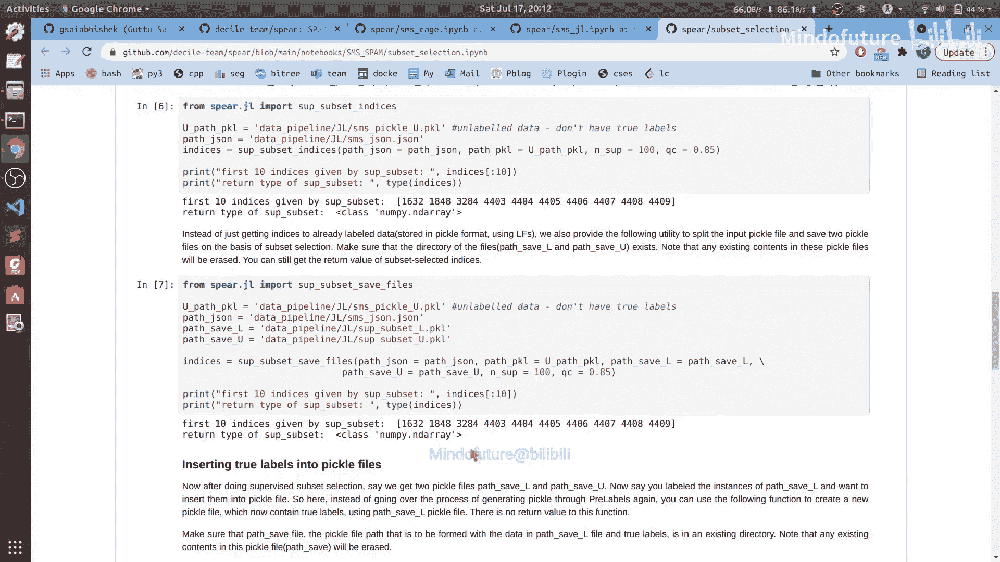

*   **`replace_pickle`函数**：此工具函数可用于替换Pickle文件中的任何数组。

## 总结

本节课中我们一起学习了SPEAR库中的三个核心部分：
1.  **CAGE模块**：用于基础的标签聚合，通过图模型从多个标注函数中学习并输出最终标签。
2.  **联合学习模块**：结合特征模型和图模型，利用少量专家标注数据提升半监督学习性能。
3.  **子集选择模块**：提供了多种策略（随机、Uncertainty-Probit、监督式）来智能选择需要专家标注的数据子集，以高效利用标注资源。

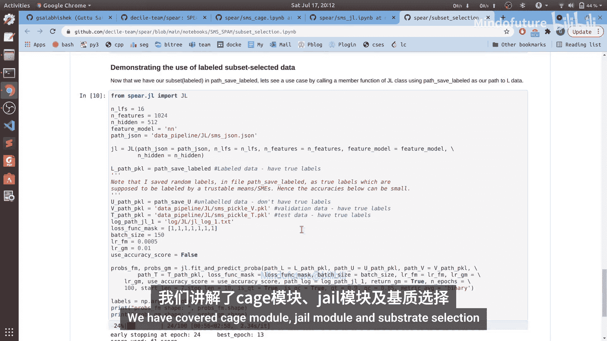

通过掌握这些工具，您可以更有效地利用弱监督和半监督方法构建机器学习训练数据集。