# 008：暗示损失与Learn2Reweight教程 - SPEAR Python库

在本教程中，我们将学习如何使用SPEAR库中的高级监督模块，对SMS垃圾邮件数据集进行端到端的标注和模型训练。我们将涵盖从数据预处理、定义标注函数到选择训练算法和评估模型的完整流程。

---

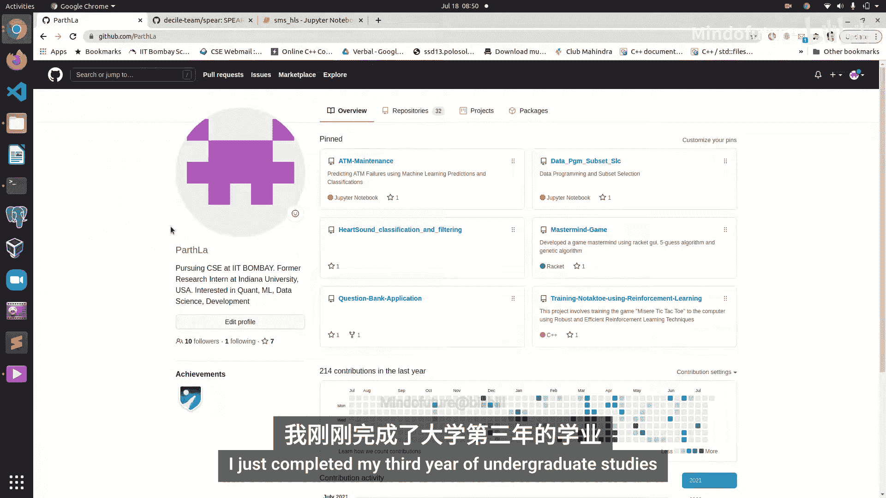

## 定义标签枚举

首先，我们需要定义一个枚举来存储数据集的标签。在SMS垃圾邮件数据集中，包含两个类别：`ham`（正常邮件）和`spam`（垃圾邮件）。

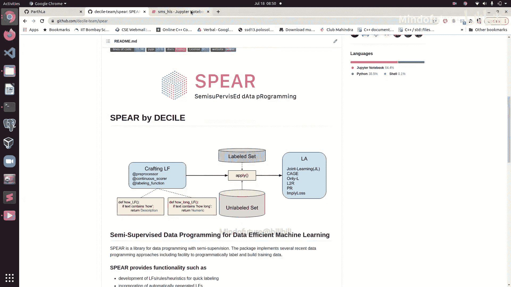

```python
from enum import Enum

class Labels(Enum):
    HAM = 0
    SPAM = 1
```

**注意**：虽然类别可以映射到任意数字，但建议使用从0开始的连续整数进行映射，即 `0` 到 `类别数 - 1`。

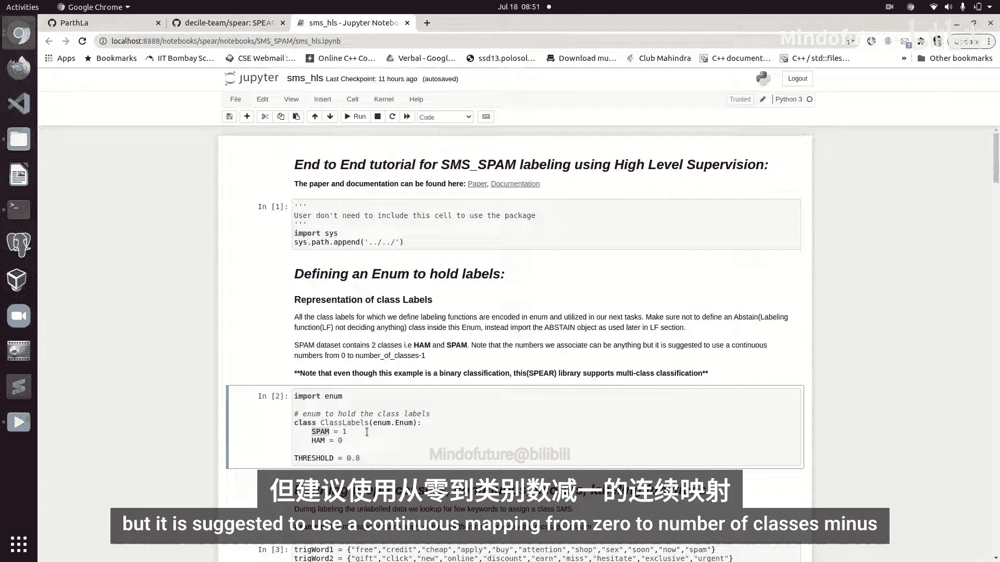

---

## 定义预处理函数与标注函数

上一节我们定义了数据标签，本节中我们来看看如何为数据定义预处理函数和标注函数。为了演示，我们展示一个将文本转换为小写的预处理函数声明方式。

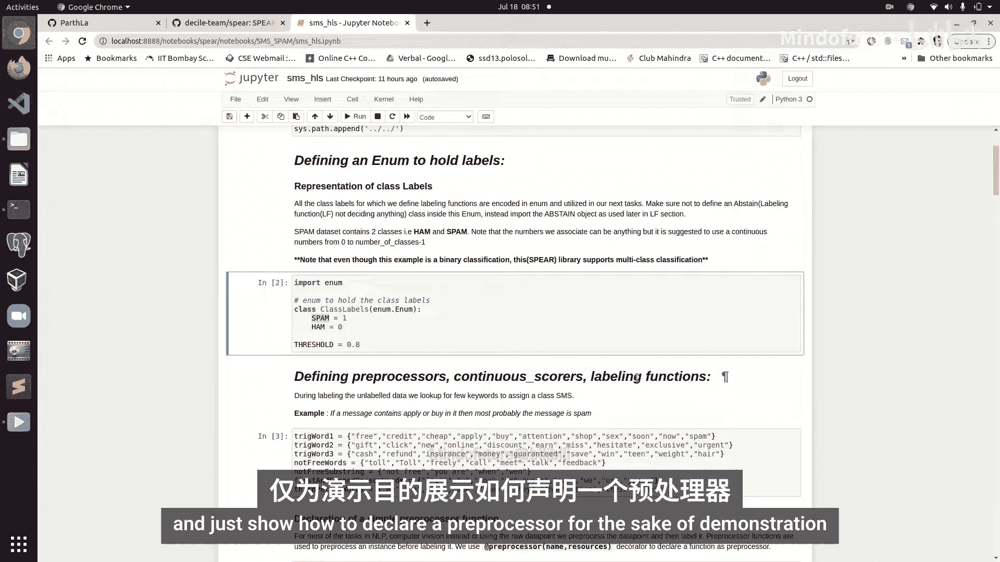

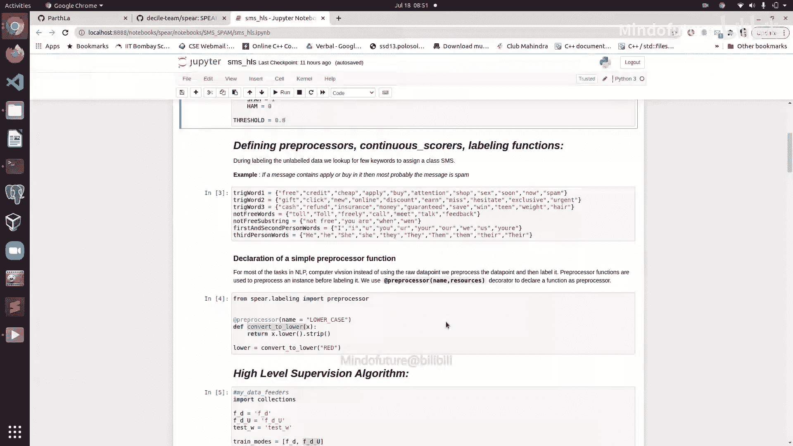

```python
def convert_to_lower(text):
    return text.lower()
```

以下是标注函数和连续评分函数的定义方式（此处不展开详述）。

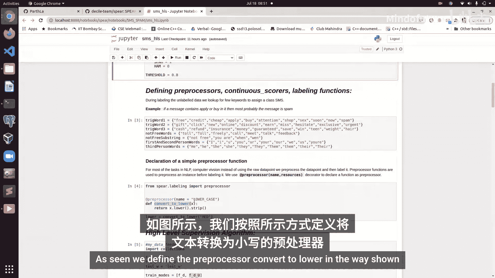

---

## 理解训练模式

高级监督模块支持两种主要的训练模式：`FD` 和 `FDU`。

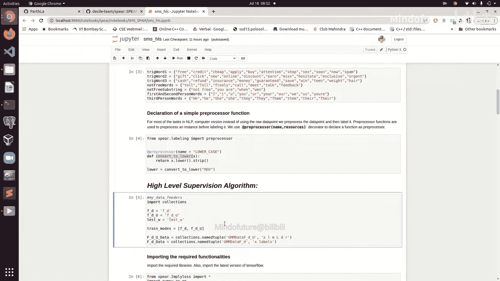

*   **`FD` 模式**：模型仅在**已标注数据**上进行训练。
*   **`FDU` 模式**：模型在**已标注和未标注数据**上共同进行训练。

选择哪种模式取决于你拥有的数据类型。

---

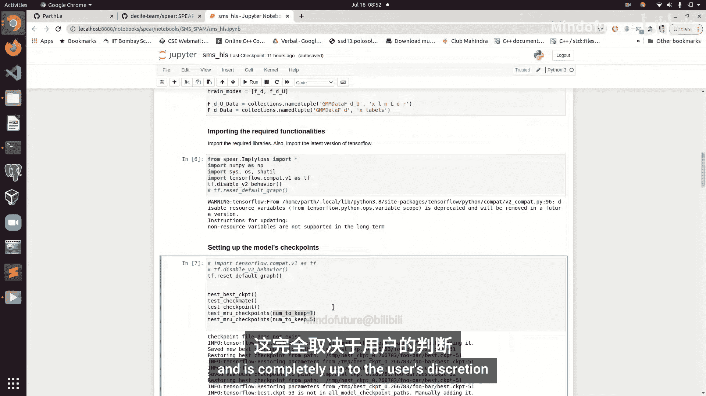

## 导入库与设置检查点

接下来，我们需要导入必要的功能库。同时，为了便于后续使用，我们会保存模型的检查点。保存检查点的数量可以作为参数传入。

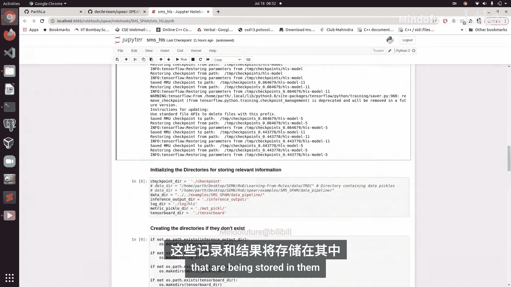

```python
import torch
import spear_ml

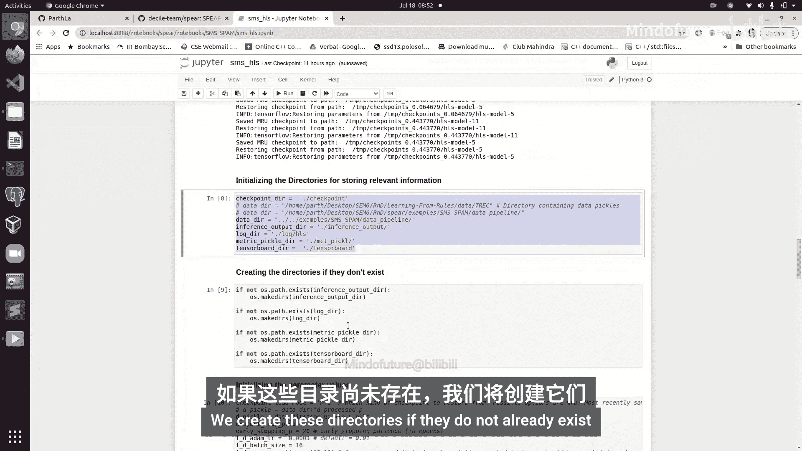

# 保存模型检查点，num_checkpoints 由用户决定
def save_checkpoints(model, path, num_checkpoints=5):
    # ... 保存逻辑
```

---

## 初始化目录与参数

我们为不同的日志记录和结果存储初始化对应的目录。如果这些目录不存在，则创建它们。

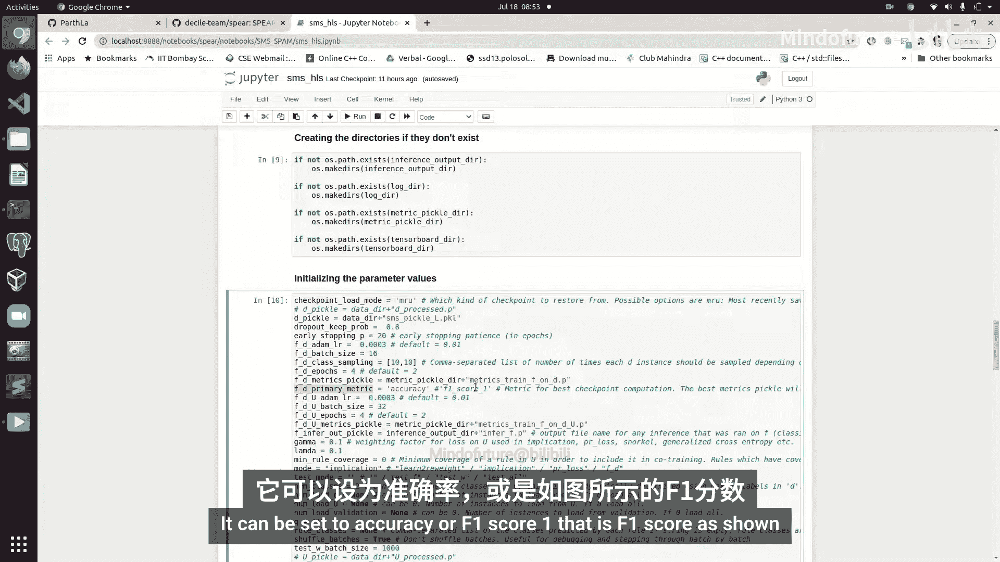

```python
import os

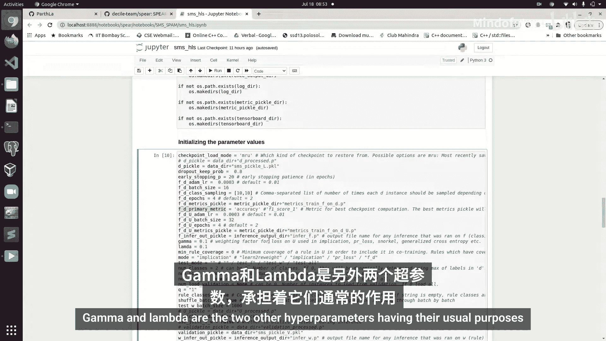

log_dir = './logs'
result_dir = './results'
os.makedirs(log_dir, exist_ok=True)
os.makedirs(result_dir, exist_ok=True)
```

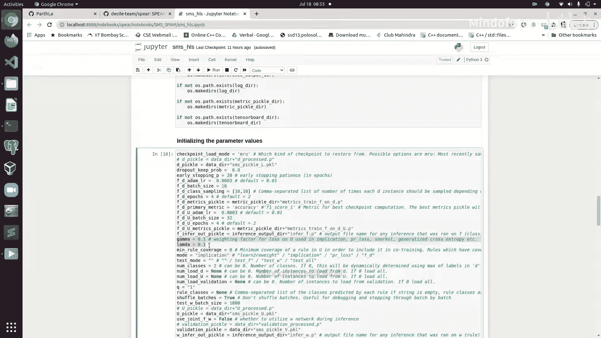

然后，我们初始化决定模型输出的各种参数和超参数。

以下是 `FD` 模式的一些常见参数：
```python
learning_rate = 0.001
batch_size = 32
num_epochs = 10
```

对于 `FDU` 模式，也需要初始化相应的参数。我们还需要设置评估模型性能的主要指标，可以是准确率或 F1 分数。

```python
primary_metric = 'accuracy'  # 或 'f1_score'
```

此外，还有两个超参数 `gamma` 和 `lambda`，它们有其特定的用途。

---

## 选择训练与测试算法

高级监督模块支持多种训练算法。我们需要通过初始化 `mode` 变量来选择要使用的算法。

```python
mode = 'implication'  # 可选：'implication', 'learn2reweight', 'pr_loss', 'maj_voter'
```
*   `implication`：暗示损失算法。
*   `learn2reweight`：Learn2Reweight 算法。
*   `pr_loss`：PR 损失算法。
*   `maj_voter` (`FD`)：多数投票算法。

该模块基于两个网络：**F网络**（分类网络）和 **W网络**（规则网络）。在测试时，我们可以选择测试哪个网络。

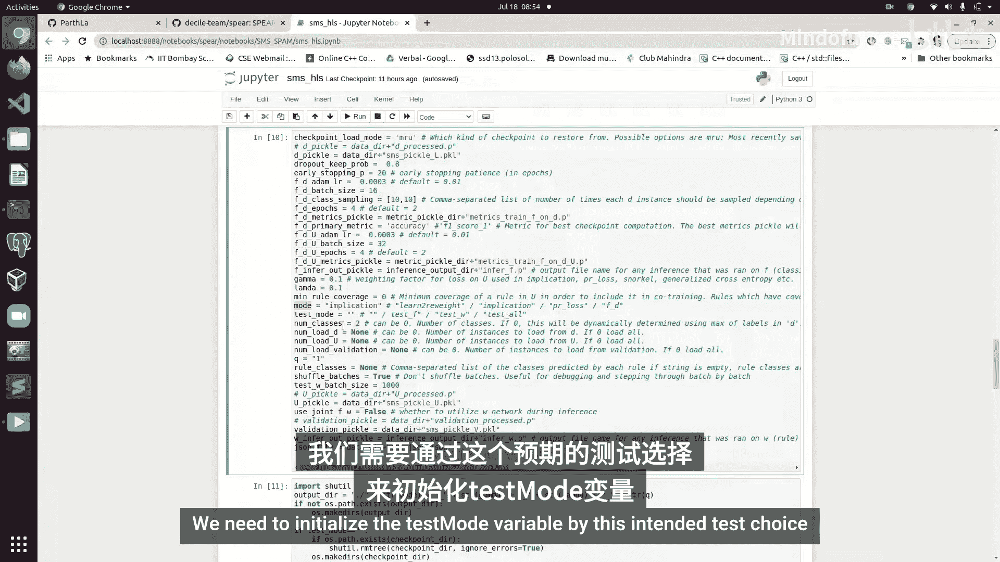

```python
test_mode = 'both'  # 可选：'f_network', 'w_network', 'both'
```

我们还需要初始化类别数量，以及一个布尔变量 `use_joint_fw` 来决定在推理和测试时是否同时使用 F 和 W 网络。

```python
num_classes = 2
use_joint_fw = True  # True 表示同时使用 F 和 W 网络
```

之后，初始化存储相关数据的变量，并根据模式、超参数等系统化地命名输出测试文件。

---

## 创建数据供给器

我们创建一个数据供给器类，其目的是对数据进行预处理。此时，我们拥有了一个数据供给器对象，将在后续命令中使用。

```python
data_feeder = DataFeeder(preprocessor=convert_to_lower, ...其他参数)
```

为了解输入数据的结构，我们可以提取以下信息：
*   输入特征数量
*   使用的类别数量
*   使用的规则数量
*   训练所用的规则数量

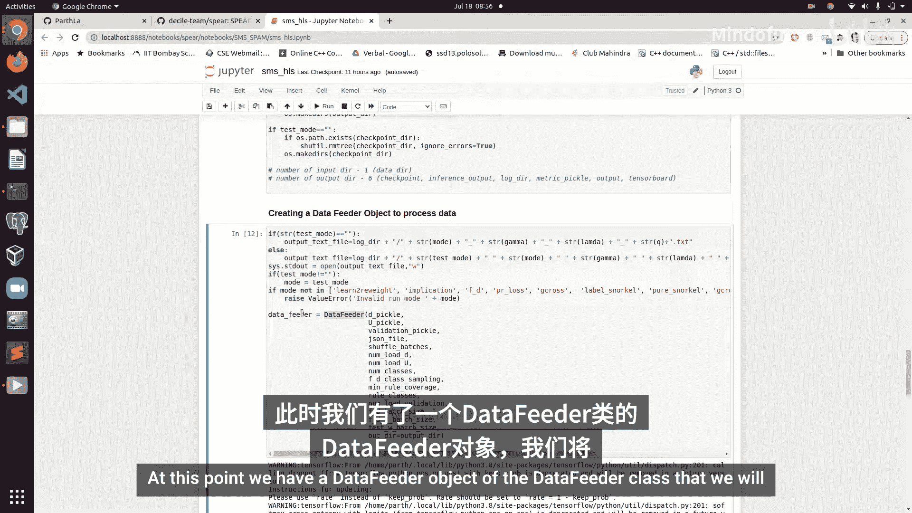

---

## 初始化网络模型

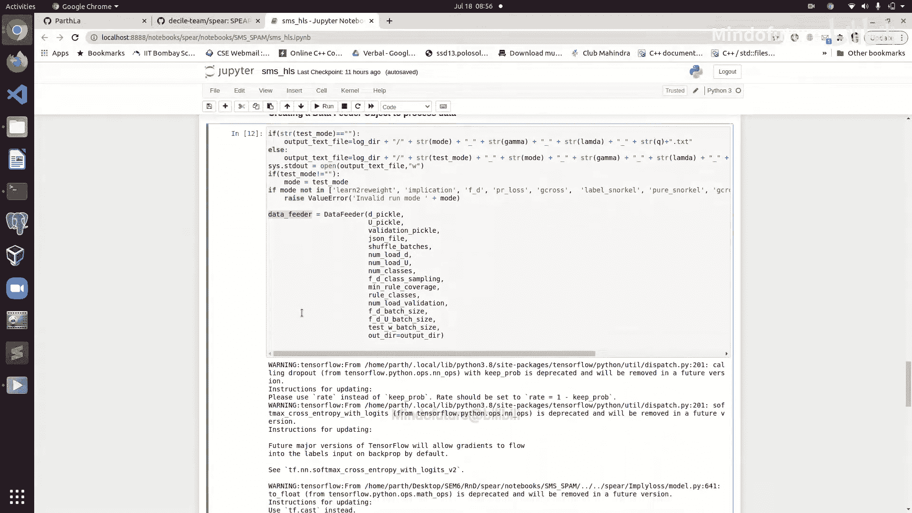

接着，我们初始化之前提到的 F 网络和 W 网络。

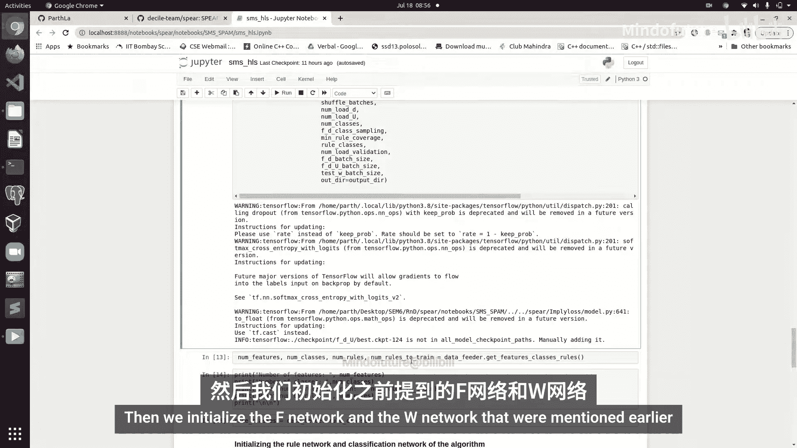

```python
f_network = ClassificationNetwork(input_dim, num_classes)
w_network = RuleNetwork(num_rules)
```

---

## 训练与测试模型

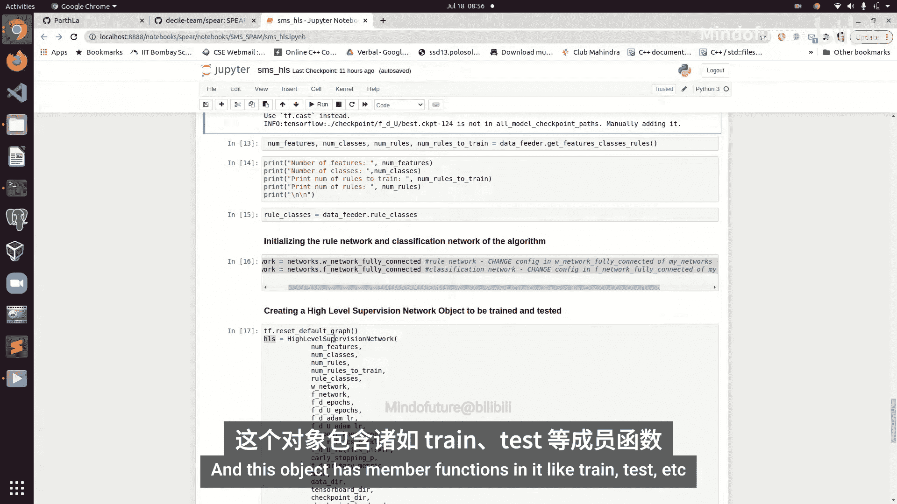

我们创建一个高级监督网络类的对象 `HLS`，该对象包含 `train`、`test` 等成员函数，用于在可用数据上训练和测试模型。

```python
hls = HighLevelSupervisionNetwork(f_network, w_network, mode=mode)
```

根据选择的训练算法调用不同的训练方法：

```python
if mode == 'maj_voter':
    # FD 模式，需要已标注数据
    hls.train_f_on_d(labeled_data)
else:
    # 其他算法（如 implication, learn2reweight），可使用已标注和未标注数据
    hls.train_on_fdu(labeled_data, unlabeled_data)
```

同样，根据测试模式调用对应的测试函数。

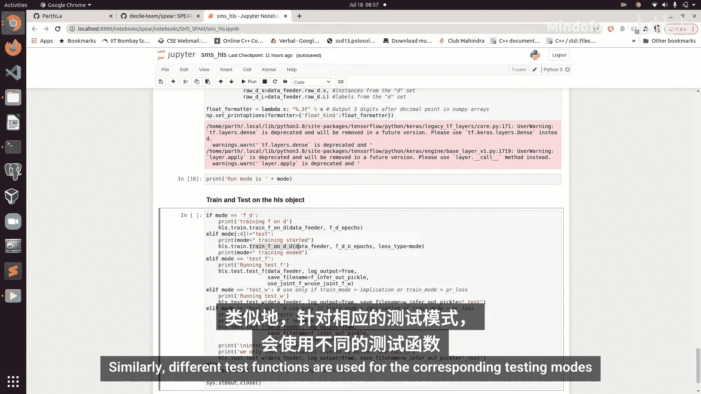

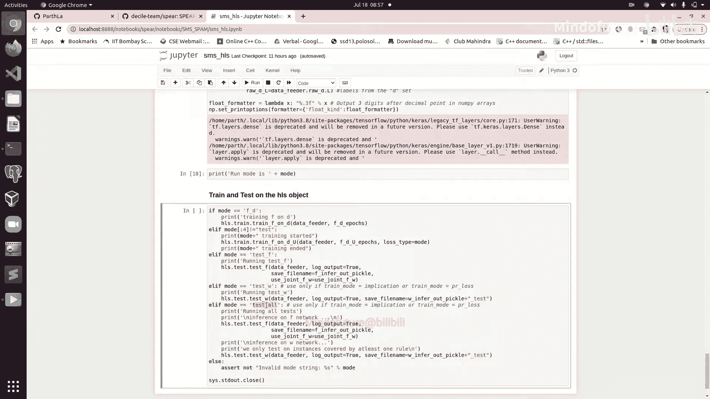

---

## 总结

本节课中，我们一起学习了使用 SPEAR 库的高级监督模块进行数据标注和模型训练的完整流程。我们从定义标签和预处理函数开始，逐步讲解了训练模式的选择、超参数设置、网络初始化以及最终的训练与测试步骤。通过本教程，你应该能够利用标注函数和其他相关组件，对你自己的数据集应用高级监督学习算法。

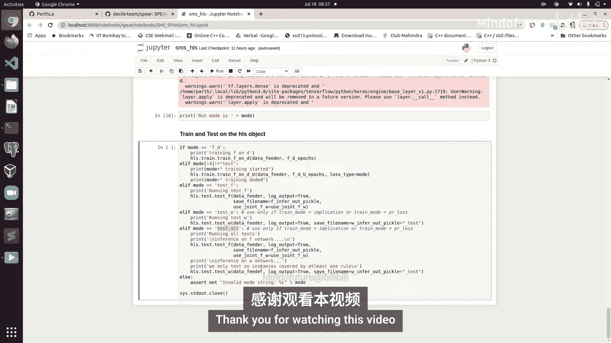

如有任何疑问、建议或反馈，欢迎联系 SPEAR 研究小组。感谢观看本视频。