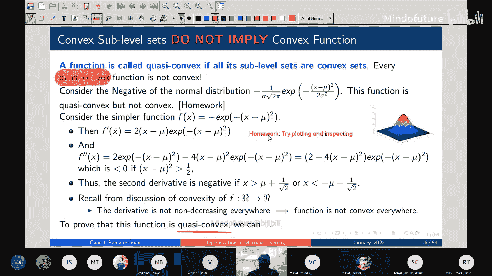

# 009：凸函数、拟凸性与方向导数

在本节课中，我们将结束对机器学习中凸函数的讨论，并引入一个非常重要的概念——方向向量。方向向量将帮助我们过渡到凸函数的一阶和二阶定义与性质。我们将从作业问题讨论开始，然后总结凸函数的剩余性质或示例，最后探讨方向向量、梯度和次梯度的概念。

## 作业问题讨论

以下是本周作业中关于损失函数凸性的讨论。

### 1. L1/L2正则化逻辑回归损失函数
该损失函数是凸的。原因在于，其内部第一项（对数求和指数项）在特定替换下是凸函数，而正则化项（范数）也是凸函数。凸函数之和仍为凸函数，因此整个函数是凸的。

**核心概念**：
*   **凸函数之和**：若 `f(x)` 和 `g(x)` 是凸函数，则 `h(x) = f(x) + g(x)` 也是凸函数。
*   **对数求和指数函数**：`log(sum(exp(g_i(x))))` 在 `g_i(x)` 为仿射函数（或常数）时是凸的。

### 2. L1/L2正则化支持向量机（SVM）损失函数
该损失函数是凸的。原因在于，它是两个函数的逐点最大值：一个常数函数 `0` 和一个线性函数 `1 - y_i * theta^T * x_i`。线性函数是凸的，常数函数也是凸的，而有限个凸函数的逐点最大值仍是凸函数。

**核心概念**：
*   **逐点最大值**：若 `f_1(x), ..., f_k(x)` 是凸函数，则 `h(x) = max(f_1(x), ..., f_k(x))` 也是凸函数。

### 3. L1/L2正则化多类逻辑回归损失函数
该损失函数是凸的。可以将其视为单类逻辑回归损失函数的推广，本质上是线性项与对数求和指数项的组合，因此是凸的。

### 4. L1/L2正则化最小二乘损失函数
该损失函数是凸的。第一项可以视为平方函数与线性函数的复合，平方函数是凸的，线性函数是仿射的，因此复合后是凸的。第二项是范数正则化项，也是凸的。

**核心概念**：
*   **凸函数的仿射复合**：若 `f(x)` 是凸函数，`g(x) = Ax + b` 是仿射函数，则 `h(x) = f(g(x))` 是凸函数。

### 5. 矩阵补全损失函数
该损失函数是凸的。第一项是仿射函数（观测矩阵与参数矩阵之差）的范数，是凸的。第二项是谱范数（核范数），即矩阵奇异值向量的范数，也是凸的。

**核心概念**：
*   **谱范数（核范数）**：矩阵 `X` 的谱范数 `||X||_*` 等于其奇异值之和，是一种凸的范数。

### 6. Softmax上下文赌博机损失函数
该函数在参数 `theta` 上既不是凸函数，也不是凹函数。分母中也包含参数 `theta`，导致其性质复杂。尽管如此，该问题仍有高效的求解方法。

## 强凸性回顾

上一节我们介绍了凸函数的基本性质，本节中我们简要回顾一个重要的强化概念——强凸性，它在算法收敛性分析中扮演关键角色。

一个函数 `f` 是强凸的，如果存在常数 `mu > 0`，使得函数 `f(x) - (mu/2) * ||x||^2` 仍然是凸函数。参数 `mu` 被称为强凸性参数。

**核心概念**：
*   **强凸性定义**：`f` 是强凸的，若 `g(x) = f(x) - (mu/2) * ||x||^2` 是凸函数，其中 `mu > 0`。
*   **意义**：强凸性意味着函数存在一个二次下界，这通常能带来更快的算法收敛速度。需要注意的是，强凸性并不保证函数处处可微（例如，L1正则化的Hinge损失函数是强凸但不可微的）。

## 方向导数

理解了函数的凸性后，我们自然要问：如何找到函数的最小值点？对于单变量函数，我们令导数 `f'(x) = 0`。对于多变量函数，我们需要推广这一概念，这就引出了方向导数。

方向导数衡量的是函数在某一点沿特定方向的变化率。

**定义**：对于函数 `f: R^n -> R`，在点 `x` 处沿单位向量 `v` (即 `||v|| = 1`) 的方向导数定义为：
`D_v f(x) = lim_{h->0} [f(x + h*v) - f(x)] / h`
前提是该极限存在。

**重要性质**：
1.  如果取 `v` 为坐标轴方向的单位向量 `e_k`（第k个分量为1，其余为0），那么方向导数 `D_{e_k} f(x)` 就是偏导数 `∂f/∂x_k`。
2.  如果函数 `f` 在点 `x` 可微，那么沿任意方向 `v` 的方向导数存在，且可以通过梯度计算：`D_v f(x) = ∇f(x)^T * v`。
3.  由性质2和柯西-施瓦茨不等式可知，方向导数的最大值出现在 `v` 与梯度 `∇f(x)` 同向时，且最大值为 `||∇f(x)||`。这为梯度下降算法提供了动机。

**几何直观**：考虑函数的等高线图。在一点处，沿等高线切线方向移动，方向导数为零（函数值不变）。沿垂直于等高线向函数值降低最快的方向移动，方向导数负值最大（绝对值最大），此方向正是负梯度方向。

## 下水平集与拟凸性

在观察函数等高线时，我们注意到凸函数的等高线所围成的内部区域（即下水平集）似乎是凸的。本节中我们来看看这一观察是否普遍成立，并引出拟凸性的概念。

**定义**：函数 `f` 的 `α`-下水平集定义为：`L_α = {x | f(x) ≤ α}`。

**凸函数的下水平集**：如果函数 `f` 是凸函数，那么对于任意 `α`，其下水平集 `L_α` 都是凸集。
*   **证明思路**：任取 `x1, x2 ∈ L_α`，即 `f(x1) ≤ α`, `f(x2) ≤ α`。根据凸性，对任意 `θ ∈ [0,1]`，有 `f(θ*x1 + (1-θ)*x2) ≤ θ*f(x1) + (1-θ)*f(x2) ≤ θ*α + (1-θ)*α = α`。因此 `θ*x1 + (1-θ)*x2 ∈ L_α`，故 `L_α` 是凸集。

**逆命题是否成立？** 如果一个函数的所有下水平集都是凸集，那么这个函数本身一定是凸函数吗？答案是否定的。

**反例**：函数 `f(x) = log(|x|)`。对于任意 `α`，其下水平集 `{x | log(|x|) ≤ α} = {x | |x| ≤ e^α}` 是一个关于原点对称的区间，是凸集。但 `f(x)` 本身并不是凸函数（例如，在 `x=0` 处未定义，且图形不是“碗状”）。

**拟凸函数**：我们将所有下水平集均为凸集的函数称为**拟凸函数**。
*   所有凸函数都是拟凸函数，但反之不成立（如 `log(|x|)`）。
*   拟凸性比凸性更弱，条件更宽松。

**课后思考**：尝试绘制或分析标准正态分布密度函数的负值（即 `f(x) = -exp(-x^2/2)`）的下水平集。验证其是否为拟凸函数？它是否是凸函数？

## 总结

本节课中我们一起学习了：
1.  **作业回顾**：分析了多种常见机器学习损失函数的凸性，并运用了凸函数的和、逐点最大值、仿射复合等保持凸性的运算性质。
2.  **强凸性**：回顾了强凸性的定义及其在加速算法收敛中的作用。
3.  **方向导数**：引入了方向导数的概念，将其定义为函数沿特定方向的变化率，并建立了其与梯度的关系（`D_v f(x) = ∇f(x)^T v`），指出梯度方向是函数上升最快的方向。
4.  **下水平集与拟凸性**：证明了凸函数的下水平集必为凸集。反之则不成立，从而引出了**拟凸函数**的定义——所有下水平集均为凸集的函数。拟凸性是比凸性更广泛的一类函数性质。

这些概念为我们后续深入理解一阶优化条件、次梯度计算以及设计优化算法奠定了重要的基础。