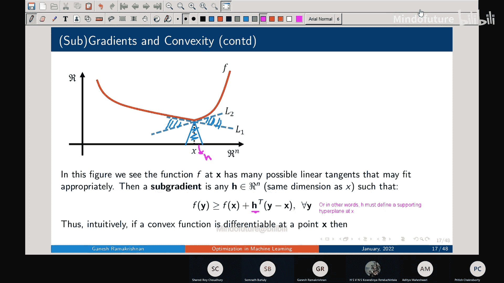

# 010：凸性与一阶性质

在本节课中，我们将要学习凸函数的一阶性质，包括如何通过梯度来定义凸函数的支撑超平面，并初步了解次梯度的概念。我们首先会回顾上节课关于拟凸性的内容，然后深入探讨凸函数与其上图的关系，最后引出次梯度的定义。

## 回顾：凸函数的次水平集

上一节我们介绍了凸函数的次水平集。对于一个凸函数 **f**，其所有次水平集 **L_α(f) = {x | f(x) ≤ α}** 都是凸集。然而，反之则不成立：一个函数的所有次水平集都是凸集，并不能保证该函数本身是凸的，这类函数被称为**拟凸函数**。

## 拟凸性示例：负高斯函数

以下是关于负高斯函数拟凸性的证明思路。

我们考虑一个简化后的函数：**f(x) = -exp(-(x-μ)²)**。我们的目标是证明该函数是拟凸的，但不是凸的。

**证明其非凸性：**
对于标量情况，我们可以检查其二阶导数。函数 **f(x)** 的二阶导数在某些区间内为负值，例如当 **|x-μ| > 1/√2** 时。由于凸函数要求二阶导数处处非负，因此该函数不是凸函数。

**证明其拟凸性：**
我们需要证明对于任意 **α**，次水平集 **{x | -exp(-(x-μ)²) ≤ α}** 是凸集。这等价于证明集合 **{x | exp(-(x-μ)²) ≥ -α}** 是一个连续的区间（在 **μ** 附近）。由于指数函数在 **x<μ** 时单调递增，在 **x>μ** 时单调递减，因此该集合总是一个连续的区间，从而是凸集。这证明了 **f(x)** 是拟凸函数。

## 凸函数与上图

本节中我们来看看凸函数的另一种等价定义——通过其**上图**。

函数 **f** 的**上图**是位于其图像上方的所有点的集合，即 **epi(f) = {(x, t) | x ∈ D, t ≥ f(x)}**，这是一个 **R^(n+1)** 空间中的集合。

**核心结论：**
一个函数是凸函数，当且仅当其上图是凸集。

这个性质比次水平集的性质更强，因为它建立了凸函数与凸集之间的一一对应关系。这对于我们后续理解对偶性等问题非常重要。

## 凸函数的一阶性质

基于上图的概念，我们可以推导出凸函数的一阶性质。直观理解是，凸函数在其定义域内任意一点的切线（或更一般地，支撑超平面）都位于函数图像的下方。

**一阶条件：**
设 **f** 是在凸集 **D** 上可微的函数，则 **f** 是凸函数当且仅当对于所有 **x, y ∈ D**，有：
**f(y) ≥ f(x) + ∇f(x)^T (y - x)**

这个公式意味着，函数在任何点 **x** 处的线性近似（由梯度给出）都是该函数的一个全局下界估计。

**几何解释：**
在点 **(x, f(x))** 处，由梯度 **∇f(x)** 和偏移量 **-1** 定义的超平面 **h = [∇f(x); -1]** 支撑着函数的上图。这个超平面在 **x** 处与函数相切，并且整个上图都位于该超平面的一侧。

对于严格凸和强凸函数，有类似但更强的一阶条件：
*   **严格凸**：当 **x ≠ y** 时，有严格不等式 **f(y) > f(x) + ∇f(x)^T (y - x)**。
*   **强凸**：存在常数 **m > 0**，使得 **f(y) ≥ f(x) + ∇f(x)^T (y - x) + (m/2) ||y - x||²**。

## 从一阶条件证明凸性

**充分性证明：**
假设一阶条件成立。取任意 **x1, x2 ∈ D** 和 **θ ∈ [0,1]**，令 **x = θ x1 + (1-θ)x2**。分别对 **(x, x1)** 和 **(x, x2)** 应用一阶条件：
1.  **f(x1) ≥ f(x) + ∇f(x)^T (x1 - x)**
2.  **f(x2) ≥ f(x) + ∇f(x)^T (x2 - x)**

将第一个不等式乘以 **θ**，第二个乘以 **(1-θ)**，然后相加。利用 **θ(x1 - x) + (1-θ)(x2 - x) = 0**，我们得到：
**θ f(x1) + (1-θ) f(x2) ≥ f(x) = f(θ x1 + (1-θ)x2)**
这正是凸函数的定义。

**必要性证明：**
需要利用导数的定义。对于凸函数 **f** 和任意点 **x, y**，根据凸性定义，对于任意 **θ ∈ (0,1]**，有：
**f(x + θ(y - x)) ≤ (1-θ)f(x) + θ f(y)**
整理可得：
**[f(x + θ(y - x)) - f(x)] / θ ≤ f(y) - f(x)**
令 **θ → 0**，左边即为方向导数 **∇f(x)^T (y - x)**，于是得到：
**∇f(x)^T (y - x) ≤ f(y) - f(x)**
这等价于一阶条件 **f(y) ≥ f(x) + ∇f(x)^T (y - x)**。

## 次梯度的引入

上一节我们介绍了可微凸函数的一阶性质。本节中我们来看看当函数凸但不可微时的情况。

对于在某些点不可微的凸函数（例如 hinge loss 函数），在不可微点（如“拐点”处），可能不存在唯一的梯度，但依然存在支撑函数上图的超平面。实际上，可能存在**无数个**这样的超平面。

**次梯度定义：**
对于凸函数 **f** 定义域内的一点 **x**，一个向量 **g** 被称为 **f** 在 **x** 点的**次梯度**，如果它满足以下条件：
**f(y) ≥ f(x) + g^T (y - x), for all y**
所有这样的 **g** 构成的集合称为 **f** 在 **x** 点的**次微分**，记作 **∂f(x)**。

**几何解释：**
每个次梯度 **g** 都对应一个支撑超平面，其法向量为 **[g; -1]**。在可微点，次微分只包含一个元素，即梯度 **∇f(x)**。在不可微点，次微分是一个集合（可能包含多个向量，甚至是一个线段或更复杂的凸集）。

本节课中我们一起学习了凸函数的一阶性质及其几何意义。我们了解到凸函数在其定义域内任一点的梯度都定义了该函数的一个全局线性下界。更重要的是，我们引入了**次梯度**的概念，它将可微情况下的梯度性质推广到了不可微的凸函数，为后续研究非光滑优化算法奠定了基础。