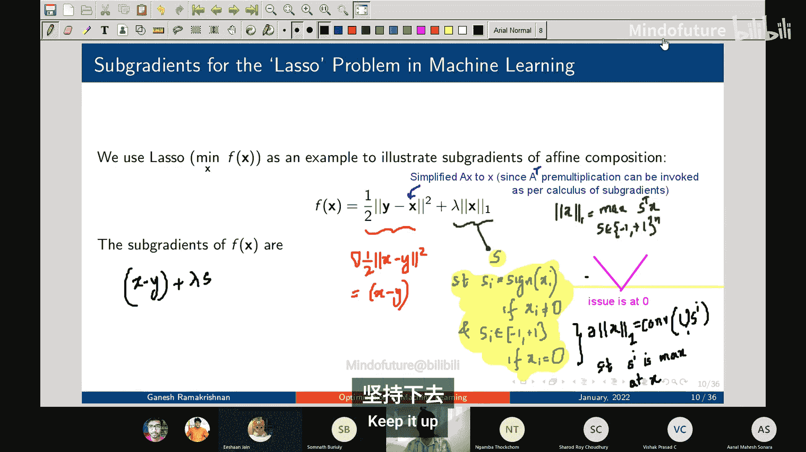

# 011：次梯度计算

在本节课中，我们将要学习凸函数的一阶和二阶性质，并深入探讨一个重要的概念——次梯度。次梯度是梯度概念的推广，它允许我们处理那些不可微的凸函数，这在机器学习优化问题中非常常见。

上一节我们介绍了凸函数的方向导数和曲率，本节中我们来看看当函数不可微时，如何定义其“梯度”。

## 次梯度的引入

对于一个凸函数，即使它在某点不可微，其上方图（epigraph）在对应点也存在一个支撑超平面。这个支撑超平面对应的法向量，就是原函数在该点的“次梯度”。因此，次梯度是梯度概念的推广。

*   **核心定义**：对于凸函数 `f`，向量 `g` 是其在点 `x` 的一个次梯度，当且仅当对于定义域内所有 `y`，都满足：
    `f(y) >= f(x) + g^T (y - x)`
    所有次梯度构成的集合称为 **次微分**，记作 `∂f(x)`。它是一个闭凸集。

## 次梯度的性质与计算

以下是关于次微分的一些重要性质：

*   **唯一性**：如果凸函数 `f` 在点 `x` 可微，那么其次微分 `∂f(x)` 是单点集，且唯一元素就是梯度 `∇f(x)`。
*   **非空性**：对于凸函数，次微分在定义域内每一点都是非空的。
*   **凸组合**：如果 `g1` 和 `g2` 分别是函数在点 `x` 的次梯度，那么它们的任何凸组合 `θ*g1 + (1-θ)*g2`（其中 `0 <= θ <= 1`）也是 `f` 在点 `x` 的次梯度。

现在，让我们看一些具体函数的次梯度例子。

### 最大值函数的次梯度

考虑函数 `f(x) = max(f1(x), f2(x), ..., fm(x))`，其中每个 `fi` 都是凸函数。在点 `x` 处，令 `I(x)` 为达到最大值的函数下标集合（即“活跃”函数集）。那么 `f` 在点 `x` 的次微分是这些活跃函数在 `x` 点梯度的凸包。

**公式表示**：
`∂f(x) = conv{∇fi(x) | i ∈ I(x)}`
其中 `conv` 表示凸包。

### L1 范数的次梯度

L1 范数 `||x||_1 = Σ|xi|` 是一个典型的不可微凸函数。我们可以将其重写为最大值形式：`||x||_1 = max_{s: si ∈ {-1,1}} s^T x`。利用最大值函数的次梯度规则，可以得到：

*   当 `xi ≠ 0` 时，次梯度在 `i` 方向的分量为 `sign(xi)`。
*   当 `xi = 0` 时，次梯度在 `i` 方向的分量可以是 `[-1, 1]` 区间内的任意值。

**公式表示**：
对于 `g ∈ ∂||x||_1`，其分量 `gi` 满足：
`gi = sign(xi)`，若 `xi ≠ 0`
`gi ∈ [-1, 1]`，若 `xi = 0`

### 更一般的 Lp 范数与对偶性

Lp 范数 `||x||_p` 的定义涉及 Holder 不等式，这引入了对偶性的概念。Lp 范数可以等价地通过对偶方式定义：
`||x||_p = max_{z: ||z||_q <= 1} z^T x`
其中 `1/p + 1/q = 1`。这里 `||·||_q` 称为 `||·||_p` 的对偶范数。例如，L2 范数的对偶是它自身，L1 范数的对偶是 L∞ 范数。

## 应用于机器学习：Lasso 问题的次梯度

考虑一个简化的 Lasso 问题目标函数：
`F(x) = (1/2) * ||y - x||_2^2 + λ * ||x||_1`
其中第一项可微，第二项是 L1 范数。根据次梯度的加法规则（凸函数的正线性组合），`F(x)` 的次微分为：
`∂F(x) = (x - y) + λ * ∂||x||_1`
将 `∂||x||_1` 的具体形式代入，我们就得到了用于优化（例如次梯度下降法）的关键表达式。

## 次梯度计算练习

作为课后练习，请思考如何计算复合函数 `f(x) = h(g(x))` 的次梯度，其中 `h` 是凸的且各分量非减，`g` 是凹的且各分量非增（这正是我们证明 `log(sum(exp(x)))` 凸性时用到的结构）。**提示**：尝试从次梯度的基本定义出发进行推导。

本节课中我们一起学习了次梯度的概念、性质和一些重要函数的次梯度计算。次梯度是处理不可微凸优化问题的强大工具，在带有 L1 正则化等结构的机器学习模型中有着直接的应用。理解并掌握次梯度的计算，是进行相关模型优化的重要基础。