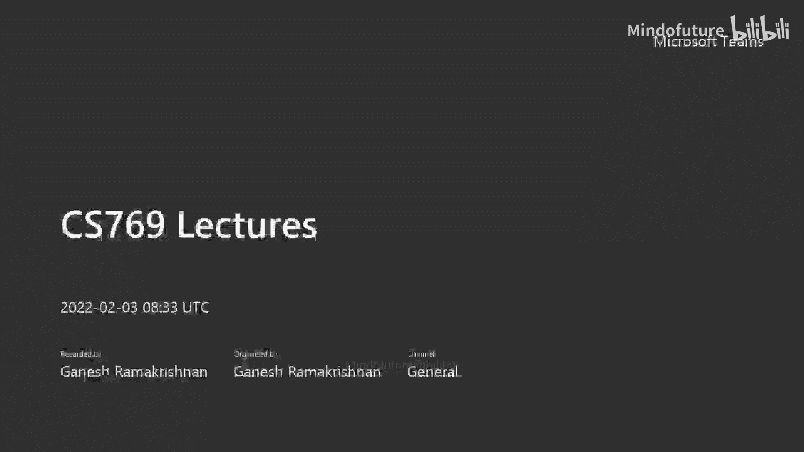
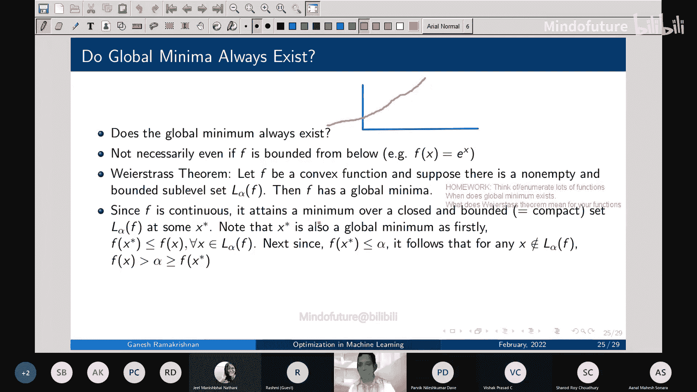
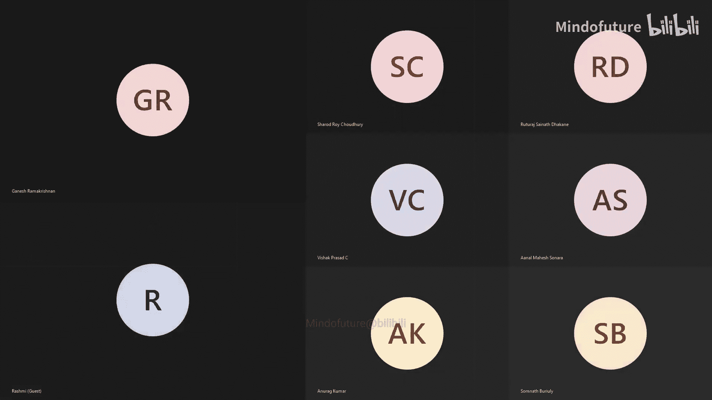

# 012：次梯度计算结束与凸性、局部和全局最小值



在本节课中，我们将结束关于次梯度计算的讨论，并基于作业的讨论，深入探讨局部和全局最小值。我们将审视优化问题的充分条件，建立其与次梯度的联系，并探讨凸性与全局最小值的关系。最后，我们将为后续学习一阶和二阶优化算法打下基础。

## 次梯度计算回顾与作业讨论

上一节我们介绍了次梯度的基本概念。本节中，我们来看看如何应用这些概念解决具体问题，特别是复合函数的次梯度计算。

以下是关于复合函数 `F(x) = P(Q(x))` 次梯度计算的要点，其中 `Q(x) = [Q1(x), ..., Qk(x)]`：

*   **情况一：P 凸且非递减，每个 Qi 凸**
    对于这种情况，我们可以推导出 F 的一个次梯度。思路是分两步利用次梯度不等式：
    1.  利用每个凸函数 Qi 的次梯度不等式。
    2.  利用 P 的凸性及其在每一维上的非递减性质，将第一步得到的不等式代入。
    最终得到的次梯度形式为：`∑_i (∂P/∂Qi) * ∂Qi`，其中 ∂P/∂Qi 和 ∂Qi 分别是 P 在 Q(x) 处和 Qi 在 x 处的（某个）次梯度。需要注意的是，此方法构造出的是 F 次微分的一个子集，未必是全部。

*   **情况二：P 凸且非递增，每个 Qi 凹**
    计算逻辑与情况一类似，但需注意由于 Qi 是凹函数，其不等式方向相反（使用超梯度）。最终得到的次梯度表达式形式相同。

## 邻近算子简介

在分析约束优化问题时，邻近算子是一个非常有用的工具。

考虑点 x 到凸集 C 的距离函数：`d(x) = inf_{y∈C} ||x - y||`。这个函数是凸的。我们可以通过指示函数重新表述带约束的优化问题：
`min_{x∈C} f(x)` 等价于 `min_x f(x) + I_C(x)`，其中 `I_C(x)` 在 x∈C 时为0，否则为+∞。

邻近算子可以看作是对指示函数 `I_C(x)` 的一种近似。当我们将约束惩罚项替换为 `(1/2λ)||x - y||^2` 时，就引出了邻近梯度下降算法的基础。与次梯度相关的另一个概念是法锥，它描述了在集合边界点处所有可能的“向外”方向。

## 单调性与凸性的关系

我们已知，对于一元可微凸函数，其导数 `f'(x)` 是单调不减的。那么，对于多元函数，梯度的单调性如何定义呢？

我们不能简单地要求梯度的每个分量都单调不减，因为这过于严格且不实用。取而代之的是，我们定义向量值函数 `g(x)`（例如梯度）的单调性如下：

*   **单调性**：如果对于所有 x, y，有 `(g(x) - g(y))^T (x - y) ≥ 0`，则 g 是单调的。
*   **强单调性**：如果存在常数 m > 0，使得对于所有 x, y，有 `(g(x) - g(y))^T (x - y) ≥ m ||x - y||^2`，则 g 是强单调的。

这与凸性有深刻联系：
*   **定理**：一个可微函数 f 是凸的，当且仅当其梯度 ∇f 是单调的。
*   **定理**：一个可微函数 f 是强凸的，当且仅当其梯度 ∇f 是强单调的。

直观理解，单调性要求向量 `g(x) - g(y)` 与向量 `x - y` 的夹角始终为锐角或直角，这正是一元函数导数不减在高维空间的推广。

## 优化问题：局部与全局最小值

现在让我们正式进入优化问题的讨论。考虑一个函数，它可能具有多个局部极小值和极大值。

*   **全局最小值**：对于定义域 D 中的所有 x，如果 `f(c) ≤ f(x)`，则 c 是全局最小值点。
*   **局部最小值**：如果存在一个以 c 为中心的开球 B，使得对于 B 中的所有 x，有 `f(c) ≤ f(x)`，则 c 是局部最小值点。

那么，次梯度与最小值点有何关系？

*   **充分条件**：对于凸函数 f，如果 `0 ∈ ∂f(x*)`（即零向量属于 f 在 x* 处的次微分），那么 x* 是 f 的全局最小值点。
    证明很简单：根据次梯度定义，对于所有 y，有 `f(y) ≥ f(x*) + 0^T (y - x*) = f(x*)`。
    特例：若 f 可微，该条件简化为 `∇f(x*) = 0`。

## 应用：LASSO问题的软阈值算子

让我们将上述充分条件应用于 LASSO 问题的简化形式：
`min_x (1/2)||x - y||^2 + λ||x||_1`
我们已知其目标函数的次微分是：`∂f(x) = x - y + λ s`，其中 `s_i = sign(x_i)`（若 `x_i ≠ 0`），否则 `s_i ∈ [-1, 1]`。

为了找到最小值点，我们应用充分条件 `0 ∈ ∂f(x*)`。通过分析 `x_i` 的不同情况，可以得到著名的软阈值算子解：

```
x*_i = {
    y_i - λ,      if y_i > λ
    0,            if -λ ≤ y_i ≤ λ
    y_i + λ,      if y_i < -λ
}
```

这个解直观地表示：当 `y_i` 的绝对值大于 λ 时，将其向零收缩 λ；当 `y_i` 的绝对值小于等于 λ 时，直接置为零。这恰好是产生稀疏解的原因。该解也是迭代软阈值算法的基础。

## 凸函数最小值的重要性质

对于凸优化问题，局部最小值和全局最小值之间有非常强的联系：

*   **性质一**：对于凸函数，任何局部最小值点同时也是全局最小值点。
    **证明思路**（反证法）：
    1.  假设 x 是局部最小点，y 是全局最小点且 `f(y) < f(x)`。
    2.  构造点 `z = θy + (1-θ)x`，其中 θ 足够小，使得 z 位于 x 的局部最小邻域内。
    3.  根据凸性，`f(z) ≤ θf(y) + (1-θ)f(x)`。
    4.  由于 `f(y) < f(x)`，可得 `f(z) < f(x)`。
    5.  这与 x 是局部最小值点矛盾。因此，`f(x)` 必须等于 `f(y)`，x 也是全局最小值点。

*   **性质二**：对于严格凸函数，全局最小值点是唯一的。
    **证明思路**（反证法）：
    1.  假设存在两个不同的全局最小值点 x 和 y。
    2.  考虑其中点 `z = (x+y)/2`。
    3.  根据严格凸性，`f(z) < (1/2)f(x) + (1/2)f(y) = f(x)`。
    4.  这与 x, y 是全局最小值点矛盾。因此，全局最小值点只能有一个。

最后需要指出，即使凸函数有下界，其最小值也不一定总能取到（例如 `e^x` 下界为0但无法取到）。保证最小值存在的一个充分条件是：函数存在一个非空且有界的下水平集。

## 总结

本节课中我们一起学习了：
1.  完成了复合函数次梯度计算的讨论，理解了其构造方法。
2.  介绍了邻近算子的概念及其与约束优化的联系。
3.  探讨了梯度单调性与函数凸性的等价关系。
4.  明确了局部最小值与全局最小值的定义，并掌握了利用次梯度判断全局最小值的充分条件。
5.  将理论应用于LASSO问题，推导出了其解析解——软阈值算子。
6.  证明了凸函数局部最小值即全局最小值，以及严格凸函数全局最小值唯一这两个关键性质。





这些内容为我们接下来学习具体的优化算法奠定了坚实的理论基础。