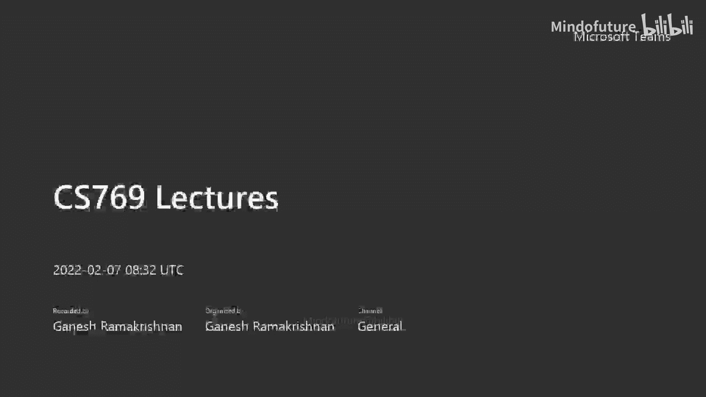
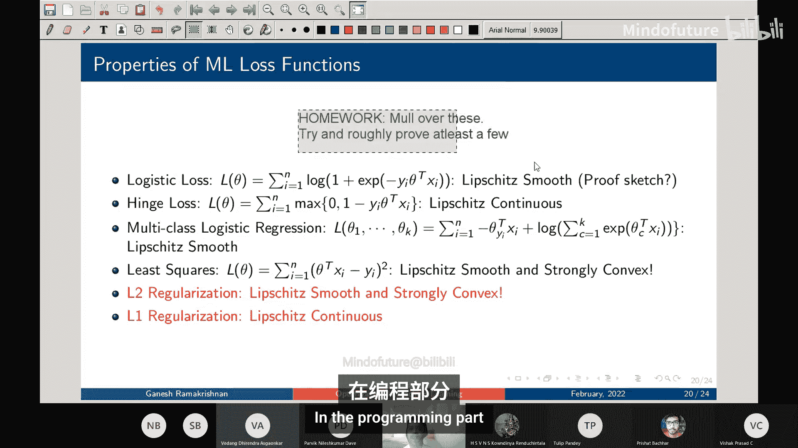

# 013：凸性、最小值与利普希茨连续性对算法的作用 🎯

在本节课中，我们将深入学习凸性与全局最小值的关系，并引入一个对优化算法至关重要的概念——利普希茨连续性。我们将探讨这些概念如何为后续的算法收敛性分析奠定基础。

## 凸性与最优性条件回顾

上一节我们介绍了凸函数的最优性条件。对于凸函数，零次梯度是全局最小值的**充分条件**。这意味着，如果在一个点处找到零次梯度，那么该点就是全局最小值点。

此外，我们提到了一个重要的存在性定理：如果一个凸函数存在**非空且有界的下水平集**，那么该函数必然存在全局最小值。反之，即使函数有下界（如函数 \( e^x \)），若其下水平集无界，也可能不存在全局最小值点。

## 鞍点：非凸优化中的挑战

在讨论全局和局部最小值时，我们无法避开**鞍点**。鞍点是梯度为零，但既不是局部最小值也不是局部最大值的点。

*   **直观理解**：想象一个马鞍的形状。沿着一个方向（如马的前后方向），该点是局部最小值；沿着另一个方向（如马的左右方向），该点则是局部最大值。
*   **数学示例**：考虑函数 \( f(x) = x^3 - 5x \)。其导数为 \( f'(x) = 3x^2 - 5 \)。在 \( x = 0 \) 处，导数为负，但二阶导数（曲率）为零。检查其邻域会发现，它既不是局部最小也不是局部最大，而是一个鞍点。
*   **重要性**：在深度神经网络等非凸优化问题中，鞍点的分析至关重要，因为它们可能使优化算法陷入停滞。

## 约束凸优化问题简介

一个一般的约束凸优化问题形式如下：
\[
\min_{x} f(x) \quad \text{subject to} \quad x \in \mathcal{X}
\]
其中 \( \mathcal{X} \) 是一个凸集，\( f(x) \) 是凸函数。

*   **约束集**：通常由一组凸不等式 \( g_i(x) \leq 0 \) 定义，每个不等式都描述了一个凸的“半空间”。整个可行域 \( \mathcal{X} \) 就是这些半空间的交集。
*   **最优性条件**：对于约束问题，最优性条件不再仅仅是梯度为零。
    *   如果最优解 \( x^* \) 在可行域内部，那么 \( 0 \in \partial f(x^*) \) 仍然是充分条件。
    *   如果 \( x^* \) 在边界上，则需要满足：对于可行域内所有 \( x \)，有 \( \nabla f(x^*)^\top (x - x^*) \geq 0 \)。这意味着在 \( x^* \) 处，梯度方向与指向可行域内部的任何方向都成锐角（或直角），你无法沿着一个可行方向使函数值下降。

## 利普希茨连续性：函数变化的速度上限 🚀

在进入具体算法之前，我们需要理解**利普希茨连续性**。这个概念描述了函数变化的“最大速度”，对分析算法的收敛性极为关键。

一个函数 \( f \) 被称为是 **L-利普希茨连续** 的，如果存在常数 \( L > 0 \)（利普希茨常数），使得对于所有 \( x, y \) 都有：
\[
|f(x) - f(y)| \leq L \|x - y\|
\]
这表示函数值的变化被自变量距离的线性函数所控制。**L 越小，函数变化越平缓**。

*   **与梯度的关系**：如果 \( f \) 可微，那么利普希茨连续性等价于其梯度范数有界：\( \| \nabla f(x) \| \leq L \)。
*   **性质**：
    *   两个利普希茨连续函数之和仍是利普希茨连续的，常数约为两者之和。
    *   两个**有界**的利普希茨连续函数之积也是利普希茨连续的。

## 利普希茨光滑性：梯度变化的速度上限 📈

一个更严格的概念是 **利普希茨光滑性**，它约束的是**梯度**的变化速度。

一个函数 \( f \) 被称为是 **L-光滑** 的，如果其梯度是 L-利普希茨连续的：
\[
\| \nabla f(x) - \nabla f(y) \| \leq L \|x - y\|
\]
这大致意味着函数的**曲率（Hessian矩阵的特征值）有上界**。对于二次可微函数，这等价于 \( \nabla^2 f(x) \preceq L I \)。

*   **几何意义**：L-光滑函数可以被一个二次函数“从上界”紧紧包裹，这为后续梯度下降法的分析提供了关键工具。
*   **与强凸性的对比**：回忆一下，**强凸性**要求曲率有**下界**（\( \nabla^2 f(x) \succeq \mu I \)），确保函数不会太平坦。而**光滑性**要求曲率有**上界**，确保函数不会太弯曲。两者可以同时存在（\( \mu \leq L \)），分别从下方和上方约束了函数的形状。

## 概念层次与实例

在闭有界集上，这些概念之间存在包含关系（从宽到严）：
1.  **连续函数**
2.  **几乎处处可微的函数**（如 \( \|x\|_1 \)）
3.  **利普希茨连续函数**
4.  **连续可微函数**（梯度连续）
5.  **利普希茨光滑函数（L-光滑）**

**示例分析**：
*   \( f(x) = x^2 \)：既是强凸的（\( \mu=2 \)），也是光滑的（\( L=2 \)）。
*   \( f(x) = |x| \)：是利普希茨连续的（\( L=1 \)），但并非处处可微，因此不属于光滑函数。
*   \( f(x) = x^4 \)：在全局范围内不是利普希茨光滑的，因为其梯度 \( 4x^3 \) 的变化速度会随着 \( x \) 增大而无界增长。但在任何闭有界区间内，它是光滑的。

## 重要函数的性质总结 💡

以下是常见机器学习损失函数及其正则化版本的性质总结，理解这些对选择和使用优化算法至关重要：

*   **逻辑损失**：是利普希茨光滑的。
*   **铰链损失**：是利普希茨连续的，但非处处可微。
*   **多类逻辑回归损失**：是利普希茨光滑的。
*   **最小二乘（平方损失）**：既是强凸的，也是利普希茨光滑的（理想情况）。
*   **L2正则化**：使目标函数同时具有强凸性和利普希茨光滑性。
*   **L1正则化**：通常仅保持利普希茨连续性和凸性，但可能不可微。
*   **组合示例**：
    *   L2正则化逻辑回归：强凸且利普希茨光滑。
    *   L1正则化逻辑回归：利普希茨连续。
    *   L1正则化最小二乘（LASSO）：利普希茨连续且强凸（在特定条件下）。

## 总结

本节课中，我们一起深入探讨了凸优化问题的核心理论。我们回顾了凸函数的最优性条件，认识了非凸优化中的“拦路虎”——鞍点，并简要了解了约束优化问题的形式。随后，我们重点学习了**利普希茨连续性**和**利普希茨光滑性**这两个核心概念，它们分别限制了函数值及其梯度的最大变化率，是分析梯度下降等算法收敛性的理论基础。最后，我们总结了常见损失函数的这些性质，为后续实际应用算法做好了准备。下一节，我们将正式进入优化算法的世界。