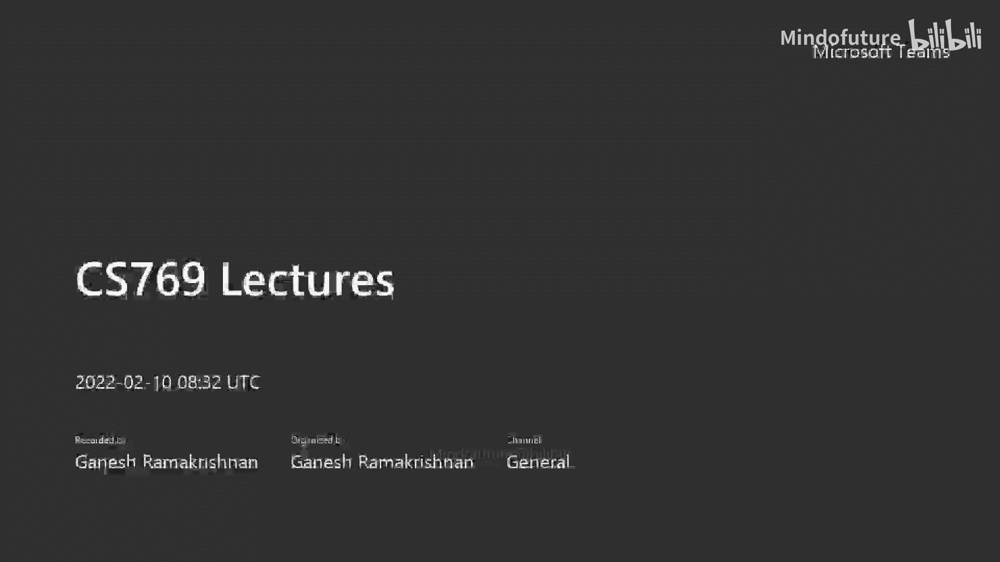
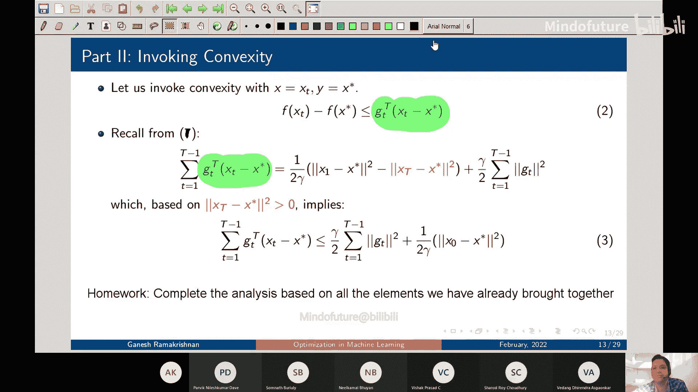

# 014：优化算法与收敛性分析

在本节课中，我们将学习机器学习目标函数的利普希茨连续性与平滑性，并探讨这些性质在梯度下降等优化算法收敛性分析中的重要性。我们将通过具体的数学推导，理解如何利用这些性质来证明算法的收敛性。

## 概述

上一节我们介绍了利普希茨连续性和平滑性的概念。本节中，我们将把这些概念应用到梯度下降算法的分析中，并学习如何利用代数变换和伸缩求和等关键技巧来证明收敛性。

## 利普希茨性质回顾

利普希茨连续性限制了函数值的变化速度。对于一个函数 **f**，如果存在常数 **L**，使得对于所有 **x** 和 **y**，都有：
\[
|f(x) - f(y)| \leq L \|x - y\|
\]
那么该函数是利普希茨连续的。

利普希茨平滑性则限制了梯度变化的速度。如果函数的梯度 **∇f** 是利普希茨连续的，即存在常数 **L**，使得：
\[
\|\nabla f(x) - \nabla f(y)\| \leq L \|x - y\|
\]
那么该函数是利普希茨平滑的。

## 常见损失函数的性质分析

以下是几种常见机器学习损失函数和正则化项的性质总结：

*   **逻辑损失**：既是利普希茨连续的，也是利普希茨平滑的。
*   **Hinge损失**：是利普希茨连续的，但不是利普希茨平滑的。
*   **最小二乘损失**：在有限定义域内，既是利普希茨连续的，也是利普希茨平滑的，并且是强凸的。
*   **L1正则化**：是利普希茨连续的。
*   **L2正则化**：是利普希茨平滑的，并且是强凸的。

对于组合函数，有以下性质：
*   利普希茨连续函数的和仍然是利普希茨连续的。
*   利普希茨平滑函数的和仍然是利普希茨平滑的。
*   凸函数与强凸函数的和是强凸的。

## 优化算法与水平集

任何优化算法的核心思想都是从参数空间中的一个点移动到另一个点。理解这一点的一个有效工具是**水平集**的概念。

在水平集的视角下，算法的每次迭代由两个关键部分组成：**方向**和**步长（幅度）**。利普希茨连续性和强凸性等性质会影响我们选择方向和步长的策略，从而决定了算法收敛到最优解的速度。

## 梯度下降算法

最流行的优化算法之一是梯度下降。对于凸函数 **f**，我们希望找到接近最优解 **x\*** 的点。梯度下降的迭代公式为：
\[
x_{t+1} = x_t - \gamma \nabla f(x_t)
\]
其中，**γ** 是步长参数，**∇f(x_t)** 是函数在 **x_t** 处的梯度。

梯度方向是函数在该点处上升最快的方向，垂直于该点的水平集。然而，这并不意味着可以任意选择大步长。步长过大可能导致在最优解附近震荡，影响收敛。

## 收敛性分析的关键技巧

分析梯度下降收敛性时，我们主要依赖两种代数技巧：

1.  **代数变换**：将点积转化为二次型表达式。
2.  **伸缩求和**：对一系列项求和时，中间项相互抵消，只剩下首尾项。

以下是分析的基本步骤框架：

1.  从梯度下降更新公式出发。
2.  通过引入最优解 **x\*** 和代数运算，得到包含内积 **<∇f(x_t), x_t - x\*>** 的表达式。
3.  利用恒等式 **2vᵀw = \|v\|² + \|w\|² - \|v - w\|²** 将内积转化为范数平方项。
4.  对迭代次数 **t** 求和。利用伸缩求和，许多中间项会被消去。
5.  利用函数的**凸性**对 **<∇f(x_t), x_t - x\*>** 项进行下界估计（根据一阶凸性条件，该项不小于 **f(x_t) - f(x\*)**）。
6.  利用函数的**利普希茨连续性**或平滑性对梯度范数 **\|∇f(x_t)\|²** 项进行上界估计。
7.  将不等式组合起来，最终得到函数值误差 **f(x_t) - f(x\*)** 或解的距离 **\|x_t - x\*\|²** 的上界，该上界随着迭代次数 **t** 增加而衰减，从而证明收敛性。

具体的推导过程涉及细致的数学操作，我们鼓励读者作为练习完成整个证明，以深入理解各性质如何共同保证收敛。

## 总结

本节课中，我们一起学习了如何将利普希茨连续性与平滑性的概念应用于梯度下降算法的理论分析。我们了解到：
*   不同的损失函数具有不同的利普希茨性质。
*   水平集视角有助于理解优化算法的方向与步长选择。
*   收敛性证明依赖于凸性、利普希茨性质以及代数变换和伸缩求和两大核心技巧。
*   在利普希茨平滑和强凸的假设下，梯度下降能够获得更快的收敛速率（例如线性收敛），而仅有利普希茨连续性时，收敛速率通常较慢（例如次线性收敛）。

理解这些分析工具和思想，是设计和理解更复杂优化算法的基础。