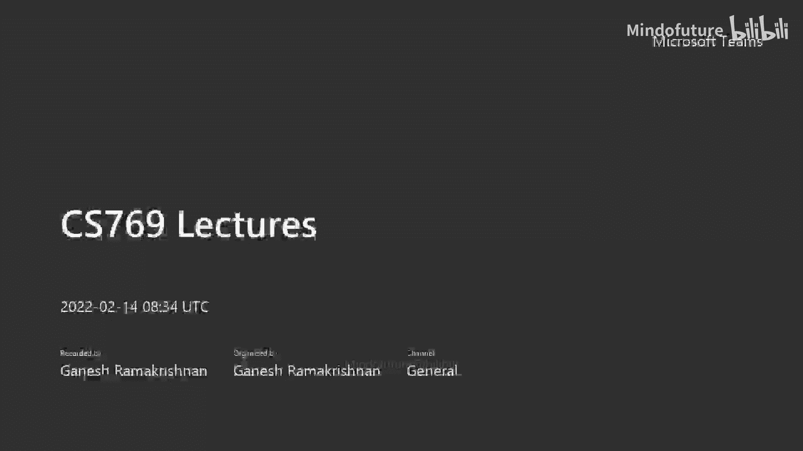
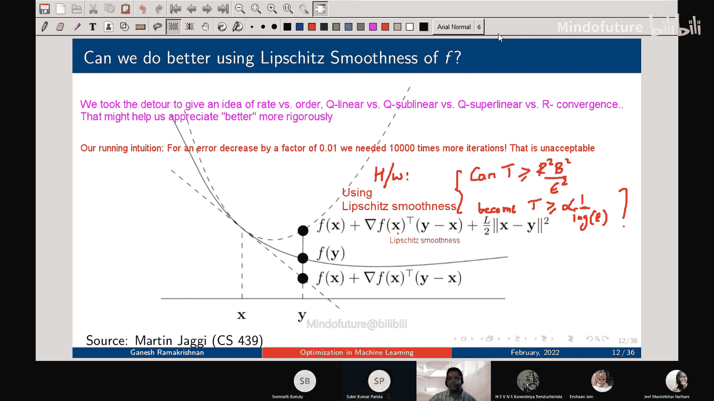

# 015：凸性、利普希茨假设与技巧



## 概述
在本节课中，我们将深入探讨梯度下降算法的收敛性分析。我们将回顾凸性和利普希茨连续性这两个核心假设，并学习如何运用一系列数学技巧来推导梯度下降的收敛速率。通过本次学习，你将理解为什么梯度下降在特定条件下能够收敛，以及如何量化其收敛速度。

## 梯度下降算法回顾
我们从一个简单的梯度下降实现开始。该算法旨在最小化一个目标函数，例如逻辑回归的损失函数。其核心更新规则为：
```python
x_{t+1} = x_t - γ * ∇f(x_t)
```
其中，`γ` 是步长（学习率），`∇f(x_t)` 是在点 `x_t` 处的梯度。算法在满足优化条件（例如梯度范数足够小）或达到最大迭代次数时停止。

上一节我们介绍了梯度下降的基本流程，本节中我们来看看如何从理论上分析它的收敛行为。

## 收敛性分析的数学基础
收敛性分析依赖于对目标函数性质的假设。我们主要使用以下两个性质：
1.  **凸性**：函数图像在其定义域内任意两点连线之上。对于凸函数 `f` 和任意点 `x, y`，有 **f(y) ≥ f(x) + ∇f(x)^T (y - x)**。这为函数值提供了一个线性下界。
2.  **利普希茨连续性**：函数的梯度变化不会太快。存在常数 `B > 0`，使得对于任意 `x, y`，有 **||∇f(x) - ∇f(y)|| ≤ B ||x - y||**。这为梯度范数提供了一个上界。

在分析中，我们设 `x*` 为全局最优点，`f(x*)` 为最优函数值。我们的目标是证明迭代点 `x_t` 的函数值 `f(x_t)` 能收敛到 `f(x*)`。

## 收敛证明的核心技巧
以下是推导收敛速率过程中使用的关键技巧：

**技巧一：代数恒等式展开**
我们利用向量恒等式 `2 * v^T w = ||v||^2 + ||w||^2 - ||v - w||^2` 来处理迭代更新公式中的内积项，将其转化为范数平方项，便于后续应用不等式。

**技巧二：利用凸性得到关键不等式**
将凸性定义应用于 `x = x_t` 和 `y = x*`，我们得到 **f(x*) ≥ f(x_t) + ∇f(x_t)^T (x* - x_t)**。移项后得到 **f(x_t) - f(x*) ≤ ∇f(x_t)^T (x_t - x*)**。这个不等式将函数值的差与梯度和解的距离联系起来。

**技巧三：对迭代进行求和（伸缩求和）**
我们将从第一次迭代到第 `T-1` 次迭代得到的不等式进行求和。求和后，许多中间项会相互抵消，最终表达式主要包含首项、末项以及梯度范数的平方和。

**技巧四：应用利普希茨连续性**
利普希茨连续性给出了梯度范数的上界：**||∇f(x_t)|| ≤ B**。因此，梯度范数的平方和 `∑||∇f(x_t)||^2` 可以被 `(T-1) * B^2` 所界定。

**技巧五：假设初始点不远**
我们假设初始迭代点 `x_1` 距离最优解 `x*` 不太远，即存在一个常数 `R`，使得 **||x_1 - x*|| ≤ R**。这是一个合理的工程假设。

**技巧六：优化步长参数 `γ`**
经过上述步骤，我们得到一个形如 `f(x_t) - f(x*) ≤ A(γ)` 的上界，其中 `A(γ)` 是步长 `γ` 的函数。我们通过最小化 `A(γ)` 来找到使上界最紧的步长，得到最优步长 **γ* = R / (B * √T)**。将其代回上界，得到 **f(x_t) - f(x*) ≤ (R * B) / √T**。

## 收敛速率与含义
令 `x_hat` 为所有迭代中函数值最小的点（即最终输出或最佳迭代点）。根据梯度下降使函数值下降的性质，`f(x_hat)` 不会差于平均表现。因此，我们有：
**f(x_hat) - f(x*) ≤ (R * B) / √T**

这个结论告诉我们：
*   **收敛性**：随着迭代次数 `T` 增加，最优间隙 `f(x_hat) - f(x*)` 以 `1/√T` 的速率趋近于0。
*   **计算复杂度**：为了达到精度 `ε`，即 `f(x_hat) - f(x*) ≤ ε`，所需的迭代次数 `T` 至少为 **Ω( R² * B² / ε² )**。这里 `Ω` 表示下界，意味着迭代次数随精度要求呈平方反比增长。

## 当前分析的局限性与改进方向
虽然我们证明了收敛性，但当前分析揭示的收敛速率较慢（次线性收敛）。要达到 `ε=0.01` 的精度可能需要约 `10^4` 量级的迭代，对于 `ε=0.001` 则需要约 `10^6` 量级，这在实践中可能成本过高。

主要局限性包括：
1.  使用了“神奇”的理论最优步长 `γ*`，该步长依赖于未知的 `R` 和 `B`，在实际中无法直接计算。
2.  收敛速率较慢。
3.  分析基于较弱的 `R-收敛` 概念。

在实践中，我们使用更鲁棒的方法选择步长，例如：
*   **精确线搜索**：在每次迭代中，沿梯度方向寻找精确的最小值点。
*   **回溯线搜索**：从一个较大的步长开始，不断按比例缩小，直到满足阿米霍（Armijo）条件等充分下降条件，保证每次迭代有足够的函数值下降。

此外，利普希茨**光滑性**（Lipschitz Smoothness）是一个比连续性更强的假设，它限制了函数梯度的变化率（即曲率）。在后续课程中我们将看到，利用光滑性假设，结合更先进的算法（如动量法、自适应方法），有望获得更快的收敛速率（例如线性收敛或 `log(1/ε)` 级别的收敛）。



## 总结
本节课中我们一起学习了梯度下降在凸性和利普希茨连续性假设下的收敛性证明。我们通过一系列数学技巧，推导出其收敛速率为 `O(1/√T)`，并理解了达到指定精度所需迭代次数的下界。我们也指出了该分析的局限性，包括收敛速度慢和步长选择不实用等问题，并简要介绍了回溯线搜索等实用步长选择策略，以及利用更强假设（如光滑性）来改进收敛速度的可能性。这为后续学习更高效的优化算法奠定了理论基础。