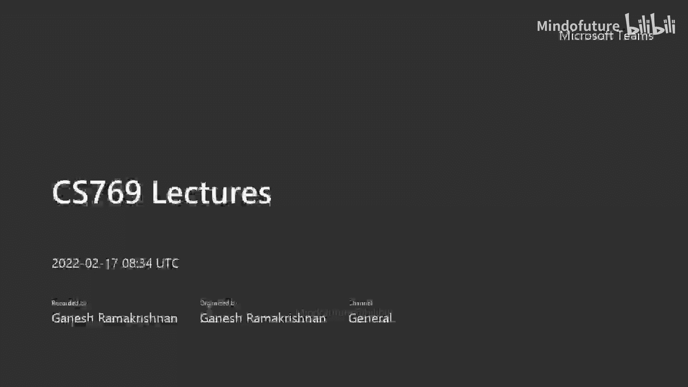
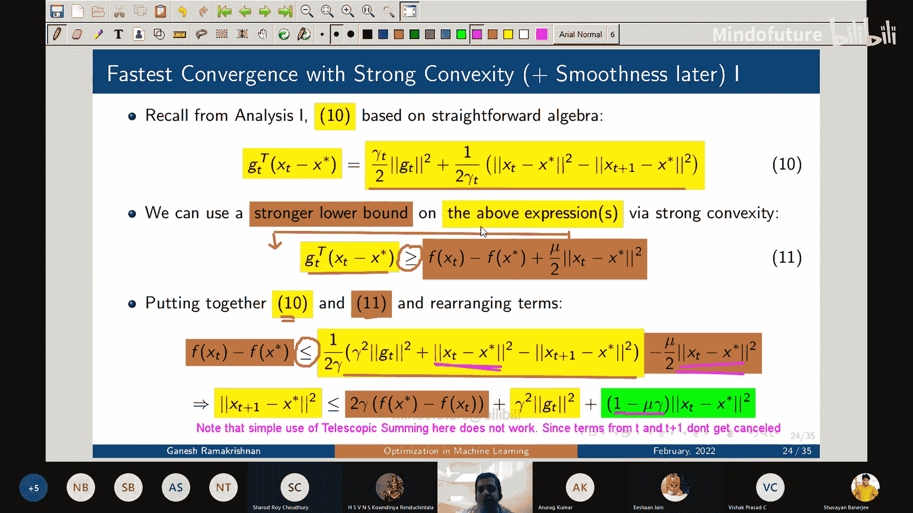

# 016：梯度下降收敛分析（续）

在本节课中，我们将继续分析梯度下降算法的收敛性。我们将重点探讨**利普希茨光滑性**这一重要概念，并回顾之前关于利普希茨连续性和凸性的分析。通过结合这些性质，我们将推导出更快的收敛速率。

---

## 课程回顾

上一节我们介绍了在**利普希茨连续**和**凸**函数假设下，梯度下降的收敛性分析。我们得到的迭代次数与误差平方的倒数成正比，即 `T ~ O(1/ε²)`。这个收敛速度并不理想。

本节中，我们将引入更强的假设——**利普希茨光滑性**，看看它是否能帮助我们获得更好的收敛速度。

## 利普希茨光滑性简介

利普希茨光滑性是对函数梯度变化率的一个上界约束。对于一个利普希茨光滑的函数 `f`，存在一个常数 `L`，使得对于任意两点 `x` 和 `y`，满足以下不等式：

`f(y) ≤ f(x) + ∇f(x)ᵀ(y - x) + (L/2) ||y - x||²`

这个性质意味着函数可以被一个二次函数从上方“包住”，它比单纯的利普希茨连续性（只约束函数值）提供了更多关于函数曲率的信息。在实践中，利普希茨光滑性通常比连续性更常见且更有用。

## 逻辑回归的利普希茨光滑常数

我们之前已经证明，逻辑回归的损失函数是利普希茨光滑的。现在，我们来推导其光滑常数 `L` 的大致形式。

逻辑回归的损失函数形式为：
`L(θ) = Σᵢ log(1 + exp(-yᵢ θᵀxᵢ))`

通过分析其梯度的变化，并利用柯西-施瓦茨不等式，我们可以得到 `L` 的一个上界。这个上界与数据矩阵 `X`（其中每行是一个样本 `xᵢ`）的**最大奇异值（谱范数）**有关。

具体推导涉及复合函数的利普希茨常数计算。最终，逻辑回归的利普希茨光滑常数 `L_LR` 大致满足：
`L_LR ∝ λ_max(XᵀX)`
其中 `λ_max` 是矩阵 `XᵀX` 的最大特征值。这表明数据的尺度会影响优化速度。

## 光滑函数下的梯度下降分析

现在，我们分析当目标函数 `f` 是**利普希茨光滑**时，梯度下降的表现。我们暂时**不假设凸性**。

梯度下降的更新公式为：
`x_{t+1} = x_t - γ ∇f(x_t)`

将 `y = x_{t+1}`, `x = x_t` 代入利普希茨光滑性不等式：
`f(x_{t+1}) ≤ f(x_t) - γ ||∇f(x_t)||² + (Lγ²/2) ||∇f(x_t)||²`
`f(x_{t+1}) ≤ f(x_t) - γ (1 - (Lγ/2)) ||∇f(x_t)||²`

我们的目标是找到一个步长 `γ`，使得每次迭代的函数值下降尽可能多。这引出了我们的**第三个技巧**：**最小化上界**。

我们将不等式右边视为 `γ` 的函数，并对其进行最小化。求导并令导数为零：
`d/dγ [ -γ + (Lγ²/2) ] = -1 + Lγ = 0`
解得最优步长为：
`γ = 1/L`

将这个最优步长代回不等式，我们得到：
`f(x_{t+1}) ≤ f(x_t) - (1/(2L)) ||∇f(x_t)||²`

这是一个非常有力的结论！**即使在没有凸性的情况下，利普希茨光滑性也能保证梯度下降在每一步都使函数值下降，且下降量至少与梯度范数的平方成正比。**

## 结合光滑性与凸性

上一节我们得到了仅凭光滑性就能保证函数值下降。现在，我们引入**凸性**假设，以期获得关于最优解 `x*` 的收敛速率。

我们回到之前凸性分析中得到的核心不等式（经过整理）：
`f(x_t) - f(x*) ≤ (1/(2γ)) [||x_t - x*||² - ||x_{t+1} - x*||²] + (γ/2) ||∇f(x_t)||² - ∇f(x_t)ᵀ(x_t - x*)`

利用凸性性质 `f(x*) ≥ f(x_t) + ∇f(x_t)ᵀ(x* - x_t)`，我们可以简化不等式。然后，我们将之前从光滑性得到的不等式 `||∇f(x_t)||² ≤ 2L [f(x_t) - f(x_{t+1})]` 代入。

经过一系列代数运算和求和（**技巧二：伸缩求和法**），并假设初始点 `x_0` 在最优解 `x*` 的一个半径为 `R` 的球内（即 `||x_0 - x*|| ≤ R`），我们可以推导出：

`f(x_T) - f(x*) ≤ (L R²) / (2T)`

这意味着，为了达到 `f(x_T) - f(x*) ≤ ε` 的精度，所需的迭代次数 `T` 满足：
`T ≥ (L R²) / (2ε)`

与仅有利普希茨连续性和凸性时的 `T ~ O(1/ε²)` 相比，现在的收敛速率是 `O(1/ε)`，这是一个显著的改进！

## 展望：强凸性与更快的收敛

我们之前提到，利普希茨光滑性给出了函数曲率的一个**上界**（与最大特征值 `λ_max` 相关）。自然，我们会想，如果有一个曲率的**下界**呢？这就是**强凸性**。

一个函数是 `μ`-强凸的，如果对于任意 `x, y`，满足：
`f(y) ≥ f(x) + ∇f(x)ᵀ(y - x) + (μ/2) ||y - x||²`

这为函数提供了一个二次下界。常数 `μ` 与海森矩阵的最小特征值 `λ_min` 有关。

当函数同时满足 `L`-光滑和 `μ`-强凸时，其收敛分析会引入比值 `L/μ`，这个比值被称为问题的**条件数**。条件数越大（即 `L >> μ`），问题越“病态”，优化越困难；条件数越接近1，问题越“良态”，优化算法收敛越快。

在强凸和光滑的假设下，梯度下降可以实现**线性收敛**（也称指数收敛），即误差以 `O(ρ^T)` 的速度下降，其中 `ρ < 1` 是一个与条件数相关的常数。这比我们目前看到的 `O(1/T)` 收敛要快得多。

具体的证明会更为复杂，因为强凸性引入的额外项 `(μ/2) ||x_t - x*||²` 使得直接的伸缩求和不能完全消去所有项，但正是这项的留存导致了误差的指数级衰减。我们将在后续课程中详细探讨。

---

## 总结

本节课中我们一起学习了：
1.  **利普希茨光滑性**的定义及其意义，它用二次函数上界约束了梯度的变化。
2.  推导了**逻辑回归**损失函数的利普希茨光滑常数与数据矩阵谱范数的关系。
3.  分析了在**仅有利普希茨光滑性**（无需凸性）下，梯度下降能保证函数值稳定下降，并得到了最优步长 `γ = 1/L`。
4.  将**光滑性与凸性**结合，证明了梯度下降的收敛速率提升为 `O(1/ε)`，优于仅有连续性和凸性时的 `O(1/ε²)`。
5.  展望了**强凸性**的概念，并指出在光滑且强凸的假设下，有望获得更快的线性收敛速率。

理解这些函数性质（连续性、光滑性、凸性、强凸性）如何影响优化算法的收敛行为，是设计和分析高效机器学习算法的基石。