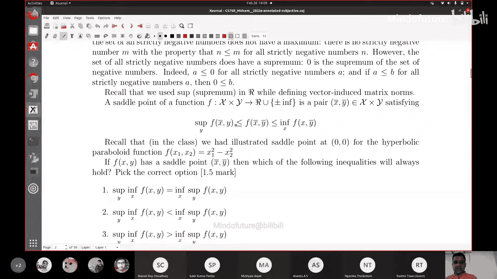
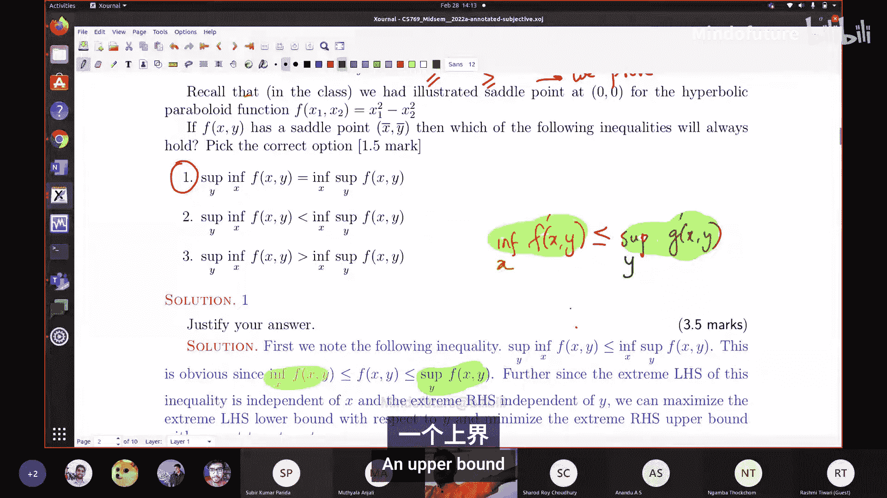
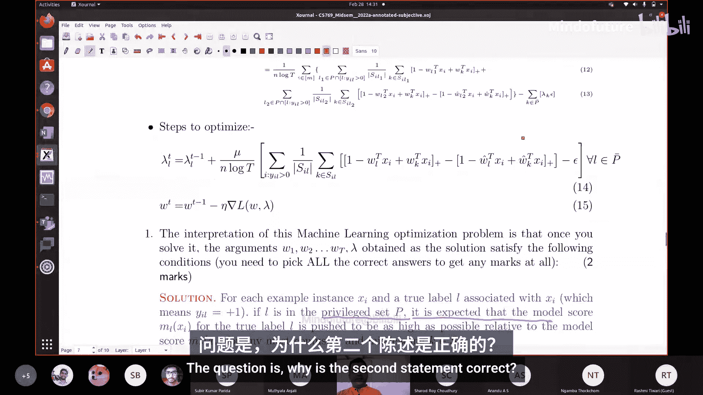
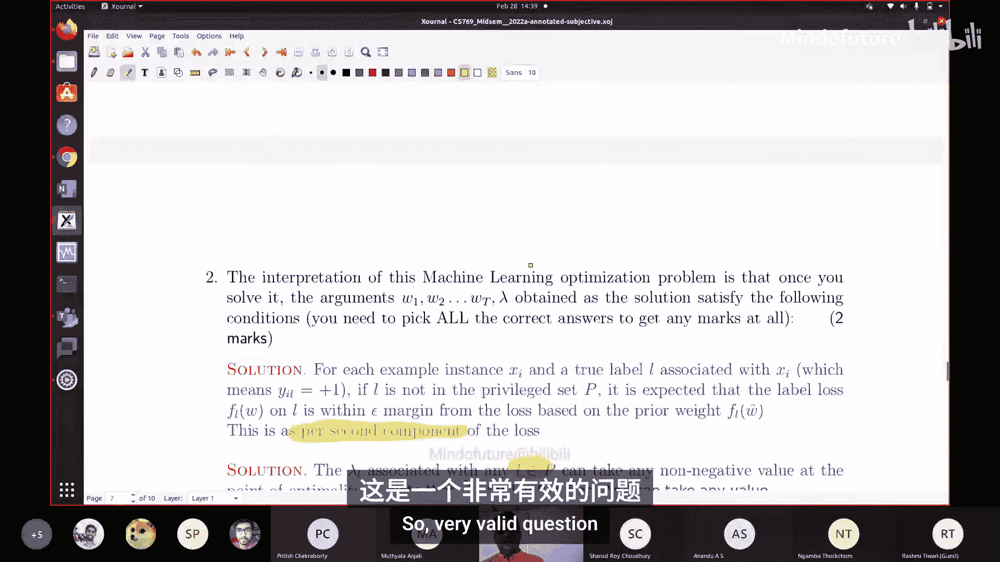
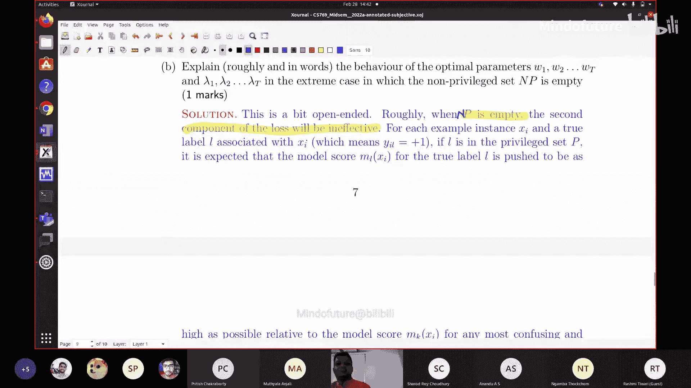
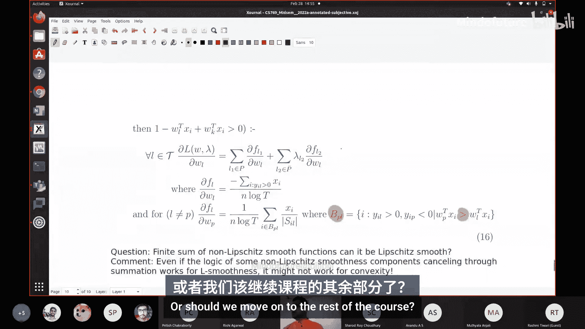
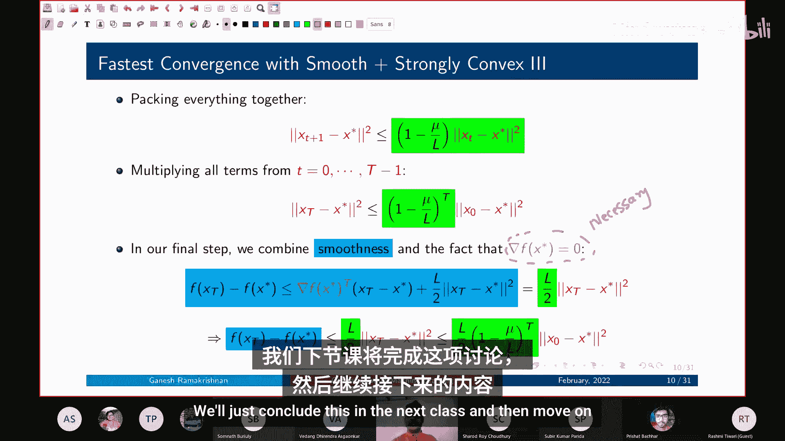

# 017：中期总结与强凸性+利普希茨平滑假设下的梯度下降收敛性分析

## 概述
在本节课中，我们将对机器学习优化课程进行中期总结，并深入分析在函数同时满足**强凸性**和**利普希茨平滑**假设下，梯度下降算法的收敛性。我们将回顾几个关键问题，并逐步推导出更快的收敛速率。

## 问题一：Min-Max不等式与鞍点
上一节我们介绍了优化中的一些基本概念，本节中我们来看看一个关于Min-Max不等式的问题。该不等式指出，对于任意函数，其最小值与最大值之间存在特定关系。

**Min-Max不等式**：
对于函数 \( f(x, y) \)，以下不等式恒成立：
\[
\min_x \max_y f(x, y) \geq \max_y \min_x f(x, y)
\]

当点 \( (\bar{x}, \bar{y}) \) 是函数的一个**鞍点**时，上述不等式变为等式。证明该等式的思路是双向证明不等式。

以下是证明的关键步骤：
1.  首先，对于任意 \( x, y \)，显然有 \( f(x, y) \leq \max_{y'} f(x, y') \)。
2.  由于左边与 \( y \) 无关，我们可以对左边取关于 \( y \) 的下确界，得到 \( \inf_y f(x, y) \leq \max_{y} f(x, y) \)。
3.  现在，左边独立于 \( y \)，右边独立于 \( x \)。我们可以通过分别对左边取关于 \( x \) 的上确界，对右边取关于 \( x \) 的下确界来收紧边界。
4.  最终得到 \( \sup_x \inf_y f(x, y) \leq \inf_y \sup_x f(x, y) \)，这就是Min-Max不等式。
5.  如果存在鞍点 \( (\bar{x}, \bar{y}) \)，将其代入即可证明等式成立。

这个不等式在优化理论中非常重要，特别是在处理博弈论或对抗性训练问题时。

## 问题二：梯度下降中的常见错误分析
在分析梯度下降收敛性时，初学者常会犯一些代数错误。我们通过一个具体例子来审视这些错误。

考虑在**利普希茨平滑**且**凸**的函数上使用梯度下降，步长 \( \gamma = 1/L \)。在推导过程中，可能会发生符号错误或项的顺序错误。

例如，在展开式子 \( f(x_{t+1}) - f(x_t) \) 时，可能会错误地写成加号而不是减号。另一个常见错误是在代入表达式时，没有正确地进行合并同类项和消元。

关键是要理解每一步的意图：我们通常试图将函数值的差与梯度范数的平方联系起来，并利用平滑性假设给出的上界。仔细检查每一步的代数变换，确保其与优化目标（如证明函数值下降）保持一致。

## 问题三：多标签分类中的优化问题解释
现在，我们来看一个更接近实际应用的优化问题：多标签分类。这与我们之前讨论的二元分类不同。

在多标签分类中，一个样本（例如一篇文档）可以同时属于多个类别。例如，一篇关于体育饮料的广告文档可能同时带有“体育”和“食品”的标签。有些标签可能是“特权”的，需要更多关注；有些则是“非特权”的。

我们定义了一个损失函数，其形式类似于支持向量机中的铰链损失，但针对多标签场景进行了扩展。损失函数包含两部分：
1.  对于特权标签，我们鼓励模型正确标签的得分远高于混淆标签的得分。
2.  对于非特权标签，我们不希望过度优化其区分度，而是希望其行为与某个先验模型（例如，一个基于流行度的简单模型）的输出保持在一定范围内。

这个优化问题可以表述为一个Min-Max问题，并可能通过寻找鞍点来求解。对最优解的解释有助于我们理解模型在特权标签和非特权标签上的不同行为。

## 强凸与利普希茨平滑下的梯度下降收敛性分析
回顾了前期问题后，我们进入核心内容：在函数同时满足**强凸性**和**利普希茨平滑**假设下，分析梯度下降的收敛性。

之前我们分别讨论过：
*   仅满足利普希茨连续性时，收敛速度为 \( O(1/\sqrt{T}) \)。
*   仅满足利普希茨平滑性时，收敛速度为 \( O(1/T) \)。

现在，结合**强凸性**，我们期望获得更快的收敛速度。

### 关键不等式与推导
我们从梯度下降的更新公式 \( x_{t+1} = x_t - \gamma \nabla f(x_t) \) 开始。利用**强凸性**和**平滑性**，我们可以得到关于迭代点与最优解 \( x^* \) 之间距离的不等式。

**强凸性**给出下界：
\[
f(y) \geq f(x) + \nabla f(x)^T (y-x) + \frac{\mu}{2} \|y-x\|^2
\]
其中 \( \mu > 0 \) 是强凸系数。

**利普希茨平滑性**给出上界：
\[
f(y) \leq f(x) + \nabla f(x)^T (y-x) + \frac{L}{2} \|y-x\|^2
\]
其中 \( L \) 是平滑常数。

将 \( y = x_{t+1} \)， \( x = x_t \) 代入平滑性条件，并利用梯度下降更新规则，我们得到：
\[
f(x_{t+1}) \leq f(x_t) - \gamma (1 - \frac{L\gamma}{2}) \|\nabla f(x_t)\|^2
\]

同时，将 \( y = x^* \)， \( x = x_t \) 代入强凸性条件，并利用最优解处梯度为零 \( \nabla f(x^*) = 0 \) 的性质，经过一系列代数运算（包括将距离项 \( \|x_t - x^*\|^2 \) 合并到不等式一侧），我们可以推导出：
\[
\|x_{t+1} - x^*\|^2 \leq (1 - \mu\gamma) \|x_t - x^*\|^2 + \text{其他项}
\]

这里的“其他项”包含 \( f(x^*) - f(x_t) \) 和 \( \|\nabla f(x_t)\|^2 \)。我们的目标是证明这个“其他项”是非正的，或者能被控制。

### 收敛速率
通过选择最优步长 \( \gamma = 1/L \)，并利用平滑性条件进一步控制梯度范数项，我们可以证明：
\[
\|x_{t+1} - x^*\|^2 \leq (1 - \frac{\mu}{L}) \|x_t - x^*\|^2
\]

由于 \( \mu \leq L \)（海森矩阵的特征值介于 \( \mu \) 和 \( L \) 之间），因此 \( 0 < 1 - \frac{\mu}{L} < 1 \)。这意味着迭代点与最优解的距离以**线性（指数）速率**收敛：
\[
\|x_t - x^*\|^2 \leq (1 - \frac{\mu}{L})^t \|x_0 - x^*\|^2
\]

为了得到函数值的收敛速率，我们再次利用平滑性条件。在最优解 \( x^* \) 处应用平滑性，并注意到 \( \nabla f(x^*) = 0 \)，可得：
\[
f(x_t) - f(x^*) \leq \frac{L}{2} \|x_t - x^*\|^2
\]

将距离的收敛上界代入，我们最终得到函数值的线性收敛速率：
\[
f(x_t) - f(x^*) \leq \frac{L}{2} (1 - \frac{\mu}{L})^t \|x_0 - x^*\|^2
\]

这比仅满足平滑性时的 \( O(1/T) \) 速率快得多。

## 总结
本节课中我们一起学习了：
1.  **Min-Max不等式**及其在鞍点处取等式的性质，这是分析对偶问题和对抗训练的基础。
2.  在梯度下降收敛性推导中需要避免的常见**代数错误**，强调了严谨推导的重要性。
3.  一个实际的**多标签分类优化问题**，展示了如何将理论应用于设计具有特定偏好的损失函数。
4.  在函数同时满足**强凸性**和**利普希茨平滑性**的强假设下，梯度下降算法可以达到**线性收敛速率**。这是目前我们得到的最快的确定性收敛速率，其关键条件是问题的条件数 \( L/\mu \)。条件数越接近1，收敛越快。

这个分析为我们理解优化算法的效率提供了重要基准，后续我们将探讨如何加速梯度下降，以及处理非平滑和非凸等更复杂情况的方法。