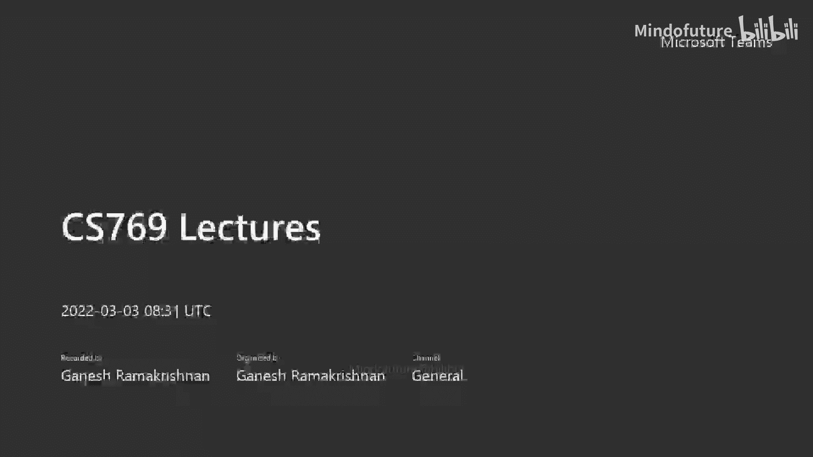
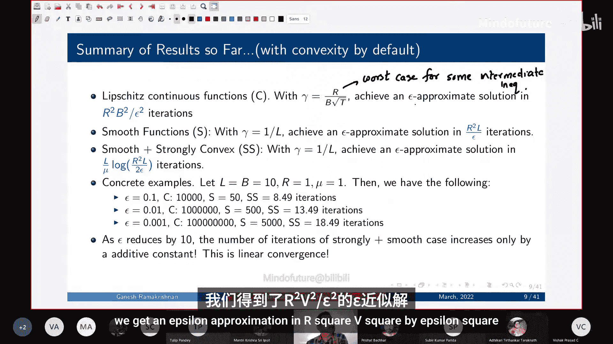
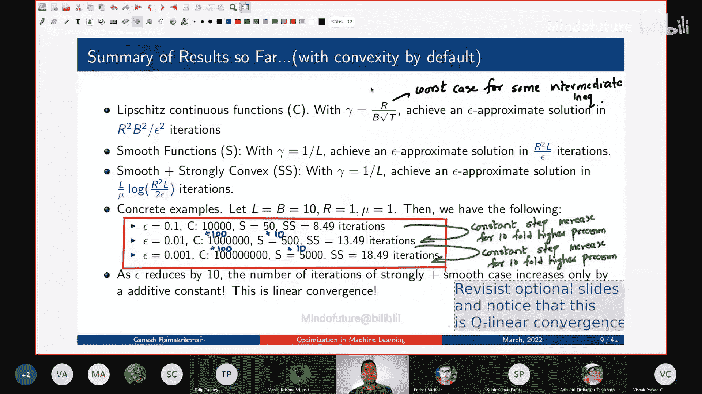
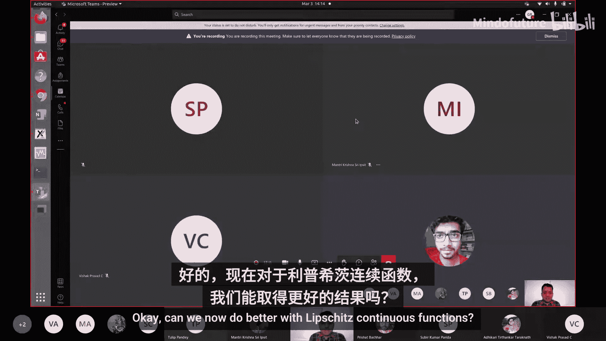
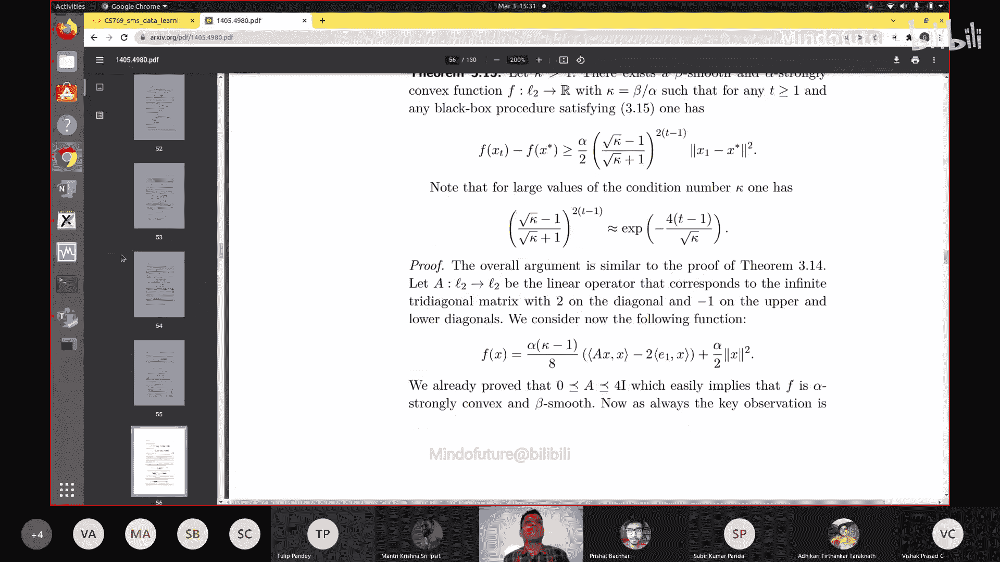

# 018：凸性和利普希茨假设下梯度下降收敛分析的上界与加速梯度下降方法

在本节课中，我们将继续讨论在强凸性和利普希茨连续性假设下梯度下降的收敛性分析。我们将回顾之前得出的结论，并探讨如何通过引入加速方法来改进算法性能。最后，我们将介绍加速梯度下降方法的基本动机和两种主要实现形式。

## 回顾：强凸性与利普希茨光滑性下的收敛性

上一节我们分析了在强凸性和利普希茨光滑性假设下梯度下降的收敛行为。我们得到了一个关键的递推不等式：

**公式**：\|x_{t+1} - x^*\|^2 \leq (1 - \frac{\mu}{L}) \|x_t - x^*\|^2

其中，\(\mu\) 是强凸性系数，\(L\) 是利普希茨光滑系数。由于 \(1 - \frac{\mu}{L}\) 的值在0到1之间，这个不等式保证了迭代误差会指数级衰减。

为了将误差与函数值联系起来，我们结合了光滑性条件和最优解处梯度为零的条件，得到了函数值差的界：

**公式**：f(x_t) - f(x^*) \leq \frac{L}{2} \|x_t - x^*\|^2

进一步，我们假设初始点 \(x_0\) 与最优解 \(x^*\) 的距离存在一个上界 \(R\)，即 \(\|x_0 - x^*\| \leq R\)。基于此，我们可以推导出达到预定精度 \(\epsilon\) 所需的迭代次数 \(T\)。

以下是达到精度 \(\epsilon\) 所需迭代次数的推导步骤：

1.  将距离上界代入函数值差的不等式。
2.  利用递推关系将误差表示为初始误差和衰减因子的乘积。
3.  解出满足 \(f(x_T) - f(x^*) \leq \epsilon\) 的最小 \(T\)。

最终，我们得到所需迭代次数为 \(T = O(\frac{L}{\mu} \log(\frac{R^2L}{2\epsilon}))\)。与仅满足光滑性和凸性（非强凸）时所需的 \(O(1/\epsilon)\) 次迭代相比，强凸性带来了对数级别的显著加速，这被称为线性收敛。

## 利普希茨连续与强凸函数下的收敛分析

在实际机器学习问题中，目标函数可能不可微（例如使用某些激活函数时），因此我们常常需要考虑利普希茨连续但非光滑的函数。通过添加正则项（如 \(\lambda \|w\|^2\)），我们可以使函数具有强凸性，同时保持利普希茨连续性。

一个自然的问题是：对于利普希茨连续且强凸的函数，梯度下降的收敛速度能否比 \(O(1/\epsilon)\) 更好？

我们回顾在利普希茨连续（系数为 \(G\)）和强凸（系数为 \(\mu\)）假设下的分析。通过选择递减的步长 \(\gamma_t = \frac{2}{\mu (t+1)}\) 并进行伸缩求和，我们可以得到如下收敛上界：

**公式**：f(\bar{x}_T) - f(x^*) \leq \frac{2G^2}{\mu (T+1)}

其中 \(\bar{x}_T\) 是迭代点的加权平均。这个上界表明收敛速度为 \(O(1/T)\)，等价于 \(O(1/\epsilon)\)。有趣的是，这与光滑+强凸情况下的对数收敛不同，而与仅满足光滑+凸性的情况在阶数上相同（尽管常数项更优）。

理论下界分析表明，对于利普希茨连续且强凸的函数，任何基于一阶信息的黑箱优化算法，其误差下界也是 \(\Omega(1/T)\)。因此，标准梯度下降在这个设定下已经达到了最优的收敛阶。

## 加速梯度下降的动机

然而，在光滑且凸（非强凸）的函数上，我们发现了改进的空间。标准梯度下降的收敛上界是 \(O(1/T)\)，而理论下界是 \(\Omega(1/T^2)\)。这之间存在一个明显的差距，激励我们去寻找更快的算法。

加速梯度下降的核心思想是引入“动量”项。直观上，当梯度方向在连续迭代中变化不大时，我们可以通过结合当前梯度和历史更新方向（即动量）来获得一个更有效的搜索方向，减少振荡，从而加速收敛。

以下是一个物理类比：将参数更新想象为一个在损失函数地形中滚动的球。梯度提供了瞬时力，而动量代表了球由于惯性而保持之前运动趋势的倾向。结合两者可以更平滑、更快速地到达谷底。

## 两种加速梯度下降方法

基于动量的思想，有两种著名的加速算法变体。

### 1. 重球法

重球法在标准梯度下降更新中显式地加入了一个动量项。

**算法步骤**：
1.  计算当前点的梯度 \(\nabla f(x_t)\)。
2.  更新速度（动量）项：\(v_{t+1} = \alpha v_t - \gamma \nabla f(x_t)\)，其中 \(\alpha \in [0,1)\) 是动量衰减系数。
3.  更新参数：\(x_{t+1} = x_t + v_{t+1}\)。

这种方法直观地模拟了带有惯性的运动。

### 2. 涅斯捷罗夫加速梯度法

涅斯捷罗夫加速梯度法采用了一种“前瞻”策略，它在动量点处计算梯度，而不是在当前点。

**算法步骤**：
1.  计算一个“展望”点：\(y_t = x_t + \alpha (x_t - x_{t-1})\)。
2.  在展望点 \(y_t\) 处计算梯度 \(\nabla f(y_t)\)。
3.  更新参数：\(x_{t+1} = y_t - \gamma \nabla f(y_t)\)。

这种方法的关键在于，梯度是在一个结合了当前动量的点 \(y_t\) 上计算的，这使得更新方向能更好地预测未来的地形，从而更有效地利用函数的光滑性信息。理论证明，对于光滑凸函数，NAG可以达到 \(O(1/T^2)\) 的最优收敛率。

对于光滑强凸函数，两种加速方法都能达到接近理论下界的收敛速度，显著快于标准梯度下降。

## 总结

本节课中我们一起学习了梯度下降在不同函数假设下的收敛性上界，以及加速梯度下降方法的动机和原理。

1.  **收敛性回顾**：强凸性结合利普希茨光滑性能带来指数级（线性）收敛，远快于仅凸性时的次线性收敛。
2.  **利普希茨连续场景**：对于利普希茨连续且强凸的函数，梯度下降的收敛阶为 \(O(1/\epsilon)\)，且已达到理论下界。
3.  **加速动机**：在光滑凸函数上，标准梯度下降的 \(O(1/\epsilon)\) 上界与理论下界 \(\Omega(1/\epsilon^2)\) 存在差距，这为加速算法提供了可能。
4.  **加速方法**：引入动量是加速的关键思想。我们介绍了**重球法**和**涅斯捷罗夫加速梯度法**，后者通过“前瞻”梯度计算，能够最优地利用函数光滑性，达到 \(O(1/\epsilon^2)\) 的收敛速度。

理解这些上界、下界和加速原理，有助于我们在实践中根据目标函数的性质选择合适的优化算法，并理解其背后的理论保证。