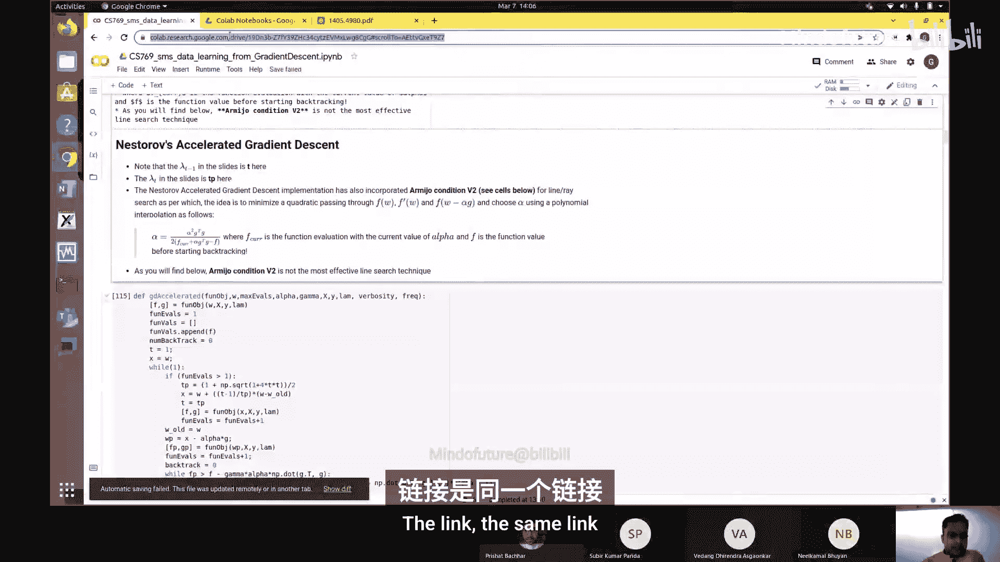
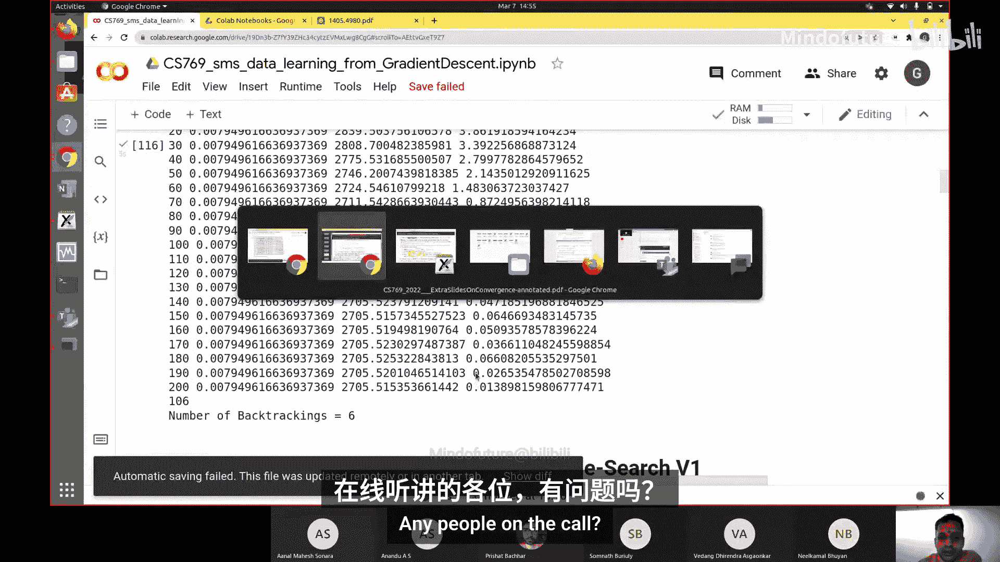
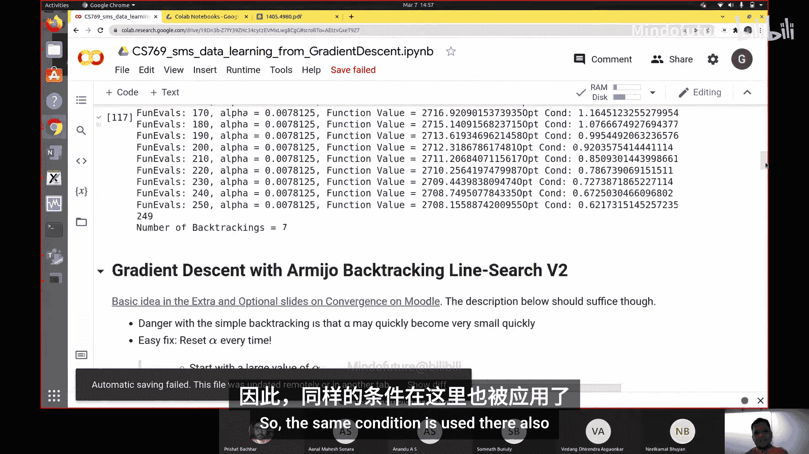
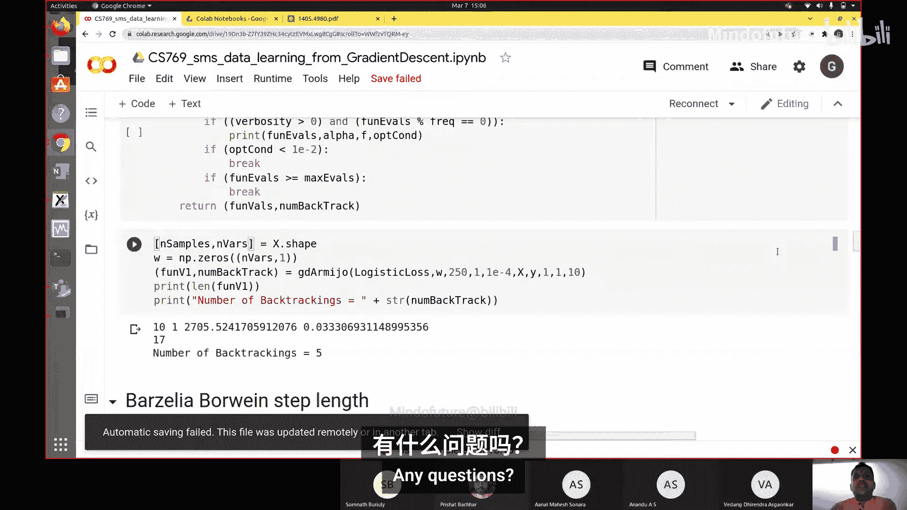
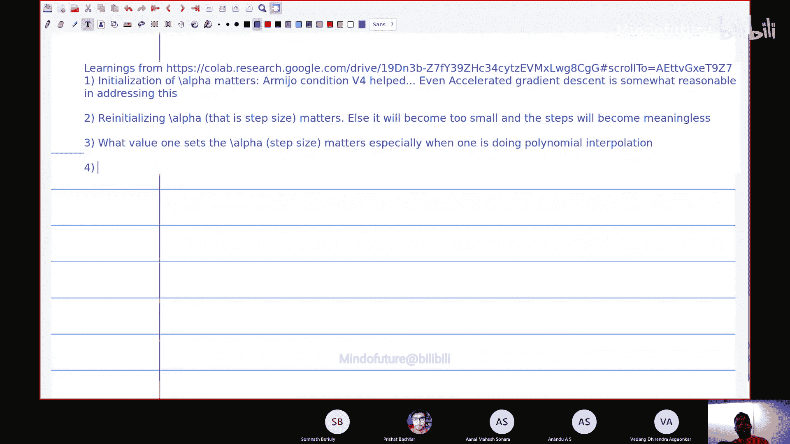
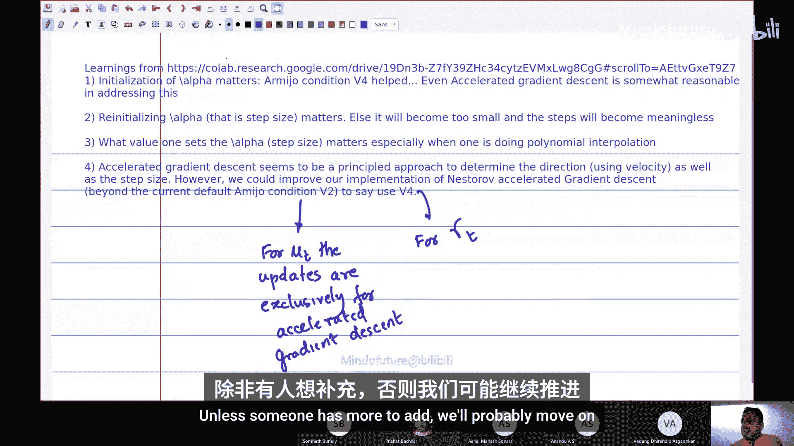
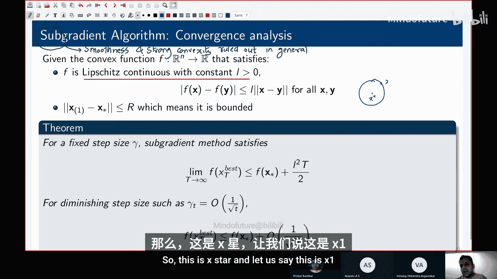
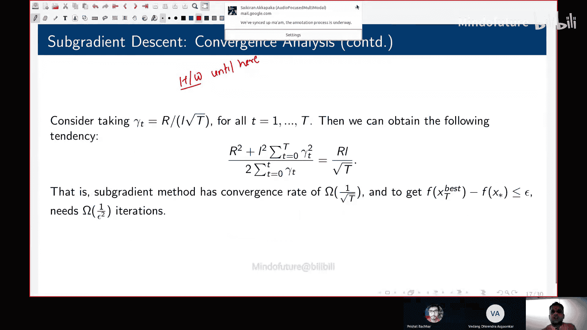
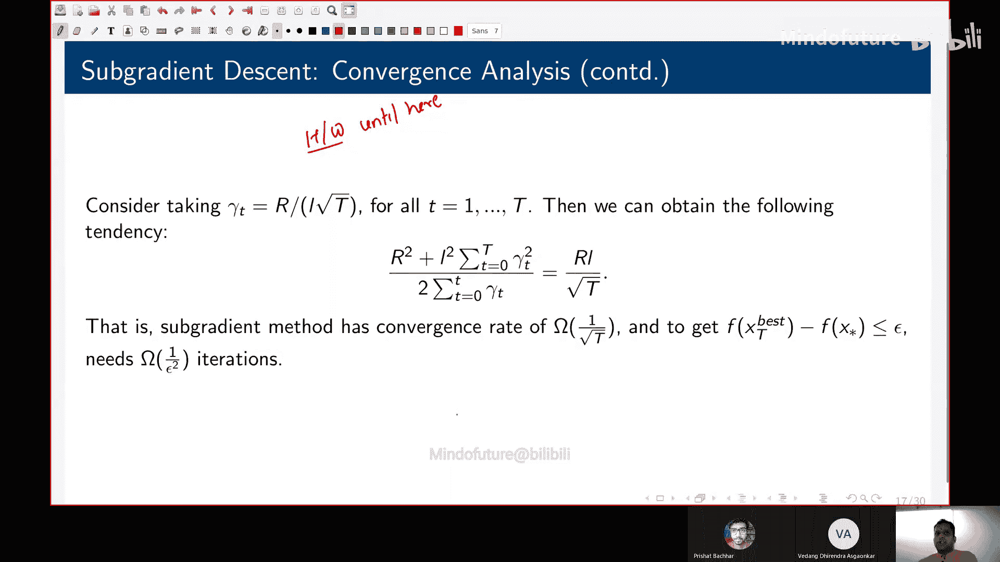

# 019：加速梯度下降与线搜索方法演示

在本节课中，我们将要学习梯度下降的收敛性分析，并探讨如何通过加速梯度下降来弥补理论上的性能差距。我们还将通过演示线搜索方法，直观地理解步长选择的重要性，并初步介绍次梯度下降的概念。

## 回顾与问题引入

上一节我们讨论了梯度下降在光滑且强凸函数上的优异表现，其收敛速度为 `O(log(1/ε))`。然而，对于仅满足光滑性（Lipschitz连续梯度）但非强凸的函数，我们遇到了一个理论上的性能差距。

*   梯度下降的上界为：`f(x_t) - f(x*) ≤ (L R^2) / (2t)`
*   理论下界为：`f(x_t) - f(x*) ≥ (L R^2) / (8(t+1)^2)`

这个差距促使我们寻找更优的算法。加速梯度下降（如Nesterov动量法）正是为了弥合这一差距而设计的。其核心思想是引入“动量”或“速度”项，利用历史梯度信息来修正当前更新方向，减少振荡，从而走得更“直”。

## 加速梯度下降的核心思想

加速梯度下降的更新规则可以直观地理解为结合了速度与梯度信息。速度项本身是负梯度的一个指数衰减移动平均，这有助于逐渐淡去过早的历史信息。

以下是两种主要的动量更新方式：

1.  **Polyak Heavy Ball（动量法）**：在当前点计算梯度，然后与上一步的速度（动量）结合。
    *   公式：`v_{t+1} = β v_t - α ∇f(x_t)`, `x_{t+1} = x_t + v_{t+1}`
2.  **Nesterov Accelerated Gradient（NAG）**：先根据当前速度“展望”到一个未来点，在该点计算梯度，再用这个梯度来修正速度。
    *   公式：`y_{t+1} = x_t + β v_t`, `v_{t+1} = β v_t - α ∇f(y_{t+1})`, `x_{t+1} = x_t + v_{t+1}`

对于光滑强凸函数，NAG可以达到 `O((1 - 1/√κ)^t)` 的收敛速度，这与理论下界匹配。更重要的是，对于仅光滑的函数，NAG可以将收敛上界提升至 `O(L R^2 / t^2)`，从而填补了与理论下界之间的差距。

## 线搜索方法演示

尽管加速梯度下降在理论上很完美，但其更新公式中的步长和动量参数设置可能较为复杂。在实践中，线搜索方法提供了一种自适应确定步长的替代方案，有时也能达到类似的效果。

线搜索的基本思想是：沿着负梯度方向（射线），动态地尝试不同的步长 `α`，直到找到一个满足“充分下降条件”的步长。这个过程通常通过“回溯”来实现。

以下是几种线搜索策略的演示和比较：

*   **固定步长梯度下降**：使用一个恒定的学习率。
*   **简单回溯线搜索（版本1）**：从一个较大的初始步长开始，如果不满足充分下降条件，则将步长减半，直到条件满足。
*   **重置回溯线搜索（版本2）**：在每次迭代开始时，都将步长重置为初始值，然后进行回溯。
*   **插值回溯线搜索（版本3/4）**：基于当前函数值和梯度信息，对最优步长进行多项式插值估计，而不是简单地减半。

通过在一个逻辑回归任务（使用SMS垃圾邮件数据集）上的演示，我们发现：
*   简单的固定步长梯度下降收敛较慢。
*   即使是基本的回溯线搜索（版本1）也能显著改善性能。
*   插值法（版本4）通过更智能地猜测步长，减少了回溯次数，从而提高了效率。
*   在本例中，由于目标函数（带正则化的逻辑损失）既是光滑的也是强凸的，因此加速梯度下降的优势没有完全凸显，但线搜索方法已经表现出了强大的实用性。

线搜索的动机来源于对“充分下降条件”的追求，并试图在多次迭代中通过插值来维持良好的步长序列。

## 次梯度下降简介

接下来，我们将目光转向更具挑战性的情况：当目标函数不可微，因而无法计算标准梯度时，我们该怎么办？这时，次梯度下降法将成为我们的工具。

对于非光滑凸函数，我们在不可微点（如L1范数的零点）有多个次梯度（构成一个次微分集合）。次梯度下降法允许我们选择任何一个次梯度方向进行下降。

然而，“下降”并非总能保证。因此，次梯度下降法通常采用两种策略：

1.  **记录历史最优值**：由于目标函数值可能震荡，我们记录并返回所有迭代中函数值最小的那个点 `x_t_best`。
2.  **使用递减步长**：固定步长通常效果不佳。我们常使用满足以下条件的递减步长序列：
    *   `lim_{t->∞} α_t = 0`
    *   `∑_{t=1}^{∞} α_t = ∞` （步长衰减不能太快）
    *   例如，`α_t = 1/√t` 是一个常见选择。

在假设函数是Lipschitz连续且迭代点有界的前提下，使用步长 `α_t = 1/√t` 的次梯度下降法可以达到 `O(1/√t)` 的收敛速率。虽然这比光滑情况下的速率慢，但对于处理不可微函数来说是标准且可接受的结果。

## 总结

本节课中我们一起学习了：
1.  **加速梯度下降**：通过引入动量（Nesterov动量），我们能够弥合光滑非强凸函数上梯度下降的理论性能差距，达到 `O(1/t^2)` 的最优收敛速率。
2.  **线搜索方法**：作为一种实践工具，线搜索通过自适应地选择步长，能够有效改善梯度下降的性能，其核心是回溯和充分下降条件。
3.  **次梯度下降**：当函数不可微时，我们可以使用次梯度代替梯度。为了确保收敛，需要采用记录历史最优点和使用递减步长（如 `1/√t`）的策略。

这些方法构成了处理从光滑到非光滑、从凸到非凸（部分方法可扩展）优化问题的基础工具箱。下一讲，我们将进入更具随机性的领域：随机梯度下降。