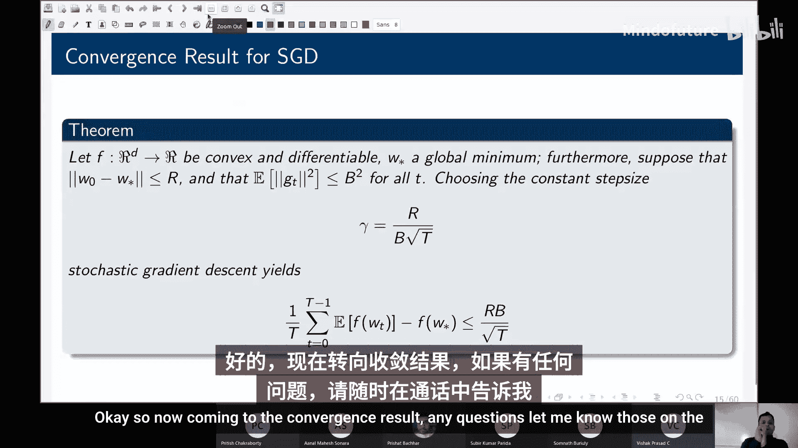
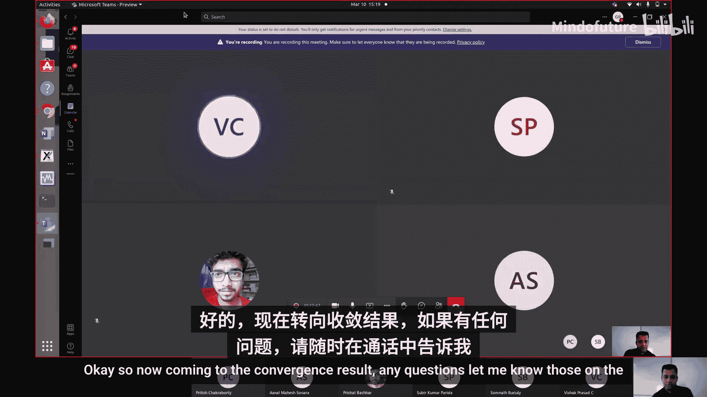
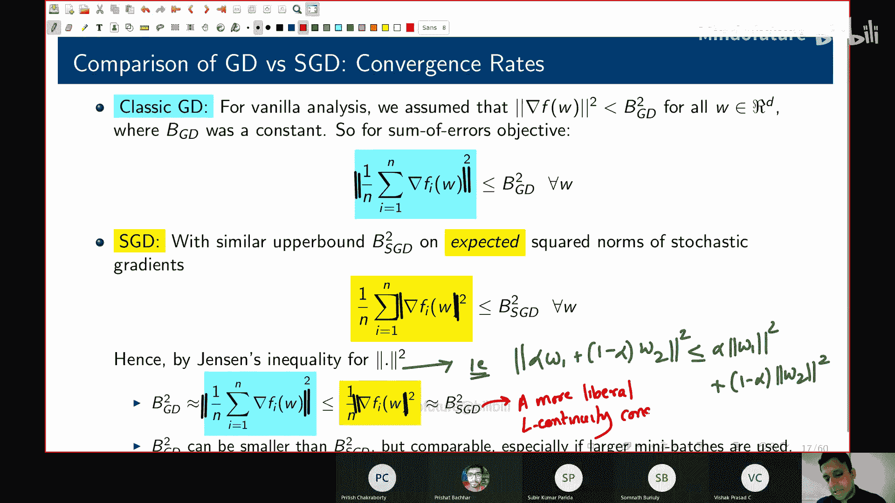
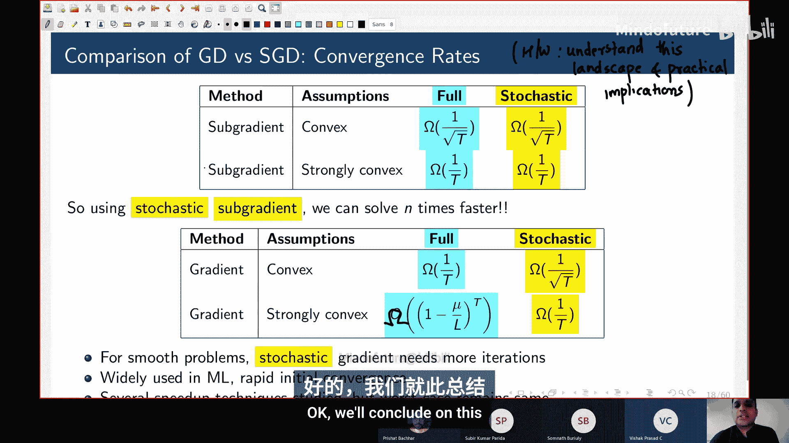
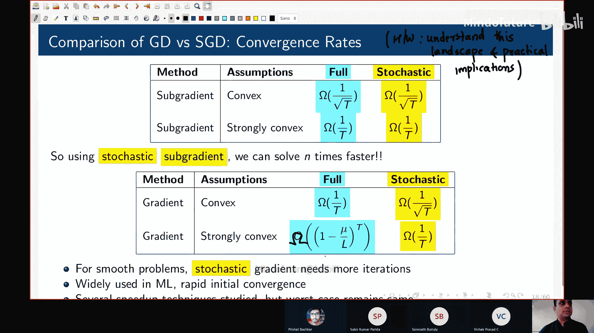

# 020：次梯度与随机算法

在本节课中，我们将要学习次梯度下降算法的收敛性分析，并探讨其在机器学习中的应用，特别是如何通过数据子集选择来优化损失函数的计算。

## 概述

上一节我们介绍了次梯度下降的基本概念。本节中，我们将深入分析其收敛性，并探讨如何将其思想应用于机器学习，特别是通过选择数据子集来高效计算损失函数。

## 次梯度下降的收敛性分析

我们之前已经看到，对于光滑凸函数，加速梯度下降能够达到 `O(1/√ε)` 的收敛速度。然而，当我们将其推广到次梯度下降时，情况有所不同。

由于次梯度下降不再保证每一步都是下降的，我们需要关注**迄今为止的最佳迭代点**。对于递减的步长序列 `η_t`，可以证明存在以下收敛界：

`f(x_{best}) ≤ f(x*) + (R² + L² ∑ η_t²) / (2 ∑ η_t)`

其中 `R` 是初始点与最优解的距离上界，`L` 是 Lipschitz 常数。

为了使上述界收敛到 `f(x*)`，我们需要对步长序列 `η_t` 施加条件。以下是关键条件：

*   **条件一**：`∑ η_t²` 必须收敛（即有限）。
*   **条件二**：`∑ η_t` 必须发散到无穷大。

一个满足条件的经典步长选择是 `η_t = R/(L√t)`。将其代入界中，我们可以推导出达到精度 `ε` 所需的迭代次数 `T` 满足：

`T ≥ (L² R²) / ε²`

这意味着收敛速度为 `O(1/ε²)`。这与我们之前在 Lipschitz 连续函数上得到的结果一致，但分析过程有两个重要区别：

1.  步长选择需要更严格的假设。
2.  分析对象是“最佳迭代点”，而非最后迭代点，因为算法不保证单调下降。

## 从优化到机器学习：数据子集选择

次梯度下降在机器学习中尤其常见。机器学习损失函数通常具有一个显著特点：它是所有训练样本损失的和。

`L(w) = (1/n) ∑_{i=1}^{n} l_i(w)`

计算完整梯度 `∇L(w)` 需要遍历所有 `n` 个样本，计算成本为 `O(n)`。然而，数据通常存在冗余，并非所有样本对每次更新都同等重要。这就引出了一个核心问题：**我们能否只选择一个数据子集来计算梯度近似，从而显著提高效率？**

以下是选择重要数据子集的一些思路：

*   **靠近决策边界的样本**：这些点通常对定义模型最为关键。但确定边界本身可能需要模型，存在“先有鸡还是先有蛋”的问题。
*   **具有大梯度范数的样本**：梯度大小可以反映模型在该样本上的“不确定”程度。但远离边界的点也可能有较大梯度。
*   **类别代表点（核心集）**：在每个类别内进行聚类（如在特征空间或梯度空间），选择簇中心或代表点，剔除可能的噪声点。例如 CRAIG 算法。
*   **基于梯度的聚类**：将全部样本的梯度堆叠成雅可比矩阵，通过特征值分解区分信息空间和噪声空间，或直接在梯度空间进行核聚类。
*   **随机子集**：一个简单而强大的基线方法是**均匀随机采样**。如果数据冗余度高，随机子集通常能提供良好的梯度近似，并且是许多复杂方法需要超越的基准。

## 随机梯度下降

基于随机子集选择的最简单算法就是经典的**随机梯度下降**。其更新公式如下：

`w_{t+1} = w_t - η_t * ∇ l_i(w_t)`

其中索引 `i` 是在每轮迭代中从 `{1,...,n}` 中**均匀随机采样**得到的（通常是有放回采样）。

SGD 的核心在于其梯度估计的**无偏性**：`E[∇ l_i(w_t)] = ∇L(w_t)`。这使得我们可以在期望意义上进行分析。

对于凸且 Lipschitz 连续的损失函数，若最优解 `w*` 在一个半径为 `R` 的球内，并选择步长 `η_t = R/(B√t)`（其中 `B` 是随机梯度范数期望的上界），则 SGD 满足以下收敛界：

`E[L( (∑_{t=1}^{T} w_t / T) )] - L(w*) ≤ (R B) / √T`

如果函数还具有强凸性（参数为 `μ`），并选择步长 `η_t = 2/(μ (t+1))`，则收敛速度可以提升至 `O(1/T)`。

## 与经典梯度下降的对比

将 SGD 的收敛结果与经典梯度下降（GD）进行对比很有启发性。假设梯度的 Lipschitz 常数上界为 `G`，随机梯度范数期望的上界为 `B`。根据 Jensen 不等式，有 `G ≤ B`。因此，SGD 的收敛界中的常数 `B` 通常比 GD 中的 `G` 更大，这反映了一次只用一个样本带来的方差。然而，SGD 每次迭代的成本远低于 GD（`O(1)` vs `O(n)`），这使得它在总计算时间上往往具有巨大优势。

## 总结

本节课中我们一起学习了：
1.  **次梯度下降的收敛性**：分析了其 `O(1/ε²)` 的收敛速度，并理解了其与梯度下降在分析上的差异（需关注最佳迭代点，对步长要求更严）。
2.  **机器学习中的数据子集选择**：探讨了通过选择重要样本来近似全梯度、提升优化效率的动机和多种方法（如边界样本、大梯度样本、核心集、随机采样）。
3.  **随机梯度下降**：介绍了 SGD 的基本框架，基于随机采样的无偏梯度估计，以及其在凸和强凸设置下的收敛性理论。
4.  **实践意义**：理解这些理论有助于我们在实际应用（如深度学习）中根据问题特性（数据冗余度、计算瓶颈、模型凸性）选择合适的优化算法及其变种。