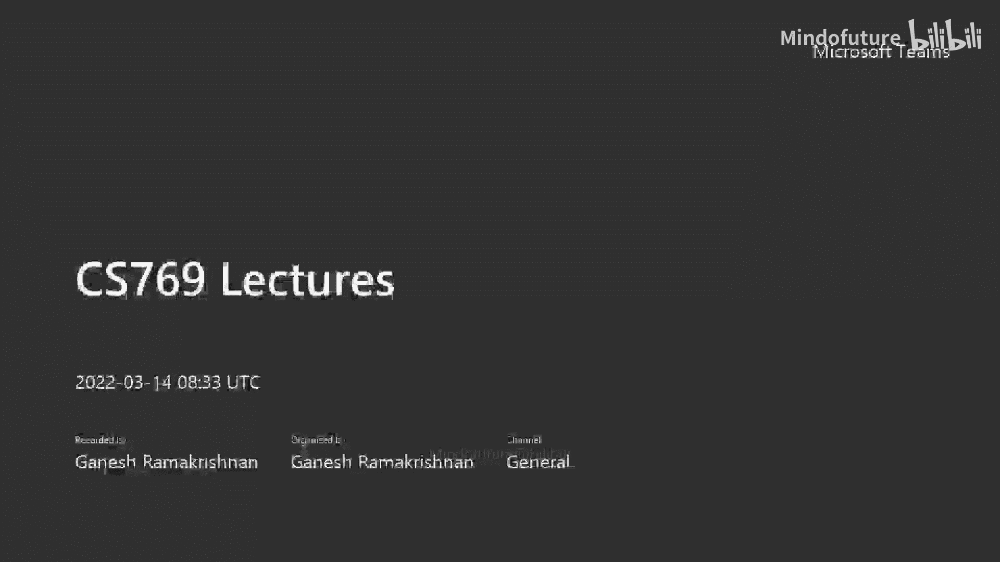
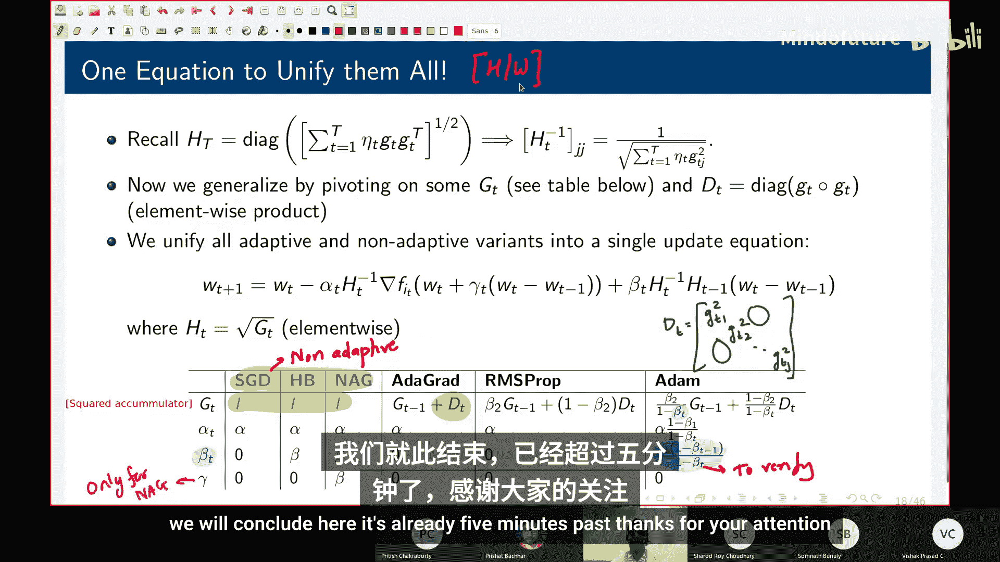
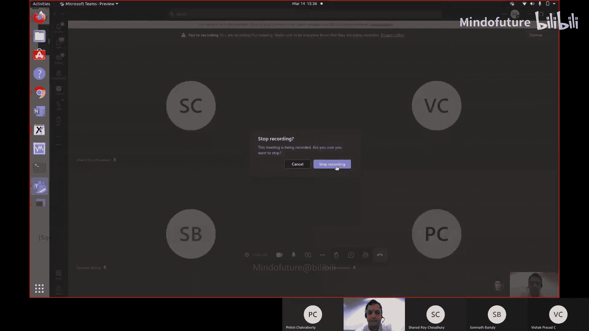

# 021：小批次、方差缩减与自适应方法

在本节课中，我们将要学习随机梯度下降算法的几种重要变体。我们将探讨如何通过使用小批次、方差缩减技术以及自适应学习率方法来改进算法的性能，特别是针对强凸和平滑问题中存在的收敛速度差距。

上一节我们介绍了经典的随机梯度下降及其收敛性分析。本节中我们来看看如何通过一些改进策略来弥补其理论上的不足。

## 小批次随机梯度下降

为了降低随机梯度估计的方差，一个直观的改进是使用小批次数据。我们不再基于单个样本计算梯度，而是基于一小批样本计算梯度的平均值。

**核心公式**：
`G_t^B = (1/|B|) * Σ_{i∈B} ∇f_i(w_t)`

其中，`B` 是随机选取的一批样本索引，`|B|` 是批次大小。

以下是使用小批次的主要影响：
*   **方差降低**：梯度的方差降低为单样本随机梯度的 `1/|B|`。
*   **计算成本**：每次迭代的计算成本从 `O(1)` 变为 `O(|B|)`，但仍比全梯度下降的 `O(n)` 便宜 `n/|B|` 倍。
*   **实践优势**：小批次能更好地代表整个数据集，通常在实践中能带来更稳定的收敛和更快的初始进展。

## 方差缩减技术

小批次虽然能降低方差，但并未从根本上解决强凸问题中线性收敛与次线性收敛的巨大差距。方差缩减技术旨在更有效地利用历史梯度信息来降低当前梯度估计的方差。

其核心思想是：与其在每次迭代后丢弃计算过的梯度，不如将它们累积起来，作为一个“修正项”或“控制变量”，以减少新梯度估计的波动。

一个开创性的方法是随机平均梯度。其基本思路是维护一个表，存储每个数据点最近一次计算得到的梯度。在每次迭代中，随机选择一个样本 `i_t`，仅更新该样本对应的梯度，然后使用所有存储梯度的平均值来更新参数。

**算法示意**：
1.  初始化：为所有 `i=1,...,n` 存储梯度 `g_i`（初始需计算一次）。
2.  迭代：随机选取索引 `i_t`。
3.  计算新梯度：`∇f_{i_t}(w_t)`。
4.  更新存储：`g_{i_t} = ∇f_{i_t}(w_t)`。
5.  参数更新：`w_{t+1} = w_t - η_t * (1/n) * Σ_{i=1}^n g_i`。

这种方法及其后续改进（如SVRG）能够显著提升强凸问题下的收敛速度，使其接近全梯度下降的线性收敛率。

## 自适应梯度方法

除了降低方差，另一个改进方向是自适应地调整每个参数的学习率。传统的SGD对所有参数使用相同的全局学习率，这在高维、稀疏或非平稳梯度的问题中可能效率低下。

自适应方法的动机部分来源于牛顿法。牛顿法使用Hessian矩阵的逆来缩放梯度步长，从而考虑损失函数的曲率信息。然而，直接计算Hessian在深度学习中通常不可行。

自适应方法通过一个正定矩阵 `H_t`（或其逆）来近似曲率信息，并据此调整更新方向。这个矩阵通常基于历史梯度信息（如梯度分量平方的累积）构造，而非直接计算二阶导数。

**通用自适应更新框架**：
`w_{t+1} = w_t - α_t * (H_t)^{-1} * m_t`
其中 `m_t` 是动量项（如当前梯度与历史速度的组合），`H_t` 是自适应缩放矩阵。

以下是几种常见自适应算法的 `H_t` 和动量构造方式对比：

| 算法 | G_t (定义 H_t = sqrt(G_t)) | 动量项 m_t | 特点 |
| :--- | :--- | :--- | :--- |
| **SGD / SGD+Momentum** | `I` (单位矩阵) | `β * m_{t-1} + (1-β)*g_t` 或 `g_t` | 非自适应，全局学习率。 |
| **AdaGrad** | `G_{t-1} + diag(g_t ⊙ g_t)` | `g_t` | 累积历史梯度平方，对频繁更新的参数减小步长。 |
| **RMSProp** | `β_2 * G_{t-1} + (1-β_2) * diag(g_t ⊙ g_t)` | `g_t` | 使用指数移动平均累积梯度平方，解决AdaGrad学习率持续衰减问题。 |
| **Adam** | `β_2 * G_{t-1} + (1-β_2) * diag(g_t ⊙ g_t)` | `β_1 * m_{t-1} + (1-β_1)*g_t` | 结合了RMSProp的自适应学习率和动量。对 `m_t` 和 `G_t` 进行偏差校正。 |

**注**：表中 `⊙` 表示逐元素乘积，`diag()` 取对角线矩阵，`β`, `β_1`, `β_2` 是超参数（通常接近1，如0.9）。

自适应方法（尤其是Adam）因其对超参数相对鲁棒、在实践中表现良好，已成为深度学习优化中的主流选择。

本节课中我们一起学习了随机梯度下降的三个关键改进方向：小批次、方差缩减和自适应方法。小批次通过平均降低了梯度噪声；方差缩减技术（如SAG）通过巧妙利用历史梯度信息，显著改善了强凸问题下的收敛速率；自适应方法（如AdaGrad， RMSProp， Adam）则为每个参数动态调整学习率，更好地适应损失函数的几何结构。这些技术共同构成了现代机器学习，特别是深度学习优化器的基础。