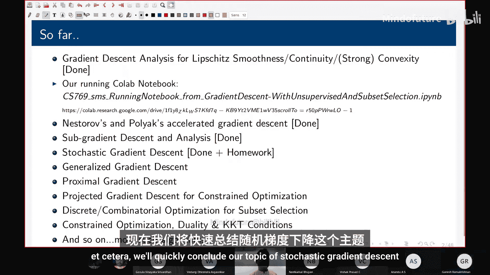
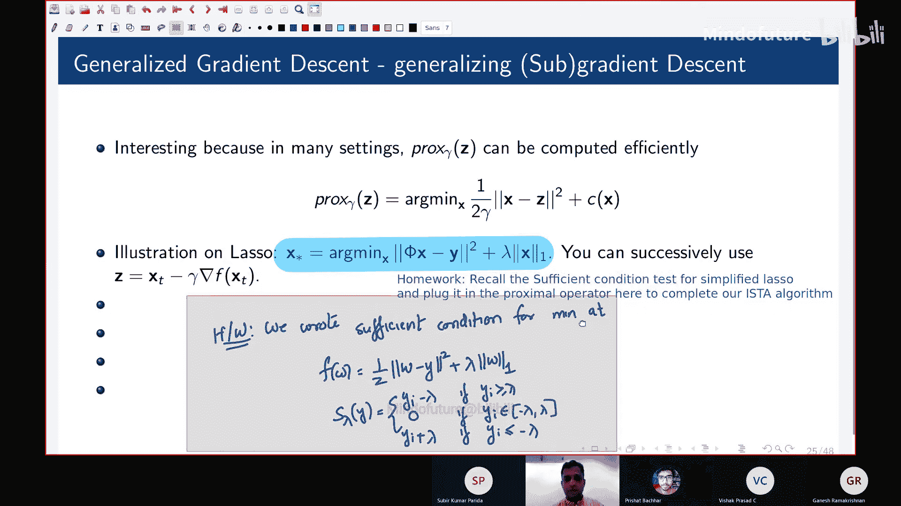

# 022：随机梯度下降、自适应学习率、动量方法及实践

在本节课中，我们将总结随机梯度下降（SGD）的收敛性分析，并深入探讨其多种变体，包括动量方法、自适应学习率算法（如AdaGrad、RMSprop、Adam）以及广义梯度下降框架。我们将重点关注这些方法的核心思想、公式差异及其在实际应用中的表现。

## 自适应学习率与动量方法的动机

上一节我们介绍了随机梯度下降的基本框架及其收敛性。本节中，我们来看看如何通过引入自适应学习率和动量来改进优化过程。

最初的动机源于对函数曲率（Hessian矩阵）的考虑，希望通过二阶信息来调整学习率。然而，另一种更直观的视角是从**累积梯度**和**累积梯度平方**的角度来理解。

*   **累积梯度**：这与动量方法相关，旨在平滑优化路径，减少振荡。
*   **累积梯度平方**：这与曲率或特征的重要性相关，用于实现**自适应学习率**，即对不同的模型参数使用不同的学习步长。

## 统一更新框架

以下是概括多种优化算法的通用更新公式：

**W_{t+1} = W_t - \alpha_t H_t^{-1} ( \beta_t \nabla L(W_t) + \gamma_t H_t H_{t-1}^{-1} (W_t - W_{t-1}) )**

其中：
*   `W_t` 是第 `t` 次迭代的参数。
*   `\alpha_t` 是学习率。
*   `H_t` 是一个（通常是对角的）矩阵，与累积梯度平方相关，用于调整学习率。
*   `\beta_t` 和 `\gamma_t` 是控制梯度项和动量项权重的系数。
*   `\nabla L(W_t)` 是在 `W_t` 处计算的损失函数梯度（或随机估计）。

在这个框架下，不同的优化算法对应于不同的 `H_t`、`\beta_t` 和 `\gamma_t` 选择。

以下是几种常见算法在该框架下的具体形式：

1.  **随机梯度下降 (SGD)**：
    *   `H_t = I` (单位矩阵)，`\beta_t = 1`，`\gamma_t = 0`。
    *   更新公式简化为：`W_{t+1} = W_t - \alpha_t \nabla L(W_t)`。

2.  **重球动量法 (Heavy Ball Momentum)**：
    *   `H_t = I`，`\beta_t = 1`，但 `\gamma_t > 0`。
    *   在SGD基础上增加了一个动量项：`W_{t+1} = W_t - \alpha_t \nabla L(W_t) + \gamma_t (W_t - W_{t-1})`。

3.  **Nesterov 加速梯度法**：
    *   与重球法类似，但梯度是在一个“向前看”的位置 `W_t + \gamma_t (W_t - W_{t-1})` 计算的，而不是直接在 `W_t`。

4.  **自适应算法 (AdaGrad, RMSprop, Adam)**：
    *   关键区别在于 `H_t` 不再是单位矩阵。
    *   `H_t` 是一个对角矩阵，其元素是历史梯度平方的累积（或指数移动平均）的平方根。`H_t^{-1}` 的作用相当于对每个参数坐标进行缩放（即除法）。
    *   这实现了**自适应学习率**：频繁更新的参数（对应大梯度平方累积）获得较小的有效学习步长，而不频繁更新的参数获得较大的步长。这对于稀疏数据特别有用。

## 自适应算法详解

现在，让我们具体看看几种重要的自适应算法。

### AdaGrad

*   **核心思想**：累积整个训练历史中所有梯度的平方。
*   **更新规则**：`G_t = G_{t-1} + (\nabla L(W_t))^2`，`H_t = \sqrt{G_t} + \epsilon`，`W_{t+1} = W_t - \alpha H_t^{-1} \nabla L(W_t)`。
*   **优点**：自动为不同特征调整学习率。
*   **缺点**：随着训练进行，`G_t` 单调增长，导致有效学习率 `\alpha H_t^{-1}` 可能变得极小，使得训练过早停止。

### RMSprop 与 AdaDelta

*   **核心思想**：解决 AdaGrad 学习率急剧衰减的问题。采用**指数移动平均**来累积梯度平方，而不是简单求和。
*   **更新规则 (RMSprop)**：`E[g^2]_t = \rho E[g^2]_{t-1} + (1-\rho) (\nabla L(W_t))^2`，`W_{t+1} = W_t - \alpha \frac{\nabla L(W_t)}{\sqrt{E[g^2]_t + \epsilon}}`。
*   **作用**：`\rho` 是衰减率，使得久远的历史梯度影响逐渐减弱，避免了学习率无限变小。

### Adam (Adaptive Moment Estimation)

*   **核心思想**：结合了**动量**（累积梯度一阶矩）和 **RMSprop**（累积梯度平方二阶矩）的优点。
*   **更新规则**：
    1.  计算梯度一阶矩的指数移动平均（动量）：`m_t = \beta_1 m_{t-1} + (1-\beta_1) \nabla L(W_t)`。
    2.  计算梯度二阶矩的指数移动平均：`v_t = \beta_2 v_{t-1} + (1-\beta_2) (\nabla L(W_t))^2`。
    3.  偏差修正（因初始化为0）：`\hat{m}_t = m_t / (1-\beta_1^t)`，`\hat{v}_t = v_t / (1-\beta_2^t)`。
    4.  参数更新：`W_{t+1} = W_t - \alpha \frac{\hat{m}_t}{\sqrt{\hat{v}_t} + \epsilon}`。
*   **特点**：通常能快速收敛，且对超参数选择相对鲁棒，是目前最流行的优化器之一。

## 实践表现与泛化思考

在诸如MNIST数据集上的实验表明：
*   **自适应方法 (如Adam)**：通常训练初期收敛速度非常快。
*   **带动量的SGD**：初期可能较慢，但后期表现强劲，有时能找到泛化性能更好的解。
*   **一个重要观察**：尽管自适应方法能快速降低训练损失，但一些研究表明，过于激进的适应性可能导致解陷入复杂的区域，从而**损害模型的泛化能力**。简单的SGD或带动量的SGD有时能获得泛化 gap 更小的解。

因此，没有绝对的“最佳”优化器。选择取决于具体问题、数据结构和我们对训练速度与泛化性能的权衡。

## 广义梯度下降：近端梯度法

到目前为止，我们讨论的方法都假设损失函数 `F(x)` 是可微的。但在机器学习中，我们经常遇到目标函数包含不可微部分的情况，例如使用 L1 正则化（LASSO）：`\min_x f(x) + \lambda ||x||_1`，其中 `||x||_1` 不可微。

近端梯度法提供了一种优雅的解决方案。其核心思想是将可微部分 `f(x)` 和不可微部分 `g(x)`（如正则项）分开处理。

**推导思路**：
1.  在当前点 `x_t`，对可微函数 `f(x)` 做一阶泰勒展开近似，并增加一个二次惩罚项。
2.  最小化这个近似函数与不可微函数 `g(x)` 之和。

经过推导（如完成平方），可以得到**近端梯度更新**公式：

**x_{t+1} = \text{prox}_{\alpha g} (x_t - \alpha \nabla f(x_t))**

其中 `\text{prox}` 是**近端算子**，定义为：

**\text{prox}_{\alpha g}(v) = \arg\min_x ( g(x) + \frac{1}{2\alpha} ||x - v||^2 )**

**直观理解**：先对可微部分 `f(x)` 做一个普通的梯度下降步，得到中间点 `v = x_t - \alpha \nabla f(x_t)`。然后，将这个中间点“映射”回一个同时考虑不可微项 `g(x)` 和距离原始中间点不要太远的点。这个映射操作就是近端算子。

**经典例子：LASSO 的软阈值算子**
对于 `g(x) = \lambda ||x||_1`，其近端算子就是著名的**软阈值函数**：
`[\text{prox}_{\alpha \lambda ||\cdot||_1}(v)]_i = \text{sign}(v_i) \max(|v_i| - \alpha \lambda, 0)`

这意味着，近端梯度法求解 LASSO 的每一步是：先梯度下降，再对结果进行软阈值收缩。

## 总结

本节课中我们一起学习了随机梯度下降家族的多种高级变体。
*   我们首先通过一个统一框架理解了**动量方法**（平滑更新方向）和**自适应学习率方法**（如AdaGrad, RMSprop, Adam，根据梯度历史调整每参数步长）的核心区别与联系。
*   我们讨论了这些优化器在实践中的表现，认识到自适应方法虽常收敛更快，但需关注其泛化性能。
*   最后，我们介绍了**近端梯度法**，它将可微与不可微的优化目标分离处理，通过“梯度步+近端映射”的方式，优雅地解决了包含L1正则等不可微项的优化问题，并将此与LASSO的软阈值求解联系起来。

掌握这些优化技术，能帮助你为不同的机器学习任务选择并调整合适的优化策略。