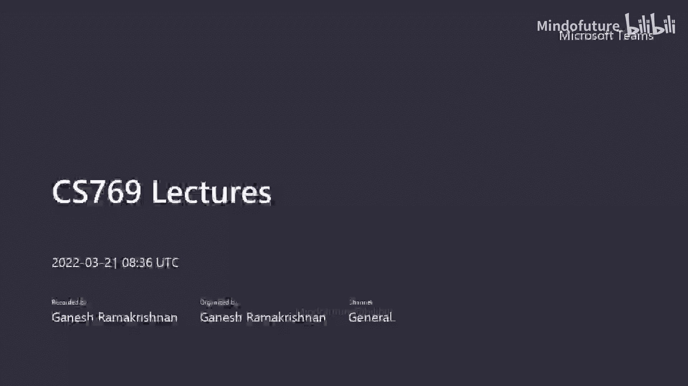
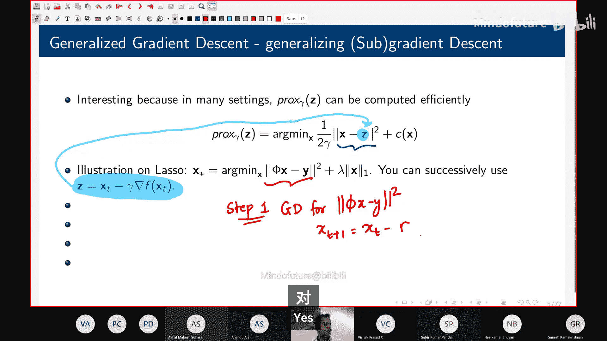
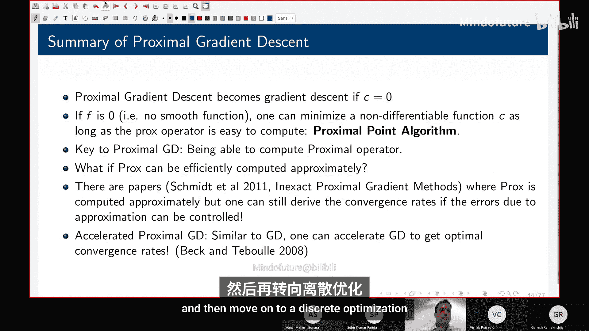
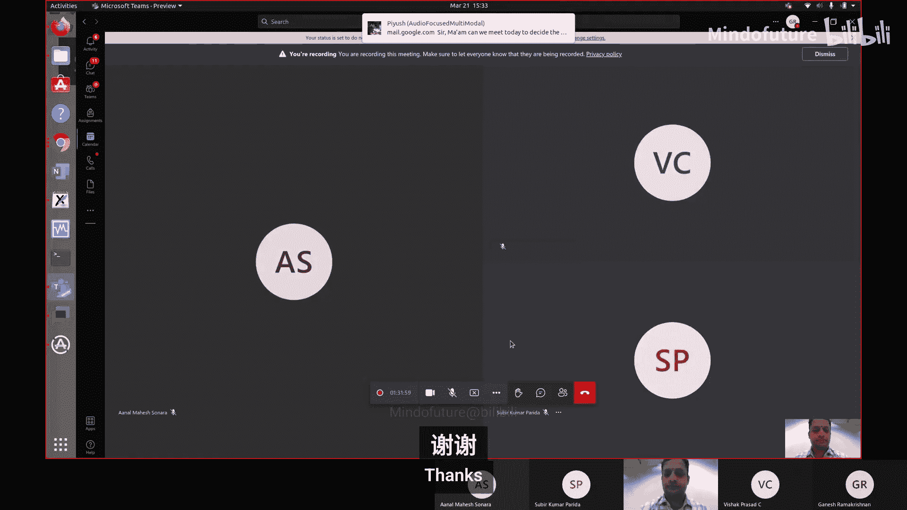

# 023：广义（加速）梯度下降收敛性与近端投影梯度下降

在本节课中，我们将要学习广义梯度下降方法，特别是近端梯度下降及其加速版本。我们将探讨其收敛性，并了解如何通过近端算子高效处理目标函数中的非可微部分。

## 概述

我们考虑最小化一个复合目标函数 **F(x) = f(x) + c(x)**，其中 **f(x)** 是可微的，而 **c(x)** 是非可微的（例如 L1 范数正则项或约束的指示函数）。标准的梯度下降法无法直接处理此类问题。近端梯度下降法通过将 **f(x)** 进行一阶近似，并保留 **c(x)** 的原貌，提供了一种有效的解决方案。

上一节我们介绍了近端梯度下降的基本思想，本节中我们来看看其收敛性分析以及如何通过“近端算子”高效实现更新步骤。

## 近端梯度下降算法回顾

算法的核心更新步骤如下：

1.  首先，对可微部分 **f(x)** 执行一步梯度下降，得到一个中间点 **z**：
    \[
    z = x_t - \gamma \nabla f(x_t)
    \]
2.  然后，求解一个近端最小化问题，该问题结合了中间点 **z** 和非可微项 **c(x)**：
    \[
    x_{t+1} = \text{prox}_{\gamma c}(z) = \arg\min_x \frac{1}{2\gamma} \|x - z\|^2 + c(x)
    \]

这个“近端”步骤得名于它试图找到一个点，该点既接近梯度下降的结果 **z**，又考虑了非可微项 **c(x)** 的影响。

## 收敛性分析

现在，我们来分析这种方法的收敛速度。一个关键问题是：与标准的次梯度下降法相比，近端梯度下降的收敛性如何？

对于次梯度下降法，在凸函数下，其误差界为 **O(1/√T)**。这个速度通常较慢。

然而，对于近端梯度下降，如果我们假设可微部分 **f(x)** 是凸函数且其梯度是 Lipschitz 连续的（即 **f** 是 **L-光滑** 的），并且非可微部分 **c(x)** 是凸的，同时近端算子可以精确求解，那么我们可以获得更好的收敛速度。

在这种情况下，近端梯度下降的收敛速度可以达到 **O(1/T)**。这比次梯度下降的 **O(1/√T)** 要快得多。

**收敛速度提升的原因**：
*   我们充分利用了 **f(x)** 的可微性和光滑性，对其执行了完整的梯度步。
*   我们分离处理了非可微部分 **c(x)**，而不是对整个函数使用次梯度。

更重要的是，**这种分解结构允许我们应用加速技术**，例如动量法（如Nesterov加速）。通过将标准梯度步替换为加速梯度步，我们可以进一步将收敛速度提升至 **O(1/T²)**，这在许多机器学习问题中至关重要。

## 近端算子的计算

算法的效率取决于近端算子 **prox_{\gamma c}(z)** 能否被高效计算。以下是几个关键例子：

**1. Lasso 回归（L1 正则化）**
当 **c(x) = λ\|x\|_1** 时，近端算子就是著名的软阈值算子：
\[
[\text{prox}_{\gamma \lambda \|\cdot\|_1}(z)]_i = \text{sign}(z_i) \max(|z_i| - \gamma \lambda, 0)
\]
这个操作可以按分量独立进行，非常高效。

**2. 指示函数（投影）**
当 **c(x)** 是集合 **C** 的指示函数时（在 **C** 内值为0，否则为∞），近端算子退化为到集合 **C** 的欧几里得投影：
\[
\text{prox}_{I_C}(z) = \arg\min_{x \in C} \|x - z\|^2
\]
这被称为**投影梯度下降**。例如，对于非负约束 **C = {x | x ≥ 0}**，投影操作就是将 **z** 的负分量置零。

**3. 其他可计算近端算子的函数**
*   二次函数
*   Huber 函数
*   对数障碍函数

存在一个关于近端算子的“微积分”，允许我们通过简单函数的近端算子组合出复杂函数的近端算子。例如：
*   **缩放与平移**：如果 **c(x) = h(ax+b)**，那么其近端算子可以通过 **h** 的近端算子表示。
*   **可分离和**：如果 **c(x) = Σ c_i(x_i)**，那么其近端算子可以按分量独立计算。

## 总结

本节课中我们一起学习了：
1.  **近端梯度下降法**通过分解目标函数，分别处理可微部分（用梯度下降）和非可微部分（用近端算子），有效解决了一类复合优化问题。
2.  在 **f(x)** 光滑、**c(x)** 凸且近端算子可精确计算的条件下，该方法的收敛速度（**O(1/T)**）远优于次梯度下降法（**O(1/√T)**）。
3.  该框架天然支持**加速技术**（如Nesterov动量），可进一步提升收敛速度至 **O(1/T²)**。
4.  许多机器学习中常见的非可微项（如L1范数、约束指示函数）都有高效甚至闭式解的近端算子，这使得算法在实践中非常快速和实用。

近端梯度下降及其加速变体是现代机器学习优化工具箱中的核心工具，广泛应用于稀疏学习、约束优化等问题。下一讲，我们将更深入地探讨投影梯度下降及其相关的投影算子计算。