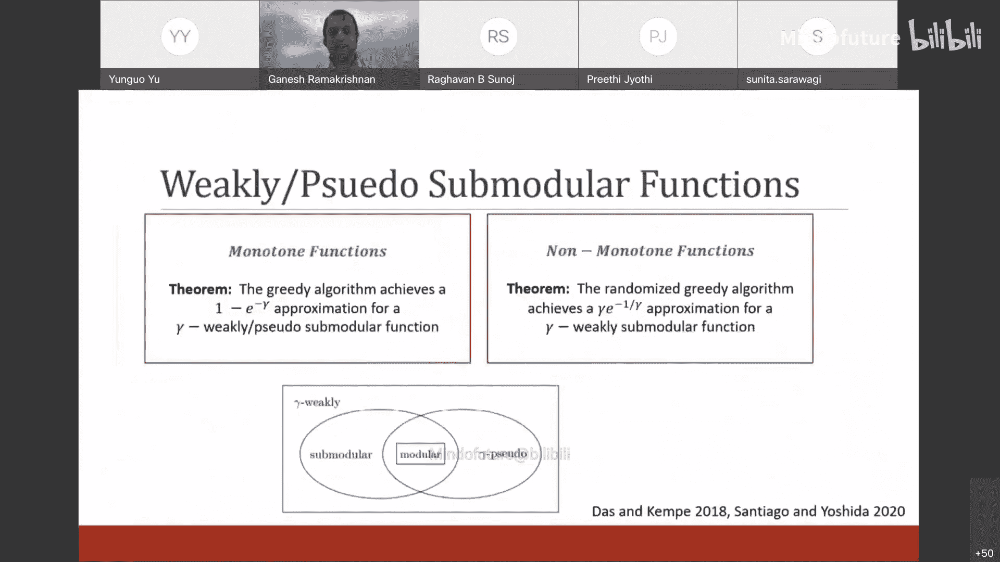

# 025：数据高效性机器学习算法与工具包（福斯讲座，2021年8月11日）

在本节课中，我们将学习数据高效性机器学习的概念，并了解一个名为 `decile` 的开源工具包。我们将探讨如何通过子集选择技术，在数据准备、模型训练和验证等阶段提升效率，同时保证模型的鲁棒性。

## 概述

深度学习模型虽然在多个领域取得了接近人类水平的性能，但其成功往往依赖于海量数据和巨大的计算成本。这带来了计算效率和数据效率两方面的挑战。计算效率体现在高昂的训练和推理成本上，而数据效率则涉及需要大量人工标注，且标注数据可能存在偏差、不一致和噪声。

本次讲座的核心是介绍一种基于**子集选择**的通用框架，利用**子模函数**和**信息论**的性质，从大规模数据、架构空间或超参数空间中智能地选取一个子集，以实现数据高效且鲁棒的机器学习。

## 子模函数与子集选择

上一节我们概述了数据效率的挑战，本节中我们来看看实现数据高效性的核心数学工具：子模函数。

我们有一个基础集合 `V`（例如所有数据点），目标是选择一个子集 `A ⊆ V`，以最大化某个反映成本或信息量的函数 `F(A)`。我们主要关注 `F(A)` 具有**子模性**的情况。

### 什么是子模函数？

子模函数的核心性质是**边际收益递减**。假设有两个集合 `A` 和 `B`，且 `A ⊆ B`。当向这两个集合中添加同一个新元素 `e` 时，该元素给较小集合 `A` 带来的增益，不小于给较大集合 `B` 带来的增益。

一个经典例子是“不同颜色球”的数量函数。假设一个集合代表罐子里的球，函数 `F` 计算球的不同颜色数。向一个已有多种颜色球的罐子（集合 `B`）里添加一个新颜色球带来的颜色数增加（边际收益），通常小于向一个颜色较少的罐子（集合 `A`）添加同一个球带来的增加。

用公式表示子模性：
`F(A ∪ {e}) - F(A) >= F(B ∪ {e}) - F(B)`，对于所有 `A ⊆ B ⊆ V` 和 `e ∉ B`。

子模函数在离散空间上的行为类似于连续空间上的凹函数，并且存在高效的优化算法。

### 子集选择的两个场景

根据可用数据的类型，子集选择可分为两类：
*   **冷启动**：只有大量未标注数据和极少量标注数据。目标是从未标注数据中选取一个信息量最大的子集进行标注。
*   **热启动**：已有一定量的标注数据。目标是从未标注数据中选取一个子集进行标注，以最有效的方式扩充现有标注集。

## 信息函数与三类子模函数

了解了子模性的基本概念后，我们来看看如何将其与信息论结合，并应用于不同类型的目标。

我们将熵、互信息等经典信息论度量中的熵函数 `H(.)`，替换为更一般的子模函数 `F(.)`，从而定义出一类新的**信息函数**。例如：
*   互信息变体：`I_F(A; Q) = F(A) + F(Q) - F(A ∪ Q)`
*   条件增益变体：`F(A | P) = F(A ∪ P) - F(P)`

这些变体允许我们实现**查询相关**（最大化与查询集 `Q` 的相关性）或**隐私保护**（最小化与隐私集 `P` 的相关性）的子集选择。

接下来，我们将介绍三类基本的子模函数，它们可以与上述信息函数组合使用。

以下是三类核心的子模函数示例：

1.  **表征函数**：目标是选择的子集能很好地“代表”整个基础集。
    *   **设施选址函数**：选择 `k` 个“设施点”（即数据点），使得所有点到其最近设施点的相似度之和最大。公式为：`F(A) = Σ_{i∈V} max_{j∈A} s(i, j)`，其中 `s(i, j)` 是相似度核函数。

2.  **多样性函数**：目标是选择的子集内部元素尽可能多样。
    *   **行列式点过程**：基于相似度矩阵的子矩阵的行列式。行列式值大致对应于所选点所张成的体积，体积越大意味着多样性越高。公式为：`F(A) = log det(L_A)`，其中 `L` 是相似度矩阵，`L_A` 是其对应于子集 `A` 的子矩阵。

3.  **覆盖函数**：目标是选择的子集能覆盖尽可能多的“概念”或特征。
    *   **概率覆盖函数**：每个数据点 `i` 以一定概率 `p_{ij}` 覆盖概念 `j`。目标是最大化至少被一个点覆盖的概念的加权和。公式可表示为：`F(A) = Σ_{j} w_j [1 - Π_{i∈A} (1 - p_{ij})]`。

通过将这三类基础函数与信息函数（互信息、条件增益等）组合，我们可以得到查询相关的表征总结、隐私保护的多样性选择等强大工具。

## 优化算法：贪心算法

定义了目标函数后，我们需要解决如何优化它，即在给定约束下选择最优子集。本节介绍最常用的算法——贪心算法。

我们面临的问题是：在约束条件 `cost(A) ≤ B`（例如 `|A| ≤ k`）下，最大化子模函数 `F(A)`。当 `F` 是单调子模函数且成本函数是模函数（即 `cost(A) = Σ_{e∈A} c(e)`）时，贪心算法能提供优秀的理论保证和实际效果。

贪心算法流程如下：
1.  初始化 `A = ∅`。
2.  **循环**直到违反约束：
    a. 找到使**单位成本增益最大化**的元素 `e`：`e* = argmax_{e∉A, cost(A∪{e})≤B} [F(A∪{e}) - F(A)] / c(e)`。
    b. 将 `e*` 加入集合 `A`：`A = A ∪ {e*}`。

对于简单的基数约束（`|A| ≤ k`），步骤 (a) 简化为选择增益最大的元素。

**理论保证**：对于单调子模函数和基数约束，贪心算法获得的解 `A_k` 满足 `F(A_k) ≥ (1 - 1/e) * F(OPT)`，其中 `OPT` 是最优解。这意味着贪心解至少能达到最优解 `63%` 的值，且没有多项式时间算法能在最坏情况下做得更好。

在实际应用中，如传感器布置覆盖区域，贪心算法通常能达到最优解 `95%` 以上的性能。

## `decile` 工具包与核心模块

前面我们介绍了子模函数和优化算法的理论基础，本节中我们来看看基于这些理论构建的实践工具——`decile` 工具包。

`decile` 是一个基于 PyTorch 的开源工具包（MIT 许可证），旨在提供数据高效机器学习的一站式解决方案。它包含多个模块，覆盖从冷启动到热启动的各种场景。使用 `submodlib`（子模优化库）非常简单，只需几行代码即可实现复杂的子集选择策略。

以下是 `decile` 工具包的核心模块：

1.  **TRUST**：专注于**冷启动**场景。用户提供一个大的未标注数据集 `V` 和一个小的目标查询集 `Q`（例如，感兴趣的图像类别）。TRUST 利用查询相关的信息函数（如互信息），从 `V` 中选出与 `Q` 最相关且信息量最大的子集供人工标注，从而高效地构建初始训练集。

2.  **SPR**：**半监督数据编程**。允许用户编写**标注函数**（Python 函数或基于样本的规则）来对未标注数据生成弱标签。SPR 的创新在于引入了**隐私保护子集选择**的思想：主动选择那些现有标注函数**不确定或分歧大**的样本进行人工标注，从而与自动标注形成互补，提升整体数据效率和模型鲁棒性。

3.  **CARDS**：专注于**热启动**场景下的**高效稳健训练**。核心思想是：并非所有训练数据都对当前模型或验证集性能同等重要。CARDS 通过选择训练数据的一个子集，使得在该子集上训练的模型在验证集上表现最好。这可以显著减少训练时间（从几天到几小时，或从几小时到几分钟），同时保持甚至提升模型性能。代表性算法如 **GLISTER** 和 **GraNdMatch**。

4.  **DISTIL**：**深度多样化交互式学习**（即主动学习）。在热启动基础上，DISTIL 指导我们如何与标注者（Oracle）交互，以最少的询问次数最大化模型性能提升。它集成了多种先进的主动学习算法，并考虑了数据增强的影响，确保评估的公平性和实用性。

## 应用案例与总结

最后，我们来看一些 `decile` 工具包的实际应用，并对本节课内容进行总结。

`decile` 已在多个真实场景中得到应用，例如视频分析、OCR（光学字符识别）和个性化语音识别。在视频分析中，利用 TRUST 模块可以快速针对特定目标（如特定类型的异常事件）构建标注数据集。工具包的有效性也获得了业界的关注。

**总结**：
在本节课中，我们一起学习了数据高效性机器学习的重要性及其面临的挑战。我们深入探讨了实现数据高效性的核心——**子模函数**和**子集选择**框架，并介绍了三类基本函数（表征、多样性、覆盖）及其与信息函数的组合。我们了解了解决此类优化问题的**贪心算法**及其理论保证。最后，我们介绍了基于这些理论构建的、覆盖完整机器学习流程的 `decile` 开源工具包及其四大核心模块：**TRUST**（冷启动标注）、**SPR**（半监督数据编程）、**CARDS**（高效训练）和 **DISTIL**（主动学习）。通过利用这些工具和思想，我们可以在减少对数据和计算资源依赖的同时，构建出更加强大和鲁棒的机器学习模型。