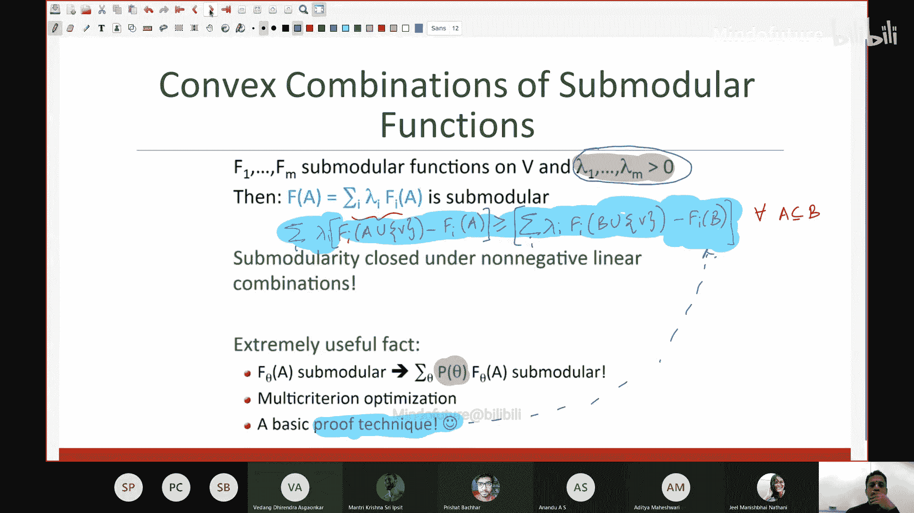
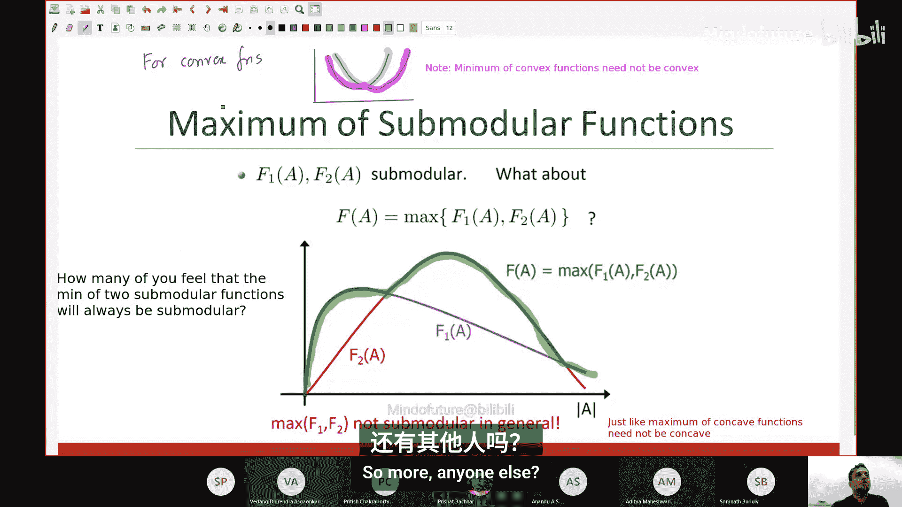
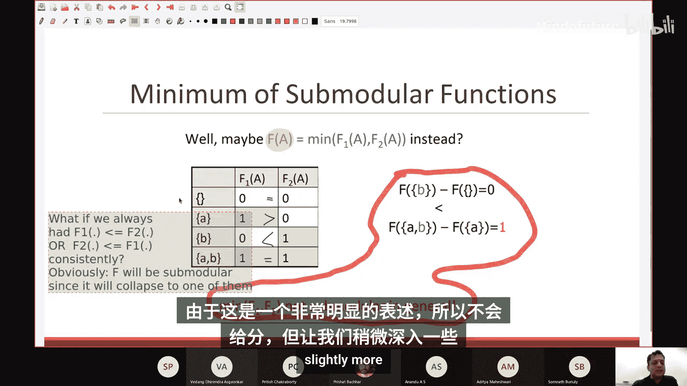
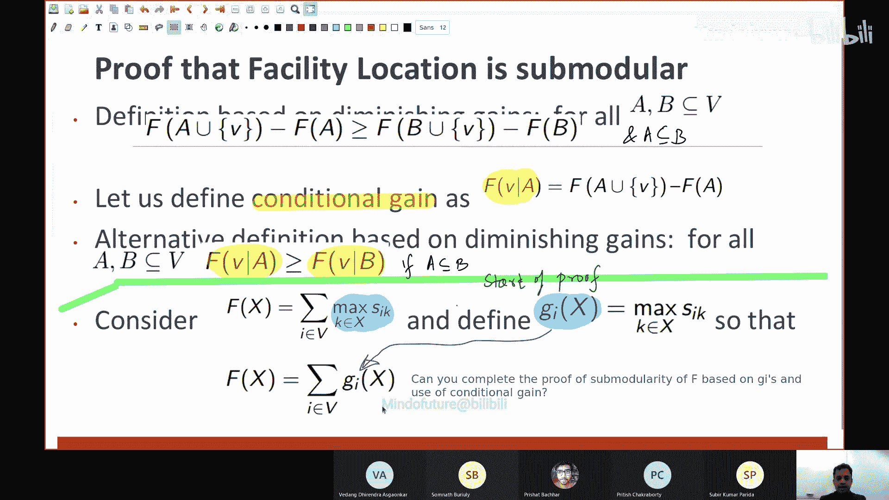
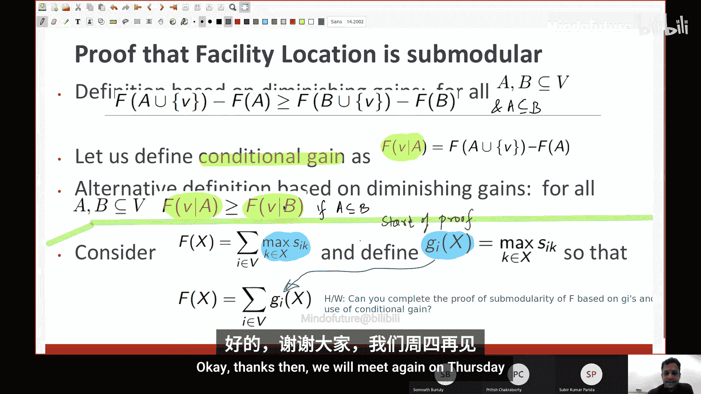

# 026：子模函数的性质与优化示例 🧮

在本节课中，我们将学习子模函数的进一步性质，并通过具体的极大化和极小化示例来理解其在机器学习优化问题中的应用。我们将从子模函数的定义和基本性质出发，探讨其与凸函数、凹函数的相似性，并分析多种实际优化问题中的子模函数实例。

上一节我们介绍了子模函数的基本定义和递减回报特性，本节中我们来看看子模函数的具体性质和一些重要的优化示例。

## 子模函数的性质 🔍

子模函数具有一系列重要的性质，这些性质有助于我们判断一个函数是否为子模函数，并在优化问题中利用这些性质。

### 凸组合性质

非负线性组合（凸组合）保持子模性。如果 \( F_1, F_2, \ldots, F_k \) 是定义在同一全集 \( V \) 上的子模函数，且 \( \lambda_1, \lambda_2, \ldots, \lambda_k \geq 0 \)，那么函数 \( F(S) = \sum_{i=1}^{k} \lambda_i F_i(S) \) 也是子模函数。

### 限制与条件化性质

给定一个固定的集合 \( W \subseteq V \)，以下操作保持子模性：
*   **限制**：函数 \( F'(S) = F(S \cap W) \) 是子模的。
*   **条件化**：函数 \( F'(S) = F(S \cup W) \) 是子模的。
*   **补集**：函数 \( F'(S) = F(V \setminus S) \) 是子模的。

### 等价定义

除了递减回报定义，子模函数还有一个等价的“并交不等式”定义：对于任意集合 \( A, B \subseteq V \)，有
\[
F(A) + F(B) \geq F(A \cup B) + F(A \cap B)
\]
模函数（如集合基数）满足等式，子模函数满足不等式。

### 最大值与最小值

与凸函数类似，子模函数的**最大值**不一定是子模的。同样，子模函数的**最小值**也不一定是子模的。这与凹函数的行为不完全一致。

### 凹函数复合性质

如果一个函数 \( F \) 是**单调非负模函数**，而 \( g: \mathbb{R} \to \mathbb{R} \) 是一个**凹函数**，那么复合函数 \( g \circ F \) 是子模的。例如，\( \sqrt{|S|} \) 是子模的，因为基数函数 \( |S| \) 是模函数，而平方根函数是凹函数。

## 极小化问题中的子模函数示例 📉

以下是子模函数在极小化问题中的一些典型应用。

### 合作成本函数

考虑采购场景，目标是最小化获取所有物品的总成本。成本函数可能具有“批量折扣”效应，即在同一地点购买更多商品会降低单价。这类函数通常可以表示为：
\[
F(A) = \sum_{P_i \in \mathcal{P}} \sqrt{\sum_{j \in A \cap P_i} r_j}
\]
其中 \( \mathcal{P} \) 是地点的划分，\( r_j \) 是物品 \( j \) 的成本权重。由于平方根函数是凹函数，而内部求和是模函数，因此整体是子模函数。

### 吸引势函数

在图像分割或马尔可夫随机场中，我们常希望相邻像素的标签（如0或1）趋于一致。这种“吸引”性质可以建模为一个子模能量函数。对于相邻像素对 \( (i, j) \)，其势能 \( E_{ij} \) 如果满足：
\[
E_{ij}(1,1) + E_{ij}(0,0) \leq E_{ij}(1,0) + E_{ij}(0,1)
\]
即相同标签的能量低于不同标签的能量，那么整个系统的能量函数（求和）是子模的。这对应于希望能量最小化的配置中相似点聚集在一起。

### 复杂度函数

在构建精简模型（如选择核心词汇表）时，我们希望用最小的子集 \( A \) 来覆盖或表示整个数据集 \( V \)。复杂度函数可以定义为：
\[
F(A) = \sum_{x \in V} \gamma( \min_{a \in A} \text{dist}(x, a) )
\]
其中 \( \gamma \) 是一个凹的、非递减的函数（如平方根）。该函数衡量了使用集合 \( A \) 表示所有点的“代价”，并且是子模的。

## 极大化问题中的子模函数示例 📈

以下是子模函数在极大化问题中的一些典型应用。

### 设施选址函数

目标是选择一组设施点 \( A \)，使得所有客户点 \( i \in V \) 都能被其最相似的设施点服务。函数定义为：
\[
F(A) = \sum_{i \in V} \max_{j \in A} s_{ij}
\]
其中 \( s_{ij} \) 表示客户点 \( i \) 与设施点 \( j \) 之间的相似度。该函数是子模的，体现了“递减回报”：增加一个新设施对已经拥有良好服务的客户收益很小。

### 饱和覆盖函数

与设施选址不同，饱和覆盖允许每个客户点从所有设施点获得相似度贡献，但有一个上限 \( \alpha \)。函数定义为：
\[
F(A) = \sum_{i \in V} \min\{\alpha, \sum_{j \in A} s_{ij}\}
\]
当 \( \alpha \) 有限时，该函数是子模的。它鼓励选择多样化的设施点，以使更多客户的总相似度达到饱和阈值 \( \alpha \)。

### 图割函数

在图模型中，选择顶点子集 \( A \) 的目标通常是最大化 \( A \) 与其余部分 \( V \setminus A \) 之间的连接，同时抑制 \( A \) 内部的连接。一种常见的子模图割函数是：
\[
F(A) = \sum_{i \in A, j \in V} s_{ij} - \lambda \sum_{i, j \in A} s_{ij}
\]
其中 \( \lambda \geq 1 \)。第一项鼓励 \( A \) 与全图的连接，第二项惩罚 \( A \) 内部的紧密连接。当 \( \lambda \geq 2 \) 时，该函数不仅是子模的，还是单调的。

## 总结 🎯

本节课中我们一起学习了子模函数的核心性质及其在优化问题中的强大建模能力。我们看到了子模函数在极小化问题（如合作成本、吸引势、模型复杂度）和极大化问题（如设施选址、饱和覆盖、图割）中的丰富应用。理解这些性质与示例，是后续设计高效子模优化算法的基础。下一讲，我们将开始探讨针对这些子模优化问题的具体算法。