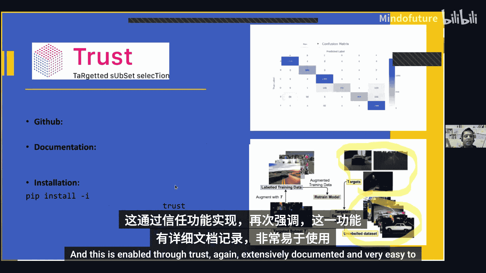
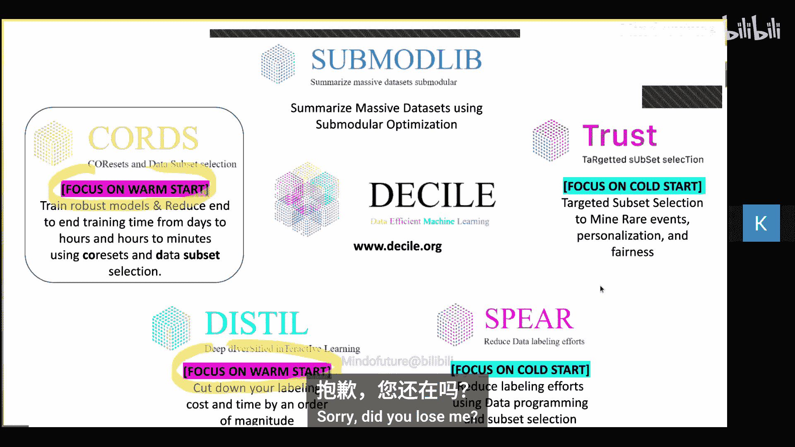
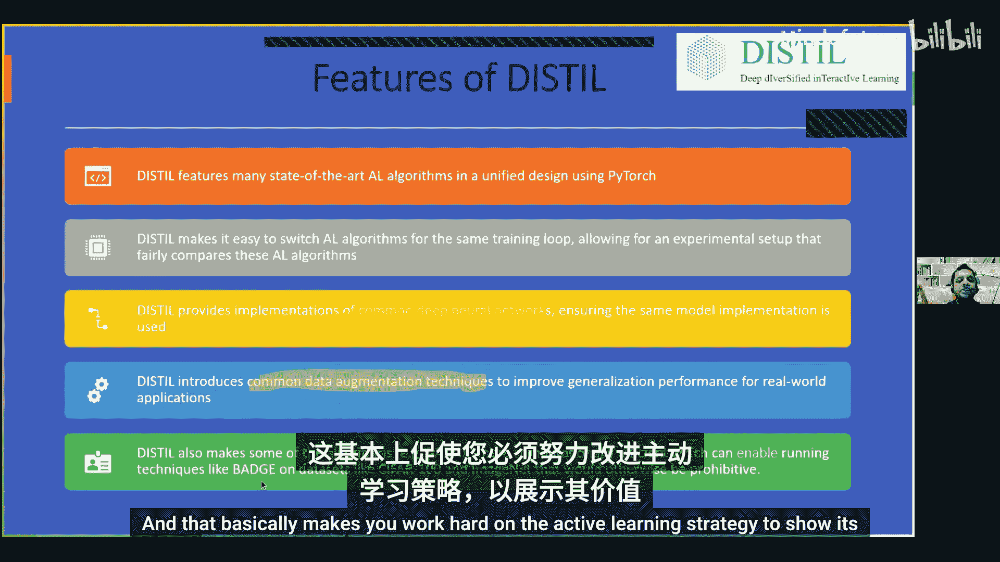
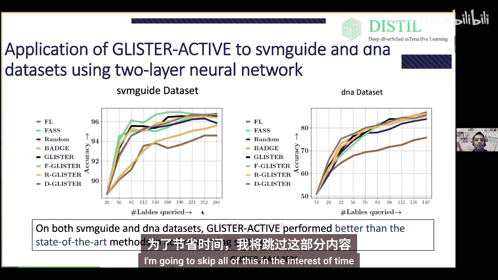

# 028：数据高效机器学习最新技术


在本节课中，我们将与Ganesh Ramakrishnan教授一同了解数据高效机器学习的前沿技术。我们将探讨一个旨在帮助资源受限环境构建高效模型的开源平台，涵盖其核心模块、理论基础和应用场景。

## 概述：数据与计算效率的挑战

深度学习已在多个领域达到接近人类的性能，但其成功依赖于大规模数据集和复杂模型。这带来了高昂的数据标注成本、巨大的计算开销（例如，训练一个BERT模型可能花费20万美元）以及显著的碳足迹。因此，在整个机器学习流程（数据准备、模型训练、验证与部署）中，追求数据与计算效率至关重要。

一个通用的解决框架是**子集选择**。我们有一个包含所有数据点的全集 **B**，目标是找到一个子集 **A**，使其在某个信息函数 **F** 的衡量下，性能尽可能接近全集。这可以应用于多种场景：在“冷启动”设置（标注数据极少）下减少标注成本；在“热启动”设置（已有大量标注数据）下减少训练时间；甚至选择模型参数的子集以减少推理时间。

尽管该领域已有大量研究（如贪婪算法、元学习、半监督学习），但一直缺乏优秀的工具包和基准测试。接下来，我们将介绍数据高效机器学习平台及其核心模块。

## 核心模块一：Submodular 优化库 (SubmodLib)

上一节我们介绍了子集选择的通用框架，本节中我们来看看实现这一目标的核心数学工具——次模函数优化库（SubmodLib）。它是所有其他模块的基础，用于通过次模优化来总结海量数据集。

### 什么是次模函数？

次模函数具有“边际收益递减”的特性。一个简单的例子是衡量一个罐子中不同颜色小球数量的函数 **F**。假设集合 **A** 是 **B** 的子集，那么向较小的集合 **A** 中添加一个蓝色小球所带来的边际增益，大于或等于向较大的集合 **B** 中添加同一个蓝色小球所带来的边际增益。满足此性质的函数即为次模函数。

**公式化定义**：对于集合函数 **F: 2^V -> R**，若对所有 **A ⊆ B ⊆ V** 和所有 **e ∈ V \ B**，满足：
**F(A ∪ {e}) - F(A) ≥ F(B ∪ {e}) - F(B)**
则 **F** 是次模函数。

SubmodLib 提供了详尽的文档和大量已实现的次模函数及其最大化算法。安装非常简单：
```bash
pip install submodlib
```

### 次模函数的类别

以下是SubmodLib中实现的几类主要次模函数：

1.  **表征函数**：旨在从数据集中选取有代表性的点。
    *   **设施选址**：选择 **k** 个“设施”点，使得所有点到其最近设施点的相似度之和最大。其函数形式为：**F(A) = Σ_{i∈V} max_{j∈A} s_{ij}**，其中 **s_{ij}** 是点 **i** 和 **j** 之间的相似度。
    *   **图割**：同时考虑子集与全集的相似度，并减去子集内部的相似度：**F(A) = Σ_{i∈A, j∈V} s_{ij} - λ Σ_{i,j∈A} s_{ij}**。

2.  **覆盖函数**：旨在选择能覆盖一组概念（如关键词、视觉概念）的实例。
    *   **集合覆盖**：选择最少的文档来覆盖所有关键词。
    *   **概率集合覆盖**：允许以概率形式覆盖概念。

3.  **多样性函数**：旨在选择彼此差异最大的项。
    *   **行列式点过程**：其对数概率是次模函数，**log det(L_A)**，其中 **L** 是相似度核矩阵，**L_A** 是其子矩阵。
    *   **分散度函数**：例如最大-最小分散度（Max-Min Dispersion）。

### 信息函数：查询与隐私

我们可以将“查询相关性”和“隐私保护”的需求，通过信息函数的形式叠加到上述任何一类次模函数上。

*   **互信息**：衡量子集 **A** 与查询集 **Q** 的相关性。广义定义为：**MI_F(A; Q) = F(A) + F(Q) - F(A ∪ Q)**。
*   **条件增益**：衡量在已知隐私集 **P** 的情况下，子集 **A** 的增益，用于隐私保护。定义为：**CG_F(A|P) = F(A ∪ P) - F(P)**。

通过组合，SubmodLib 提供了一个统一的框架，支持**提取式摘要**、**查询敏感子集选择**和**隐私保护子集选择**。

### 优化算法：贪婪法及其理论保证

子集选择的核心优化问题是在基数约束下最大化次模函数（或其变体）：
**max_{A ⊆ V, |A|≤k} F(A)**

最直观的算法是**贪婪算法**：每次选择能带来最大边际增益的元素。
```python
# 贪婪算法伪代码
S = empty set
for i in 1 to k:
    e = argmax_{e ∈ V\S} [F(S ∪ {e}) - F(S)]
    S = S ∪ {e}
```

该算法具有优秀的理论保证：对于单调非递减的次模函数，贪婪解 **S_k** 的值至少是最优解 **S*** 值的 **(1 - 1/e) ≈ 63%**。在实践中，其性能通常接近最优。值得注意的是，在多项式时间内没有算法能在最坏情况下做得比这更好。

对于带权重的预算约束，可以使用成本效益比贪婪算法，其近似比约为 **1/2**。

SubmodLib 将这些复杂的优化过程封装成简单的API，只需几行代码即可实现各种子集选择策略，并可视化结果。



## 核心模块二：冷启动设置下的工具

在“冷启动”设置中，我们面临标注数据极少的挑战。以下模块基于SubmodLib构建，专门应对此场景。

### TRUST：面向目标与稀有事件的子集选择

当拥有大量未标注数据池，但目标域（例如“夜间图像”中的异常检测）数据稀缺时，TRUST 模块可以利用基于互信息的函数，选择与目标域高度相关的子集进行标注，从而提升模型在目标域上的性能。

以下是TRUST的一些应用场景：
*   **性能导向的数据选择**：根据模型在验证集上的混淆矩阵，选择能改进特定类别（对角线）或区分易混淆类别（非对角线）的数据进行标注。
*   **稀有类增强**：主动选择并标注稀有事件样本，以改善模型对稀有类的识别能力。
*   **个性化目标选择**：例如，针对特定用户的笔迹进行个性化模型训练。

实验表明，结合了互信息（如 `LogDetMI`）的次模函数能显著提升在有限标注预算下的模型精度。

### SPR：利用数据编程与规则进行子集选择

有时，我们不仅拥有少量标注样本，还可能拥有一些领域规则或启发式程序（即“标注函数”）。SPR 模块利用“数据编程”范式，通过聚合这些弱监督信号的输出，来生成伪标签数据。

**工作原理**：
1.  用户编写多个可能不完美但有一定准确性的标注函数（例如：“如果文本包含‘how’，则标记为‘描述性问题’”；“如果图片看起来像张三，则加入‘张三’相册”）。
2.  SPR 使用标签聚合器（如来自Snorkel的算法或我们自研的CAGE算法）来融合这些冲突的弱信号，生成更可靠的伪标签。
3.  生成的伪标签数据集可用于训练下游判别模型。

**进阶——联合训练**：最新的方法不满足于“先生成伪标签，再训练模型”的两阶段流程。SPR 也实现了**联合训练**模型，该模型同时从少量真实标注数据和大量由标注函数生成的弱监督信号中学习。这通过一个联合损失函数实现，鼓励特征模型与真实标签一致、在未标注数据上具有低熵，并且其预测与（阈值化或未阈值化的）标注函数模型的输出尽可能一致。

**主动子集选择与标注函数互补**：一个关键思想是，应选择那些标注函数感到“困惑”或相互矛盾的样本进行人工标注。因为这些样本能提供标注函数之外的新信息。这可以通过**条件增益**框架来实现，选择与当前标注函数集“不相关”（即能提供新信息）的样本。实验证明，这种智能选择策略甚至优于人工挑选样本。

## 核心模块三：热启动设置下的工具

在“热启动”设置中，我们拥有相对充足的标注数据，目标是提升训练和模型维护的效率。




### Coresets：用于高效训练的数据核心集

核心集的思想是寻找训练数据的一个小子集，使得在其上训练得到的模型性能与在全集上训练的模型性能相近。这类似于支持向量机中的“支持向量”。

CARD 模块提供了多种核心集选择与高效训练算法。一个代表性算法是 **GLISTER**。

**GLISTER 算法思想**：
其优化目标是：选择一个训练子集 **S**，使得在该子集上训练得到的模型参数 **θ**，在验证集上的损失最小。
**min_{S ⊆ Train, |S|≤k} L_val(θ(S))**, 其中 **θ(S) = argmin_θ L_train(S; θ)**

这是一个双层优化问题，直接求解计算量巨大。GLISTER 采用了两种近似：
1.  **单步梯度近似**：用训练子集上的一步梯度更新来近似内层优化的解。
2.  **泰勒展开近似**：对验证损失函数进行泰勒展开，忽略高阶项。经过近似后，子集选择问题简化为计算梯度内积的形式，大大降低了计算开销。

GLISTER 采用交替优化的策略：先进行几轮模型参数更新，然后基于当前模型选择新的数据子集，如此反复。理论证明，在一定条件下，该算法能够收敛。

**效果**：GLISTER 能在保持模型精度基本不变的情况下，实现高达 **3倍** 的训练加速。如果允许轻微精度损失，加速比可达 **10倍**。它在自动化超参数调优和鲁棒性学习任务中也表现出色。

### Distill：高效主动学习与数据蒸馏

在热启动场景下，我们仍希望进一步降低持续增长的标注成本。Distill 模块集成了多种最先进的**主动学习**算法。

**主动学习**：模型主动选择“最有价值”的未标注样本（例如，模型最不确定的样本）交由人类标注，从而以最少的标注代价获得最大的性能提升。

Distill 的特点：
*   **算法丰富**：集成了多种主动学习算法，方便用户比较和切换。
*   **与深度学习框架兼容**：易于与常见的深度学习模型结合。
*   **强调数据增强**：在主动学习循环中集成了强数据增强，这迫使主动学习策略必须证明其超越简单数据增强的价值。
*   **GLISTER-Active**：将 GLISTER 的思想应用于主动学习，使用假设的伪标签来选择信息量最大的未标注样本进行真实标注。

实验显示，GLISTER-Active 等算法能在仅使用 **10%** 数据时实现 **7倍** 加速，使用 **30%** 数据时实现 **3倍** 加速。

## 应用与总结



本节课中，我们一起学习了数据高效机器学习平台及其核心模块。我们从次模优化这一数学基础出发，探讨了在冷启动（TRUST, SPR）和热启动（CARD, Distill）不同场景下，如何通过智能的数据子集选择来降低标注成本和计算开销。

这些工具已在多个实际应用中得到验证，包括：
*   为印度安全机构进行的视频分析（高效数据处理）。
*   与 Abacus/AIBM 合作的高效自动化机器学习。
*   低资源语言的OCR和机器翻译（利用SPR和TRUST）。
*   个性化语音识别（利用TRUST）。
*   生物医学成像分析。




总结来说，该平台通过提供一套强大、易用且理论扎实的开源工具包（SubmodLib, TRUST, SPR, CARD, Distill），使研究者和开发者能够在资源受限的环境中，更高效、更经济地构建和部署机器学习模型。我们鼓励社区使用这些工具，并将其集成到自己的应用或算法研究中。