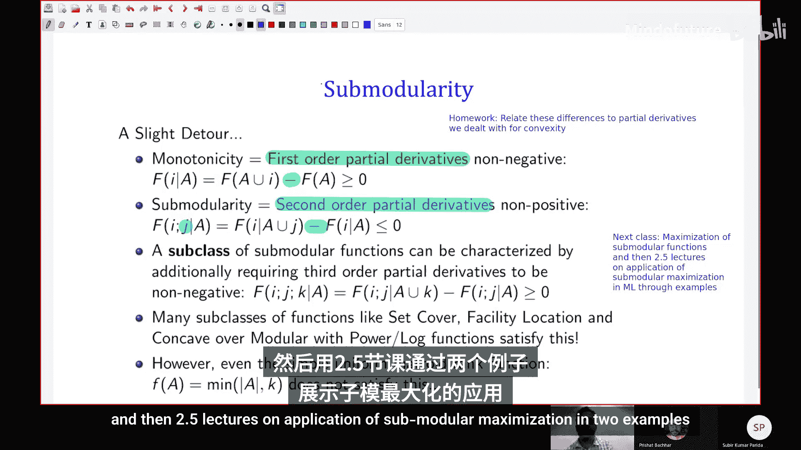

# 029：基于熵函数性质的子模信息函数构建 🧠


在本节课中，我们将总结关于子模函数熵相关性质的讨论，并快速介绍子模信息函数，同时了解子模函数最大化。我们将从熵的定义开始，回顾信息增益、互信息、条件熵和KL散度等核心概念，并探讨如何将这些信息论概念推广到一般的子模函数上，构建子模信息函数。

---

## 熵与信息论概念回顾 📚

上一节我们介绍了子模函数的基本性质。本节中，我们首先回顾一些核心的信息论概念，它们是构建子模信息函数的基础。

### 熵
熵 `H(X)` 衡量随机变量 `X` 的不确定性。对于离散随机变量，其定义为：
```
H(X) = - Σ_{x ∈ X} P(x) log P(x)
```

### 互信息
互信息 `I(X; Y)` 衡量两个随机变量 `X` 和 `Y` 之间共享的信息量。它可以表示为：
```
I(X; Y) = H(X) + H(Y) - H(X, Y)
```
它等价于联合分布 `P(X, Y)` 与独立分布 `P(X)P(Y)` 之间的KL散度，因此总是非负的。

### 条件熵
条件熵 `H(X | Y)` 表示在已知 `Y` 的条件下，`X` 剩余的不确定性。
```
H(X | Y) = H(X, Y) - H(Y)
```

### KL散度
KL散度 `D(P || Q)` 衡量两个概率分布 `P` 和 `Q` 之间的差异。它是非对称的，定义为：
```
D(P || Q) = Σ_{x} P(x) log (P(x) / Q(x))
```
信息不等式指出，`D(P || Q) ≥ 0`，当且仅当 `P = Q` 时取等号。

---

## 熵的子模性证明 🔍

我们已经知道熵函数是子模的。其证明思路利用了互信息与KL散度的关系，以及信息不等式。具体来说，互信息 `I(X; Y)` 可以表示为联合分布与独立分布之间的KL散度，其非负性保证了条件熵不大于边际熵，即 `H(X|Y) ≤ H(X)`。通过将此性质推广到集合上，可以证明熵满足子模性的递减回报特性。

---

## 从熵到一般子模函数：子模信息函数 🧩

上一节我们基于熵定义了各种信息度量。本节中，我们将看看如何将这些概念推广到**任意子模函数** `F` 上，而不仅仅是熵。这样，我们就得到了“子模信息函数”。

其核心思想是：用任意子模函数 `F` 替换掉熵 `H` 在定义中的位置。

以下是关键的定义：

### 子模互信息
子模互信息衡量两个集合 `A` 和 `B` 之间，通过子模函数 `F` 透镜观察到的共享“信息”。
```
I_F(A; B) = F(A) + F(B) - F(A ∪ B)
```
当 `F` 是熵函数时，这就变回了经典的互信息。

### 子模条件增益
子模条件增益表示在已知集合 `B` 的条件下，添加集合 `A` 所带来的增益。
```
F(A | B) = F(A ∪ B) - F(B)
```
这类似于条件熵。

### 子模条件互信息
子模条件互信息表示在给定集合 `C` 的条件下，集合 `A` 和 `B` 之间的互信息。
```
I_F(A; B | C) = F(A | C) + F(B | C) - F(A ∪ B | C)
```

通过这些定义，我们可以将信息论中的独立性、相关性等概念迁移到子模函数的框架下。例如，如果 `I_F(A; B) = 0`，则称集合 `A` 和 `B` 关于函数 `F` 是独立的。

---

## 子模信息函数示例 📊

现在，我们通过几个具体的子模函数例子，来看看这些子模信息度量在实际中意味着什么。

以下是几个常见子模函数及其对应的子模信息函数解释：

### 1. 加权覆盖函数
*   **函数 `F(A)`**：集合 `A` 所覆盖的所有元素的权重之和。
*   **条件增益 `F(A | B)`**：`A` 覆盖但 `B` 未覆盖的那些元素的权重之和。
*   **互信息 `I_F(A; B)`**：同时被 `A` 和 `B` 覆盖的那些元素的权重之和。
*   **独立性**：当 `A` 和 `B` 覆盖的元素没有交集时，两者独立。

### 2. 设施选址函数
*   **函数 `F(A)`**：对于每个元素 `i`，计算其与 `A` 中最相似元素的距离，并求和（或取最大）。
*   **条件增益 `F(A | B)`**：对于每个元素 `i`，计算 `(到A中最相似点的距离) - (到B中最相似点的距离)`，并对正值求和。这衡量了 `A` 相对于 `B` 的额外代表性。
*   **互信息 `I_F(A; B)`**：对于每个元素 `i`，计算其到 `A` 和 `B` 中最相似点的距离的**最小值**（或某种组合）。这衡量了 `A` 和 `B` 共同覆盖或代表该元素的程度。

### 3. 图割函数
*   **函数 `F(A)`**：集合 `A` 与其补集 `V\A` 之间所有边的权重之和。
*   **互信息 `I_F(A; B)`**：集合 `A` 和 `B` 之间所有边的权重之和。这直观地衡量了 `A` 和 `B` 之间的连接强度。
*   **独立性**：当 `A` 和 `B` 之间没有边连接时，两者独立。

---

## 多拟阵函数与性质 ⚙️

在结束之前，我们需要引入一个重要的子模函数子类：**多拟阵函数**。

一个归一化的、单调的、子模的函数被称为多拟阵函数。熵函数是多拟阵函数的一个特例，但多拟阵函数族更大，它严格包含了熵函数，并且是子模函数的一个子集。

对于多拟阵函数 `F`，其导出的子模信息函数具有一些良好性质：
1.  **非负性**：`F(A)`, `F(A|B)`, `I_F(A;B)` 等都非负。
2.  **单调性**：`F(A)` 对 `A` 单调。`I_F(A; B)` 在固定 `B` 时对 `A` 单调，在固定 `A` 时对 `B` 单调。
3.  **边界**：`F(A) ≥ F(A|B)`，并且 `I_F(A; B)` 不大于 `F(A)` 和 `F(B)` 中的较小值。

这些性质与信息论中熵和互信息的性质类似，但适用范围更广。

---

## 总结与展望 🎯

本节课中我们一起学习了：
1.  **回顾了信息论核心概念**：熵、互信息、条件熵和KL散度，并理解了熵的子模性。
2.  **构建了子模信息函数**：通过用任意子模函数 `F` 替代熵，我们将互信息、条件增益等概念推广到了更一般的框架。
3.  **分析了具体示例**：我们查看了加权覆盖、设施选址和图割函数，解释了其子模信息度量的实际含义。
4.  **介绍了多拟阵函数**：这是一个包含熵函数、具有良好性质的子模函数子类。

子模信息函数为我们提供了一套强大的语言，可以用信息论的视角来分析和设计各种机器学习任务中的目标函数，例如特征选择、数据摘要和聚类等。



在接下来的课程中，我们将转向**子模函数最大化**的算法，并探索这些理论在机器学习中的丰富应用。