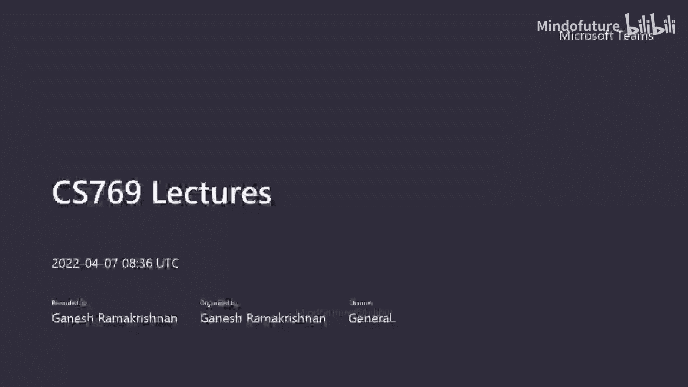
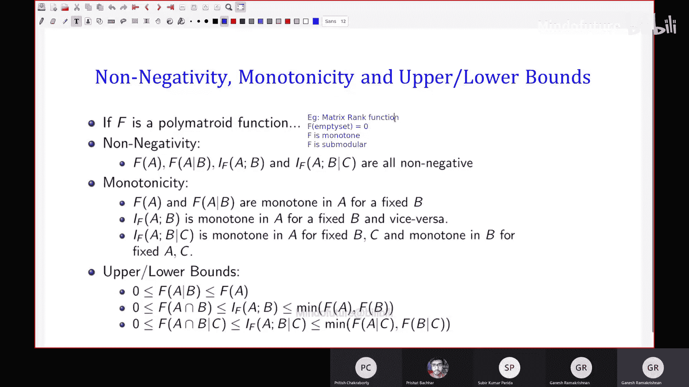
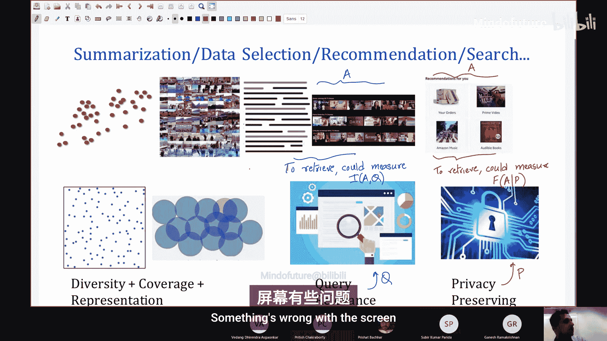
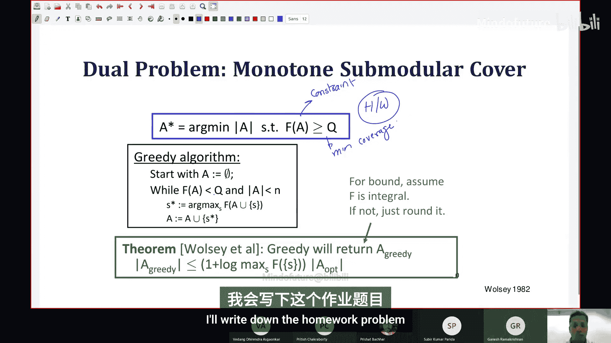

# 030：子模函数极大化算法

## 概述
在本节课中，我们将学习子模函数极大化问题及其算法。我们将首先回顾子模信息函数的性质，然后重点探讨在基数约束或预算约束下，如何利用贪心算法求解子模函数极大化问题，并分析其近似保证。

---

## 子模信息函数回顾
上一节我们介绍了子模信息函数。本节中，我们来看看它们的一些关键性质。

子模信息函数，例如互信息，具有以下特性：
*   函数值非负：`I(A; B) >= 0`，条件互信息 `I(A; B|C) >= 0`。
*   单调性：对于固定集合 `B` 和 `C`，函数 `I(A; B|C)` 关于 `A` 是单调的。反之，固定 `A` 和 `C`，则关于 `B` 单调。
*   条件作用：增加条件集合的大小通常会降低函数值。
*   下界：`F(A ∩ B) <= I(A; B)`。互信息可视作交集的信息量，但函数在交集上的值仍小于互信息。
*   上界：`F(A ∩ B) <= min(F(A), F(B))`。

此外，`F(A|B)` 关于 `A` 是子模的，但关于 `B` 既非子模也非超模。

---

## 偏导数与高阶性质
子模性与偏导数密切相关。

以下是偏导数与函数性质的关系：
*   **单调性**要求一阶偏导数非负。
*   **子模性**要求二阶偏导数非正，这类似于凹性（凸函数要求二阶导非负）。
*   对于互信息等函数，**三阶偏导数非负**是一个重要性质。这意味着在给定集合 `K` 的情况下，增加两个元素 `(I, J)` 带来的增益，不小于不给定 `K` 时的增益。

满足三阶偏导数非负性质的函数包括集合覆盖、设施选址和幂律函数，这意味着它们的互信息是子模的。而均匀秩函数（如矩阵秩）是一个反例，它不满足此性质。

---

## 应用场景
子模函数极大化有广泛的应用。

以下是几个典型应用场景：
1.  **查询聚焦摘要**：目标是选择与查询最相关的文档集合 `A`，即最大化互信息 `I(A; Q)`。
2.  **隐私保护摘要**：目标是选择集合 `A`，使其在保护隐私信息集 `P` 的同时，尽可能多地保留信息，即最大化条件增益 `F(A|P)`。
3.  **组合目标**：可以结合查询相关性和隐私保护，形成统一的目标函数，例如 `max I(A; Q|P)`，并通常附加基数约束 `|A| <= k`。

这些框架可以应用于图像摘要、目标子集选择（例如，从未标注数据中选择与目标域相似的样本进行标注）等任务。

---

## 优化视角：凸性与凹性
从优化角度看，子模性兼具凸性和凹性的特点。

*   **凸性方面**：子模函数存在凸扩展（如Lovász扩展），使得子模函数**最小化**存在多项式时间算法（例如，图割用于图像分割）。
*   **凹性方面**：子模函数表现出的“收益递减”性质类似于凹函数，这使其**极大化**问题也能获得有效的近似算法。

然而，子模函数极大化通常是NP难的。幸运的是，贪心算法在实践中非常有效，并且具有可证明的近似保证。

---

## 单调子模函数极大化与贪心算法
对于单调子模函数的极大化问题，若不加约束，最优解是选择整个集合。因此，我们通常需要施加约束，例如基数约束 `|A| <= k`。

以下是经典的贪心算法步骤：
1.  初始化 `S_0 = ∅`。
2.  对于 `i = 1` 到 `k`：
    *   在剩余元素 `V \ S_{i-1}` 中，找到能带来最大边际增益的元素 `e*`：`e* = argmax_{e ∈ V \ S_{i-1}} F(S_{i-1} ∪ {e}) - F(S_{i-1})`。
    *   令 `S_i = S_{i-1} ∪ {e*}`。
3.  返回 `S_k`。

该算法具有优异的近似保证：设 `OPT` 为最优解的函数值，`S_k` 为贪心算法得到的解，则有 `F(S_k) >= (1 - 1/e) * OPT ≈ 0.63 * OPT`。对于单调子模函数极大化，没有多项式时间算法能获得比 `(1 - 1/e)` 更好的近似比。

---

## 近似比证明概要
贪心算法近似比的证明思路巧妙，核心步骤如下：

1.  **伸缩和展开**：将最优解 `A*` 的函数值 `F(A*)` 用贪心解序列 `A_i` 进行展开。利用单调性，有 `F(A*) <= F(A* ∪ A_i)`。再将 `F(A* ∪ A_i)` 写成关于 `A*` 中元素的边际增益的伸缩和形式。
2.  **利用子模性**：根据子模性，一个元素加入较大集合（`A_i`）的边际增益，不大于其加入较小集合的边际增益。因此，`A*` 中所有元素的边际增益之和，可以用 `A*` 的大小 `k` 乘以某个上界来限定。
3.  **关联贪心选择**：这个上界恰好是贪心算法在第 `i+1` 步选择的元素 `e_{i+1}` 的边际增益。因为 `e_{i+1}` 是在所有剩余元素中边际增益最大的。
4.  **推导递推不等式**：定义差距 `Δ_i = OPT - F(A_i)`。通过上述关系，可以推导出 `Δ_{i+1} <= (1 - 1/k) * Δ_i`。
5.  **递推求解**：递归应用此不等式，得到 `Δ_k <= (1 - 1/k)^k * Δ_0 <= (1/e) * OPT`。由于 `Δ_0 = OPT - F(∅)` 且 `F(∅) >= 0`，最终得到 `F(A_k) >= (1 - 1/e) * OPT`。

---

## 推广至预算约束
当每个元素 `e` 具有选择成本 `c(e)`，且总预算为 `B` 时，问题变为预算约束下的极大化。

以下是两种扩展的贪心策略：
1.  **成本归一化贪心**：每一步选择边际增益与成本之比最大的元素：`e* = argmax_{e ∈ V \ S, c(S)+c(e)<=B} (F(S∪{e}) - F(S)) / c(e)`。单纯使用此策略，近似比可能较差。
2.  **初始化枚举+贪心**：先枚举所有不超过3个元素的初始集合作为起点，然后对每个起点运行成本归一化贪心，最后取最优解。这能获得 `(1 - 1/e)` 的近似比，但复杂度高达 `O(n^3)`。
3.  **双策略取优**：同时运行**普通贪心**（忽略成本，直到违反预算）和**成本归一化贪心**，然后取两者中函数值更高的解。这种方法在实践中效果很好，且具有常数近似比。

此外，该问题还存在对偶形式：给定一个覆盖阈值 `Q`，寻找满足 `F(A) >= Q` 的最小成本集合 `A`。这也可以通过修改贪心算法来求解。

---

## 总结
本节课中我们一起学习了子模函数极大化算法。
*   我们回顾了子模信息函数的性质及其与偏导数的联系。
*   我们探讨了子模函数极大化在查询摘要、隐私保护等领域的应用。
*   我们重点分析了在基数约束下，单调子模函数极大化的贪心算法，并详细讲解了其 `(1 - 1/e)` 近似保证的证明过程。
*   最后，我们将问题推广到一般的预算约束情形，并介绍了相应的贪心变种算法及其特点。

贪心算法因其简单、高效且具有理论保证，成为解决子模函数极大化问题的重要工具。